# 2026年去AI味Skills排行榜

作者：李守一 Demon  
发布：10-18 上海

[查看原帖](https://www.xiaohongshu.com/explore/6ad0790e000000001802d64f?xsec_token=CBbpY8YzuEhJPrNkWOruTU1y0sfd4BZvPhGVS0StGNh5I=&xsec_source=app_share)

👉01 humanizer ⭐57,045  
识别35类AI写作痕迹，保留原意并重写语气节奏。  
🔗github.com/blader/humanizer  
  
👉02 nuwa-skill ⭐34,434  
把人物思维、决策习惯和表达DNA蒸馏成可调用Skill。  
🔗github.com/alchaincyf/nuwa-skill  
  
👉03 Humanizer-zh ⭐19,705  
专治中文翻译腔、模板句式、机械排比和空泛总结。  
🔗github.com/op7418/Humanizer-zh  
  
👉04 stop-slop ⭐18,031  
检查套话和公式化结构，评分后给出自然改写。  
🔗github.com/hardikpandya/stop-slop  
  
👉05 shuorenhua ⭐2,111  
保留事实、术语和责任主体，只改生硬表达。  
🔗github.com/MrGeDiao/shuorenhua  
  
👉06 ai-flavor-remover ⭐1,180  
中文文章润色提示词，减少模板词与过度工整句式。  
🔗github.com/hylarucoder/ai-flavor-remover  
  
👉07 De-AI-Prompt-Enhancer ⭐874  
组合去AI味、文风参考和作家增强两套Skill。  
🔗github.com/OUBIGFA/De-AI-Prompt-Enhancer-Writer-Booster-SKILL  
  
👉08 writing-agent ⭐434  
导演、主笔、审校等角色协作完成长文全流程。  
🔗github.com/dongbeixiaohuo/writing-agent  
  
👉09 easywrite  
中英双语学术写作，强调证据、事实和研究诚信。  
🔗github.com/Florent2025/easywrite  
  
👉10 yotta-humanize  
用24类规则检测中文AI腔，再做可解释改写。  
🔗github.com/YottaMeta/yotta-humanize  
  
[#ai](https://www.xiaohongshu.com/search_result?keyword=ai&type=54&source=web_note_detail_r10) [#开源工具](https://www.xiaohongshu.com/search_result?keyword=%25E5%25BC%2580%25E6%25BA%2590%25E5%25B7%25A5%25E5%2585%25B7&type=54&source=web_note_detail_r10) [#大模型](https://www.xiaohongshu.com/search_result?keyword=%25E5%25A4%25A7%25E6%25A8%25A1%25E5%259E%258B&type=54&source=web_note_detail_r10) [#效率神器](https://www.xiaohongshu.com/search_result?keyword=%25E6%2595%2588%25E7%258E%2587%25E7%25A5%259E%25E5%2599%25A8&type=54&source=web_note_detail_r10) [#skills](https://www.xiaohongshu.com/search_result?keyword=skills&type=54&source=web_note_detail_r10) [#科研](https://www.xiaohongshu.com/search_result?keyword=%25E7%25A7%2591%25E7%25A0%2594&type=54&source=web_note_detail_r10) [#AI工具](https://www.xiaohongshu.com/search_result?keyword=AI%25E5%25B7%25A5%25E5%2585%25B7&type=54&source=web_note_detail_r10) [#个人开发者](https://www.xiaohongshu.com/search_result?keyword=%25E4%25B8%25AA%25E4%25BA%25BA%25E5%25BC%2580%25E5%258F%2591%25E8%2580%2585&type=54&source=web_note_detail_r10) [#AI排行榜](https://www.xiaohongshu.com/search_result?keyword=AI%25E6%258E%2592%25E8%25A1%258C%25E6%25A6%259C&type=54&source=web_note_detail_r10) [#李守一](https://www.xiaohongshu.com/search_result?keyword=%25E6%259D%258E%25E5%25AE%2588%25E4%25B8%2580&type=54&source=web_note_detail_r10)

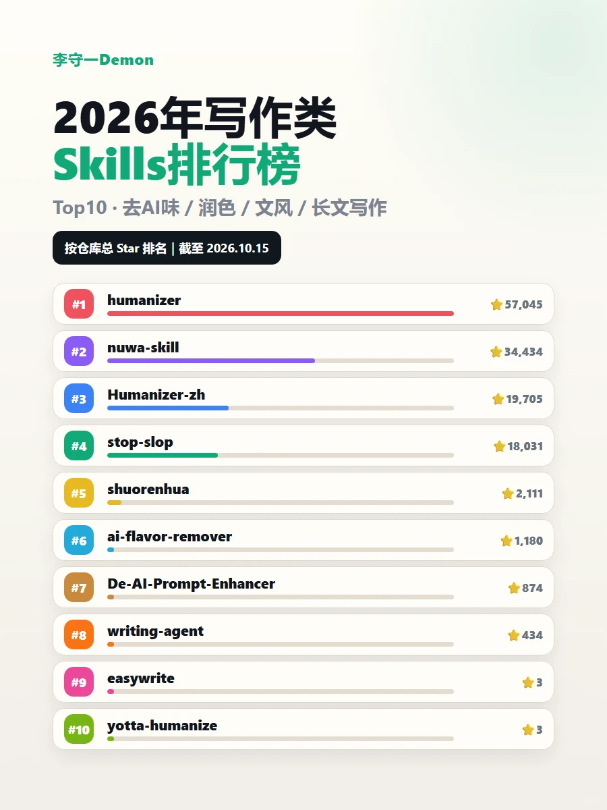

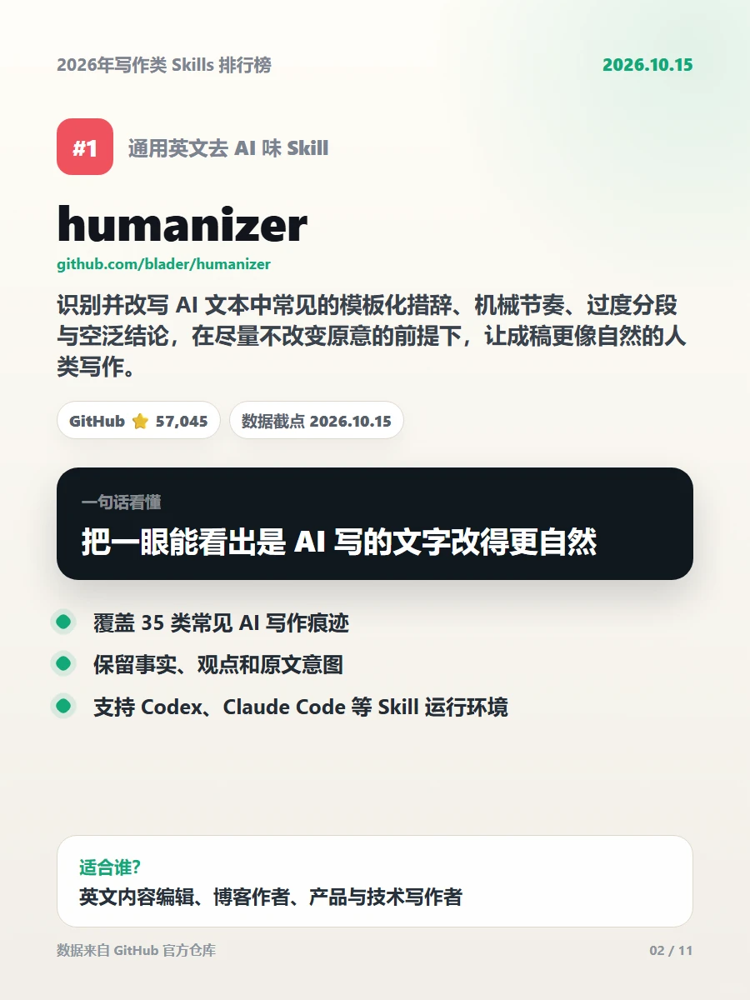

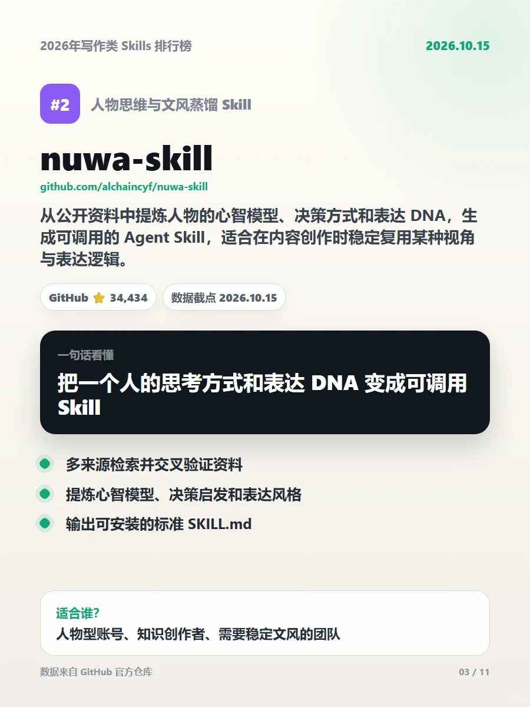

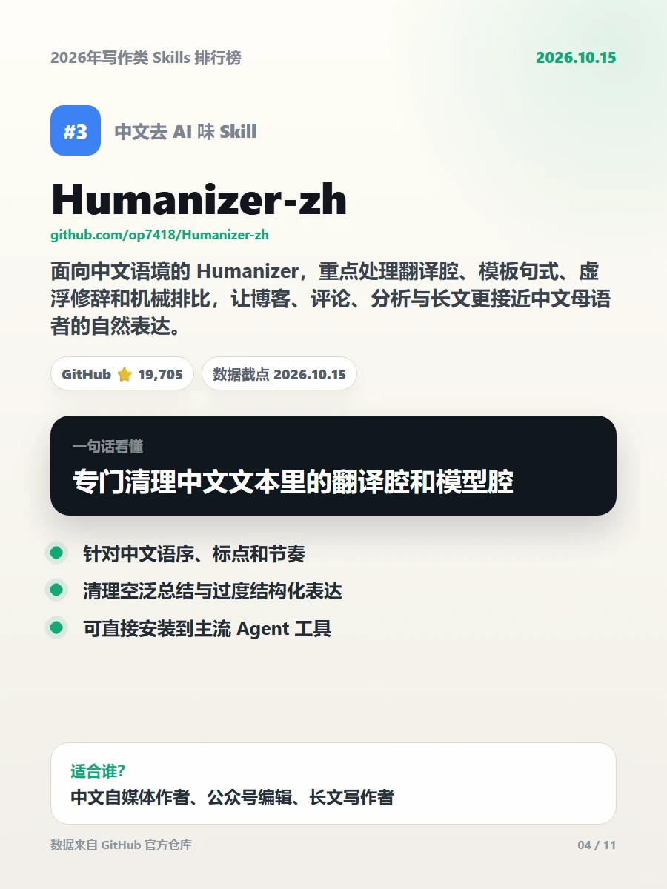

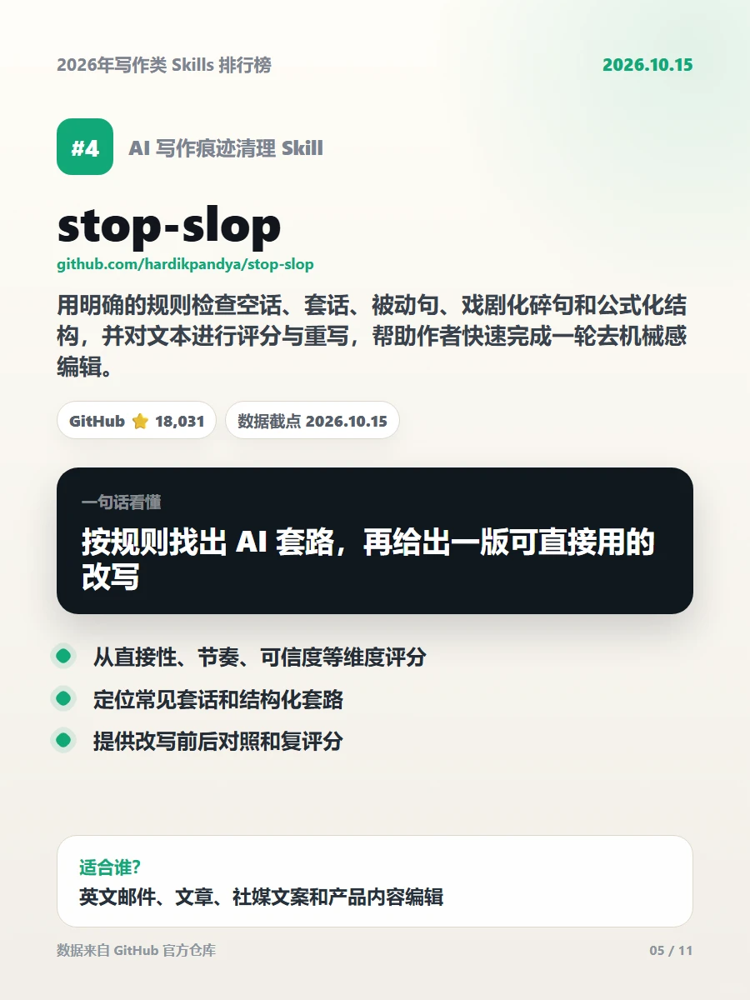

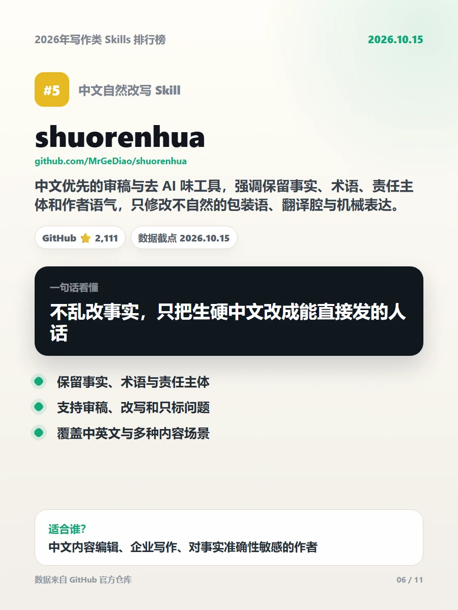

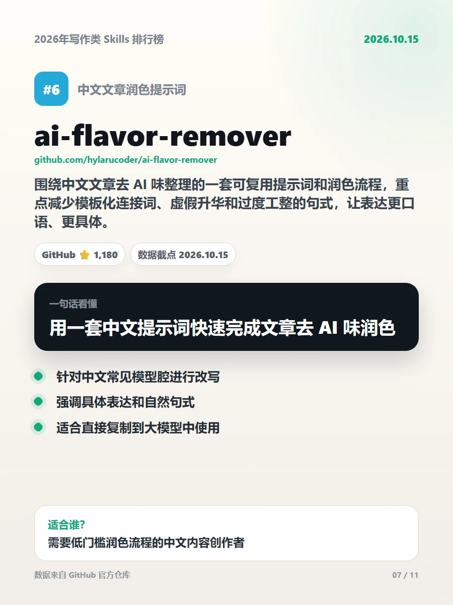

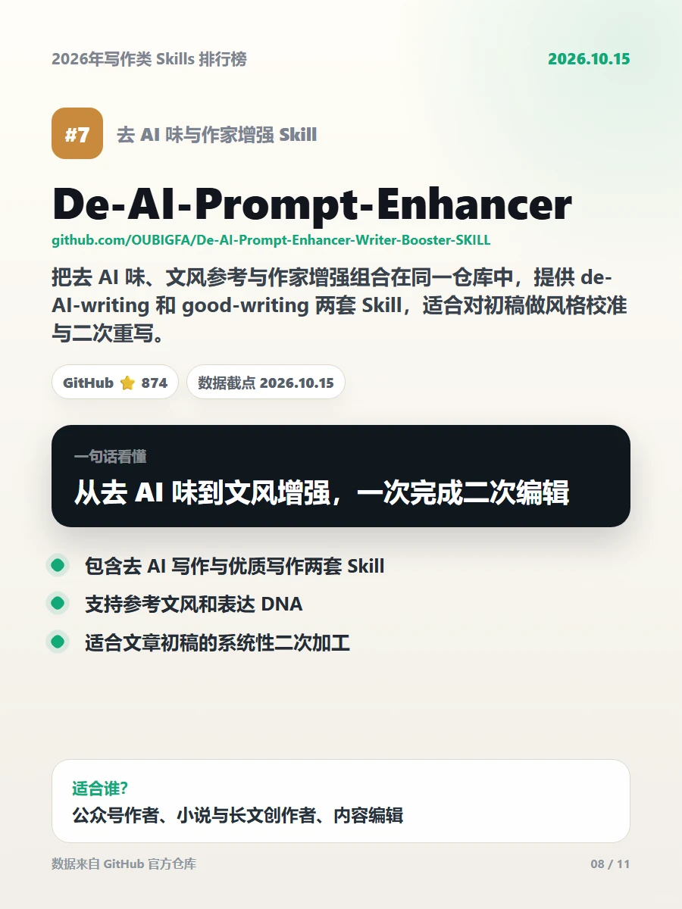

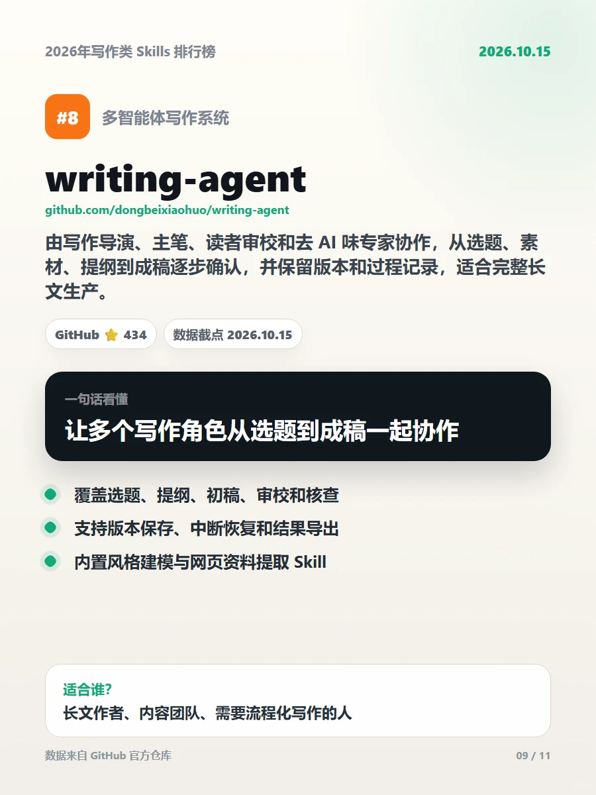

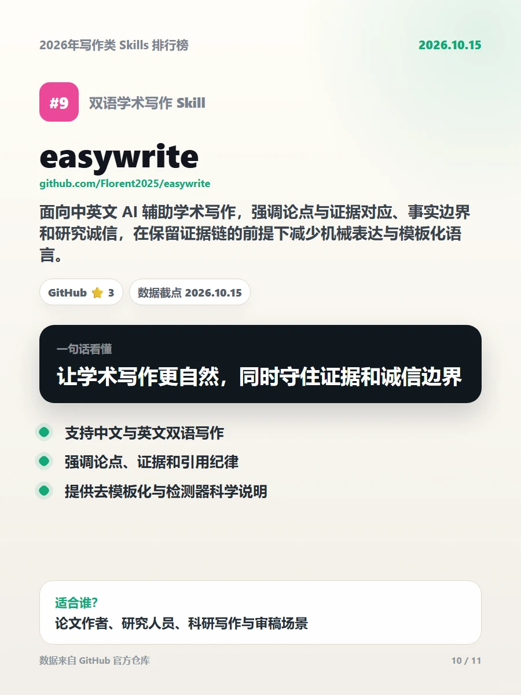

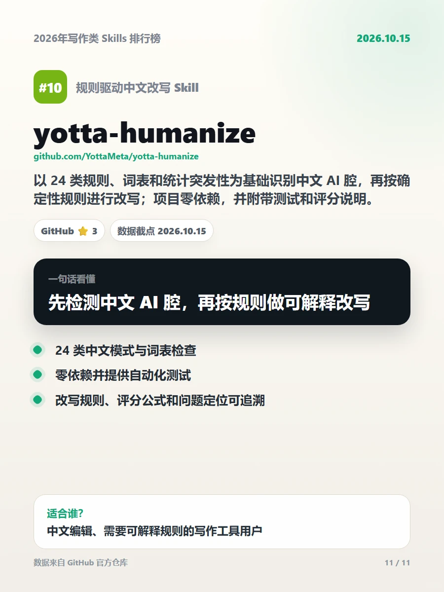
