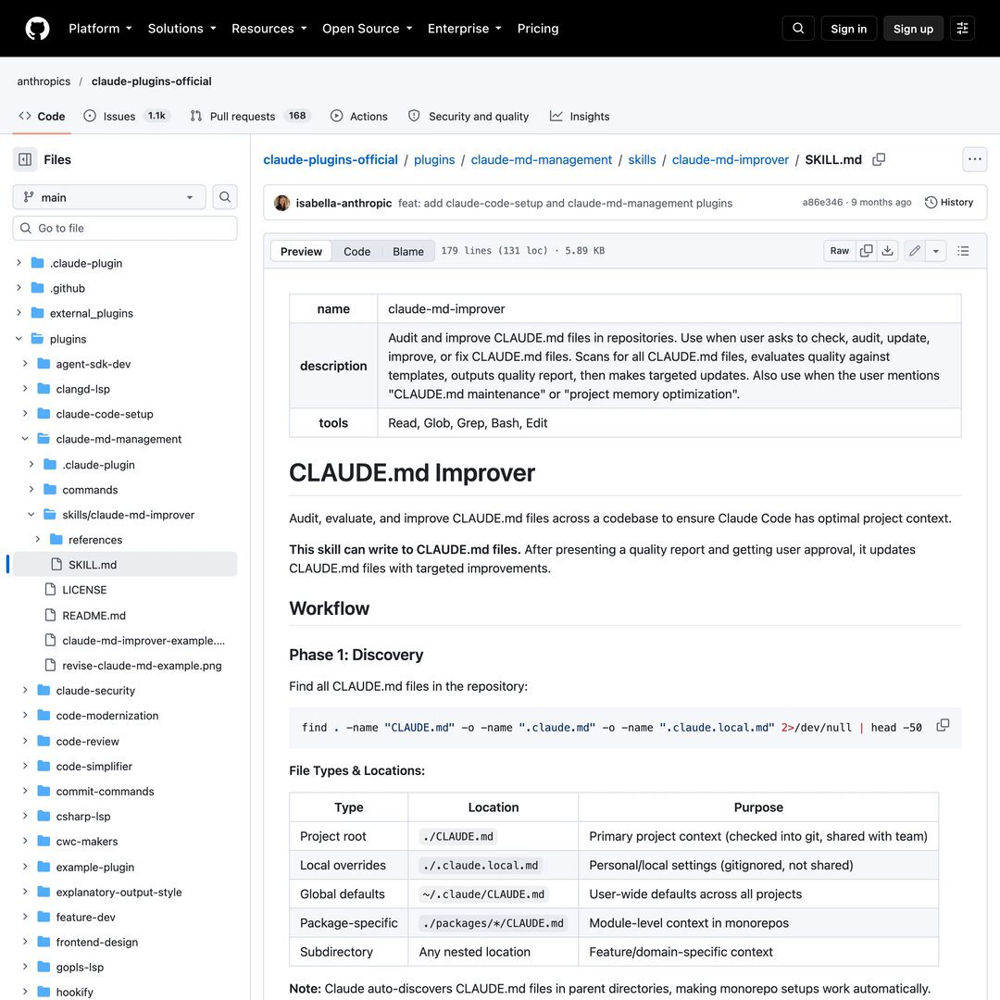

# 【官方】

作者：Skills Studio（[@sumika45379](https://x.com/sumika45379)）  
发布：2026-10-31T22:30:05.000Z

[查看原帖](https://x.com/sumika45379/status/2116659000188219579?s=46)

## 原文

【公式】  
Claude Code の CLAUDE.md が書いたきり古くなるのを、Anthropic公式のスキルが点検して最新に保ってくれる😳  
その名も claude-md-management。公式のプラグイン置き場（★約4.5万）に入っている。  
一言でいうと、CLAUDE.md の質を点検して、会話で分かったことを書き足してくれる係。  
  
入れ方はこの1行。  
/plugin install claude-md-management@claude-plugins-official  
  
・/revise-claude-md と打つと、その会話で Claude が学んだことを CLAUDE.md に残す  
・点検するのは、今ある CLAUDE.md の中身の質  
・フックにつないで案件の記憶にするか、週1回の手入れに組み込む使い方を、紹介者の dani\_avila7 が勧めている  
  
つまり CLAUDE.md の手入れが、気づいた時に自分で書き直す作業から、会話の終わりに1コマンド打つ作業に変わる。  
CLAUDE.md を育てている人ほど入れ得。  
  
スキルの中身とプラグイン置き場はこちら👇  
[https://github.com/anthropics/claude-plugins-official/blob/main/plugins/claude-md-management/skills/claude-md-improver/SKILL.md…](https://t.co/IwJtsFEeCo)  
[https://github.com/anthropics/claude-plugins-official…](https://t.co/ZkBRqGwaCp)  
  
書き足すほど長くなるのが心配なら、足すのは繰り返した失敗だけ、という線引きが効く。  
  
Anthropic社員の CLAUDE.md が短い理由は、この下の記事にまとめてます👇

## X 中文译文

【官方】  
Claude Code 的 CLAUDE.md 一旦写好就容易过时，Anthropic 官方的技能会检查并保持其最新状态😳  
它名叫 claude-md-management。收录在官方插件库中（★约 4.5 万个）。  
一句话来说，就是负责检查 CLAUDE.md 的质量，并在对话中了解到的事情基础上添加内容的角色。  
  
安装方法就这一行。  
/plugin install claude-md-management@claude-plugins-official  
  
・输入 /revise-claude-md，就会将该对话中 Claude 学到的事情记录到 CLAUDE.md 中  
・检查的是现有 CLAUDE.md 内容的质量  
・介绍人 dani\_avila7 推荐将它连接到钩子上作为项目记忆，或者每周一次的维护中使用  
  
也就是说，CLAUDE.md 的维护，从注意到时自己重写的内容，转变为对话结束时输入一条命令的操作。  
越是培养 CLAUDE.md 的人，越值得安装。  
  
技能内容和插件库在这里👇  
[https://github.com/anthropics/claude-plugins-official/blob/main/plugins/claude-md-management/skills/claude-md-improver/SKILL.md…](https://t.co/IwJtsFEeCo)  
[https://github.com/anthropics/claude-plugins-official…](https://t.co/ZkBRqGwaCp)  
  
如果担心添加内容会让它越来越长，那么只添加重复失败的部分，这个界限会很有效。  
  
Anthropic 员工的 CLAUDE.md 为什么短的原因，总结在这篇下面的文章中👇
> Skills Studio@sumika45379·10月16日
>
> 
>
>  文章【完全版】Anthropic社員のCLAUDE.mdはなぜ短いのか。AIが本当に守る書き方あなたのCLAUDE.mdは、たぶん長すぎます。書き足すほど賢くなるはずが、同じ注意を何度も打ち直していませんか。公式ドキュメントには、ファイルが長いほど指示の守られ方が落ちるとはっきり書かれています。この記...

[前往原帖播放视频](https://x.com/sumika45379/status/2116659000188219579?s=46)
