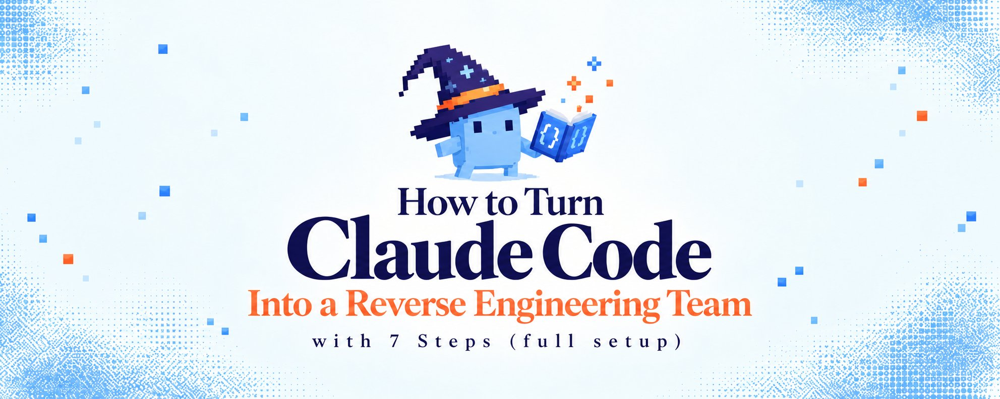

# 天哪，有人把整个逆向工程学位免费放到了 GitHub 上

作者：Gyomei（[@gyome1_](https://x.com/gyome1_)）  
发布：2026-11-01T10:24:47.000Z

[查看原帖](https://x.com/gyome1_/status/2116838860629946575?s=46)

## 原文

holy f\*ck, someone put an entire reverse engineering degree on GitHub for free  
  
7 repos, 560k+ stars, and in the right order they take you from a raw binary to agents that reverse engineer anything  
  
each repo is the next layer of the one before  
  
1. Ghidra -> how to read any binary  
the NSA’s software reverse engineering framework, where everyone starts  
  
↳ [https://github.com/NationalSecurityAgency/ghidra…](https://t.co/e0OTy789fk)  
  
2. radare2 -> the same skill in the terminal  
a UNIX-like reverse engineering framework and command-line toolset  
  
↳ [https://github.com/radareorg/radare2…](https://t.co/fGlGSOjPXx)  
  
3. LLM4Decompile -> an LLM that decompiles  
turns binary code into readable C, and the 9B v2 model reaches 64.9% re-executability on its own benchmark  
  
↳ [https://github.com/albertan017/LLM4Decompile…](https://t.co/TtHCBVR9MT)  
  
4. r2ai -> an LLM inside radare2  
LLM-based reversing for radare2, the moment AI starts reading the binary with you  
  
↳ [https://github.com/radareorg/r2ai](https://t.co/RdbzpTn7h0)  
  
5. ida-pro-mcp -> let the agent drive the tool  
bridges IDA Pro to language models through MCP  
  
↳ [https://github.com/mrexodia/ida-pro-mcp…](https://t.co/HMCygJJ7RE)  
  
6. reverse-engineering-assistant -> the same for Ghidra  
an MCP server for reverse engineering tasks in Ghidra  
  
↳ [https://github.com/cyberkaida/reverse-engineering-assistant…](https://t.co/Ev3Oy82un3)  
  
7. REA -> agents that reverse engineer anything  
35 target types, from native binaries and APKs to firmware, websites and Electron apps, with every finding backed by evidence  
  
↳ [https://github.com/morluto/rea](https://t.co/SL7BkF3aRt)  
  
work through them in this order and you can hand an old app, a binary or a firmware image to an agent and get evidence back  
  
the full list of what REA can reverse engineer below ↓

## X 中文译文

天哪，有人把整个逆向工程学位免费放到了 GitHub 上  
  
7 个仓库，超过 56 万星标，而且按正确顺序学习，它们会带你从原始二进制文件一步步到能够逆向任何东西的智能体  
  
每个仓库都是前一个的下一层  
  
1. Ghidra -> 如何读取任何二进制文件  
NSA 的软件逆向工程框架，所有人从这里起步  
  
↳ [https://github.com/NationalSecurityAgency/ghidra…](https://t.co/e0OTy789fk)  
  
2. radare2 -> 在终端中实现相同技能  
一个类 UNIX 逆向工程框架和命令行工具集  
  
↳ [https://github.com/radareorg/radare2…](https://t.co/fGlGSOjPXx)  
  
3. LLM4Decompile -> 一个用于反编译的 LLM  
将二进制代码转为可读的 C 语言，9B v2 模型在其基准测试中达到了 64.9% 的可重执行率  
  
↳ [https://github.com/albertan017/LLM4Decompile…](https://t.co/TtHCBVR9MT)  
  
4. r2ai -> radare2 中的 LLM  
基于 LLM 的 radare2 逆向工具，这是 AI 开始与你一起阅读二进制文件的时刻  
  
↳ [https://github.com/radareorg/r2ai](https://t.co/RdbzpTn7h0)  
  
5. ida-pro-mcp -> 让智能体驱动工具  
通过 MCP 将 IDA Pro 桥接到语言模型  
  
↳ [https://github.com/mrexodia/ida-pro-mcp…](https://t.co/HMCygJJ7RE)  
  
6. reverse-engineering-assistant -> Ghidra 的对应版本  
Ghidra 中逆向工程任务的 MCP 服务器  
  
↳ [https://github.com/cyberkaida/reverse-engineering-assistant…](https://t.co/Ev3Oy82un3)  
  
7. REA -> 能够逆向任何东西的智能体  
35 种目标类型，从原生二进制和 APK 到固件、网站和 Electron 应用，每项发现都有证据支持  
  
↳ [https://github.com/morluto/rea](https://t.co/SL7BkF3aRt)  
  
按这个顺序逐步学习，你就能把一个旧应用、二进制文件或固件镜像交给智能体，并获得证据反馈  
  
REA 能逆向的所有内容的完整列表如下 ↓
> Gyomei@Gyome1\_·10月18日翻译自 英语REA 在 GitHub 趋势榜上登顶第一，而大多数人仍然在单个聊天窗口中运行它  
>   
> 将其拆分为 4 个子代理，一个命令就能将您拥有的程序从密封二进制文件转变为经过测试的重建版本，并达到匹配率  
>   
> 只需设置一次，然后瞄准下一个：
>
> 
>
>  文章How to Turn Claude Code Into a Reverse Engineering Team with 7 Steps (full setup)On October 8 REA went to number one on GitHub trending, and ten days later most people who starred it are still running it inside a single chat window.  
> Bookmark This   
> every agent file, prompt and...

[前往原帖播放视频](https://x.com/gyome1_/status/2116838860629946575?s=46)
