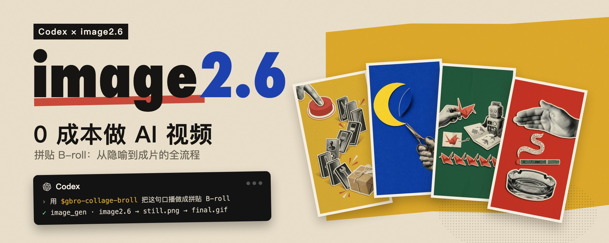
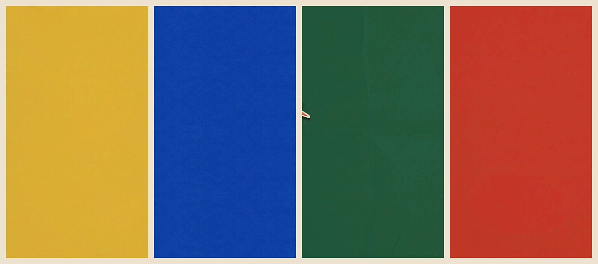
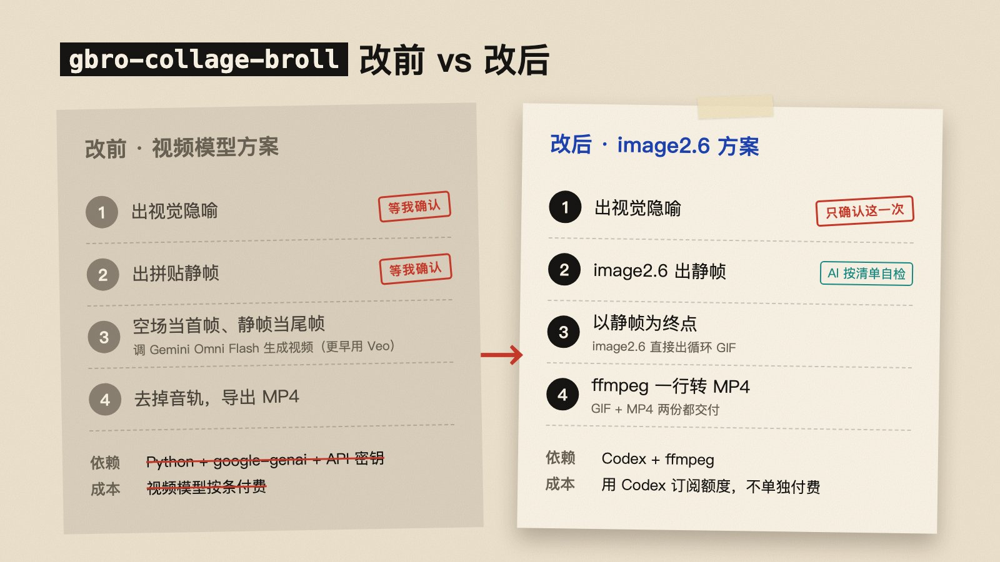
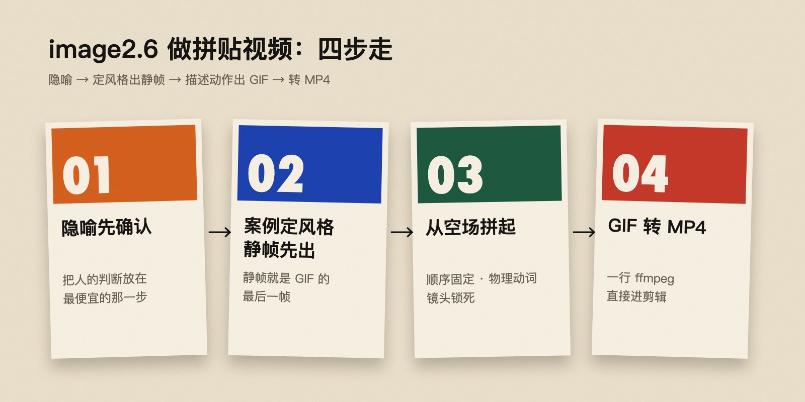
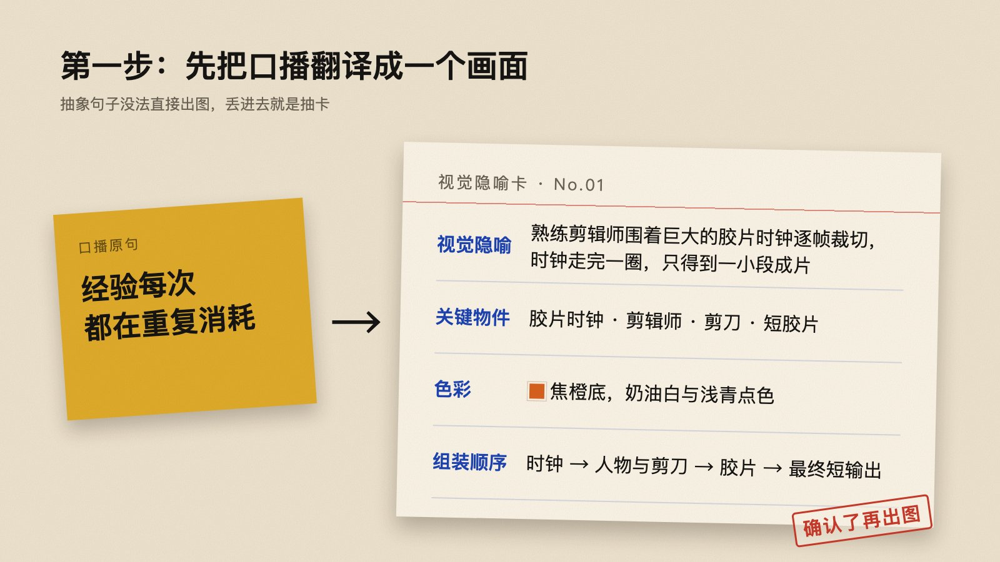
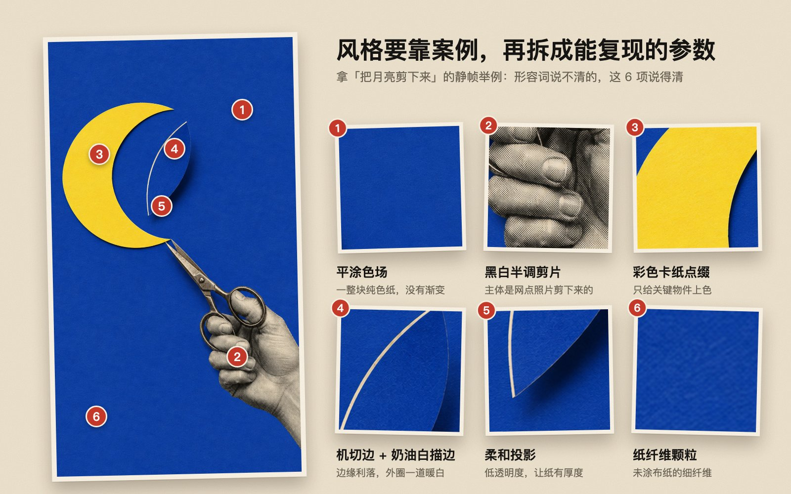
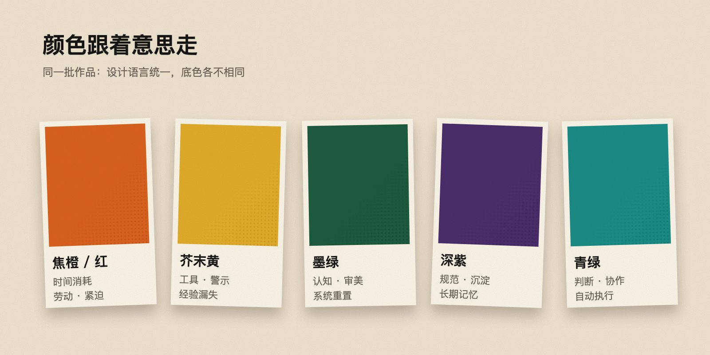
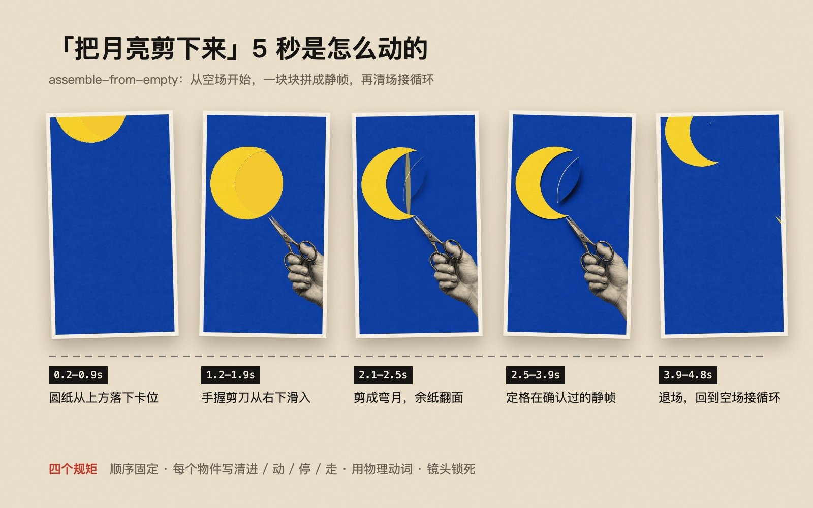
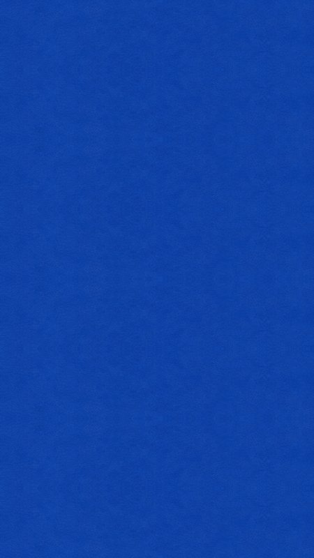

# 巧用 Codex image2.6，0 成本 AI 视频生成：从隐喻到成片的全流程

作者：狗哥笔记（[@gbroai](https://x.com/gbroai)）  
发布：2026-11-06T06:21:56.000Z

[查看原帖](https://x.com/gbroai/status/2118589683819262346?s=46)



昨天 Codex 更新了 image2.6，核心是能直接生成 GIF 了。

我当晚就拿它跑了四条拼贴 B-roll，全程没碰视频模型。



[前往原帖播放视频](https://x.com/gbroai/status/2118589683819262346?s=46)

说实话，这次给我的震撼比 Opus 5.5 写代码做视频那一波还大。

原因就两个：成本，和能做出来的画面有多复杂。

Opus 5.5 写代码做视频，本质上是 HTML 动画。数字跳动、卡片翻转、信息图，它做得又快又准。但一到「一只手拿剪刀，把月亮从纸上剪下来」这种画面，代码就画不出来了：纸的毛边、半调网点、手的形状，这些得靠图像模型。

以前要做这种有手工质感的镜头，我得接视频模型的 API，按条付费。一条5秒的视频大概是1块钱。

结果就是，我舍不得为一句口播单独做一个镜头。

现在整条链路都在 Codex 里跑完，用的是本来就在付的订阅额度。不接 API，不配密钥，不再为每条单独付钱。

对天天剪口播的人来说，这意味着一句话也配得起一个专门的镜头了。

## 我把自己的 skill 改了

我有个开源的 skill 叫 gbro-collage-broll，专门把一句 5 秒左右的口播，做成半调纸拼贴风的 B-roll。

改之前的流程是这样的：

1. 先出视觉隐喻，等我确认
2. 再出静帧，再等我确认
3. 拿纯色空场当首帧、静帧当尾帧，调 Gemini Omni Flash 生成首尾帧视频（更早用的是 Veo）
4. 拿到视频去掉音轨

改完变成：

1. 只确认一次隐喻
2. image2.6 出静帧，AI 自己按清单检查、有问题自己重出
3. 以静帧为终点，image2.6 直接出循环 GIF
4. GIF 转成 MP4，方便进剪辑软件

具体改了三处：

**视频模型整个拿掉了。** 依赖从「Python + google-genai SDK + API 密钥」变成「Codex + ffmpeg」，装机门槛低了一大截。

**两道确认砍成一道。** 我发现真正需要人判断的只有隐喻这一步。静帧有没有假字、主体集不集中、纸片是不是太碎，这些都能写成清单让 AI 自己查。我盯着看反而是浪费时间。

**交付从 MP4 变成 GIF + MP4 两份。** GIF 发推、放笔记里直接动，MP4 拖进剪映用。



下面是我这几天跑下来的经验。如果你也想用 image2.6 低成本做 AI 视频，又想把质量做上去，可以按这四步走：

隐喻 → 定风格出静帧 → 描述动作出 GIF → 转 MP4



## 第一步：先确认隐喻

口播是抽象的。比如「经验每次都在重复消耗」，这句话你没法直接丢给模型出图，丢了也是随机抽卡。

所以第一步要把它翻译成一个画面。我的 skill 会给出这样一张卡：

```plaintext
核心意思：经验每次都在重复消耗
视觉隐喻：熟练剪辑师围着巨大的胶片时钟逐帧裁切，时钟走完一圈，只得到一小段成片
关键物件：胶片时钟、剪辑师、剪刀、短胶片
色彩：焦橙底，奶油白与浅青点色
组装顺序：时钟 → 人物与剪刀 → 胶片 → 最终短输出
```



为什么一定要在这里停下来确认？

因为隐喻错了，后面每一步都白做。看一段文字只要十秒，重出一组图要几分钟，还要烧额度。

**把人的判断放在最便宜的那一步，这是免抽卡的关键。**

几条规则：

- 一句话只做一个隐喻，别想一个画面讲三件事
- 物件控制在 3–6 个，多了语义变弱，动起来还会互相遮挡
- 不要把文稿的字放进画面，画面负责隐喻，字幕负责文字
- 批量做的时候，让几条隐喻前后成叙事。比如先拍手工消耗、经验流失，再拍规范沉淀、人机分工

## 第二步：定风格，出静帧（最关键的一步）

这一步最决定成片质量，篇幅我多花一点。

### 1. 风格不能光靠形容词，一定要有案例

你跟模型说「高级的杂志拼贴风」，出十次能给你十种拼贴。

形容词每个人理解都不一样，模型也一样。要让风格稳定，必须给它一个具体的案例。也就是你觉得满足这个你心中这个风格的图究竟是什么样的。

有了案例之后，我的 skill 会做一件事：把案例拆成可执行的材料参数，写进一份 visual-spec.json。拼贴风拆出来是这样的：

- **平涂色场**：背景是一整块强烈、均匀的纯色纸，没有渐变
- **黑白半调剪片**：主体是黑白网点照片剪下来的纸片，看得见印刷网点
- **彩色卡纸点缀**：关键物件（卡片、按钮、胶片）才用红、黄、青、橙、紫
- **机切边 + 奶油白描边**：每块纸边缘干净利落，外圈一道细细的暖白边
- **柔和投影**：低透明度的纸片阴影，让纸有一点厚度
- **纸纤维颗粒**：未涂布纸的细纤维质感

案例负责让你和模型看到同一个东西，参数负责每次都能复现它。两样缺一不可。



### 2. 颜色跟着语义走

我以前默认全用钴蓝底，一批看下来很单调。现在按意思挑底色：

- 焦橙 / 红：时间消耗、劳动、紧迫
- 芥末黄：工具、警示、经验漏失
- 墨绿：认知、审美、系统重置
- 深紫：规范、沉淀、长期记忆
- 青绿：判断、协作、自动执行



同一批作品，设计语言统一，底色各不相同。彩色纸片只用在需要强调的地方，不为了彩色而彩色。

### 3. 构图要给动画留位置

静帧不是一张海报就完事了，它是 GIF 的最后一帧。所以出图时就要想好它怎么动起来：

- 主体放在画面中间 70% 的区域
- 留出大块干净的纯色空白，动画要从这块空场开始拼
- 画面由 3–6 个能分开的大纸片组成，不要满屏碎片

碎片太多，动起来就是一锅粥。

### 4. 把模型的坏习惯提前禁掉

图像模型很爱在画面里塞假字、假 logo、假界面。拼贴风尤其容易冒出报纸上那种乱码小字。

所以提示词里要明确写：无文字、无字母、无数字、无 logo、无水印、无 UI、无字幕、不要光滑 3D、不要写实场景。

我的静帧提示词模板长这样，可以直接拿去改：

```plaintext
Use case: ads-marketing
Asset type: final still frame for a 9:16 B-roll clip
Primary request: Create a finished editorial paper-collage image expressing [一句话视觉命题].
Scene/backdrop: perfectly flat [颜色] paper field [hex] with subtle uncoated paper fiber.
Style/medium: premium editorial stop-motion paper collage; black-and-white halftone photographic cut-outs mixed with selective [点色] colored cardstock.
Composition/framing: vertical 9:16 locked poster frame; central subject within the middle 70 percent; generous clean color-field negative space; 3–6 large separable paper groups for later assemble-from-empty animation.
Materials/textures: visible printed halftone dots, crisp machine-cut edges, thin warm-cream paper keylines, soft low-opacity physical drop shadows.
Constraints: [这条隐喻必须一眼看懂的关系].
Avoid: no typography, no readable letters, no numerals, no logos, no watermark, no UI, no subtitles, no glossy 3D, no photoreal environment, no clutter.
```

### 5. 为什么一定要先出静帧

这是我最想强调的一点：**跳过静帧、直接让 image2.6 出 GIF，质量明显差一截。**

道理也简单。一步出 GIF，模型要同时决定风格、构图、动作三件事，等于三件事一起抽卡。结果往往是画面发糊、纸片闪烁、假字乱冒。

先把静帧定死，GIF 的任务就只剩一件事：把这张图从空场拼出来。终点已经确定，模型只管过程。

### 6. 静帧出来先过一遍清单

- 隐喻是不是一眼能看懂
- 主体集不集中
- 有没有假字、logo、水印、UI
- 纯色空场留够了没有
- 是 3–6 个大组，还是满屏碎片
- 同一批是不是质感统一、底色有变化

有一条不过就重出。这个清单我已经交给 AI 自己跑了，不用人盯。

## 第三步：怎么描述动作，让 AI 出 GIF

静帧定好之后，动作描述的核心就一句话：**从空场开始，把纸片一块块拼成这张静帧。**

我管这个叫 assemble-from-empty。为什么不用「轻微漂移」「缓慢推镜」「呼吸感」这种描述？因为放在 GIF 里，这些小动作看起来就是画面在抖。拼贴风的魅力在定格动画那种一块纸「啪」地卡到位的感觉。

我的 skill 描述动作有四个规矩。

**一、顺序固定。** 基础结构先进场，然后是人物或关键卡片，再是连接件，最后是动作和结果。拼完定格一会儿，再清场回到空场，正好接上下一轮循环。

**二、每个物件写清四件事。** 从哪进、做什么动作、停在哪、什么时候走。

**三、用物理动词。** 滑入、落下、卡位、翻面、剪开、装订、点亮。别写「出现」「浮现」，那是淡入淡出，不是拼贴。

**四、镜头锁死。** 不切镜、不缩放、不变形、不加静帧里没有的新物件、不出文字。

拿我昨天做的「把月亮剪下来」举例，5 秒的动作是这样排的：

```plaintext
0.2–0.9s  钴蓝空场，一张奶油黄圆纸从上方落下，卡到位
1.2–1.9s  一只黑白半调的手握着剪刀，从右下方滑入
2.1–2.5s  剪刀合拢，圆纸被剪成弯月，剪下的余纸翻面，露出蓝色背面和奶油白细边
2.5–3.9s  定格在确认过的静帧
3.9–4.8s  手和月亮各自退出画面，回到空场，接上下一轮
```



写成提示词，模板是这样：

```plaintext
Paper-collage stop-motion assembly. The attached image is the exact completed final frame.
Open on the empty flat [颜色] paper field. Assemble the scene piece by piece with crisp physical stop-motion timing: [按顺序写每个物件：从哪进、做什么、停在哪].
Hold the completed composition, then clear the pieces out back to the empty field so the loop is seamless.
Keep the exact 9:16 framing, [hex] color field, halftone dots, cream keylines, crisp cut edges and soft shadows.
No scene cuts, no camera movement, no zoom, no morphing, no new objects, no text, no letters, no numbers, no logos, no watermark, no UI.
Output: looping GIF, 9:16, 5 seconds, about 20 fps, infinite loop.
```



[前往原帖播放视频](https://x.com/gbroai/status/2118589683819262346?s=46)

GIF 出来之后，别只看最后一帧。要逐段检查：入场有没有提前露出纸片、中段是不是真的一块块拼、定格是不是和静帧一致、循环接头会不会跳一下。

## 第四步：GIF 转 MP4

GIF 发推很方便，但剪映、PR 对 GIF 的支持一般，所以我最后都会转一份 MP4。

一行 ffmpeg 就够：

```bash
ffmpeg -v error -n -ignore_loop 1 -i final.gif -map 0:v:0 -an -vf "fps=24,scale=720:1280:force_original_aspect_ratio=decrease,pad=720:1280:(ow-iw)/2:(oh-ih)/2,setsar=1" -c:v libx264 -pix_fmt yuv420p -movflags +faststart final.mp4
```

几个参数解释一下：

- -ignore\_loop 1：GIF 带着无限循环标记，这里显式让 ffmpeg 只读一遍。要是设成 0，它会按标记一直循环读下去
- fps=24：我的 GIF 按 20fps 出，这里统一成剪辑软件习惯的 24fps
- scale + pad：缩放到 720×1280 竖屏，比例不对就补边，不拉伸
- -pix\_fmt yuv420p：兼容性最好的像素格式，手机、剪映都能正常播
- -an：不要音轨，B-roll 的声音在剪辑里统一处理

转完用 ffprobe 看一眼：5 秒左右、720×1280、24fps、H.264、没有音轨，就可以拖进时间线了。

```bash
ffprobe -v error -show_entries stream=codec_type,codec_name,width,height,pix_fmt,avg_frame_rate:format=duration -of json final.mp4
```

顺带说一句，拼贴风天生适合走 GIF：大面积平涂色块加黑白网点，用到的颜色本来就少，GIF 的 256 色基本够用，不太会出现色带。

## 最后

整个流程总结一下：

1. **隐喻先确认**：把人的判断放在最便宜的那一步，免抽卡
2. **风格靠案例，静帧必须先出**：案例让风格稳定，静帧给 GIF 定终点
3. **动作从空场拼起**：顺序固定、物理动词、镜头锁死
4. **GIF 转 MP4**：一行 ffmpeg，直接进剪辑

这个 skill 我开源在 GitHub：

<https://github.com/pyang5166/gbro-collage-broll>

现在仓库里还是旧版（Gemini Omni Flash 方案）。image2.6 的新版我再调试两天，稳定了就推上去。

想第一时间用的，可以先点个 star，更新了我会在这里说一声。
