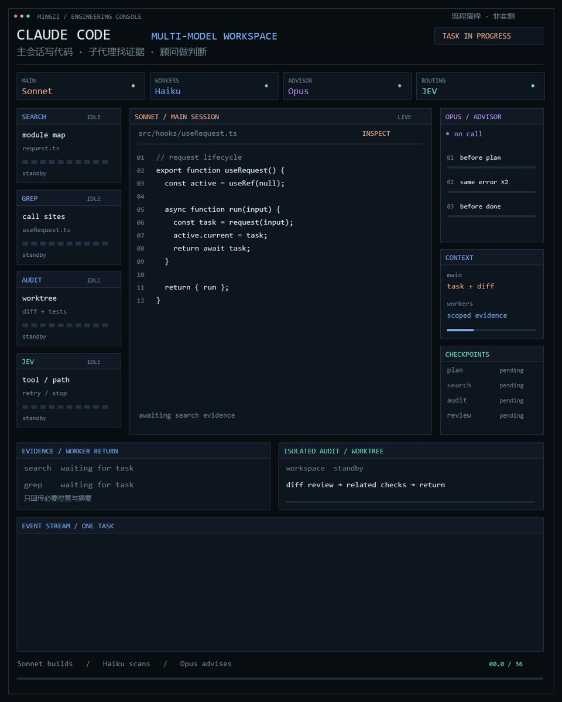

# 这绝对是一座真金矿！

作者：明子206（[@mingzi206](https://x.com/mingzi206)）  
发布：2026-11-06T03:28:21.000Z

[查看原帖](https://x.com/mingzi206/status/2118545997798453679?s=46)

这绝对是一座真金矿！  
  
Anthropic 刚发了一个 Claude Code 封神级的高阶玩法。  
  
思路极其简单：同时跑 Sonnet、Haiku 5.5 和 Opus 5.5，每个模型只干自己最擅长的活。  
不仅写代码效果更好，还能省下大笔 token。  
  
启动 Claude Code 这样写就行：  
`claude --model sonnet --advisor opus`  
  
三层模型各司其职：  
· Sonnet 5.5 负责主会话，专心写代码、改 bug  
· Haiku 5.5 并行扫整个代码库，只读搜索、grep 和查文档  
· Opus 5.5 坐镇当顾问，只在关键决策时出手，最后审核改动  
不需要 Opus 的活，绝不浪费它一丝一毫的上下文。  
  
Opus 只在三个时候介入：  
① 计划敲定之前  
② 同一个错误出现第二次的时候  
③ 宣布完成之前  
  
底层逻辑和 JEV 工程完全一致：不需要动脑的小选择（选文件、选工具、重试或停止）交给 JEV 毫秒级处理，大模型只用来思考真正的硬骨头。  
  
把这段提示词直接贴进 Claude Code 重新配置：  
“按这个结构重新配置我的 Claude Code：  
1. 主会话用 Sonnet 5.5，Opus 5.5 当顾问。  
2. 在 .claude/agents 里建三个 Haiku 5.5 子代理：search（梳理代码库）、grep（查找调用位置）、audit（检查改动）。  
3. 给 audit 设置 worktree 隔离，让它的检查不碰我的工作分支。  
4. 在 CLAUDE.md 里加一条规则：所有代码库搜索和测试都交给 Haiku 5.5 子代理，让主上下文保持精简。  
5. 快速、确定性的小选择（选工具、选路径、重试）交给 JEV 处理。  
所有改动先用 diff 给我看，我说开始之前不要动任何文件。”  
  
👉 官方子代理文档：[http://code.claude.com/docs/en/sub-agents…](https://t.co/lWJe071wuJ) [#ClaudeCode](https://x.com/hashtag/ClaudeCode?src=hashtag_click)

[前往原帖播放视频](https://x.com/mingzi206/status/2118545997798453679?s=46)
