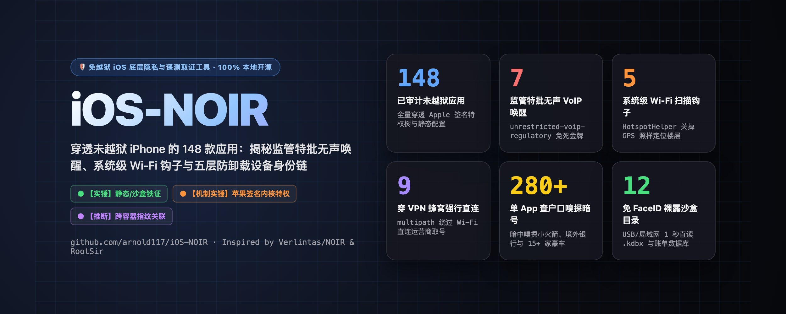
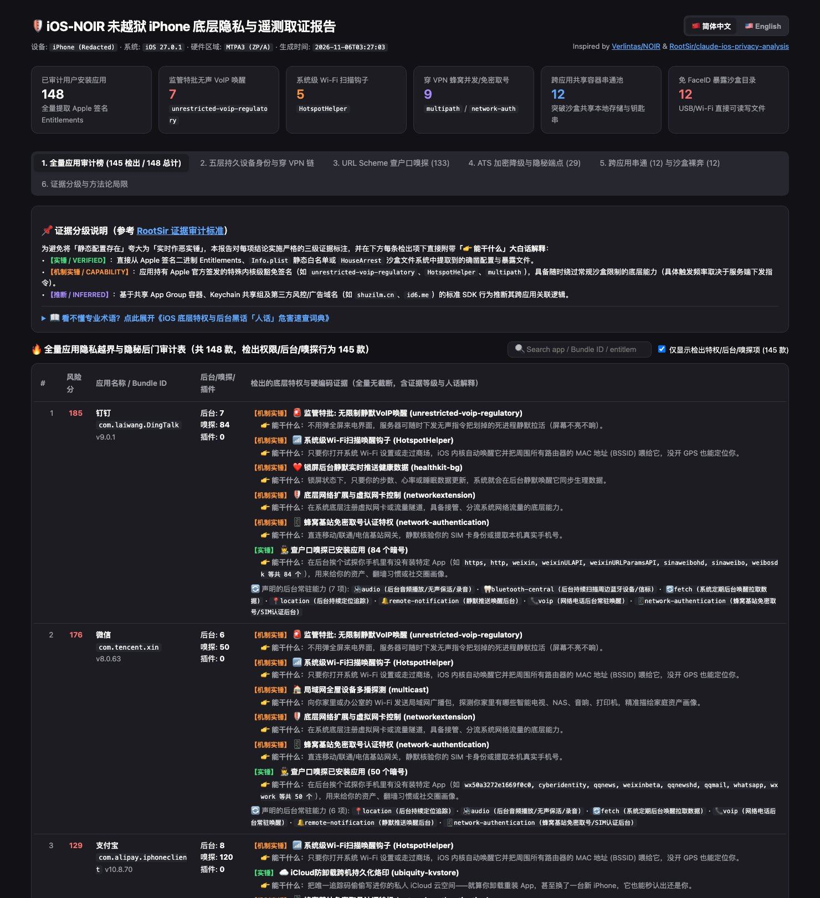
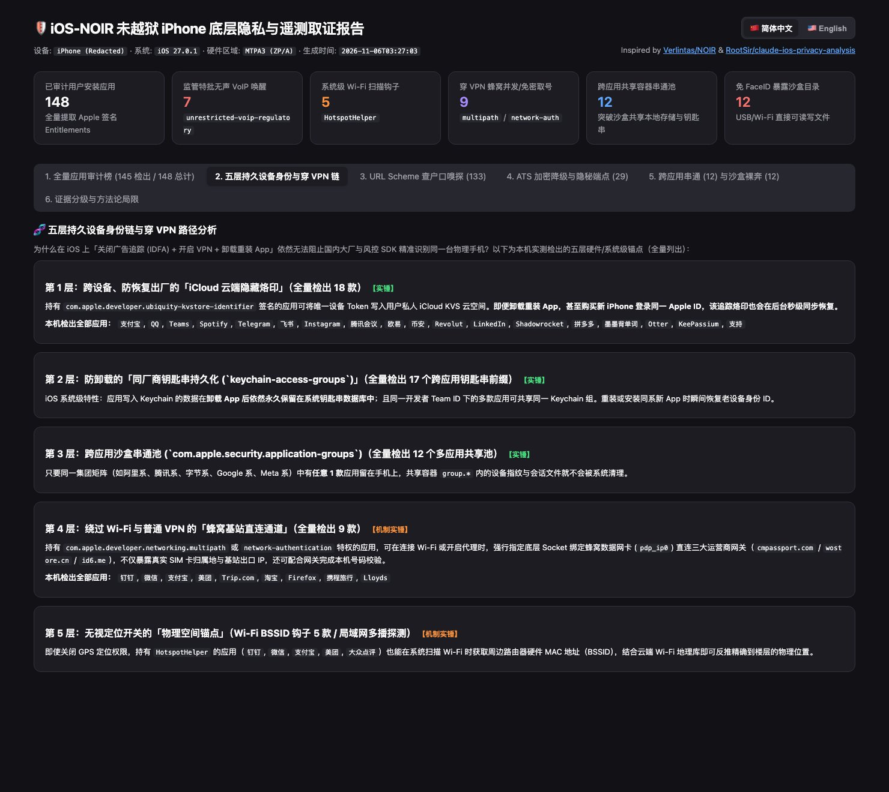

# “买 iPhone 不越狱就安全”是个彻底的幻觉：一台主力 iPhone 的 148 款应用底层穿透取证报告

作者：Arnold（[@arnoldchow117](https://x.com/arnoldchow117)）  
发布：2026-11-06T05:40:23.000Z

[查看原帖](https://x.com/arnoldchow117/status/2118579224995123465?s=46)

大多数买 iPhone 的人都有一个根深蒂固的安全感：**“只要我不越狱、不装企业证书、平时随手把 App 往上划掉、再挂个 VPN，流氓软件就被死死关在苹果的沙盒里，奈何不了我。”**

直到今天早上，我因为好奇，受 Android 隐私审计项目 [@Verlintas](https://x.com/@Verlintas) 的NOIR 和 [@RootSir](https://x.com/@RootSir) 的 Claude iOS 逆向报告启发，用 Python 写了一套免越狱的 iOS 底层取证工具 **iOS-NOIR**。

不需要越狱，只需插上一根 USB 数据线，直接穿透苹果底层的 lockdownd、InstallationProxy、HouseArrest、崩溃黑匣子 .ips 与开发者模式内核遥测（DVT sysmon / OsTrace），对我手里这台再普通不过的未越狱主力 iPhone（共安装 148 款应用）做了一次底朝天的体检。

**扫完之后，我盯着终端屏幕足足愣了五分钟。**

以下所有发现均来自我这台未越狱真机的第一手取证产出（遵循 RootSir 的证据分级标准：**🟢【实锤】**为静态配置/沙盒文件/内核日志确凿铁证；**🟠【机制实锤】**为苹果官方签发的特殊内核豁免签名已就绪）：

**一、 办公桌静置 1 小时实验：被你“划掉”的 App，是怎么借尸还魂的？**

早上 09:20 到 10:22，我把手机放在办公桌上，几乎没怎么亮屏操作。按理说，所有软件都应该在沙盒里安静冬眠。

但我每隔一小时抓了一次 iOS 内核进程表（DVT sysmon），做了一次精确到毫秒的 CPU 与磁盘读写差分（Diff）：

1. **锁屏下的磁盘狂飙【实锤】**在这几乎没碰手机的 1 小时里，常驻后台的 WhatsApp（PID 330）偷偷燃烧了 **105.7 秒** 的纯 CPU 时间，在后台狂读了 **411.5 MB** 手机存储、写入 **83.6 MB**；Instagram（PID 539）在后台烧掉了 **35.6 秒** CPU，读取了 **195.0 MB** 本地硬盘数据！
2. **「推送插件」借尸还魂术（哪怕你关闭了后台刷新、划掉了进程）【实锤】**我明明早就把美团、小红书从后台划掉了，甚至关掉了它们的「后台 App 刷新」，为什么内核进程表里还是抓到了它们的影子？ 因为流氓软件早就找到了苹果沙盒的合法后门——**NotificationServiceExtension（通知服务扩展插件）**。 只要它们的服务器发一条带 mutable-content: 1 的推送，iOS 系统哪怕看到主 App 死透了，也会在后台强行拉起一个替身进程，给它 **30 秒的独立 CPU 时间与完整网络/沙盒读取权限**！ 在这短短 1 小时内：**美团**的推送替身（PID 56726）在后台被拉起，一口气读取了 **16.57 MB** 本地磁盘数据；  
   **小红书**的推送替身（PID 55925）在后台被拉起，一口气读取了 **22.65 MB** 本地磁盘数据！
3. **14,228 次狂暴唤醒与「监管特批」免死金牌【实锤 + 机制实锤】**导出手机内部的系统级崩溃黑匣子（.ips 诊断日志）时，我发现了一份触目惊心的系统处决记录： **支付宝**在一次后台运行中，在短短 7,414 秒内触发了 **14,228 次后台线程唤醒（平均每秒唤醒 1.9 次！）**，最终因为突破了 iOS 内核单进程 45,000 次唤醒的硬红线（45001 count limit exceeded），被系统内核动用 cpu\_resource\_fatal 强行斩首。 更离谱的是：从 iOS 13 开始，苹果为了封杀借道 VoIP 网络电话推送偷跑后台的行为，立下铁规——**收到 VoIP 推送必须立刻弹出全屏来电界面，否则直接封杀唤醒权**。 但 iOS-NOIR 穿透签名树发现：**微信、QQ、钉钉**等 7 款应用，赫然持有苹果从未在公开文档里宣传过的 [**com.apple**](https://com.apple)**.developer.pushkit.unrestricted-voip-regulatory: True（监管特批无限制静默 VoIP 唤醒）** 签名！ 这意味着什么？意味着普通开发者的 App 不弹电话界面就会被苹果杀死，而持有这张“免死金牌”的超级 App，**服务器随时可以下发无声指令把死透的后台拉活上万次，而你的手机屏幕绝对不会亮、不会响、不留一丝痕迹。**

**二、 查户口与“验资”：单个 App 塞进 280 个探测暗号，连你开什么超跑都摸得一清二楚**

你以为 App 读不到你的应用安装列表？ 在 iOS 上，虽然苹果封禁了直接遍历全机应用列表的私有 API，但留了一个叫 canOpenURL: 的口子——只要开发者在安装包 Info.plist 的 LSApplicationQueriesSchemes 白名单里提前写好别人的唤醒暗号（URL Scheme），就能在后台挨个向系统发问：“这台手机能不能打开 xxx://？”（全程不弹窗、无感知）。

iOS-NOIR 把全机 148 款应用的嗅探白名单全量扒了出来【100% 静态实锤】：

- **航旅纵横（Umetrip）**：单枪匹马硬编码了 **280 个** 嗅探暗号！
- **Soul**：一个社交软件，硬编码了 **250 个** 嗅探暗号！翻开它的名单我直接看傻了——它不仅探测你装没装各大银行和办公软件，还专门列了一串**顶级豪车车企专属暗号**： porsche（保时捷）、ferrari（法拉利）、AstonMartin（阿斯顿马丁）、maserati（玛莎拉蒂）、McLaren（迈凯伦）、bentley（宾利）、lamborghini（兰博基尼）、tesla（特斯拉）、nio（蔚来）…… **你刚注册账号，还没发一句话，人家在后台花 10 毫秒跑完这 250 个问答，就已经把你的真实消费阶层和身价摸得明明白白。**
- **翻墙与境外社交嗅探**：包括 **小红书、BOSS直聘、百度网盘、大麦、得物** 在内的几十款国内日常软件，全都在白名单里写死了对 whatsapp、telegram、twitter、facebook、instagram 甚至代理工具的嗅探。

**三、 为什么「关 IDFA + 挂 VPN + 卸载重装」依然是个笑话？（五层持久设备身份链）**

很多人问：“我已经关了系统设置里的『允许 App 请求跟踪 (IDFA)』，平时 24 小时挂着小火箭 VPN，甚至把软件卸载重装了，为什么国内大厂和风控系统还是能一秒认出我是同一台手机？”

因为 IDFA 只是摆在明面上的安慰剂。iOS-NOIR 在我的手机上测绘出了完整的\*\*「五层持久设备身份与穿 VPN 链路」\*\*：

1. **第 1 层：换新 iPhone 都洗不掉的「iCloud 云端隐藏烙印」（本机检出 18 款）【实锤】**包括**支付宝、QQ、飞书、拼多多、腾讯会议**在内的 18 款应用，持有 [com.apple](https://com.apple).developer.ubiquity-kvstore-identifier 签名。它们可以把生成的唯一设备追踪码偷偷写进你私人 iCloud 的隐藏键值对空间里。**就算你卸载重装 App，甚至去苹果店买了一台全新的 iPhone，只要登录同一个 Apple ID，这个追踪烙印就会在后台秒级自动同步回来。**
2. **第 2 & 3 层：删不掉的「同厂商钥匙串」与「跨应用串通池」（17 组钥匙串 + 12 个共享容器）【实锤】**iOS 有个著名的底层机制：App 写进系统钥匙串（Keychain）的数据，**在卸载 App 后依然永久保留在手机里不会清除**。同时，同一大厂矩阵（如阿里系、腾讯系、字节系、Google 系、Meta 系）通过共享 [com.apple.security](https://com.apple.security).application-groups 容器互通有无——只要你手机上还留着同门派的**任意 1 款**软件，你的设备 DNA 指纹就永远处于激活状态。
3. **第 4 层：无视 Wi-Fi 与 VPN 的「蜂窝基站强行直连」（本机检出 9 款）【机制实锤】**为什么你挂着全局 VPN，App 还是知道你的真实手机号和国内归属地？ 因为**钉钉、微信、支付宝、美团、淘宝、携程、Trip.com** 等 9 款应用持有 multipath（多路径 TCP）或 network-authentication（蜂窝网络免密认证）底层特权。 哪怕你连着家里的 Wi-Fi 或者挂着 VPN 虚拟网卡（utun），它们也能在底层强行指定 Socket 绑定 **4G/5G 蜂窝数据物理网卡（pdp\_ip0）**，直接穿透到三大运营商的基站取号网关（移动 [cmpassport.com](https://cmpassport.com)、联通 [wostore.cn](https://wostore.cn) / [id6.me](https://id6.me)、电信 [189.cn](https://189.cn)），1 秒钟静默完成本机号码核验与真实基站 IP 暴露！
4. **第 5 层：关掉 GPS 也没用的「系统级 Wi-Fi 扫描钩子」（本机检出 5 款）【机制实锤】**  
   **美团、大众点评、支付宝、微信、钉钉** 全部持有 [com.apple](https://com.apple).developer.networking.HotspotHelper 特权。这个接口原本是苹果给“公共 Wi-Fi 自动登录工具”准备的；但被外卖和支付巨头拿走后，**只要你走过商场或点开系统 Wi-Fi 列表，iOS 内核就会在后台自动唤醒它们，并把周围扫到的所有路由器硬件 MAC 地址（BSSID）打包喂给它们**。不需要任何 GPS 权限，对照云端 Wi-Fi 地理库就能把你定死在哪栋楼、哪层店。

**四、 代码里的“幽灵后门”、肌肉生物探针与 1 秒免 FaceID 掏空沙盒**

除了特权签名，当我让 iOS-NOIR 对全机应用的 NSExceptionDomains（开发者点名申请关闭苹果 HTTPS 加密保护的后门域名）和沙盒文件接口做穿透扫描时，抓出了三个最让人后背发凉的细节【全部实锤】：

1. **早被苹果明令封杀的远程热更新后门与隐秘指纹网**在**我爱我家**的配置文件里，赫然硬编码着 [jspatch.com](https://jspatch.com) —— 这是当年著名的 **JSPatch 远程热更新框架**（允许服务器不经 App Store 审核，直接向手机下发 JavaScript 脚本调用任意 Objective-C 底层接口执行代码，早已被苹果安全团队严令封杀）。  
   在 **Airbnb（爱彼迎）** 里，静态抽取出国内的跨应用设备 DNA 指纹库 **数字联盟 (**[**shuzilm.cn**](https://shuzilm.cn)**)** 以及中国联通免密取号网关 ([id6.me](https://id6.me) / [mdn.open.wo.cn](https://mdn.open.wo.cn))。  
   在商务办公软件 **腾讯会议** 里，竟然硬编码了整整 **12 家商业广告监测与实时竞价网络**（秒针 [miaozhen.com](https://miaozhen.com)、国双 [gridsumdissector.com](https://gridsumdissector.com)、AdMaster 等）。
2. **植入金融软件的「手指肌肉微动作与打字习惯探针」与「AI 行程监控库」**在**渣打银行 (SC Mobile)** 的后台推送插件二进制堆栈中，抓出了 LexisNexis 旗下的 **TMXBehavioSec（行为生物特征监控引擎）**——它不光看你的设备号，还在后台记录你**每次敲击键盘的毫秒级停顿节奏、手指按压屏幕的角度与滑动曲率**。  
   在**星展银行 (DBS digibank)** 裸露的沙盒目录里，直接翻出了比利时行为监控公司 Sentiance 的全套 SQLite 数据库（com.SENTTimelineModel.sqlite、SENTLocationTrigger.sqlite），利用陀螺仪和加速度计全天候推断你是在步行、坐地铁还是开车。
3. **无需 FaceID！USB / 局域网 Wi-Fi 1 秒掏空 12 款应用的私人文件**全机有 12 款应用开启了 UIFileSharingEnabled。这意味着只要你的手机插上任何一台曾经点过「信任」的电脑（或者在同一局域网下开启了 Finder Wi-Fi 同步），**根本不需要解锁 App、不需要验证 FaceID**，任何程序都能在 1 秒钟内通过苹果原生的 HouseArrest 协议，直接把这 12 款应用 /Documents 目录里的 .kdbx 密码库文件、银行对账单 PDF、个人简历和数据库全部静默拷走！

**五、 开源 iOS-NOIR：不止把底裤扒出来，还给你两道免越狱系统护盾**

与其在黑盒里焦虑，不如把武器交到每个人自己手里。

我今天把这套工具完整打包开源到了 GitHub（链接：<https://github.com/arnold117/iOS-NOIR>  
**iOS-NOIR**，MIT 协议，100% 纯本地离线运行，零联网、零遥测，目前已实测支持 macOS）：

1. **python ios\_noir.py scan（一键生成中英双语 6 标签页交互式 HTML 取证报告）**10 秒钟扫完全机所有应用，自动在浏览器生成一份深浅色自适应的独立网页报告。  
   为了照顾非技术背景的朋友，我在报告里为每一个检出的底层特权都配上了\*\*「👉 能干什么」的大白话危害说明\*\*与一键展开的《底层黑话人话词典》，并支持右上角一键切换 **🇨🇳 简体中文 / 🇺🇸 English**。  
   自带 --redact 脱敏截图模式（自动给你的设备名和裸露的私人文件名打码，放心截图发推）。
2. **python ios\_noir.py radar（实时“抓现行”隐私雷达）**实时挂钩 iOS 内核 OsTrace 日志流，你在手机上随便点开一个可疑 App，电脑终端毫秒级滚动打印它暗中触发的通讯录、相册、相机、麦克风、定位与 IDFA 请求。
3. **内置两套免越狱反制护盾（shields/ 目录）  
   免 VPN 系统级原生加密 DNS 护盾（iOS-NOIR-System-Shield.mobileconfig）**：利用苹果原生的 [com.apple](https://com.apple).dnsSettings.managed 内核配置。隔空投送（AirDrop）到手机安装后，**不用开 VPN、零后台进程、零额外耗电**，由 iOS 内核 24 小时加密 DNS 并直接黑洞拦截主流追踪器；当你打开 Shadowrocket / Clash 时它自动无缝让位，关掉 VPN 瞬间自动接管，彻底封死 VPN 断开间隙的裸奔窗口。  
   **Shadowrocket / Surge / Clash 专用分流拦截规则（ios\_noir\_shield.conf）**：精准 REJECT 三大运营商免密取号网关（[cmpassport.com](https://cmpassport.com) / [wostore.cn](https://wostore.cn) / [id6.me](https://id6.me)）、数字联盟跨应用指纹（[shuzilm.cn](https://shuzilm.cn)）、[jspatch.com](https://jspatch.com) 热更新后门、[online-metrix.net](https://online-metrix.net) 行为生物探针与秒针/穿山甲/友盟等核心遥测域名，且丝毫不影响微信聊天与日常扫码支付。

只要一根日常充电的 USB 数据线，花 10 秒钟，去看看你每天捧在手里的 iPhone 到底在背着你干什么吧。
