# 教学图解版｜AI视频：从一个想法到成片的全流程（附赠完整 PPT 原件）

作者：刘老板（[@leo_xiaolei](https://x.com/leo_xiaolei)）  
发布：2026-11-06T08:49:39.000Z

[查看原帖](https://x.com/leo_xiaolei/status/2118626856199192636?s=46)

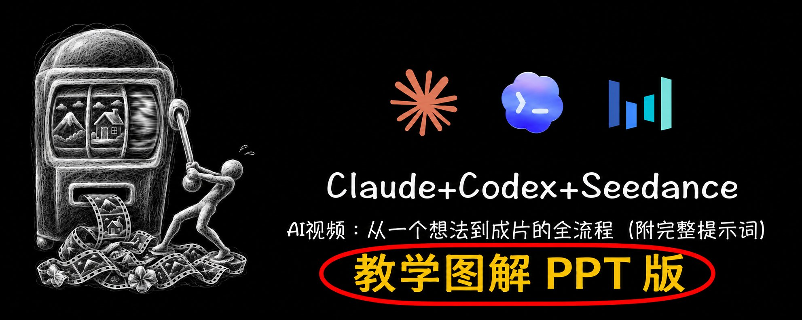

昨晚读到 Eian（[@EianLu](https://x.com/EianLu)）的长文[《Claude code/Codex+Seedance AI视频：从一个想法到成片的全流程》](https://x.com/EianLu/article/2118317430665613741)，讲怎么让 Claude Code、Codex、Seedance 分工合作，用尽量少的钱、尽量低的抽卡率做出一支 AI 短片。内容非常扎实，但也非常长：故事、分镜、机位、首尾帧、提示词、后期，一环扣一环，读一遍很难全记住。

我想把它做成一份**看图就能懂**的 PPT。最后用 [APS](https://apsdeck.com/) 做出了 74 页的「教学图解版」，**从新建到发布上线一共 1 小时 18 分钟**，中间我只发了十几条消息。

这篇把整个过程拆开：我每一步实际发了什么、AI 实际怎么做的、哪里顺利、哪里卡住了。照着做，你也能把手里的长文、课程笔记做成一份图解演示稿。

**先看成品**：<https://threerocks.github.io/aps-ppts/mw4lo3le-840f5d/>（电脑上按 ← → 翻页，按 1–4 换主题，F 全屏，o 全览）

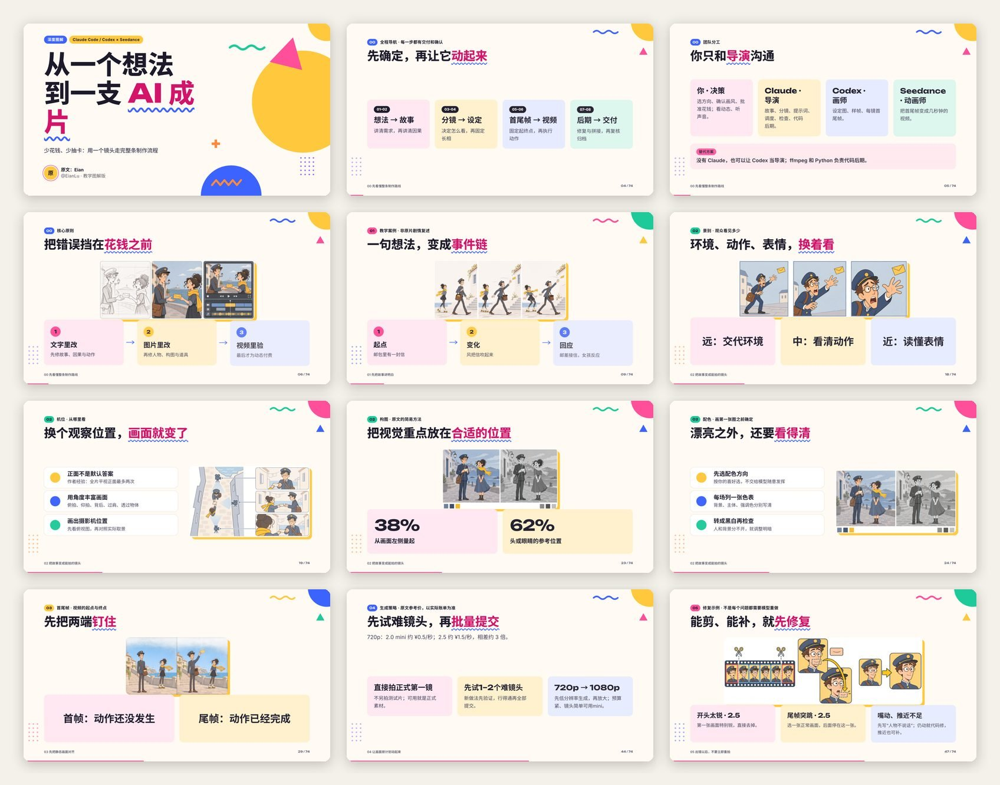

### 一分钟看完

- **成品**：74 页，其中 58 页主讲（分 7 章）、15 页提示词工具箱和参数速查、1 页结尾；**12 张重新画的教学插图**；4 套可以随时切换的配色；发布在 GitHub Pages，手机和电脑打开链接就能看。
- **用时**：14:35 新建 → 15:00 确认大纲 → **15:22 74 页全部出齐（约 23 分钟）** → 15:27–15:52 逐页微调 → 15:53 发布。
- **我只做了三步**：① 丢文章，要一份图解 PPT；② 觉得不够清楚，加一段参考视频让它重来；③ 选中某几页，逐页微调。
- **模型**：一个 ChatGPT 订阅，写文字、画插图都靠它，没有另外申请 API Key。
- **最管用的一句话**：「PPT 应该一定比文章更易懂和清晰才对」。这句话让 AI 从「把文章拆成目录」改成了「用一个例子带你走一遍」，整份 PPT 的质量就是从这里上来的。

### 准备：APS 的界面和要准备的东西

APS 的编辑器分三栏：

- **左边**是页面缩略图，右键可以把某几页「添加到对话」；
- **中间**是画布，双击文字可以直接改；
- **右边**是五个面板：**AI 对话**（主要在这里干活）、内容、素材、设计（模板和配色）、**版本**（AI 每次改之前都会自动存一版）。对话框下面还有「精简文字」「更口语」「拆成两页」「换个版式」这些一键指令，和一个**范围**选择：整份演示稿、当前页，或者你挑的几页。

开始之前准备三样东西：

1. **一个 APS 账号**：在 [apsdeck.com](https://apsdeck.com/) 注册，新账号免费试用 14 天，不用绑卡。
2. **一个模型连接**：在「设置 → 模型连接」里添加。可以直接登录 ChatGPT 或 GitHub Copilot 订阅，也可以填自己的 API Key（OpenAI 或 Anthropic 协议的接口都行）。这次我用的是 ChatGPT 订阅。**要让 AI 画插图，需要 ChatGPT 订阅或 OpenAI 官方 API 的连接**，别的连接也能做页面，只是画不了新图。
3. **素材**：原文的全文（下面会说为什么不能只给链接）；有参考视频或图片更好。

### 第一步：把文章交给 AI，先拿到大纲

**新建一份演示稿，在 AI 对话里发了第一句话：**

> 根据这篇文章，出一篇深度讲解 PPT，多用图少用文字 <https://x.com/EianLu/article/2118317430665613741>

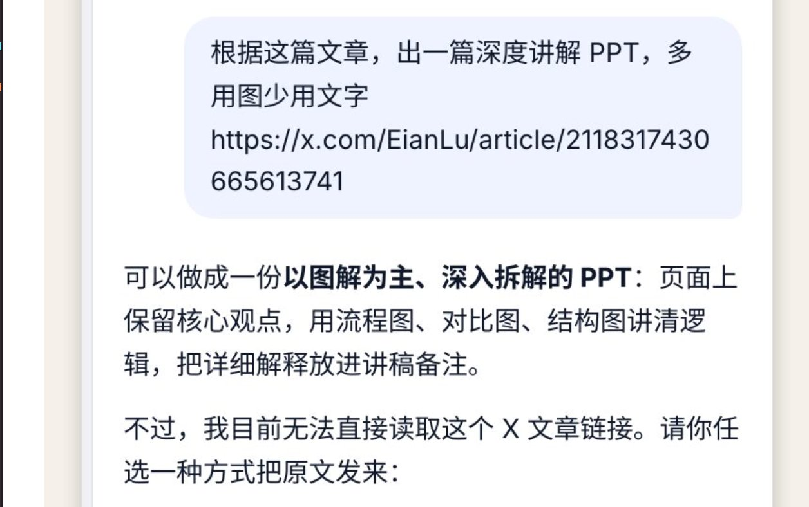

**AI 没有假装读过**：X 的文章要登录才能看，APS 打不开这类链接，它直接说读不到，让我任选一种方式把原文发过去：粘贴全文（可以分几条）、上传截图，或者上传 PDF。顺便问了一句：这份 PPT 是现场演讲用，还是给读者自己看？

我把全文粘贴了进去。AI 没有马上开始做页面，而是先讲它怎么理解这篇文章：

> 把视频制作变成一条有分工、有验收、有预算控制的生产线，把错误尽量挡在付费生成之前。

然后给了一版「章节 + 每页要点 + 图解方式」的大纲：48 页主讲加 8 页附录。

**这一步最重要的是：大纲确认之前，一页都不会生成。** 原文有句话我很喜欢：「文字里能发现的错，不留到图上；图上能发现的错，不留到视频上。」做 PPT 也一样：**大纲里能发现的问题，不要留到页面上**。改大纲只是改几行字，几十页做完再推翻就费时间了。

> 小提示：公众号、X、知乎这类要登录或有反爬的链接，都建议直接贴正文。文章特别长可以分几条发，AI 会等你发完。

### 第二步：觉得不够清楚？直说，再给它一段视频

读完第一版大纲，我的感受是：**它把文章拆成了目录，但我作为读者，看大纲还没有看原文清楚。** 这不对，PPT 本来就该比文章更好懂。

正好原文作者用这套方法做出了一支短片，我把视频也给了 AI。第二句话是这样发的：

> 我觉得我作为一个读者看的还没有文章清晰，这不符合认知，PPT 应该一定比文章跟易懂和清晰才对。 视频就是由这个文章产出的，你可以把素材应用于内容，但不要直接引用视频本身，可以采用插图等形式，你自己分析。 重新出一版本吧

**视频怎么传**

**直接把视频文件拖进对话框**（点附件按钮选、或者粘贴也行）。

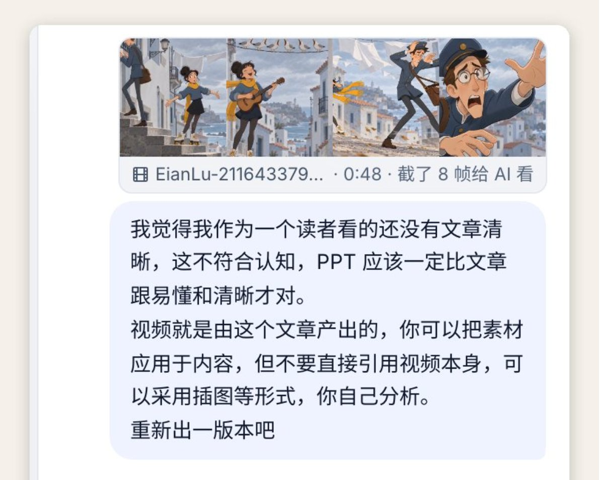

模型接口只收图片、不收视频，所以 APS 在你的浏览器里按时长均匀截几帧，当成图片发给模型：大约每 3 秒一帧，最多 8 帧。这段视频 48 秒、1080p，截了 8 帧，大约每 6 秒一帧。几点要知道：

- **视频文件本身不上传**，只上传截出来的帧，存进这份演示稿的素材库，AI 之后也能拿来当参考图；
- **AI 听不到声音**，帧和帧之间的动作也看不到，所以它只能分析画面里的角色、场景、构图和配色；
- MP4（H.264）和 WebM 在主流浏览器里都能打开；浏览器打不开的格式，附件上会直接提示转一下格式。

**AI 换了一种讲法**

这次 AI 先承认上一版的问题：「**把文章拆成了目录，却没有把方法解释得更清楚。** 页数多、术语多，但读者仍然不知道我现在该做什么、为什么、做到什么程度才能往下走。」然后提出新的做法：

> 用一个贯穿始终的例子，带读者亲手走完一次制作流程。先看懂怎么做，再理解为什么这样做。

具体来说：

- **一个贯穿全篇的练习镜头**：「海风吹起邮包里的信，邮差伸手去接，女孩在后方作出反应。」这是它从 8 帧画面里的角色和道具（黄围巾女孩、蓝制服邮差、信封、海边石阶）构造出来的教学例子，并且明确说了**不当作原片剧情**，因为截帧看不到完整的故事和动作。
- **每一步都回答同样四个问题**：拿什么开始 → 做什么 → 得到什么 → 谁确认后才能继续。
- **主线换成一条制作路径**：想法 → 故事 → 分镜 → 画风与设定 → 首尾帧 → 视频生成 → 后期 → 交付。
- **不直接用视频截图**：把画面转译成教学插图、俯视机位图、分镜草图、首尾帧示意和错误对照图。

我回了一句「**可以，按这个做**」。

23 分钟，74 页出齐

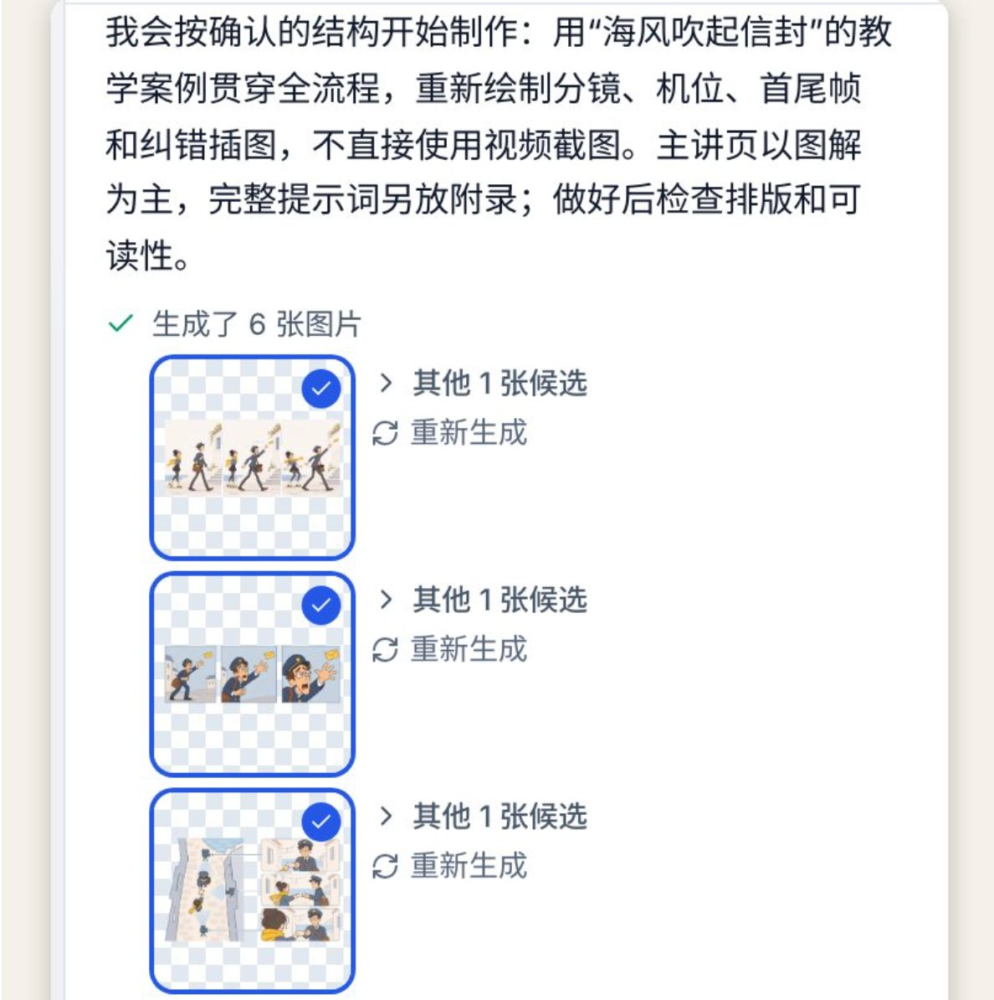

AI 先画插图，再一页页写。每张插图都会出两个候选，AI 先用第一张，另一张留着；你不满意可以点开换，或者点「重新生成」。页面写完，它还会自己截图检查排版，把文字溢出的地方修掉。

**最后的结构是：**

**插图是怎么做到「人物不走样」的**

我最满意的是插图。12 张图里，邮差和女孩从头到尾是同一个长相，靠的是这个顺序：

1. 先拿视频截帧当**角色参考**，画了一张**设定图**：邮差和女孩的正面、侧面、表情特写，加上帽子、邮包、围巾、信封；
2. 之后画首尾帧、纠错对照、后期示意，都拿这张设定图当参考。

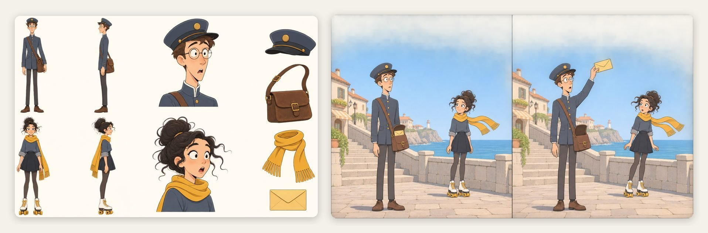

有意思的是，这正是原文教的方法：**先用设定图把长相固定下来，再画正式镜头**。AI 在做这份 PPT 的时候，自己也照着用上了。

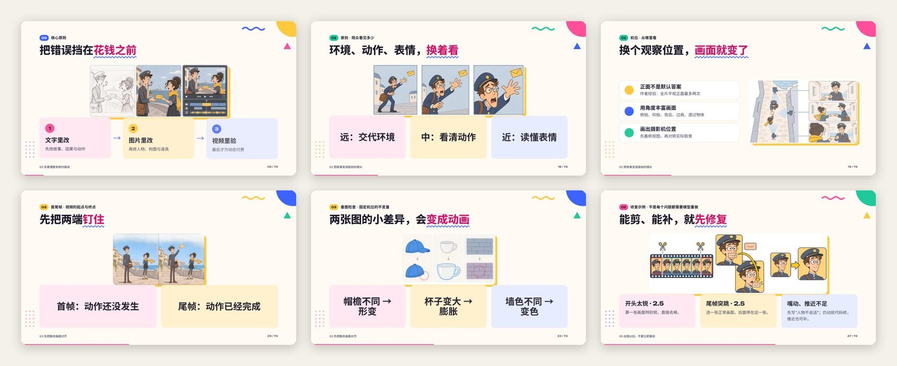

另外，按我的要求，PPT 里**没有直接贴视频截图**，所有画面都是重新画的教学图；每页的讲稿备注里写明了哪些是原文的观点、哪些只是教学示意，封面和结尾也注明了原文作者。

### 第三步：选中页面，逐页微调

整份出齐之后，剩下的就是逐页挑毛病。微调最重要的一点是**先圈定范围**：

- 在左边缩略图上**右键 →「添加到对话」**，可以选一页或几页；
- 或者把范围切到「当前页」；
- 在画布上选中某个元素再点「问 AI」，就只改这个元素。

AI 只改范围内的内容，别的页不会被顺手动掉。

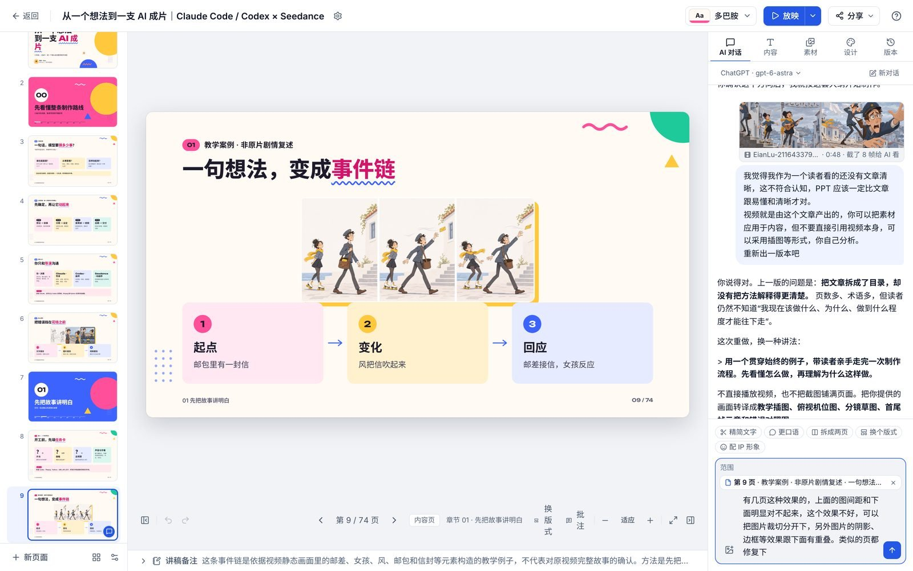

**例 1：第 73 页，一句话改成中文**

第 73 页是参数速查，生图提示词开头那句是英文。选中这一页，发：

> 这一页除了模型名称外都改成简体中文

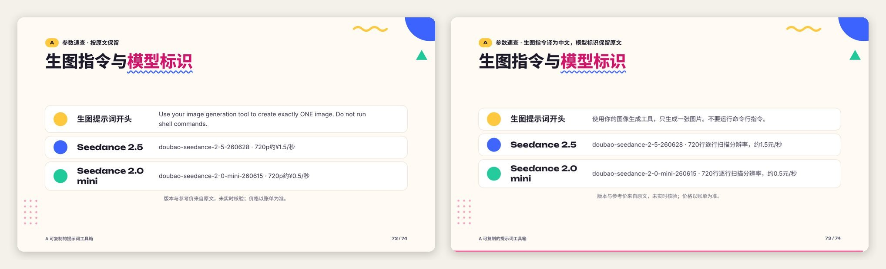

一次就改好了，模型名称和完整的模型标识都保留了原文。只有一个小地方：它把「720p」也翻成了「720行逐行扫描分辨率」。这种行话保留原样更好懂，提要求时可以多补一句：「**720p 这类通用写法保留**」。

**例 2：第 4 页，序号溢出换成胶囊**

第 4 页的「01–02」这种长序号挤出了圆形编号。选中这一页：

> 这个序号文字有些溢出，可以换成胶囊形状吗

一轮就改好：序号挪进了独立的胶囊标签，文字完整显示，四个阶段的内容一个字没变。

**例 3：第 9 页，图文对不齐：说清楚，也要接受做不到**

第 9 页上面是一张三格插图，下面是三张说明卡片。三格图和三张卡片的位置对不上，图片的黄色阴影还压到了卡片上。我发的是：

> 有几页这种效果的，上面的图间距和下面明显对不起来，这个效果不好，可以把图片裁切分开下，另外图片的阴影、边框等效果跟下面有重叠。类似的页都修复下

**这一页来回改了好几轮，值得说说过程：**

1. AI 先把三格图裁成三张，拆成了三页，每页一张大图。图文是对齐了，但多出两页，我回了一句「就在一页吧，要不然会导致页数过多」；
2. 它合回一页，下面三张卡片改成一行文字。我想要的是每段说明对准上面的那一格图，又提了一次；
3. 它把说明文字直接画进了图片里，对齐是对齐了，但文字没法再改。我指出这是在取巧；
4. 它把三张裁图分别放进三张卡片，结果图被缩成了小图标，看不清；
5. 我画了一张示意图发给它：上面一个图片框，下面一个文字框；
6. 最后 AI 直说了：**当前模板里没有「三列、每列上图下文」的版式**，靠现有版式做不到，不应该再用加页数、缩图片、把文字画进图里来凑。

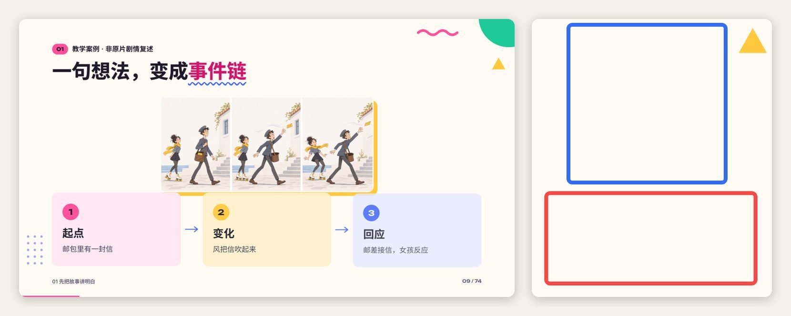

这一页我先恢复成了原来的样子。这一轮让我总结出几条微调经验：

- **把「不要什么」一起说出来**。「一页放下、图不能缩、文字要能改」这三个条件，第一句就说清楚，能省掉好几轮来回。
- **说不清就画给它看**。随手画两个框，比写一段话准确得多；图片可以直接粘贴进对话框。
- **改坏了就回到旧版本**。「版本」面板里，AI 每次改之前都会自动存一版，点开就能预览，「恢复这个版本」一键回去；只想撤掉某一轮，也可以在对话里点「撤销这一轮」。
- **AI 说做不到，就停下来**。好的反应是直说哪里做不到，而不是一轮轮硬试，把页面越改越乱。

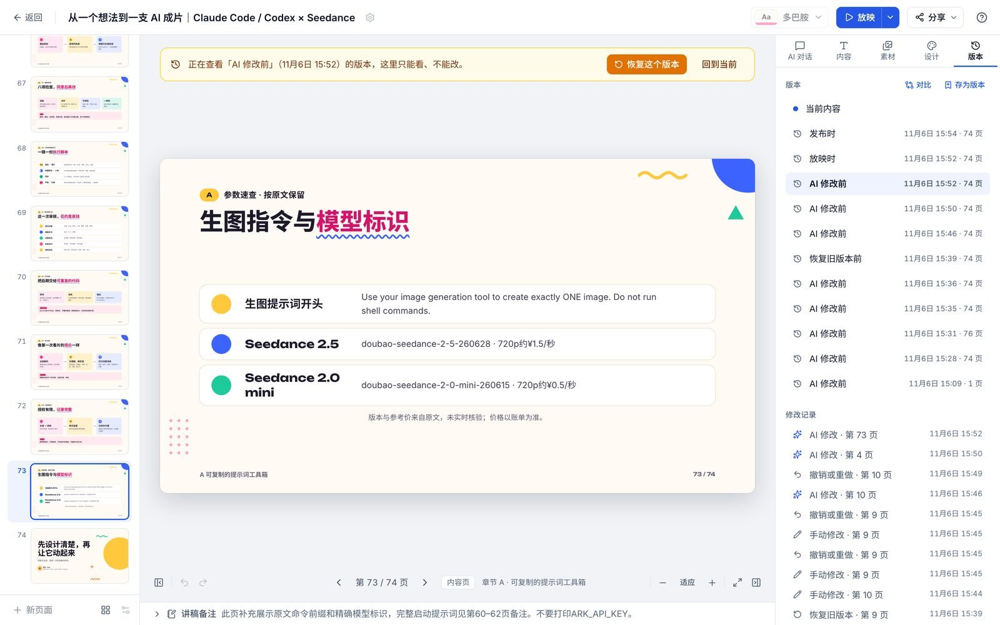

### 第四步：放映、发布，把链接发出去

**放映**：点右上角「放映」。演讲时可以开演讲者视图看讲稿备注；放映时按 ← → 翻页、1–4 换配色、F 全屏、D 用画笔圈画。

**发布到 GitHub Pages**：点「分享 → 发布到 GitHub Pages」。

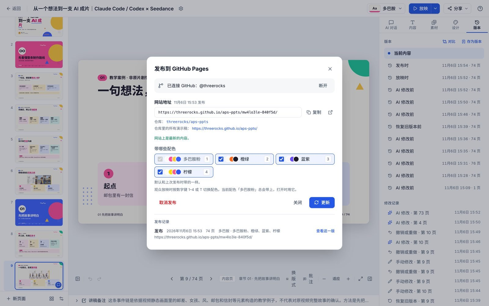

1. 第一次用先连接 GitHub：打开网址、输入设备代码授权；
2. 选一个仓库，或者新建一个公开仓库；一个仓库可以放好几份演示稿，每份有自己的地址；
3. 选要带哪些配色，观众放映时可以按数字键切换；
4. 勾选「我知道发布后所有人都能看到这份演示稿」，点「发布」。

等 GitHub 生成好网站（第一次可能要几分钟），就得到一个手机电脑都能打开的网址。之后再改了内容，回到这里点「更新」就行。注意：GitHub Pages 上的内容所有人都能访问，**讲稿备注和隐藏页不会发布**。

不想公开的话，还有别的方式：生成**分享链接**（可以设密码和有效期），或者导出 **PDF**、**图片**、**离线放映包**和**可以继续编辑的 PPTX**。

### 复盘：可以直接抄的三句话

**几条心得：**

1. **先改大纲，再出页面**。大纲阶段推翻重来只花一两分钟。
2. **拿「比原文更清楚」当验收标准**。这句话比「再精美一点」「多加点图」管用得多。
3. **给参考素材，但说清楚怎么用**。「不要直接引用，可以转成插图」这句话，让 AI 把参考画面变成了教学图，而不是把截图铺满页面。
4. **让 AI 先画设定图**。要画同一个角色的多张图时，先固定长相，后面才不会走样。
5. **微调时一次只说一页，把不要什么也说出来**。改坏了不要紧，版本都在。

### 常见问题

**APS 能直接读 X（推特）、公众号的文章链接吗？**

不能。这类页面要登录或者有反爬，APS 打不开。把正文直接粘贴进对话框最稳，太长可以分几条发；也可以上传截图或 PDF。

**视频能直接传给 AI 吗？**

能。把视频拖进 AI 对话框，APS 在浏览器里按时长均匀截帧（大约每 3 秒一帧，最多 8 帧），当成图片发给模型。视频文件本身不上传；AI 听不到声音，也看不到帧与帧之间的动作。MP4（H.264）和 WebM 最稳。

**插图是谁画的？每页的人物会不会长得不一样？**

插图由你连接的模型来画，需要 ChatGPT 订阅或 OpenAI 官方 API 的连接，这次用的是 ChatGPT 订阅。要让人物前后一致，可以让 AI 先画一张角色设定图，之后的插图都拿它当参考。这份 PPT 里 12 张插图的人物就是这样保持一致的。

**做一份 74 页的 PPT 要多久？**

这次从确认大纲到 74 页出齐，大约 23 分钟，其中包括画 12 张插图。整个过程算上读大纲、提意见、逐页微调和发布，一共 1 小时 18 分钟。

**能导出成 PowerPoint 吗？**

能。可以导出可以继续编辑的 PPTX，也能导出 PDF、图片和离线放映包。

**发布到 GitHub Pages 要花钱吗？**

GitHub 的公开仓库开 GitHub Pages 是免费的。发布后所有人都能看到，讲稿备注和隐藏页不会发布。不想公开就用带密码的分享链接，或者导出文件。

**AI 改坏了怎么办？**

AI 每次修改之前都会自动存一个版本。在「版本」面板里点开预览，一键恢复；也可以在对话里撤销某一轮修改。

### 写在最后

再放一次成品链接：[**从一个想法到一支 AI 成片｜教学图解版**](https://threerocks.github.io/aps-ppts/mw4lo3le-840f5d/)。内容全部来自 Eian（[@EianLu](https://x.com/EianLu)）的原文，想做 AI 视频的朋友，强烈建议把[原文](https://x.com/EianLu/article/2118317430665613741)也读一遍，提示词写得非常细。

这份 PPT 就是用我自己做的产品 [**APS Deck**](https://apsdeck.com/) 做的。它是一个给讲师、技术分享者和内容创作者用的 AI 演示稿编辑器：

1. **先问清楚、再出大纲**：把讲稿、课程笔记或文章丢进去，AI 先问你听众和目的，给出大纲，你确认了才开始做页面。
2. **一页页生成 HTML 演示稿**：多套模板和配色，能画插图，生成后会自己检查排版。
3. **对话式逐页修改**：选中一页或一个元素，说一句话就改；也可以自己动手改文字；每次 AI 修改前都会自动存版本，随时回退。
4. **AI 能看图，也能看视频**：图片、视频直接拖进对话框，当作参考素材。
5. **放映、分享、导出一条龙**：网页放映（带演讲者视图和画笔）、带密码和有效期的分享链接、发布到 GitHub Pages，导出 PDF、图片、离线包和可编辑的 PPTX。
6. **模型用你自己的**：填自己的 API Key（OpenAI 或 Anthropic 协议的接口都行），或者直接登录 ChatGPT、GitHub Copilot 订阅，不赚模型差价。

**读者福利：**

- **新注册免费试用 14 天，不用绑卡。**
- **上线优惠：年付订阅首年 5 折，只要 $20**（原价 $40/年）。在设置页订阅年付时，收银台输入优惠码 **3GXZS7NE**，**2026 年 11 月 30 日前有效，限前 500 份**。（订阅支持银行卡、Apple Pay 和 Google Pay；想用微信支付，可以买不自动续费的一次性时长包。）

👉 **立即体验：**[**https://apsdeck.com**](https://apsdeck.com/)

你手里有一直想讲清楚、却懒得做 PPT 的长文吗？丢进去试试，做出来了欢迎在 X 上 @ 我（[@leo\_xiaolei](https://x.com/leo_xiaolei)）。
