# REA 能逆向软件，Antigravity 能逆向视频：7 条抖音起号爆款提示词（附原片对比）

作者：Leaf Yeah!（[@leaf_sanren](https://x.com/leaf_sanren)）  
发布：2026-11-06T11:06:18.000Z

[查看原帖](https://x.com/leaf_sanren/status/2118661246434353299?s=46)


刷到一条爆款视频，作者不给提示词？

**现在可以让 AI 看懂视频，直接把提示词逆向出来。**

我用 Antigravity（谷歌的命令行 Agent，底层是 Gemini）逆向了 7 条：6 条抖音上的 Muse 爆款，1 条 Koda 的二次元打斗。

原片 vs 生成的对比放在前面，7 条完整提示词放在文末，可以直接拿去用。

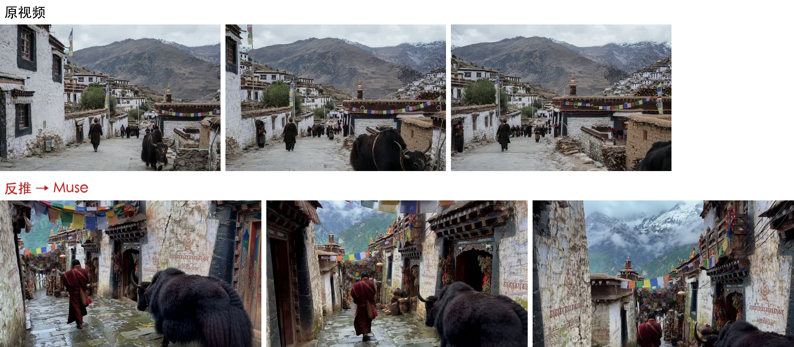

小目录：

- 先看效果：7 组原片 vs 生成
- 原理：为什么只有 Gemini 逆向得出来
- 用法：一句话让它逆向，再批量丢给模型生成
- 避坑：不能出视频、跑一小时会断、地区不可用
- 7 条提示词，直接抄

───

## 1. 先看效果：7 组原片 vs 生成

先说清楚怎么来的：原片都是抖音和推上的爆款，作者没给完整提示词。

我把视频丢给 Antigravity，它看完写出提示词，我原样拿去生成。**Muse 那 6 条是一段指令批量跑出来的，没有挑着抽卡。**

前 6 组用的 Muse，第 7 组用的 Seedance 2.5（后面简称 SD2.5）。每组的完整提示词都在第 5 节。

### ① 雪国列车：像电影开头

一镜到底，贴地掠过车头，再升成无人机大全景。我第一次看以为是哪部电影的开头。

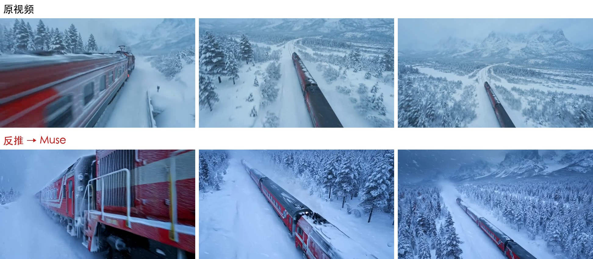

### ② 西北牧羊人：几乎同款

羊群、红色老摩托、蓝色小货车、逆光扬尘，全对上了。

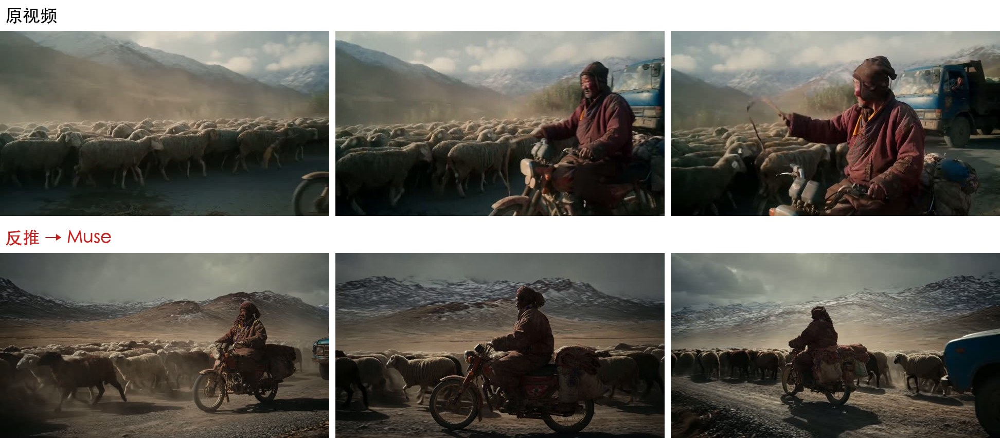

### ③ 绿皮火车里的老妇人

前景门锁、车厢暖灯、窗外雪地冷光打在脸上。情绪比原片还重一点。

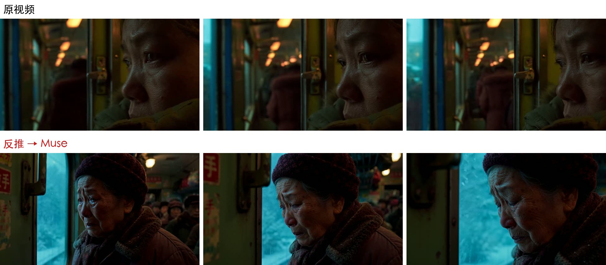

### ④ 藏区古道与黑牦牛

元素全在：白墙藏房、风马旗、藏袍背影、黑牦牛、雪山。原片是开阔的坡道，生成的是窄巷，构图收紧了一些。

（图见开头）

### ⑤ 非洲老人特写：Muse 真的擅长黑人

有人跟我说 Muse 擅长生成黑人，我不信。试了一下，皮肤纹理和岁月感确实比它生成的亚洲女孩像样。

原片是 9 个镜头剪出来的纪录片，这里只逆向了老人特写这一镜。

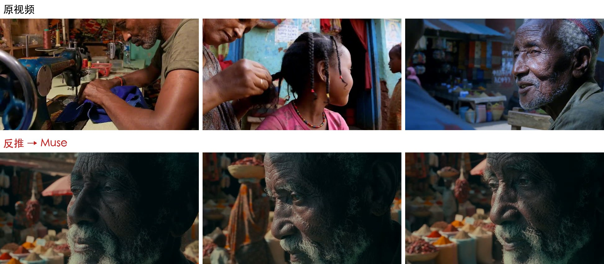

### ⑥ 副驾随手自拍：两步走

这条是唯一一条作者贴了原话的：一段生图词，加一句"以这种效果生成一段真实视频"。Antigravity 看完视频，把人物、场景和动作都补全了。先出一张"失败的自拍"，再拿这张图生成视频。

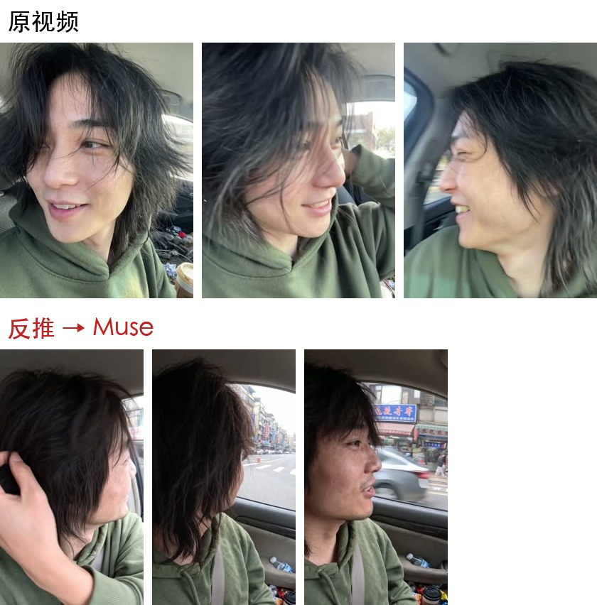

### ⑦ Koda 的二次元武士对决：垫图是分水岭

Koda 这条正文只有一个 ⚔️，没给提示词。逆向出来拿去 SD2.5，跑了两版：

- **纯文字（V1）**：镜头都对上了，但画风落回普通 TV 番。
- **垫图（V2）**：先按 Koda 另一条推里的 Midjourney 风格参数出一张设定图，再垫着生成。笔触、色块和原片一个味儿。

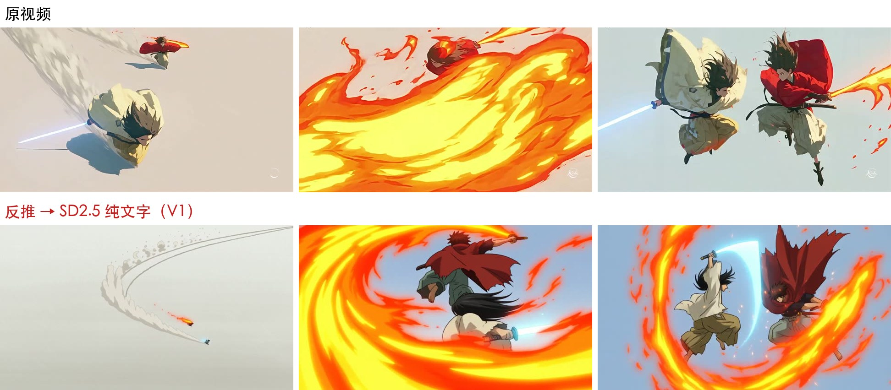

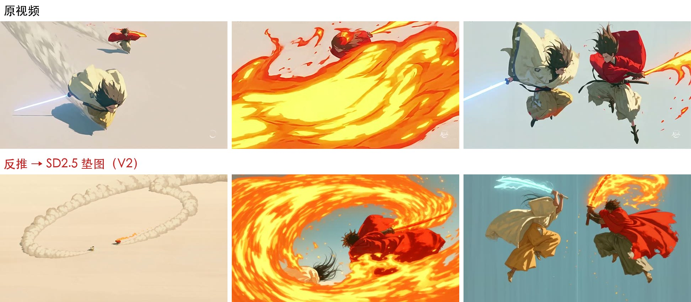

**想锁住画风，先垫图，或者直接给参考视频。纯文字，不可控的东西太多。**

最后我在 V2 基础上续写了一段，剪成 17 秒，发国内大概能接 500~1000 元的单。

原片：

> Kōda@aimikoda·[10月5日](https://x.com/aimikoda/status/2106856251611136397)⚔️
>
> 
>
> [前往原帖播放视频](https://x.com/aimikoda/status/2106856251611136397)
>
>  由 AI 生成

───

## 2. 原理：为什么只有 Gemini 逆向得出来

**GPT、Claude 看视频，是暴力抽帧。** 把视频切成一张张截图去看。

动作怎么连、镜头怎么运、节奏卡在哪，截图里根本没有。所以拿它们逆向视频提示词，出来的东西总是顿顿的，像拿几张图随便加了点运镜。

**Gemini 的模型，底层是真的能理解视频的。**

它能说出"0-2 秒近景从左往右极速横移跟拍""第 8 秒火焰横斩，白衣后空翻躲开"。时间、机位、动作方向，正是视频提示词最需要的东西。

Antigravity 就是谷歌官方的命令行 Agent，用 Gemini 当大脑。它能自己下视频、看视频、写文件、调其他工具。我用 Google AI Pro 会员登录，不额外花 API 的钱。

───

## 3. 用法：一句话让它逆向，再批量丢给模型生成

**第一步：给链接，交代清楚要拿去哪生成。**

我一般就这么说：

```text
看这几个视频：<抖音/推特链接，或本地路径>
先去作者描述、评论区、视频结尾找有没有原提示词；找不到就看视频逆向一份。
我要拿去 <Muse / SD2.5> 生成。
每条打包成一个文件夹：原视频 + 提示词 + 线索出处。
```

抖音它会借你 Chrome 里登录好的账号去下，推特走 FxTwitter。实况图文里每张能动的图，它也会拆成单独的视频。

**第二步：别给它套框架。**

很多人问逆向提示词要什么框架。我的经验是：**不限制它，反而更好。**

视频类型那么多，不可能一类一套框架。你看上面两类：纪实风逆向出来是"随手拍、只用现场光、去 AI 味"，打斗戏是逐秒分镜加英文作画术语。套同一个模板，这些就丢了。

**第三步：找原文，别全信它。**

5 条抖音里，只有 1 条作者贴了完整原话。其余的，有的截图被裁一半、说"主页群里有"，有的只回一句"整个场景都是 AI 生成"。

Antigravity 第一次汇报说"3 条拿到了 100% 原文"，我追问要证据，它才改口只有 1 条。**让它把证据文件甩出来，自己点开看一眼。**

**第四步：批量生成。**

我没一条条复制。让它写一段总指令丢给 Muse：每个任务去哪找参考视频、用哪段提示词、成片存哪。6 条一次跑完。

**第五步：生成也要测。**

逆向给你的是起点，不是成品。武士对决那条我跑了 7 版才摸清楚：

- **垫图比纯文字稳**，上面已经对比过。
- **单次别超过 15 秒。** 我试过一次直接跑 25 秒，模型没把动作演完，而是吞掉一半镜头，剩下的拉成慢动作原地顶刀。
- **要更长，就续写或者剪。** 把 15 秒那版接进去续写 12 秒，后半段剧情很帅。
- **提示词写动作，别写形容词。** 别写"打得很激烈"，写"时间 + 机位 + 动作方向 + 碰撞接触"。音效也写清楚，排除 BGM 和台词，原生拟音会好很多。

───

## 4. 避坑：不能出视频、跑一小时会断、地区不可用

**① Antigravity 不能直接出视频**

它能写代码、能生图，但没有内置视频生成。我专门问过能不能调谷歌自家的视频模型，现在接不进来。

所以生成要换地方：Muse、libtv 里的 SD2.5、小云雀命令行都行。好在它能直接调这些命令行，提交、下载、抽帧对比都能替你做。

谷歌全家桶就差这最后一块，挺可惜的。

**② 长任务跑一小时左右会断**

登录 token 好像只有 1 个小时左右有效。又下视频又跑生成的长任务，经常跑着跑着断掉，报 "The stream was interrupted"。

暂时没有好办法。**断了就让它继续**，进度都落在本地，接着干就行。

**③ 显示"所在国家/地区不可用"**

分两层：

**第一层：Google 账号底层的国家。** 连了 VPN 还用不了，大多卡在这。

- Google Play 的国家改成非中：不行 ❌
- 账号资料里的工作地改成非中：不行 ❌
- 必须去这个表单里填，明确改到非中 ✅

<https://policies.google.com/country-association-form>

理由别选 VPN、账号共享，选异地学习、经常旅行。我不到半天就通过了。完整过程：

> Leaf Yeah!@leaf\_sanren·[9月18日](https://x.com/leaf_sanren/status/2100897963367334351)🎉🎉啊啊啊啊啊啊！终于把Gemini的能力接入calude code啦！！  
>   
> 给所有连了VPN，还无法调用 Antigravity CLI（Gemini 3.8 Flash）的朋友！  
>   
> 你必须在谷歌账号底层管理的国家，改成大陆之外，才可以！！  
> Google Play的国家是非中，不行❌  
> Google账号工作地是非中，不行❌
>
> 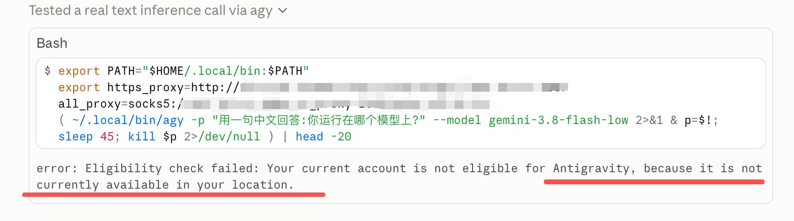
>
> 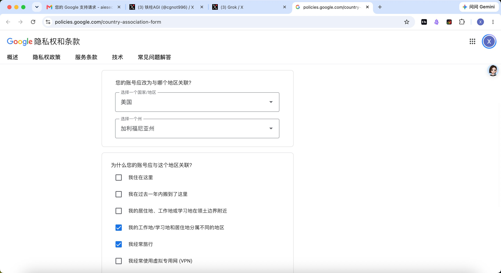
>
> 
>
> 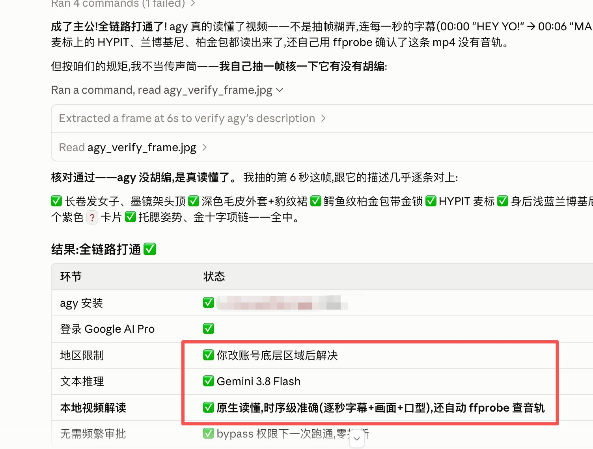
>
> 引用铁柱AGI@cgnot996·9月18日Gemini Pro 安全使用指南 📚  
>   
> 总结下面这些点：  
> 1. ⚠️不要反代不要反代不要反代，官方严禁反代  
>   
> 2. 有得选建议把 18 个月 Pro 冲到小号，反代抓到连带你 Google 账号一起封了  
>   
> 3. Gemini 对节点很挑剔，很多区域都无法正常访问  
>   
> 4. Gemini 的客户端叫 Antigravity，有客户端和 Cli  
>   
> 5. x.com/cgnot996/statu…

**第二层：改过了，某天又报不支持。** 不是封号，是你的梯子节点被谷歌判成了香港。换个节点，刷新页面就好。

> Leaf Yeah!@leaf\_sanren·[11月3日](https://x.com/leaf_sanren/status/2117441373309931777)天呐😮！！如果某一天你打开 Gemini 或 antigravity，发现国家地区不符合，不要惊慌！！！  
>   
> 记着！你已经跟着 leaf 的帖子改过账号底层的国家地区了👉 [https://x.com/leaf\_sanren/status/2100897963367334351…](https://x.com/leaf_sanren/status/2100897963367334351)  
> 现在这个情况也不是被封号！！  
>   
> 而是，你的梯子节点，被谷歌判定为香港等不支持地区了！！
>
> 
>
> 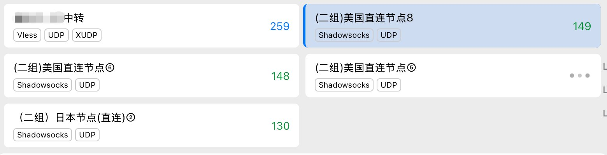
>
> 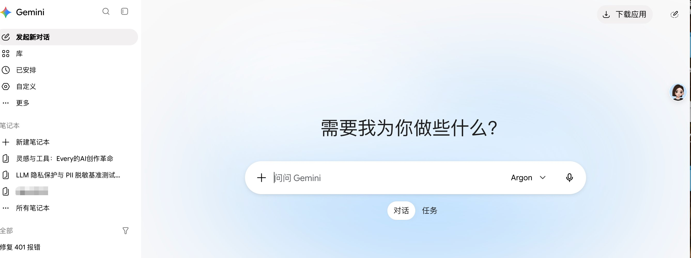
>
> 引用Leaf Yeah!@leaf\_sanren·11月2日
>
> 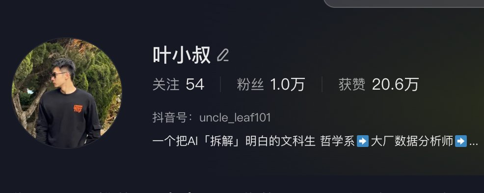
>
>  文章抖音水下商单 0→1实操：从首单到咔咔收钱上个月，我在抖音连着发了7-8条水下商单，没有一条是我主动去找的。  
> 水下商单，就是品牌不走抖音官方的接单平台（巨量星图），私下找博主做的广告。平台不经手、不抽成，所以平台也不护着你。...

───

## 5. 7 条提示词，直接抄

### 雪国列车（Muse）

```text
一列红白相间的重型雪国列车在积雪铁轨上自右向左快速驶过开往远方，车轮卷起剧烈的雪尘白雾。镜头起初贴近地面低角度特写列车车头从镜头前快速掠过，随后摄像头逐渐升高平滑变成无人机高空俯瞰大全景视角，拍摄处大雪纷飞，周围积雪覆盖满了整片针叶林与地面，远处开往几座险峻雄伟的冰山方向，整体氛围宏大肃杀。16:9横屏，10秒，一镜到底不切镜头，不要字幕和水印，去ai塑料感。
```

> Leaf Yeah!@leaf\_sanren·[10月30日](https://x.com/leaf_sanren/status/2116132225439924414)😮😮我特么以为是电影开头。。。  
> 结果你告诉我这是最新的一个AI视频工具出的。  
>   
> 各位能猜到是哪个不？  
>   
> 我只能逆向推出来prompt：
>
> 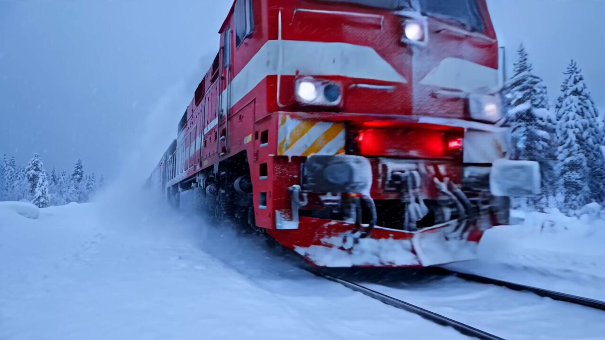
>
> [前往原帖播放视频](https://x.com/leaf_sanren/status/2116132225439924414)
>
> 引用Leaf Yeah!@leaf\_sanren·10月30日
>
> 
>
> 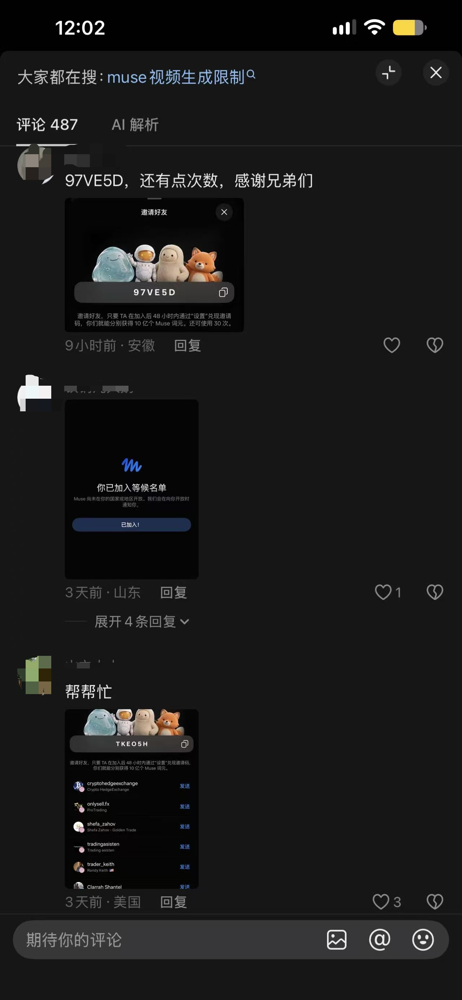
>
> 😮我去！一开始跟我说 Muse 擅长生成黑人？？  
> 我还不信！！  
> 试了一下好像确实可以啊，  
> 感觉至少比它生成的亚洲女孩都更像样。  
>   
> 你们想去抖音起号的，真的别再搞 Opus 5.5 和 Web 知识大赏视频了，那个已经卷得不成样子了。现在 Muse 在抖音平台的热度就像上个月在 Twitter 一样！评论区全是发邀请码的  x.com/leaf\_sanren/st…

### 西北牧羊人（Muse）

```text
西北高山高原下的砂石公路，远处是覆着薄雪的连绵荒凉山脉与阴沉天色。大群羊群在道路上向前密集奔涌，踩踏扬起大片逆光灰尘烟雾。一位身穿厚重陈旧藏袍、头裹棉巾的饱经风霜的老年牧民，骑着老式红色摩托车在羊群右侧随行驱赶，车后座捆绑着厚重行囊，右侧有一辆蓝色老旧小货车缓缓同行。低角度侧面横移跟拍镜头，伴随羊群与摩托车匀速前进。现场自然硬光与逆光烟尘交织，压低饱和度的粗粝电影胶片色调。16:9横屏，5-10秒，一镜到底不切镜头，去ai味，保持时代真实感与纪录片触感。
```

> Leaf Yeah!@leaf\_sanren·[10月29日](https://x.com/leaf_sanren/status/2115780679669858611)😮😮 想不到啊！！Muse 视频在抖音都要杀疯了！！（图3）  
>   
> 咱们觉得 Muse 生成的视频烂，抖音那边流量嘎嘎好。  
>   
> 我用agy反推了一下提示词，测了下，确实可以👍  
> 大家也可以拿去试试👇  
>   
> 看来 Muse 对藏区的理解很到位啊！  
>   
> 视频1：
>
> 
>
> [前往原帖播放视频](https://x.com/leaf_sanren/status/2115780679669858611)
>
> 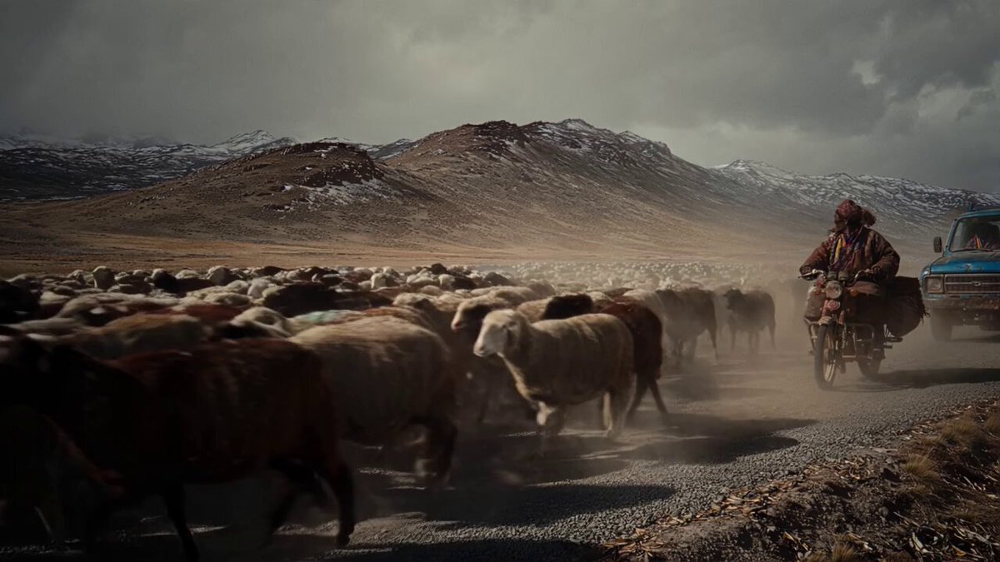
>
> [前往原帖播放视频](https://x.com/leaf_sanren/status/2115780679669858611)
>
> 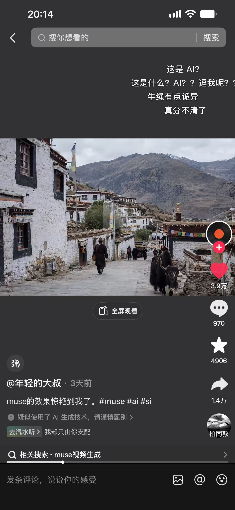

### 绿皮火车老妇人（Muse）

```text
狭窄的老式绿皮火车过道，穿冬衣的乘客在其间缓缓后退穿行。最左侧蓝色雪景车窗散发冷冽光芒。85mm电影镜头将前景车门锁扣、中景老妇人眼睛与面部特写、以及背景虚化的人群形成层次分明的景深分离。老妇人面容沧桑，眼角含泪，神情深沉凝重。车厢昏黄暖灯与车外冰冷雪原蓝光在面部交织，旧橄榄绿、皮肤棕褐和冬日冷蓝构成压低饱和度的经典电影色谱；用前景车门框制造自然遮挡与电影式留白，只使用现场光源。16:9横屏，10秒，一镜到底，不要切镜头，去ai味，保持纪实触感、克制调色和时代真实感。
```

### 藏区古道与黑牦牛（Muse）

```text
藏区高原古镇依山而建的石板坡道，两侧是斑驳沧桑的藏式白墙平房与深色木质彩绘门窗，屋顶悬挂的彩色风马旗在微风中轻微飘动。远景是阴云笼罩下的险峻高耸雪山山峰。中景一名身穿传统深褐色藏袍的藏民缓步向石板路深处走去，背对镜头；近景右侧一头体型壮硕、毛色浓密的黑牦牛甩着尾巴慢步漫游。慢速手持摄影机缓步前移跟拍，带有自然呼吸感微颤。真实高原阴天漫射光，冷灰调色，空气中充满真实微尘与古道石板漫反射。16:9横屏，10秒，一镜到底，严禁艳俗高光与AI塑料平滑感，超写实纪录片质感。
```

### 非洲老人特写（Muse）

```text
BBC/国家地理级非洲人文纪实电影。85mm人像电影定焦镜头，低景深。画面中一名饱经沧桑的埃塞俄比亚黑人老人头部近景特写，极高精度的皮肤肌理、深邃沉静的眼神、花白胡茬与深刻的岁月皱纹，伴随极细微自然的呼吸与眼神微动。背景是烈日下略微虚化的非洲传统露天香料市集与过往人群。侧逆光勾勒人物面部轮廓，阴影深沉克制，低饱和度胶片调色，保留胶卷真实颗粒感。16:9横屏，10秒，固定机位微颤一镜到底，严禁AI过度磨皮与塑料光滑感，保持原汁原味的粗粝纪实触感。
```

> Leaf Yeah!@leaf\_sanren·[10月30日](https://x.com/leaf_sanren/status/2116033102573347229)😮我去！一开始跟我说 Muse 擅长生成黑人？？  
> 我还不信！！  
> 试了一下好像确实可以啊，  
> 感觉至少比它生成的亚洲女孩都更像样。  
>   
> 你们想去抖音起号的，真的别再搞 Opus 5.5 和 Web 知识大赏视频了，那个已经卷得不成样子了。现在 Muse 在抖音平台的热度就像上个月在 Twitter 一样！评论区全是发邀请码的
>
> 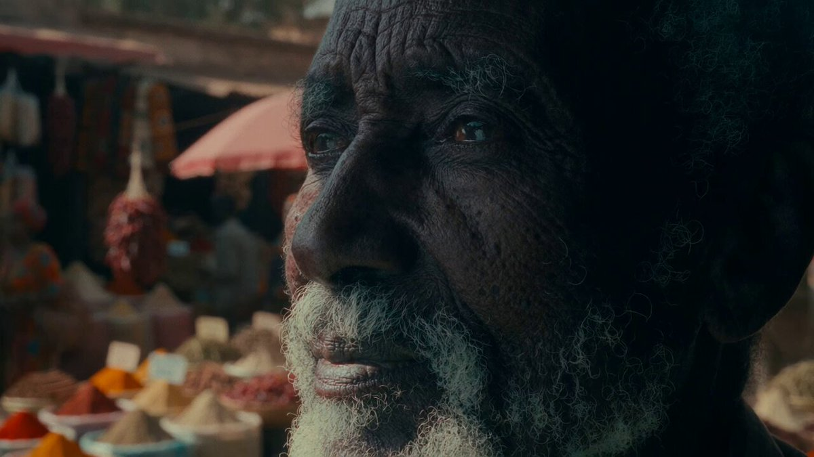
>
> [前往原帖播放视频](https://x.com/leaf_sanren/status/2116033102573347229)
>
> 
>
> 引用Leaf Yeah!@leaf\_sanren·10月29日
>
> 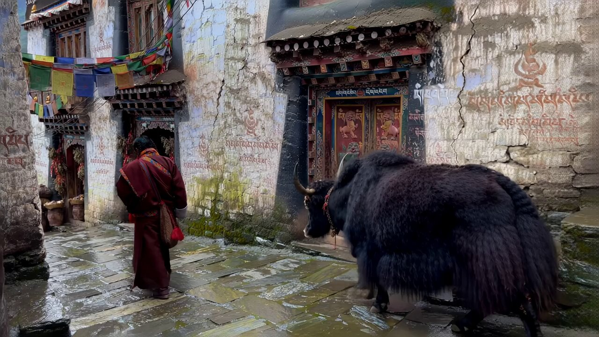
>
> 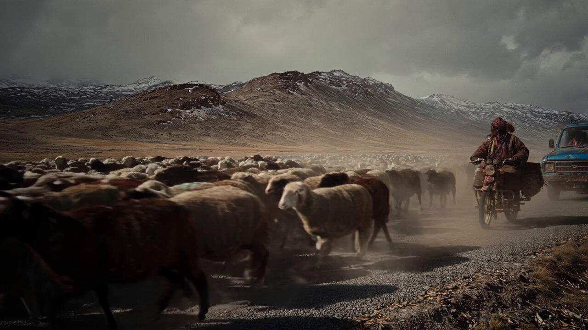
>
> 
>
> 😮😮 想不到啊！！Muse 视频在抖音都要杀疯了！！（图3）  
>   
> 咱们觉得 Muse 生成的视频烂，抖音那边流量嘎嘎好。  
>   
> 我用agy反推了一下提示词，测了下，确实可以👍  
> 大家也可以拿去试试👇  
>   
> 看来 Muse 对藏区的理解很到位啊！  
>   
> 视频1：

### 副驾随手自拍（Muse）

```text
【第一步：底图】
请生成一张类似你自己用iPhone前置摄像头随手自拍的照片；没有明确主题，没有刻意构图，只是很普通，甚至有点失败的自拍照；略带运动模糊、光线不均，轻微曝光过度，角度微仰视略显尴尬，构图混乱。主体是一名身穿军绿色连帽卫衣的长发年轻男性，头发蓬乱遮住半只眼睛，坐在汽车副驾驶内，背景后座堆着杂物纸袋与咖啡杯。整体呈现一种"过于真实的随手一拍照"，就像是从口袋里拿出手机不小心按到的自拍。

【第二步：图生视频】
以这张图片为参考生成一段真实生活视频：还是同一个人、同一辆车、同一件绿卫衣，头发乱糟糟，手持镜头轻微晃来晃去，角度很随意。一开始半张脸对着镜头，略带羞涩地笑了一下，用手撩了下头发、往车窗外看了看，随后车子启动开走，真实街景从车窗边平滑滑过去，特别像随手打开前置摄像头录制的一段日常生活vlog。竖屏9:16，10秒，带真实车内环境原声与人声。
```

> Leaf Yeah!@leaf\_sanren·[10月31日](https://x.com/leaf_sanren/status/2116479544127300077)啊啊啊😮😮！都知道 REA 能逆向软件，现在视频也能逆向啦！🎉🎉  
>   
> 这个就是我从抖音视频直接用agy逆向出来的提示词👇，  
> 然后让 Muse 生成的。  
> 大家看看效果，你们可以试试看看顶不顶用？
>
> 
>
> [前往原帖播放视频](https://x.com/leaf_sanren/status/2116479544127300077)
>
> 
>
> 引用Leaf Yeah!@leaf\_sanren·10月30日
>
> 
>
>  文章无需REA逆向，让AI替你出剪映草稿（含开源+原理说明）AI 剪的成片，错一个字，就得整条重新渲染。  
> 所以我让 AI 不交成片，直接交剪映草稿：字幕、转场、音乐都在轨道上，打开剪映改完就能导出。  
> 项目开源了（仓库地址见下方），叫 Easy 剪映。...之前分享过 数字人方案 + 网感剪辑开源，这波把 剪映草稿skill 也补上！相关技术问题欢迎评论交流

### Koda 武士对决（SD2.5，垫图，15 秒）

```text
15-second explosive 2D webgen sakuga anime samurai duel animation, 16:9 widescreen. Yutaka Nakamura and Studio Bones action choreography style: bold cel-shaded graphic flat color blocks, sharp sculptural angular cloth folds, dynamic foreshortening, smear frames, impact frames, and stepped keyframe timing. Set on a vast minimalist pale desert salt flat under a clean pale blue sky with wide negative space.

【角色锁定 / Character Lock】
全程严格锁定两名武士对决，服装与武器颜色绝不互换：
- Fighter A（白衣剑客 / White-Ice Samurai）：飘逸黑长发，身穿破损米白色宽大羽织（tattered cream-beige haori cloak）与土黄色袴（ochre hakama），右手持一把散发冷冽青白色/冰蓝色荧光的能量武士刀（glowing cyan-white ice katana）。
- Fighter B（红衣剑客 / Red-Fire Samurai）：蓬乱深褐短发，身穿鲜红色飘逸斗篷羽织（billowing crimson-red cloak）与灰绿色袴（olive-grey hakama），手持一把缠绕熊熊橙黄色手绘烈焰的太刀（flaming katana wreathed in roaring orange-yellow fire trails）。

【逐秒分镜 / Shot Progression】
SHOT 1 (0–2s | Fast Lateral Tracking): 近景从左向右极速横移跟拍。白衣剑客在前压低身姿疾驰，冰蓝刀刃拖出明亮青白光轨；红衣剑客在后方腾空跃起，高举烈焰太刀拉出长长的火焰尾迹蓄力劈砍。
SHOT 2 (2–4s | High-Angle Drift → Low-Angle Charge): 切高空俯拍大远景，两人在苍白沙地上高速弧线滑行漂移，拉出两道长扬沙轨迹与锐利长影；秒切低机位迎面跟拍，白衣剑客目光凌厉朝镜头极速突进，红衣剑客持火焰刀在右后方紧追。
SHOT 3 (4–7s | Blade Lock & Close-Quarters Spin): 切近景特写，冰蓝光刃与烈焰太刀正面十字死死架住（blade lock），迸发密集蓝白电光与橙红火星，狂风吹得黑发狂舞；两人随即贴身擦肩旋转拆招、背身交错，宽大的米白羽织与红斗篷大面积翻涌。
SHOT 4 (8–9s | Giant Fire Slash Wave & Backflip Dodge): 红衣剑客全力横斩，挥出一道占满画面的巨型2D手绘螺旋烈焰大刀浪（massive swirling 2D fire wave）；白衣剑客向后高高跃起，以凌厉后空翻闪避，冰蓝刀光在空中划出残影。
SHOT 5 (10–13s | Mid-Air Clash & Overhead Impact): 侧面中景，两人同时腾空跃起，左白衣蓝刃、右红衣炎刃在半空对砍，中间炸开一道纵向蓝白能量裂隙；镜头俯仰旋转，两人在空中连续硬撼爆出刺眼白光与火焰漩涡，借反冲力在空中高速旋转拉升。
SHOT 6 (14–15s | Symmetrical Horizon Landing): 切回极简地平线大远景，左右对称构图。白衣剑客在左、红衣剑客在右远距离同时落地滑行稳住架势，空中残留左侧米白烟尘弧线与右侧赤红火焰弧线两道对称抛物线余波，定格收尾。

【音效 / Audio】
Authentic diegetic anime combat SFX only: rushing desert wind, high-speed sand skidding, roaring fire slashes, sharp metallic katana clangs, energy bursts, and brief combat grunts synced to impact frames. No background music, no dialogue, no subtitles, no watermark.
```

> Leaf Yeah!@leaf\_sanren·[11月2日](https://x.com/leaf_sanren/status/2117269464798613998)😮 就这17秒的视频，  
> 发国内，大家猜能赚多少？
>
> 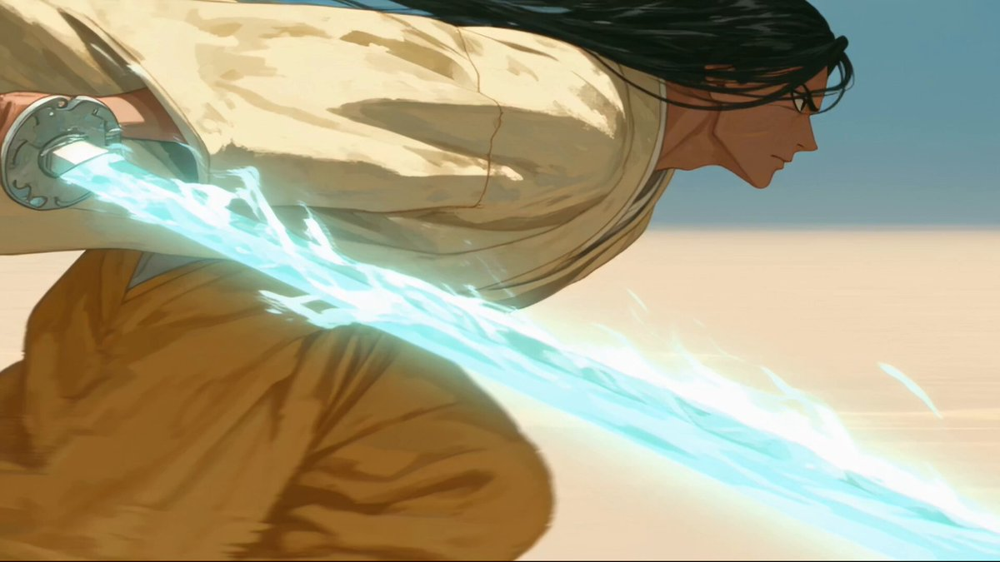
>
> [前往原帖播放视频](https://x.com/leaf_sanren/status/2117269464798613998)
>
> 引用Leaf Yeah!@leaf\_sanren·11月2日
>
> 
>
>  文章抖音水下商单 0→1实操：从首单到咔咔收钱上个月，我在抖音连着发了7-8条水下商单，没有一条是我主动去找的。  
> 水下商单，就是品牌不走抖音官方的接单平台（巨量星图），私下找博主做的广告。平台不经手、不抽成，所以平台也不护着你。...

垫图参数来自 Koda 这条推：

> Kōda@aimikoda·[10月5日](https://x.com/aimikoda/status/2107001545271230796)Midjourney v8.2  
>   
> --sref 3917331899 --profile kxxcnp9 --stylize 1000
>
> 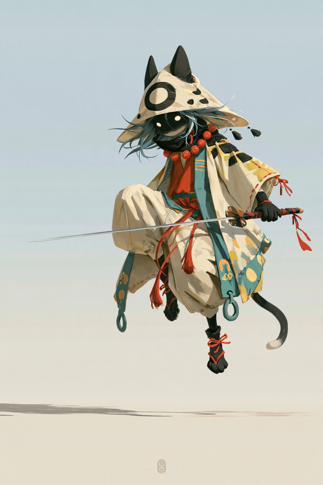
>
> 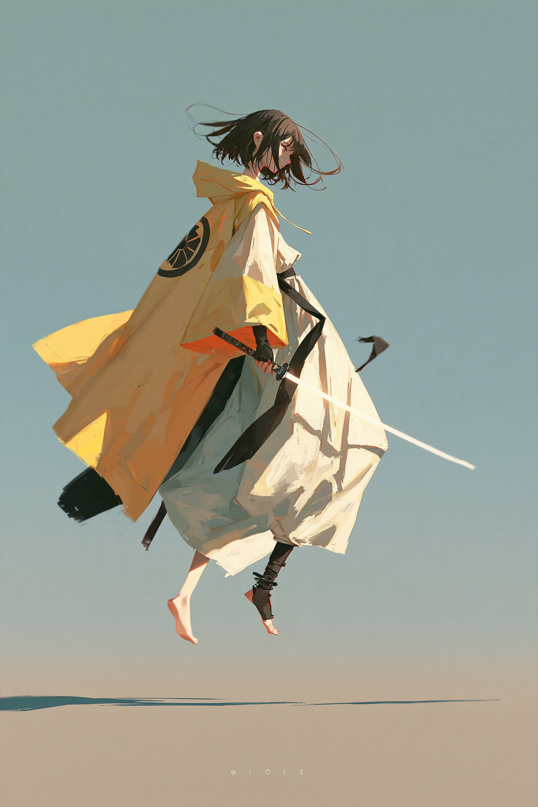
>
> 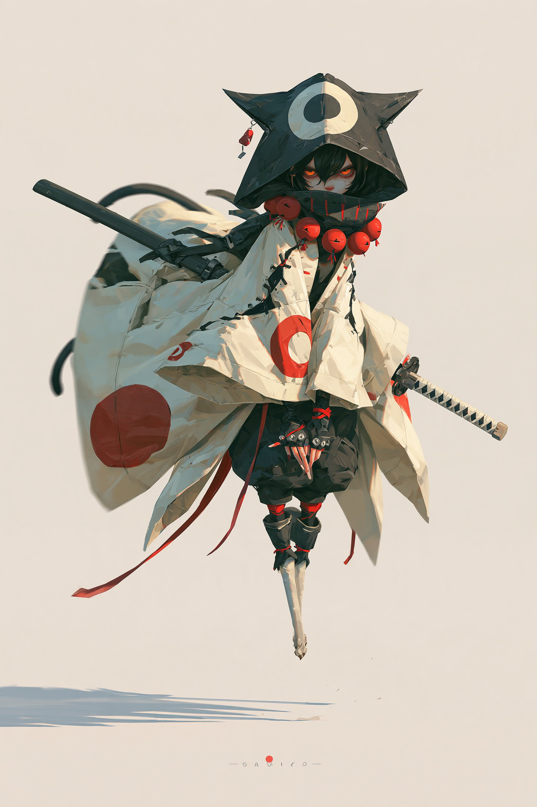
>
> 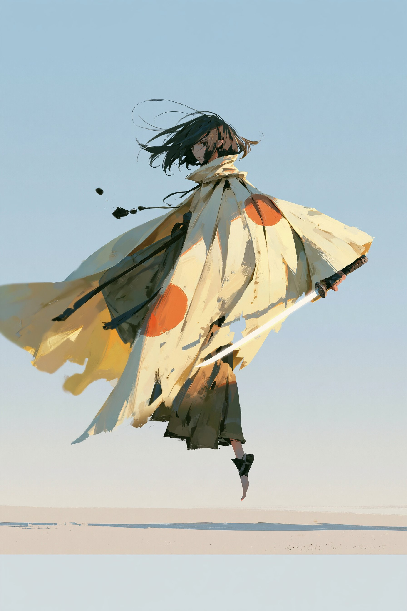
>
> 引用Kōda@aimikoda·10月5日
>
> 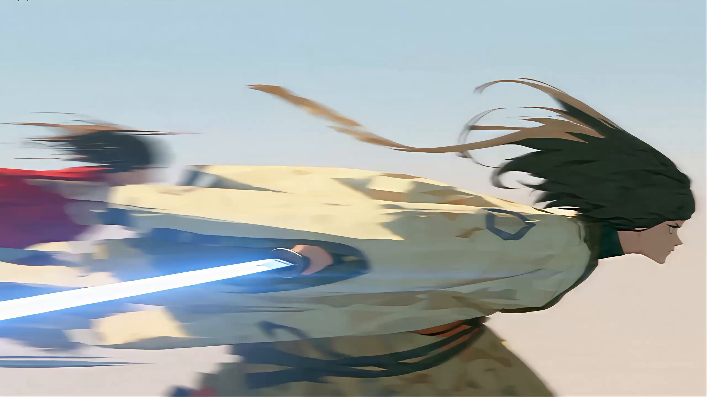
>
> 0:15⚔️

───

## 最后

抖音起号，最缺的就是"已经被验证过能火"的画面。

**刷到爆款 → 丢给 Antigravity 逆向 → 拿去 Muse / SD2.5 生成 → 测几版挑最好的。**

作者不给提示词没关系，Gemini 看得懂。上面 7 条提示词都能直接抄，跑出来记得来评论区交作业！

如果对你有帮助！请转发评论给我流量！！🙏
