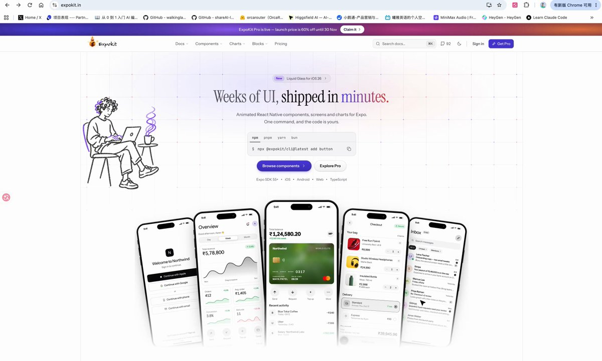

# 你的网页UI做得烂，不是你水平低，而是你没用好这些组件库！

作者：摸鱼巨匠🔨（[@chatgptastra](https://x.com/chatgptastra)）  
发布：2026-11-08T08:41:59.000Z

[查看原帖](https://x.com/chatgptastra/status/2119349702688641177?s=46)

你的网页UI做得烂，不是你水平低，而是你没用好这些组件库！  
  
1. Looseleaf  
纸张纹理 + 手绘钢笔线条 + 胶带贴纸风格，像画在笔记本上的完整界面。   
[https://kevintngo.github.io/looseleaf/](https://t.co/jmT6gR50oP)  
  
2. Rare UI  
专门做稀有的动画组件，每个组件一个文件，支持shadcn CLI/MCP安装  
[http://rareui.com](https://t.co/FSLcLVIsus)  
  
3. ExpoKit  
带液态玻璃、3D效果、图表等的移动端高端组件库  
[https://expokit.in](https://t.co/gw4oR8olFa)  
  
4. goopUI  
帮你做出会滴落、拉伸、融合的液体物理效果。  
[http://goop.timmcmasters.work/docs/components](https://t.co/PQbLsUyP0k)  
  
5. beUI  
动画丰富的组件库，覆盖Web和React Native。  
[https://beui.dev](https://t.co/MQeCLl2nEo)  
  
6. Sketchbook UI  
手绘笔记本风React组件库  
[https://sarthakrawat-1.github.io/sketchbook-ui/](https://t.co/SIHd9hIf0a)  
  
7. AffectUI  
专注AI产品的React组件库，Agent可观测性做得非常深  
[https://affectui.com](https://t.co/pHMq3xTSOm)

[前往原帖播放视频](https://x.com/chatgptastra/status/2119349702688641177?s=46)
