# Opus 5.5 Motion Lab: Make Claude Animate Like a Studio

作者：Florence（[@flxrnc](https://x.com/flxrnc)）  
发布：2026-09-30T15:00:31.000Z

[查看原帖](https://x.com/flxrnc/status/2105311836190978392?s=46)

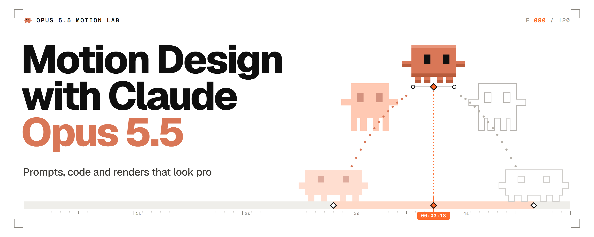

Every animation in this lab was made by Claude Opus 5.5, and each one comes with the exact prompt that made it plus every follow-up it needed. No fake one-shots. Just motion design with receipts.

Since Opus 5.5 launched on September 22, the feed has filled with motion pieces captioned "one prompt". Some really were one line. The most viewed music video was five minutes of talking and a 12-hour run. Almost nobody posts the middle part: the second prompt, the third, the note that says "frame 84 peaks late".

This article is the lab notebook for that middle part. Three animations made by Opus 5.5, picture and sound, with every prompt and every follow-up printed. The numbers that made them work. The setup that takes you from an empty folder to a loop you can post on X.

**The opening shot: liquid chrome that pours itself into a title, from a prompt full of numbers.**

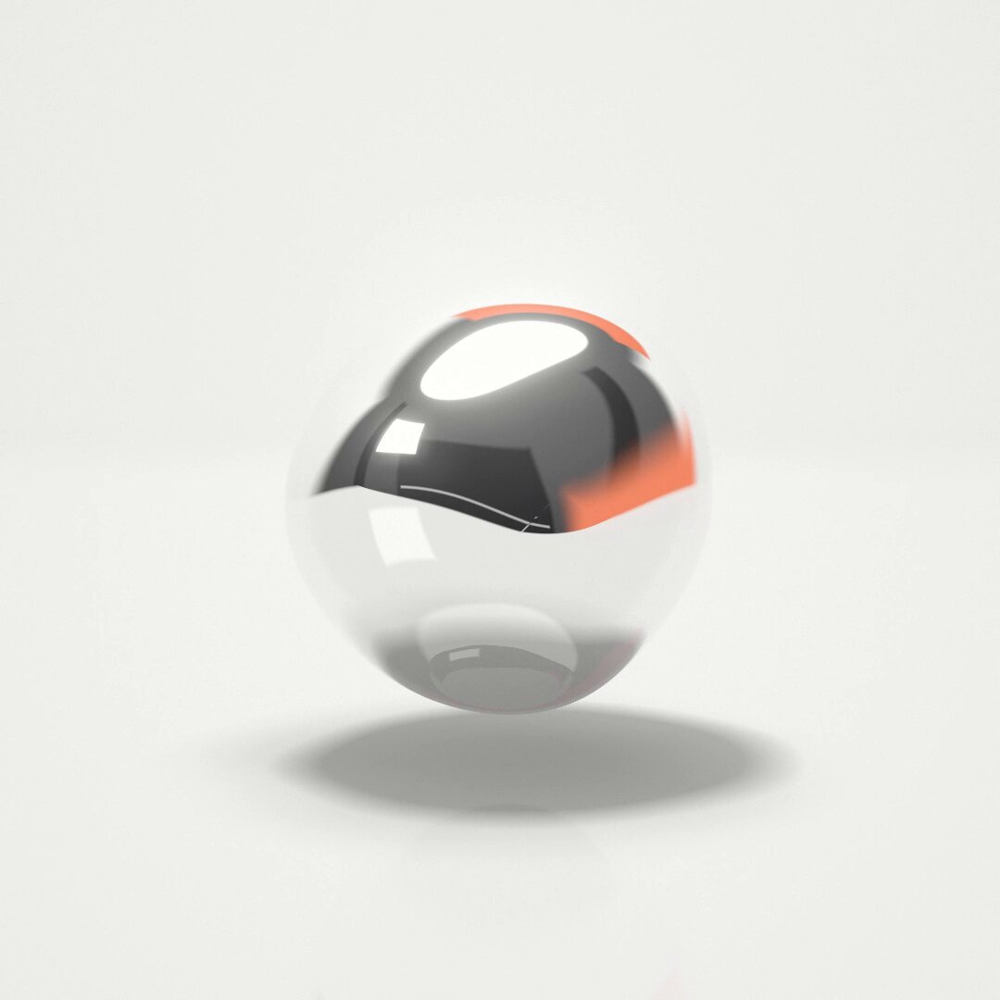

[前往原帖播放视频](https://x.com/flxrnc/status/2105311836190978392?s=46)

Six seconds, one loop: a chrome blob squashes, stretches and pinches into 7 drops, each drop pours into its letter, a glint sweeps the word, and the letters melt back into one wobbling blob. The liquid is a single raymarched shape drawn in a shader, the letters are real three.js TextGeometry, and the GPU rendered every frame at 60 fps with motion blur blended from subframes.

The exact prompt, pasted into Opus 5.5 as is:

```python
Liquid Chrome: 6 s seamless loop, 60 fps, 1080x1080, one HTML file, three.js 0.160.0 via jsdelivr importmap only.

window.renderAt(t) sets everything from t in seconds; all motion and noise periodic in 6 s; with ?t= never start requestAnimationFrame; window.__ready after font and bake. Quarter-pixel camera jitter, 4 offsets from frac(t*60).

Raymarch blob, 7 droplets and text as one SDF in a full-screen shader. Smooth-min k 0.35, falling to 0.1 as droplets part; each droplet becomes its glyph through mix(dropSDF, textSDF, K). Text: TextGeometry "OPUS 5.5" per glyph, helvetiker_bold from the pinned examples/fonts, size 0.52, height 0.12 (r160 reads height, not depth), bevel 0.03, 10 bevel and 24 curve segments, tracking -0.04 em, period optically centered. Bake the same outlines into a 2048x512 signed distance texture on the GPU, extruded as a rounded box to match the mesh. From 3.3 to 4.7 s cross-fade to the real mesh (creased normals, 35 degrees), same GLSL, reflections traced into the SDF.

Chrome: F0 0.92, Schlick fresnel, roughness 0.04, 3 bounces.

Studio: white floor at y -0.8, soft overhead shadow, contact darkening, 6% reflection, black beyond z 4 (camera side) so letter faces reflect dark. Environment in azimuth and elevation, camera at 0: black camera-side panel 86x57 degrees, softboxes overhead (2.4) and upper left (3.0), black flags at 75 degrees left and right, a D97757 rim strip behind at 149 degrees, 24 up, intensity 1.4, a 2 degree glint strip, intensity 6, tilted 40 degrees, sweeping left to right 3.3 to 4.1 s.

Timeline:
0 to 1.2 s: blob radius 0.62 breathes 3% every 1.5 s, simplex noise 0.05.
1.2 to 1.4 s: squash 10%.
1.4 to 2.1 s: stretch 2.4x wide and pinch into 7 droplets sized by glyph area; each arcs 0.2 up to its glyph, overshoots 7%, stretches along its velocity.
2.2 to 2.9 s: droplets become letters left to right, 3 frames apart, 0.4 s each; bevels start 0.07 puffy and spring flat.
2.9 to 4.8 s: hold.
4.8 s: 6-frame swell, letters slump 0.12 and soften, drain to the center with ease-in, merge at 5.62 s with a 3-bounce wobble (14%, damping 0.25) running through frame 0.

Camera: 30 degree lens, dolly 5.6 to 7.2 by 2.6 s, push to 6.95 in the hold, back to 5.6 by 5.9 s; orbit 7 degrees each way centered on the hold; 6 degrees above.

Post: bloom threshold 1.0, strength 0.3; tone curve linear to 0.9, then a soft shoulder; vignette 7%; grain 1.5% seeded by frame index.
```

One line in it comes from a real three.js trap. In r160, TextGeometry reads "height" for the extrusion depth, and a "depth" parameter is overwritten with 50, so letters meant to be 0.12 deep come out 50 deep. Pin the version, name the right parameter, and the trap is gone.

Follow-ups: 10, printed below exactly as they were sent. The first build already had the whole choreography, blob to drops to letters and back. Follow-ups 1 to 5 fixed what stills and measurements showed: white plastic instead of chrome, a glint that erased the P, bevels that fused the letters, drops that left the frame. Follow-ups 6 to 9 came from checking 12 transitions frame by frame and caught things like a bump that popped onto the blob at frame 85. The last one added a horizon line for the letter faces to reflect, so they read as chrome instead of flat charcoal.

```python
1. It reads as white plastic, the letter faces only see the black floor so the glint never shows, and the mesh caps reflect bent shards. Make the studio dark (0.1 gray) with only a white cyc behind the subject, 140 degrees wide, from 10 below to 40 up. End the white floor at z 4 so camera-side rays reach the black panel. Flatten the mesh cap normals. Rim strip 12x40 degrees. Blob noise frequency 1.0.
2. The glint is a flare that erases the P: make it 0.6 degrees wide at intensity 3. The rim never reaches the letters: move the D97757 strip behind and up (165 degrees, 42 up, 70x16 degrees) and add a soft D97757 kicker on the right, azimuth 55 to 125, elevation -16 to 10, so every right-facing bevel catches it.
3. The 0.03 bevels fuse every letter pair. Space the glyphs by their measured outlines, 0.09 apart and 0.26 for the word space, and hold the camera at 7.8, pushing to 7.55. The mesh speckles on its bevels: shade it with the SDF gradient so it matches the raymarched text.
4. The outer droplets leave the frame by 8 px around frame 112. Start them at 40% of their glyph position, ease the flight with u^2.4 so the 7% overshoot lands at 1.97 s, and dolly from 1.2 to 2.5 s.
5. While the letters form they look like camouflage and the merged blob looks like crumpled foil. Surface ripple 0.008 at frequency 3.2.
6. A bump pops onto the blob at frame 85. Grow the droplets from radius -0.4 over 1.2 to 1.65 s and regrow the blob from -0.4, so their smooth-min pull fades in.
7. mix(sphere, letter) passes through flat coins. Let each droplet pour into its glyph instead: bake one SDF channel per glyph, reveal each letter inside a sphere growing from its droplet (smooth max 0.05, ease-out, 0.4 s), shrink the droplet into it, join them with smooth-min, and start the puff spring only once the letter is full (damping 0.55, 3 Hz). Melt in reverse, draining from 5.2 s.
8. The glint reaches the O late and leaves the last 5 early. Make it touch the O at 3.3 s and clear the last 5 at 4.1 s (calibrated sweep: azimuth -0.083 to 0.302).
9. The letters vanish before their drops exist and the merged ball inflates. Regrow the drops first (4.88 to 5.1 s, 1.15x glyph size), retract the letters after (5.0 to 5.35 s), and grow the central blob from 5.15 s.
10. The letter faces read as flat charcoal. Add a thin 0.5 horizon strip at -6 degrees inside the camera-side panel, and soften the floor's end over z 3.6 to 4.0.
```

Then the sound, from one more prompt. Opus 5.5 can't hear, so it scored the loop from frame numbers: every sound synthesized in code with the Web Audio API, no samples, and each hit landing 1 frame after its picture. It took 5 sound follow-ups, all from measuring the decoded audio, none from listening: the first hits peaked 8 to 11 ms late, the levels over the bed were uneven, the limiter squashed the final gloop, and the codec added 16 ms of padding at the seam.

```python
# Sound prompt
Score this seamless 6 s loop (360 frames, 60 fps). Synthesize everything in code with the Web Audio API, no samples, no downloads. Each hit lands 1 frame after its visual event.
Bed: 120 BPM, four 3/4 bars of 90 frames starting on frames 67, 157, 247 and 337. Kick on 67, 247 and 337, offbeat shaker only where no hit plays, sub and pad on Bm, G, A, D.
Events: squash inhale peaking at 84, stretch glide 84 to 112, pinch bloops at 112, 113, 114 and 120, pour bloops rising through D major pentatonic at 136, 138, 141, 145, 147, 150 and 153, metallic ting at 200 (partials under 8 kHz), shimmer panned left to right until 245, liquid swell from 288 peaking at 303, drips at 309, merge blups at 319, 321, 322 and 325, slurp into a gloop at 337 wobbling at 2.4 Hz.
48 kHz stereo WAV, about -14 LUFS, peak -1 dBTP, no click at the seam. Mux into the MP4.
# Sound follow-ups (5), exactly as they were sent
1. Measured on the isolated hits: the kick and the gloop peak 8 to 11 ms late (a 4x waveshaper and sines that start at phase 0), and the levels over the bed are uneven (ting +10 dB, gloop +1 dB, drips -8 dB, dot drop +1 dB). Build every tonal hit as a buffer whose attack ends on a cosine crest at exactly (F + 1) x 800 samples, with no waveshaper. Put every hit, or pair of hits on the same frame, 3 to 6 dB above the bed (K-weighted, first 60 ms). The mix loses 4.5 dB through a 150 Hz high-pass: cut the sub 4 dB, the kicks 1.5 dB and the kick under the gloop 4 dB, and raise the pad 1.5 dB.
2. Timing is exact now. The hits sit 6.5 to 9 dB over the quieter bed: trim the hit bus 2.5 dB, then the two pinch pairs 1.4 dB, the U and S pinch 1 dB, the swell 1.2 dB and the last pour bloop 0.5 dB, and raise the drips 2.5 dB and the gloop 3 dB, so every hit reads 3 to 6 dB over the bed.
3. The limiter takes 3.4 dB off the gloop because all its partials and the kick crest on the same sample. Put the gloop's even harmonics in sine phase and lower the kick under it 2.7 dB, so the limiter stays under 1.5 dB and the gloop keeps 3 to 6 dB over the bed.
4. Sine-phase harmonics moved the gloop's biggest waveform peak 4 ms after its frame. Keep every gloop harmonic in cosine phase so the peak is on sample 270400, set the 2nd harmonic to 0.2 and the 3rd to 0.08, drop the 4th, and lower the gloop 0.5 dB.
5. The MP4's audio runs 16 ms of codec padding past the video, so the file starts on a hard step and a looping player stops the sound hard at 6.000 s, plays 16 ms of silence and restarts hard. Keep the seamless loop as the master WAV for the two-loop post, and for the single-loop article MP4 add a 2 ms raised-cosine fade to the first and last 96 samples only.
```

The result: about 2 hours from the first prompt to the finished loop, including the 12 transition checks, plus about 45 minutes for the sound. The wobble that ends the loop runs straight through frame 0, so the seam never shows.

Every drop, light and camera move in that loop came from a number in the prompt or in a follow-up. That's the whole lab in one loop.

What's inside:

- **Experiment 1**: the same 3D product shot from a vague prompt and a directed one, side by side
- **How it works**: why Opus 5.5 writes code instead of pixels, and why that helps you
- **Setup from zero**: no install, Mac or Windows
- **Prompt anatomy**: the lines a directed motion prompt needs
- **The numbers**: easing, springs, durations, stagger, beat grid
- **Experiment 2**: anticipation, squash and stretch, overlapping action, follow-through and arcs on a 3D mascot
- **The lab loop**: how Opus 5.5 checks its own frames
- **Equipment**: Remotion, HyperFrames, GSAP, Motion, Three.js
- **The last mile**: sound, perfect loops, export for X
- **Fixes**: the failures you will hit, each with the prompt that fixes it

No After Effects needed. A browser and Claude are enough to start.

---

### Experiment 1: Vague prompt vs directed prompt

The most copied motion prompt of launch week is 26 words long: make a 15-second showreel that proves "what an incredible motion designer you are". It comes from kirill sh, who posted it on September 24 with Opus 5.5 and GPT 6 Astra side by side, from an account with 885 followers. It passed 1.8 million views.

> kirill sh@shneural·[9月24日](https://x.com/shneural/status/2103151003272962130)翻译自 英语Opus 5.5 之后，看到 GPT 6 Astra 设计的任何东西都真的让人难受  
>   
> 给两个模型完全相同的提示：“制作一段动态的 15 秒动态图形视频，展示你是一个多么出色的动态设计师，就像这是你简历的展示卷。全力以赴。”  
>   
> 完全不在一个水平，自己看看吧。GPT 在这方面真的很糟糕，OpenAI 的品味简直糟糕透顶
>
> 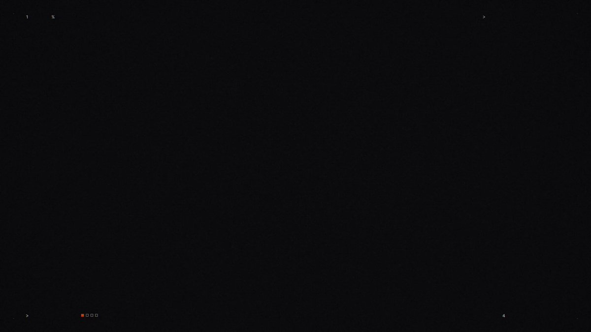
>
> [前往原帖播放视频](https://x.com/shneural/status/2103151003272962130)

This is the original post. Many reruns followed within days. It makes a great model demo because the subject is the model itself: there is no brief to miss, so nothing can come out wrong.

Now point the same trick at your own launch. A showreel is a genre with known rules and no client. Your product, your words and your timing can all come out wrong, and a one-liner says nothing about any of them.

The other end of the scale is the most viewed Opus 5.5 music video, made by Donald. Credit where it's due: the song "Claude-Pop" and its first video are by deckard, posted on September 9, before Opus 5.5 existed. Donald made the Opus 5.5 version.

> donald@donaldjewkes·[9月24日](https://x.com/donaldjewkes/status/2102801274173587569)翻译自 英语我用一个提示词和 Opus 5.5 制作了这个  
>   
> 我对着电脑说了 5 分钟，claude 工作了 12 小时，然后我醒来就看到了这个  
>   
> 完整提示词：
>
> 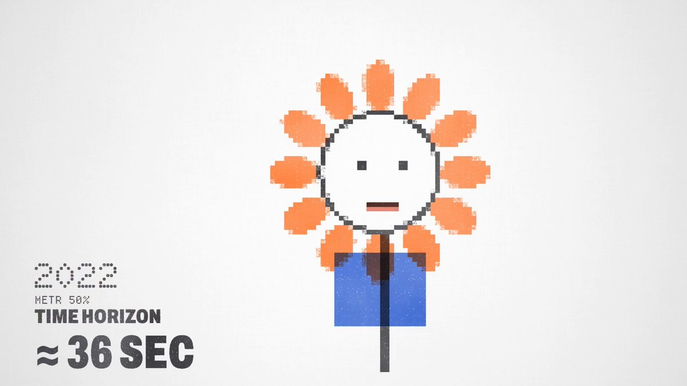
>
> [前往原帖播放视频](https://x.com/donaldjewkes/status/2102801274173587569)
>
> 引用NotinReality@other\_\_reality·9月23日
>
> 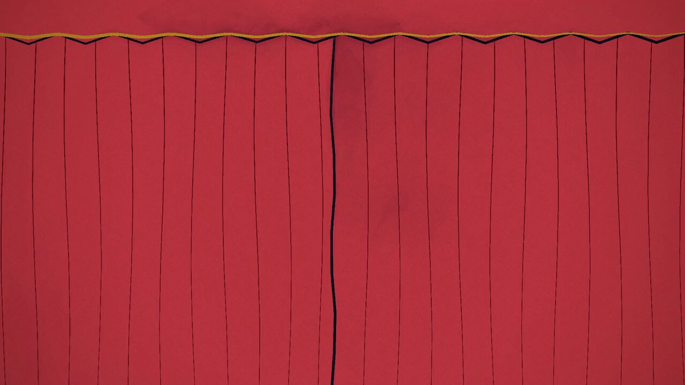
>
> 2:36翻译自 英语Claude Opus 5.5 是我迄今测试过的所有模型中，拥有最佳视觉设计的那个。 x.com/slimer48484/st…

It crossed 3.6 million views. Donald calls it one prompt, and in the same post he says he spoke to his computer for five minutes and Claude worked for 12 hours. The one prompt was a spoken brief plus 12 hours of autonomous work: direction did the heavy lifting.

So the lab ran a controlled test. Same model, same subject (a pair of wireless earbuds), same technical line: one HTML file, three.js, 960x1080 per side, a 6-second loop. Only the direction changes.

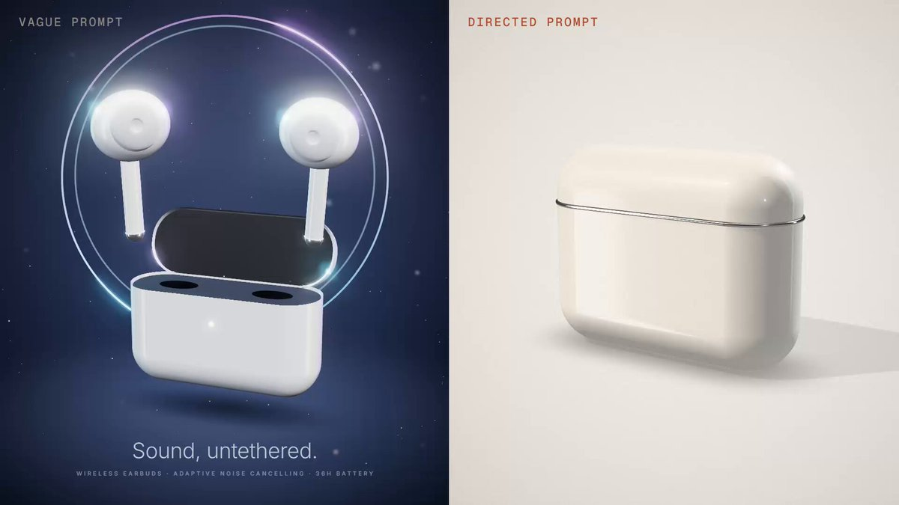

[前往原帖播放视频](https://x.com/flxrnc/status/2105311836190978392?s=46)

Watch one full loop of each side before you read the prompts. The left is what three adjectives buy. The right is what 448 words of direction buy.

Prompt A, vague (left side):

```python
Create a cool 3D product animation for a pair of wireless earbuds. Make it look premium and modern. One self-contained HTML file using three.js, 960x1080, 6-second loop.
```

Prompt B, directed (right side):

```python
GOAL: a studio product film for wireless earbuds: case opens, buds rise to the viewer, everything clicks shut.
OUTPUT: one self-contained HTML file, three.js 0.160.0 from jsdelivr (importmap), 960x1080.
TIME: 6-second loop, 60 fps = 360 frames, 120 BPM (1 beat = 30 frames). Hits land on beats.

MODEL (1 unit = 1 cm, primitives with bevels): case 6.0 x 4.6 x 2.2, 1.0 edge radius, split at 3.3, back-hinged lid, 0.06 split bevel, 0.045 chrome wire around the seam. Inside: D97757 deck, two dark elliptical wells. Buds: ellipsoid head 1.6 x 1.5 x 1.5, lathed silicone tip, 1.6 oval stem with a chrome end cap, dark grille. Seated heads sit flush with the deck.

LOOK: satin ceramic white F4F1EC (roughness 0.38, clearcoat 0.35), chrome (metalness 1, roughness 0.05), D97757 on the deck only, ink 1C1B1A, tips E4E0DA. Backdrop F0EDE8 center to DEDAD3 corners, dithered. Key FFF4E8 3.0 upper front left, soft shadows; fill E8EEF5 0.6 low right; rim FFFFFF 4.0 upper back right. Reflections: PMREM studio built in code (warm gray dome, overhead and key softboxes, rim strip). Contact shadows, opacity 0.55. Neutral tone mapping, 8% vignette, 2% grain seeded per frame.

SHOTS:
0.0 to 0.5 s: a 2.4-wide studio strip (from 5.5 s) sweeps left to right, glinting across the closed lid and seam.
0.72 to 0.95 s: anticipation: lid presses 1.5 degrees shut, case squashes 2%, hold 3 frames.
1.0 s: lid springs to 100 degrees (damping 0.6, about 10% overshoot, settled by 1.4 s).
1.5 s: buds rise 4.0 out of the wells, right first, left 4 frames later (damping 0.7). From rise frame 8 they tilt 14 degrees outward and turn 35 degrees to camera on a looser spring (damping 0.5): stems swing through and settle.
2.0 s: camera push-in.
2.4 to 4.0 s: hold, buds float 0.05 on a 1 s sine. 3.0 s: second glint crosses the buds.
4.0 s: buds straighten (0.2 s) and descend (easeInOutCubic, 0.45 s), seating with a 0.05 magnetic dip.
4.75 s: lid falls (easeInCubic), shuts exactly at 5.0 s, bounces 3 degrees, settles by 5.3 s; case recoils 1.5%.
5.5 s: next glint starts.

CAMERA: fov 30, never parked. Azimuth 34 to 10 degrees from 5.6 s to 4.0 s (easeInOutSine), back by 5.6 s (easeInOutCubic). Distance creeps 21 to 20.2, pushes to 16 at 2.0 s (easeOutExpo, 0.8 s), returns 4.0 to 5.6 s (easeInOutCubic). Buds up: elevation 12 to 19 degrees, target height 2.3 to 4.2.

BANNED: purple or blue gradients, glow orbs, bloom, neon, lens flares, particles, generic spinning turntables, dark backgrounds, text.

QA: renderAt(t) draws exactly time t, seeded noise only. Stills around every hit; frame 359 flows into frame 0.
```

Follow-ups: left side 0, by design. It is the untouched first output of a separate context that saw only Prompt A, and it came back as dark navy space, a glowing halo ring, bloom, particles, spinning buds and a made-up tagline: most of Prompt B's banned list. Right side: 15 follow-ups in 4 review rounds, printed below exactly as they were sent. The labels and the split were added after rendering.

```python
# Round 1, after the first build (stills at 0, 1.25, 2.9 and 4.9 s)
The white case melts into the backdrop and the chrome reads gray. Drop the studio dome to about a third and push the softboxes, so the unlit sides fall off and the chrome shows dark and bright bands.
The open lid reads as a flat slab. Hollow it: 0.16 rim, 0.62 deep cavity, 0.22 fillet at the ceiling.
The round dark grille reads as an eye. Make it a slim slot.
Two dark marks poke through the bottom of the case: the well floors at 0.3 sit outside the bottom arc, which insets the wall by 0.29 at that height. Raise the floors to 0.5.
The deck reads salmon. Roughness 0.7.
# Round 2, after measuring pixels
Front and top are the same value and the right side vanishes into the backdrop. Key to (-7, 12, 8), rim to (2, 8, -12), still upper front left and upper back right. Overhead softbox 2.2, exposure 0.8.
The glint is a flood light: strip on vs off changes 178,864 pixels because the 60-tall strip lights the whole face. Keep the strip in reflections only (a second PMREM for the specular lookup, the static studio for diffuse) and go back to the 2.4 width from the brief.
Exposure 0.9 and key softbox 4.5 so the ceramic reads white. Deck specular 0.3 so the grazing reflection stops washing out D97757.
Give the wells a 0.07 machined round-over.
The buds read as mouse heads. Move the stem to the outer side, replace the ball tip with a short nozzle and a flattened silicone cap, and move the grille off the head (it read as an eye twice) onto the stem.
Crane faster: reach the high target by 2.3 s, so the heads keep headroom during the push.
# Round 3, after isolating each glint
The first glint is too shy for a hook. Clearcoat roughness 0.08, strip peak 24, and shift the sweep to -80 to 0 degrees so the band is mid-face on frame 0.
The second glint flashes the whole lid cavity (207,791 pixels at 3.3 s) because the strip crosses the mirror direction of the flat faces. Raise it to 8 to 61 degrees elevation, 4.8 wide: only the curved heads and stems catch it.
The hold parks the camera: add a 0.4 dolly creep from 2.8 to 4.0 s. Float the left bud 4 frames behind the right, like its rise.
# Round 4, frame-perfect pass
The anticipation holds 4 frames (57 to 60), not 3: the spring starts at rest exactly on 1.0 s, so the beat frame is still the pressed pose. Release half a frame early (59.5/60 s): frames 57 to 59 hold, including their motion-blur subframes, and frame 60 is the first open frame.
```

The sound, one more prompt with the same rules: one soundtrack for the split screen, with every hit on the directed side's beats. It took 12 sound follow-ups in 4 rounds, all from measurements: the first mix put 80% of its energy under 60 Hz, where phone speakers play nothing, and the hits sat only 0.5 to 1.6 dB over the bed.

```python
# Sound prompt
Score the A/B video. Synthesize everything in code with the Web Audio API, no samples, no downloads. 120 BPM, 6 s loop, 360 frames at 60 fps. Each hit lands 1 frame after its visual event, and so does the bed.
Bed: kick every 60 frames, 16th shaker, bass and pad F, B flat at 120, G minor at 240, C at 300.
Right half only:
44 to 60 reverse swell.
60 lid snap: click, 880 Hz body, 120 Hz thump.
90, 94 magnetic pops, air lift to 119.
96 to 120 push-in swell.
180 to 216, 330 to 30 glint shimmer.
240 to 267 falling swish, 270 seat click.
285 to 300 whoosh into the shut: click, 200 Hz thock, 70 Hz thump; ticks 306, 312.
Hits 3 to 6 dB over the bed, nothing above 8 kHz, mono-safe. Render twice, keep the second pass. 48 kHz stereo WAV, about -14 LUFS, peak -1 dBTP. Mux into the MP4 and check every hit in its decoded audio.
# Sound follow-ups (12), exactly as they were sent
# Round 1, after measuring the first render (80.6% of the energy under 60 Hz, 3.5% in 150 Hz to 6 kHz, median 58 Hz; hits 0.5 to 1.6 dB over the bed; bodies peaking 2.5 to 5 ms after the frame)
1. The sub buries everything. Play B flat, G and C an octave higher (117, 98, 131 Hz), open the bass to 900 Hz, shorten the kick to 80 ms and give it a 190 Hz knock. Raise the pad 5 dB and every hit 6 dB, ticks 6 and 10 dB under the shut.
2. Start every body and thump in cosine phase with a 0.5 ms attack, so the first waveform peak sits on frame + 1.
3. Give the push-in swell a clear peak: 60 ms exponential rise into frame 121, then a 25 ms drop into the camera tail.
4. Duck the bed 4 dB from the shut through tick 2 (frames 301 to 313).
5. Remove the DC: subtract each channel's loop mean.
# Round 2, after measuring the second render (full mix -14.0 LUFS but only -22.9 LUFS in the 200 Hz to 6 kHz phone band; hit stem minus bed stem, K-weighted: snap -0.3, pops -3.1 and -5.2, seat -6.9, shut +2.6, ticks -0.8 and -4.3, push-in -9.3 dB; kick peak 5 ms and snap thump 2.4 ms after frame + 1)
6. The bass still carries the loudness. Drop its sine to a third, open the saw to 1200 Hz, bass 2 dB down, pad 4 dB up and brighter (1600 Hz).
7. Hits to 3 to 6 dB over the bed: push-in swell +8 dB, seat click +6 dB, pops +4 dB, ticks 4 and 8 dB under the shut.
8. Phase every tone so its first waveform peak lands exactly on frame + 1, the kick included (cosine start, 1 ms attack).
# Round 3, after measuring the third render (phone band -17.5 LUFS against -14.0 full; phone-band hit minus bed: snap 6.4, pops 5.6 and 3.5, seat 2.3, shut 8.4, ticks 3.0 and 1.8, push-in 3.0 dB; the kick's first peak is on frame + 1 but its wider second lobe is 10% louder, 2.5 ms later; limiter up to 4.4 dB)
9. Give the kick a 3 ms transient (its level falls to 65% within 3 ms of frame + 1) and the knock 3 dB more, so its largest peak is the first one.
10. Shut 2.5 dB down with the ticks kept where they are (tick 2 then 3 dB up), seat click +2 dB, push-in swell +2 dB.
11. The kick's second lobe is still 6% louder: the knock's negative half lands on it. Knock decay 4 ms, kick attack 0.5 ms. Tick bodies decay in 12 ms so earlier tails cannot flip their lobes.
# Round 4, after decoding the muxed article MP4 in Chrome (offset -0.002 ms, every hit 0.0 to 1.3 ms after frame + 1, but the AAC encode lifts the true peak from -1.3 to -0.4 dBTP)
12. Limit the WAV to -2.2 dBTP so the decoded MP4 stays under -1 dBTP; keep -14 LUFS.
```

The result: about 30 minutes for the left side and about 90 for the right, review rounds included, plus about 90 minutes for the sound. The last picture note is the kind of error only a frame-by-frame check catches: one extra held frame on the beat.

What changed between A and B:

- **"Premium" became materials**: satin ceramic at roughness 0.38 with a 0.35 clearcoat, chrome at roughness 0.05, and Claude orange only on the deck.
- **"Cool" became a studio**: a key, a fill and a rim light with exact colors and strengths, reflections from a studio built in code, soft contact shadows. No glow anywhere.
- **"Modern" became a camera**: a 30-degree field of view, a camera that never parks, an orbit from 34 to 10 degrees and one push-in on easeOutExpo at 2.0 s.
- **"Animation" became beats and springs**: 120 BPM, a 3-frame anticipation before the lid springs open at damping ratio 0.6, then buds rising at 0.7 with a looser 0.5 follow-through.
- **The defaults got named**: bloom, glow orbs, neon, particles, spinning turntables, dark backgrounds and text, banned by name. The left side shows almost every one of them.

Adjectives are where the default look lives. **Every adjective you replace with a number is a decision you take back from the model.**

---

### How Claude Opus 5.5 actually makes motion

Opus 5.5 outputs text. Every motion design clip in the feed is a program that draws frames, and a browser records them. Gideon Frost of OrcaRouter said it in one line: "Claude Opus 5.5 does not generate pixels. It writes code that paints pixels."

In practice the program is usually one HTML file. Open it in a browser and it plays. Point a headless browser at it, freeze it at each frame, save the PNGs, and ffmpeg stitches them into a GIF or an MP4.

Code instead of pixels has three consequences you can use:

1. **Every frame is reproducible.** Eric Kang's rule on the Hugging Face blog: "Every pixel is a pure function of t." Render frame 84 twice and you get the same image twice.
2. **Edits are cheap.** You change one number and re-render. No re-rolling a video model and hoping.
3. **Opus 5.5 can check its own work.** Anthropic says that even at its lowest effort setting it reads dense charts more accurately than Opus 5 did at its highest, and that it is better at seeing what changed between two versions of a diagram. A contact sheet of your animation is exactly that kind of image.

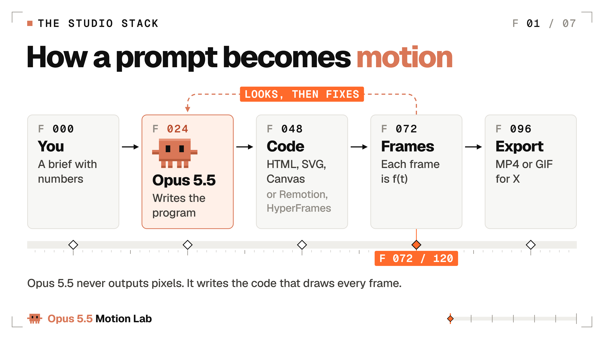

> Kevin Ngo@kevin\_t\_ngo·[9月23日](https://x.com/kevin_t_ngo/status/2102437977435893771)翻译自 英语Claude Opus 5.5 用 JavaScript 绘制了这个动画的每一帧。  
>   
> 镇上的每个人都向 Claude 发送他们的请求，但一个女孩却发送了一个问题：“你爱什么？”
>
> 
>
> [前往原帖播放视频](https://x.com/kevin_t_ngo/status/2102437977435893771)

Posted on launch day by Kevin Ngo: "Claude Opus 5.5 drew every frame of this animation in JavaScript." It is a 28-second story in which a whole town sends Claude requests, and it passed 640K views. Code-drawn frames can carry a character and a story too.

The render contract. Paste it under any motion prompt so every frame can be rendered, checked and fixed:

```python
# The render contract: paste it under any motion prompt
Output one self-contained HTML file. Only the libraries the prompt names, pinned to a version.
No network requests except fonts and those pinned libraries.
Every frame must be a pure function of time t, in seconds.
If JavaScript drives any motion, expose window.renderAt(t) that draws exactly that frame.
Animate with CSS keyframes, the Web Animations API, SVG, Canvas 2D or WebGL.
No Date.now, no setTimeout or setInterval starts, no unseeded Math.random.
Loops: render frames 0 to N-1 only, and frame N-1 must flow into frame 0.
```

Each line closes one way a render goes wrong. A clock or a timer makes frame 84 come out different on every run. Unseeded randomness makes shapes jitter from frame to frame.

Rendering frame N of a loop shows the first frame twice, which is the hiccup at the seam. All three are in the fixes table near the end, because all three will happen to you at least once.

---

### Set up the Opus 5.5 lab from zero (no install, Mac or Windows)

Three ways in. Pick by how much you want to install.

**Path 1: no install, in the Claude app**

1. Open Claude and pick Opus 5.5 in the model menu.
2. Paste the opening-shot prompt from the top of this article.
3. Claude writes the HTML and plays it in the preview panel.
4. Ask for fixes with frame numbers, for example "the punch at frame 84 peaks late, move it 2 frames earlier".
5. Download the file, open it in Chrome and record the screen (Cmd+Shift+5 on a Mac, the Snipping Tool's video mode on Windows).

One tip for the app: ask for a frame counter in a corner and a space bar that pauses, so your notes can name exact frames. Remove both before the final recording.

A screen recording is fine for a first post. It isn't frame-exact and can drop frames, so for anything that goes in a portfolio, use path 2 or 3.

**Paths 2 and 3: Claude Code on Mac or Windows**

Claude Code can render frames, open them and fix the code without you copying anything around. Install it with the one-line installer from Anthropic's Claude Code docs, then set up the lab:

```python
# macOS: Node, ffmpeg and a headless browser (Claude Code already installed)
brew install node ffmpeg
mkdir motion-lab && cd motion-lab
npm init -y
npm i -D playwright
npx playwright install chromium
claude            # then type /model and pick Opus 5.5
```

```python
# Windows 11, PowerShell: the same lab (open a NEW terminal after winget)
winget install OpenJS.NodeJS.LTS
winget install Gyan.FFmpeg
mkdir motion-lab; cd motion-lab
npm init -y
npm i -D playwright
npx playwright install chromium
claude            # then type /model and pick Opus 5.5
```

Two Windows notes. Windows PowerShell 5.1 has no &&, which is why the commands use a semicolon. If PowerShell refuses to run npx, type npx.cmd instead.

Then save this renderer as render.mjs. It opens your HTML in a headless browser, freezes it at every frame and saves the PNGs. It builds the file URL with pathToFileURL, so Windows paths work too.

```python
// render.mjs   usage: node render.mjs anim.html 6 24   (file, seconds, fps)
// Freezes the page at t = i / fps and saves every frame as a PNG.
import { chromium } from 'playwright';
import { pathToFileURL } from 'node:url';
import { mkdirSync } from 'node:fs';

const [file = 'anim.html', secs = '6', fps = '24'] = process.argv.slice(2);
const FPS = Number(fps), N = Math.round(Number(secs) * FPS);   // frames 0 to N-1
mkdirSync('out/frames', { recursive: true });

const browser = await chromium.launch();
const page = await browser.newPage({ viewport: { width: 1200, height: 675 } }); // your canvas
await page.goto(pathToFileURL(file).href, { waitUntil: 'networkidle' });
await page.evaluate(async () => { await document.fonts.ready; });

for (let i = 0; i < N; i++) {
  await page.evaluate((t) => {
    if (window.renderAt) window.renderAt(t);
    document.getAnimations().forEach((a) => { a.pause(); a.currentTime = t * 1000; });
  }, i / FPS);
  await page.screenshot({ path: `out/frames/${String(i).padStart(4, '0')}.png` });
}
await browser.close();

// Then turn the frames into a video:
// ffmpeg -framerate 24 -i out/frames/%04d.png -c:v libx264 -pix_fmt yuv420p -crf 18 -movflags +faststart out/anim.mp4
```

One command, node render.mjs anim.html 6 24, and 144 PNGs land in out/frames. The ffmpeg line at the bottom turns them into an MP4. Every frame is exact because every PNG is the page frozen at one precise t, however slow your machine is.

The 3D showcase pieces in this lab use the same renderer idea with two upgrades. The browser renders on the real GPU (an RTX 4060 Ti here) instead of in software, at 60 fps. And every output frame averages several subframes spread over half a frame, blended in linear light, which is how a 180-degree film shutter records motion blur.

From then on you rarely type commands yourself. Tell Claude Code "render anim.html with render.mjs, open frames 0, 24 and 48, and tell me what you see before you change anything", and it runs the loop from there.

Now the effort setting. Opus 5.5 starts at medium. Anthropic says medium matches or beats Opus 5 at high on its coding and knowledge-work evals, and recommends keeping xhigh and max for work where you measured a gain. Lab rule: medium for everything; raise it only when a from-scratch piece misses twice.

Fast mode (/fast in Claude Code) runs up to 2.5x faster at $8 and $40 per million tokens instead of $4 and $20. On Pro, Max, Team and Enterprise plans it bills from usage credits, not from your plan's limits. It's for iteration sprints, when speed matters more than cost.

> Shikhar@xikhar·[9月27日](https://x.com/xikhar/status/2104001664793600012)翻译自 英语第三次迭代，使用 Opus 5.5 中等设置。  
>   
> 我惊叹不已。它将 Blender、图像生成和 three.js 变成了这个美妙的东西，它能在你的浏览器中运行。  
>   
> 说 Anthropic 干得漂亮都算是轻描淡写了。你正在见证游戏开发的未来。
>
> 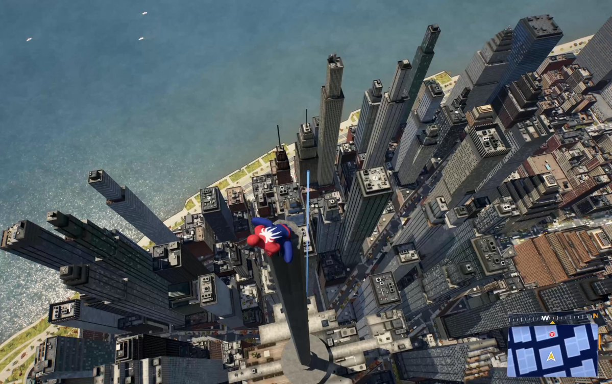
>
> [前往原帖播放视频](https://x.com/xikhar/status/2104001664793600012)

Shikhar's 3D browser world passed 1.75 million views. He built it from Blender assets, generated images and Three.js, and captioned it "Third iteration with Opus 5.5 medium." Medium effort and a third iteration made one of the biggest pieces of launch week.

---

### Anatomy of a directed motion prompt

A directed prompt isn't long for its own sake. Each line removes one decision the model would otherwise make for you, and the model's own decisions are the default look.

Anthropic's Opus 5.5 prompting guide says this directly: without design direction, Opus 5.5 "falls back on a few default styles", and a general line like "avoid a generic AI look" mostly swaps one default for another. What works is naming the exact patterns to avoid, checking which defaults the first result used, and extending the list.

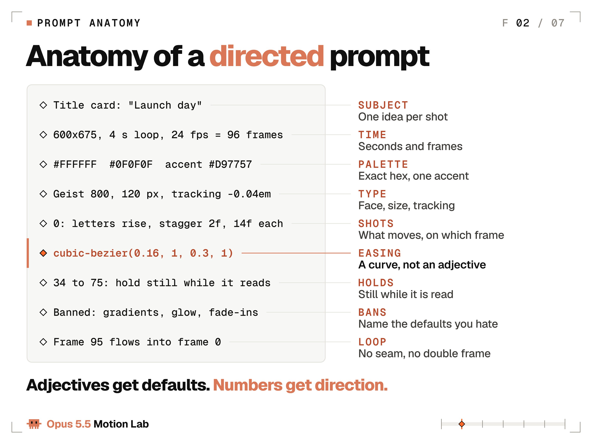

The template. Fill every line before you press enter:

```python
GOAL: what the viewer should feel or do, in one sentence
OUTPUT: one self-contained HTML file (or Remotion, HyperFrames), W x H
TIME: seconds x fps = total frames. Loop: yes or no
LOOK: palette in hex, one accent, typeface + weight + size + tracking
MOTION: easing as cubic-bezier, springs as damping ratio, durations in frames
SHOTS: frame ranges, one hero move per shot, how each shot hands off
BANNED: the defaults you never want to see
QA: stills at named frames, a contact sheet, fix, then the full render
```

Prompt B in Experiment 1 is this template filled in, plus MODEL and CAMERA lines for 3D.

Write GOAL first. If you can't say in one sentence what the viewer should feel or do, Opus can't animate it, and no easing curve will rescue the piece. Then TIME, because every other number hangs off the frame count.

SHOTS is where the story lives. Give each shot a frame range, one hero move and a handoff: a hard cut on the beat, a match cut where one shape becomes the next, or a mask wipe. Default to the cut. A transition should be a decision.

The QA line matters more than it looks. It makes Opus check stills before it renders the whole clip, and that is where the lab loop below starts.

The motion ban list the lab starts from:

- purple or blue gradients, glow, lens flares
- floating particles as decoration
- everything fading in at once
- fade-and-slide-up on every element (Anthropic's frontend-design skill calls this the generic default that reads as AI-generated)
- centered-everything layouts
- text that moves while it is being read

Keep the list alive. After every first render, name what the model used anyway and add it. That's Anthropic's own advice, and it works on motion the same way it works on web pages.

One hero per shot. The same skill puts it well: a single orchestrated moment lands better than scattered effects. Everything else waits, dims to 40%, or holds still.

Then give the rest a rank. Secondary moves travel 50 to 70% as far as the hero and start 100 to 200 ms after it. Ambient motion stays under 5% of the hero's travel, runs on a slow sine and never stops.

> Rexan Wong, whose breakdown of the trend reached about 600K views: "the context you give it is what makes it look pro."

---

### The motion numbers cheat sheet

Motion designers talk in curves and frames, so give Opus 5.5 curves and frames. Here are the numbers and where each one comes from.

**Easing.** The values below come from the standard Easings reference by Andrey Sitnik.

| Name | cubic-bezier | Use it for |
| --- | --- | --- |
| ease-out-expo | 0.16, 1, 0.3, 1 | Text and logo reveals |
| ease-out-quint | 0.22, 1, 0.36, 1 | Premium entrances |
| ease-in-out-quart | 0.76, 0, 0.24, 1 | Moves and camera pushes |
| ease-in-expo | 0.7, 0, 0.84, 0 | Fast exits |
| ease-out-back | 0.34, 1.56, 0.64, 1 | A playful pop with overshoot |

The rules: enter with ease-out, exit with ease-in and make exits 40 to 50% shorter (Material 3 pairs a 400 ms entrance with a 200 ms exit), move across the screen with ease-in-out. Linear only for rotation, progress bars and the phase of a loop. Linear easing on a move is the fastest way to make a render look like a render.

**Springs.** Every library names its knobs differently. One number translates between all of them: the damping ratio (the formula is in the code below). 1.0 never bounces. 0.7 to 0.85 feels premium. 0.4 to 0.6 is playful. Under 0.3 is a cartoon.

Remotion's default spring (mass 1, damping 10, stiffness 100) works out to 0.5; react-spring's default (tension 170, friction 26) to 1.0. Material 3's rule is worth stealing: position and size may bounce, opacity and color never do.

```python
// motion.js: one tokens file, imported everywhere, no inline numbers
export const EASE = {
  enter: 'cubic-bezier(0.16, 1, 0.3, 1)',    // ease-out-expo
  move:  'cubic-bezier(0.76, 0, 0.24, 1)',   // ease-in-out-quart
  exit:  'cubic-bezier(0.7, 0, 0.84, 0)',    // ease-in-expo
  pop:   'cubic-bezier(0.34, 1.56, 0.64, 1)' // ease-out-back
};
export const MS = { feedback: 150, move: 400, hero: 750, exit: 240 };
export const STAGGER = { letter: 30, word: 90, item: 60 };

// Damping ratio from any library's numbers: 1 = no bounce
export const dampingRatio = (k, d, m = 1) => d / (2 * Math.sqrt(k * m));

// A spring as a pure function of time, from 0 to 1.
// zeta: damping ratio (1 no bounce, 0.7 premium, 0.5 playful). f: speed in Hz.
export function spring(t, zeta = 0.7, f = 2) {
  if (t <= 0) return 0;
  const w = 2 * Math.PI * f;
  if (zeta >= 1) return 1 - Math.exp(-w * t) * (1 + w * t);   // no bounce
  const wd = w * Math.sqrt(1 - zeta * zeta);
  return 1 - Math.exp(-zeta * w * t) *
    (Math.cos(wd * t) + (zeta * w / wd) * Math.sin(wd * t));
}
```

The spring function needs no simulation. It returns the progress at any t directly, so frame 84 renders on its own without computing frames 0 to 83, which is exactly what the render contract asks for. Hand the file to Opus 5.5 with one line: use only these tokens, no inline numbers.

**Durations and stagger.** UI feedback takes 100 to 200 ms (Nielsen Norman Group: 100 ms feels instant). The rest are the lab's starting points: UI moves 200 to 500 ms, hero reveals 600 to 900 ms, letters 1 frame apart, words 60 to 120 ms, list items 40 to 80 ms. Start the next element when the previous one is 30 to 50% done: fully sequential looks robotic, all at once looks cheap.

For video, say it in frames. At 24 fps one frame is about 42 ms, so a 400 ms move is 10 frames and a 750 ms reveal is 18.

**Beat grid.** Frames per beat = fps x 60 / BPM. At 120 BPM and 24 fps that's 12 frames. At 128 BPM and 30 fps it's 14.06, so compute every beat from time and round each one. Adding a rounded 14 again and again drifts off the music: after 32 beats you are 2 frames off.

Cut on the beat and change the layout on the bar, every 4 beats. Changing everything on every beat wears the viewer out.

**Holds.** On-screen text stays at least 0.3 s per word plus 0.5 s, so a two-word title needs 1.1 s. During a hold, a slow 2% push keeps the frame alive while the words stay readable.

**Camera.** Camera moves get the softest curves, like ease-in-out-quart; objects get the snappier ones. For parallax, start with speeds of 1.0 for the foreground, 0.5 for the middle and 0.2 for the background.

**Contrast and flashes.** Keep text at 4.5:1 contrast on every frame, including over moving backgrounds, and never flash more than 3 times per second. Both numbers come from WCAG, the web's accessibility standard.

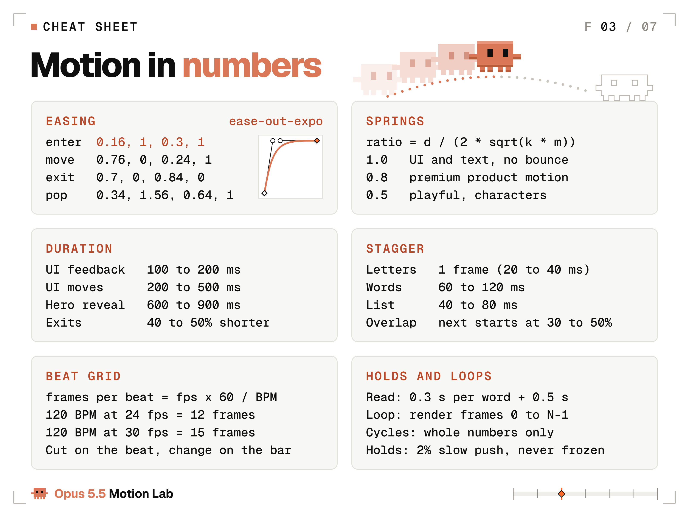

Screenshot this one.

---

### Experiment 2: Five animation principles on a 3D mascot

Frank Thomas and Ollie Johnston wrote down Disney's 12 principles of animation in *The Illusion of Life* (1981). Five of them do most of the work in a short loop, and every one of them can be written as frames and sizes. This experiment gives Opus 5.5 the pixel Claude mascot rebuilt in voxels, a miniature studio and nothing but numbers.

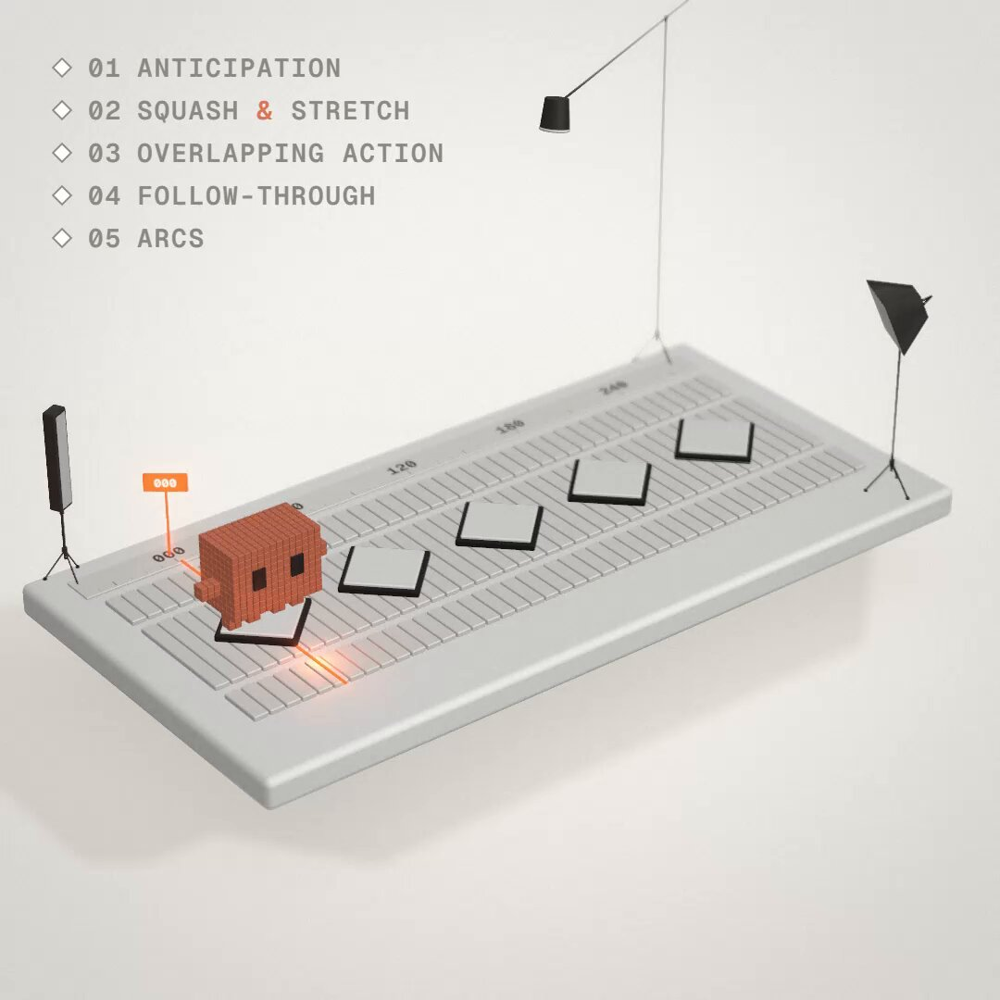

[前往原帖播放视频](https://x.com/flxrnc/status/2105311836190978392?s=46)

Eight seconds, one loop: three studio lights click on, the mascot hops pad to pad along a floor that is a motion-tool timeline, then flips back to the first pad along a dotted arc. Each principle's label lights on the frame it happens, and a playhead tag tracks the frame. It is built in three.js and rendered on the GPU at 60 fps with motion blur blended from subframes.

The exact prompt:

```python
Build a 3D animation-principles loop. One HTML file, three.js 0.160.0 via jsDelivr importmap, Geist Mono from Google Fonts. 1080x1080, 8 s at 60 fps (480 frames), frame 480 equals frame 0. window.renderAt(t) draws any frame from t alone; seeded random only.

Set: a miniature studio. A floating white 12x6 slab on an F4F2EE backdrop. Its top is a timeline: 3 tracks of 0.25 frame cells (EFEEEA), a ruler with frame numbers, 5 keyframe diamonds 2 units apart on the middle track (white fill, 0F0F0F outline). Around it on stands: a key softbox, a rim strip light, a top spot on a boom.
Hero: the pixel Claude mascot as 0.1 voxels: D97757 body 14x10x8, two 3x2 arms, four 2x3 legs, 0F0F0F 2x3 eyes; roughness 0.45, clearcoat 0.3.

Lights, 0 to 1 s: key 3200 K with soft shadows at 0.1 s, rim 7500 K at 0.4 s, top spot 5000 K at 0.7 s. Each clicks on with a 3-frame flicker, and the mascot's eyes glance at it.
Hops, 1 to 5 s: 4 hops to diamonds 2 to 5, landing on frames 105, 165, 225 and 285. Each hop: 11-frame crouch (1.2x0.75), stretch 0.85x1.28 at takeoff, 25 frames of air, squash 1.25x0.7 on landing, spring back at damping 0.55; arms lag 4 frames, legs 6. Each landing lights its diamond FF6A2B, ripples the cells 0.08 high and throws 12 voxel sparks. An FF6A2B playhead carrying a point light moves at constant speed and crosses each diamond on its landing frame.
Flip, 5 to 6.4 s: a dotted arc from diamond 5 back to diamond 1 draws in, then an 18-frame deep crouch and a 360° flip along the arc, 3.5 high, landing on frame 384 while the playhead rewinds under it.
Labels, top left, Geist Mono 28 px: a checklist 01 ANTICIPATION, 02 SQUASH & STRETCH (& in D97757), 03 OVERLAPPING ACTION, 04 FOLLOW-THROUGH, 05 ARCS, in 8E8A83. Each row turns 0F0F0F and fills its FF6A2B diamond on its exact frame: 69 (first crouch), 140 (stretch), 200 (limbs trail), 285 (arms settle), 303 (arc draws).
End: hold, blink at 7.2 s; on frame 468 the lights, diamonds and labels snap off.
Camera: FOV 18, 30° elevation, ±10° orbit over 8 s, 25% push-in tracking the hops, 4% punch-in on the flip landing.
Post: bloom on emissives, depth of field focused on the mascot, 2% grain, 10% vignette, dithered backdrop.
```

Follow-ups: 4, printed below exactly as they were sent. The first build already had everything the prompt lists: the voxel mascot, the timeline, 5 diamonds, the playhead, 3 light stands, the labels, the arc and the flip. The follow-ups fixed the look and the framing: a washed-out grade, props crossing the label block, a rim light seen edge-on and a top light whose click didn't read. Separately, a numeric audit read the live scene on all 480 frames and compared it with the prompt's numbers: 71 checks, from the blink on frame 432 to the feet touching each pad. The first run failed 6, and all 6 were fixed before the final render.

```python
1. The render is washed out and cramped. Grade so the lit front face reads D97757 and lit diamonds read FF6A2B; drop the fill so lights-off sits near 50% and each click is obvious; lower the key to 28 degrees from the front right and put the cool rim at the back left so it edges the side we see. Pull the wide shot back to 44 units so the whole floating slab and all three stands are in frame, add a soft shadow under the slab, and make sparks 0.075 to 0.12 and ruler numbers bigger.
2. Frame check fixes. Keep every prop out of the label block: track the hops at 45% and hang the top spot at 5.8 on a boom from the back right corner, above the flip. Light each lit diamond with a soft glow from its face, move the playhead light to the front edge of the track and run its line under the diamonds. Start the dotted arc above the mascot's head, keep every tripod foot on the slab, and give the arms a bigger, slower settle (2.2 Hz, damping 0.22) so the follow-through reads.
3. Turn the rim strip's panel toward the camera so its click reads.
4. Make the top spot's click read too: narrow it to a 34 degree pool at 45 cd and give the lamp a glowing lens rim.
```

The sound, one more prompt with the same rules. No sound follow-ups were needed: the first build already matched the prompt's numbers. The technical fixes, like a Web Audio gain node that starts at full volume and a compressor that adds 6 ms of delay, are logged separately.

```python
# Sound prompt
Score this 8 s loop, 480 frames at 60 fps. Synthesize everything in code with the Web Audio API, no samples, no downloads. 120 BPM, 4 bars, F major. Each hit lands 1 frame after its visual event.
Bed: pad voices A3 E4 (key light), C5 (top), G5 (rim), each following its light's flicker. Shaker 8ths from 45, kick and bass from 60, roots F D Bb F by bar; kick and shaker rest 330 to 420, bass holds C, then F at 384.
Clicks: lights 6, 24, 42, off 468.
Crouches 69, 129, 189, 249, 312: creak, inhale riser.
Takeoffs 80, 140, 200, 260, 330: upward swish.
Landings 105, 165, 225, 285, 384: rubber squash pitched by the squash scale, spark tings, 384 biggest.
Label pings A5 C6 D6 F6 A6: 69, 140, 200, 285, 303.
Dot ticks 303 to 318, flip whoosh 330 to 384, blink blip 432.
48 kHz stereo WAV, about -14 LUFS, peak -1 dBTP, seamless loop, mux into the MP4.
```

The result: about 2 hours from the first prompt to the finished loop, renders included, plus about 70 minutes for the sound. All 71 checks pass: every label lights on its printed frame, and every landing touches its pad on the planned frame.

The five principles on the checklist, plus the two that ride along with every move, written the way the prompt writes them:

| Principle | What it does | Write it in the prompt as |
| --- | --- | --- |
| Anticipation | Winds up before the move | 11-frame crouch (1.2x0.75) |
| Squash and stretch | Shows weight and speed | stretch 0.85x1.28 at takeoff, squash 1.25x0.7 on landing |
| Overlapping action | Limbs start later than the body | arms lag 4 frames, legs 6 |
| Follow-through | Parts keep moving after the body stops | arms settle at 2.2 Hz, damping 0.22 (follow-up 2) |
| Arcs | Makes motion feel natural | a flip along a dotted arc, 3.5 high |
| Slow in and slow out | Speeds up and settles softly | spring back at damping 0.55 |
| Timing | Frame count sets weight | 25 frames of air per hop, 18 frames of crouch before the flip |

The labels double as a test. The prompt pins each one to a frame (69, 140, 200, 285 and 303), so a move that runs late shows up on screen as a label that lights before its move.

The prompt also says what may not change. The mascot keeps its pixel proportions exactly: a 14x10 body, 3x2 arms, 2x3 legs and 2x3 eyes, built from 0.1 voxels and 8 deep. That line is the guardrail that keeps the character recognizable in 3D. Every style you care about needs a line like that.

The set is the lesson. Motion tools show keyframes and a playhead so animators can check timing. Here they are the floor, and the playhead crosses each diamond on its landing frame. For your own pieces, ask Opus for a playhead and frame labels while you iterate, then switch them off for the final render.

The rest of the twelve still apply. Staging is the one-hero rule from the prompt anatomy. Exaggeration matters more at phone size: push key poses 10 to 30% further than feels right, because the feed shrinks everything.

---

### The lab loop: render, look, fix

The first render is a draft. The loop that finishes it: render stills, look at them, write notes with frame numbers, fix, and re-render only what changed. Two to four rounds is normal.

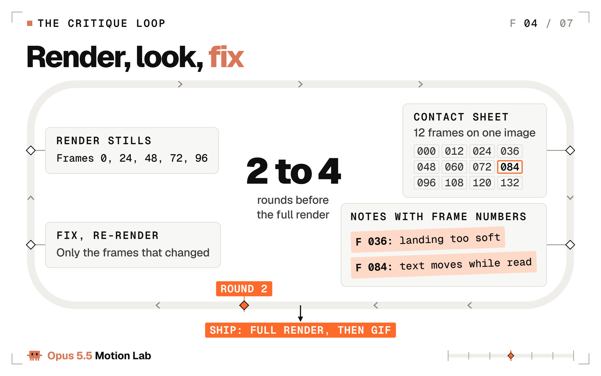

The trick that makes the loop cheap: freeze any frame by its URL. Paste this right before the closing body tag, open anim.html?t=2.5, and you are looking at the exact frame at 2.5 seconds. Opus can screenshot it and read it.

```python
<script>
// Paste right before </body>. Open anim.html?t=2.5 to see the exact frame at 2.5 s.
(function () {
  var q = new URLSearchParams(location.search);
  if (!q.has('t')) return;
  var t = parseFloat(q.get('t')) || 0;
  function freeze() {
    if (typeof window.renderAt === 'function') window.renderAt(t);
    document.getAnimations().forEach(function (a) { a.pause(); a.currentTime = t * 1000; });
  }
  freeze();
  if (document.fonts && document.fonts.ready) document.fonts.ready.then(freeze);
  window.addEventListener('load', freeze);
})();
</script>
```

For the whole clip at once, a contact sheet puts 12 frames on one image. Opus reads it like a storyboard:

```python
# Contact sheet: every 12th frame, 4 across, 3 down
ffmpeg -framerate 24 -i out/frames/%04d.png -vf "select='not(mod(n\,12))',scale=400:-1,tile=4x3" -frames:v 1 out/contact.png
```

Two views borrowed from animators make the notes sharper. An onion skin stacks frames at low opacity: even spacing means robotic motion, and spacing that tightens near the keys means the easing works. A speed graph plots position per frame: straight lines are linear motion, sharp corners are dead starts and stops. Opus 5.5 can draw both and read both.

The follow-ups that work best, ready to paste. Each one points at frames, not feelings:

```python
Render stills at frames 0, 24, 48, 72 and 96. Describe each in one sentence as a viewer would. Does that match the shot list? Fix what does not.
Make a contact sheet of every 12th frame. Mark every frame where two things move at once, then fix the hierarchy.
Onion-skin frames 24 to 47 at 25% opacity. Spacing should tighten near the keys. Adjust the easing until it does.
Plot the hero's x position and scale per frame as a PNG chart. Show me where the motion is linear or stops dead, then fix it with our tokens.
Review this like a senior motion designer: 10 notes ordered by impact, each with a frame number and the exact code change. Apply the top 5.
It is too busy. Remove 30% of the motion and keep only the moves that guide the eye.
The ending is abrupt. Add a 36-frame hold with a 2% push, then let it settle on a spring at damping ratio 0.8.
```

Pick one or two per round. Pasting all seven at once turns a fix into a rewrite.

When a note reaches you as a feeling, translate it before you send it:

- **"Make it pop"**: scale 1.0 to 1.08 to 1.0 over 6 frames, peak on the beat.
- **"Make it feel premium"**: ease-out-quint on entrances, springs at damping ratio 0.8, no overshoot on text.
- **"It drags"**: shorten each hold by 12 frames, one beat at 120 BPM and 24 fps, so every cut stays on the grid.
- **"It feels busy"**: one hero move at a time; everything else starts 150 ms later at 60% of its travel.
- **"It looks like AI"**: list the defaults it used by name, ban each one, and render again.

The lab's receipts, straight from the logs:

| Experiment | Prompt words | Creative follow-ups | Frames |
| --- | --- | --- | --- |
| Opening shot, liquid chrome | 416 | 10 | 360 |
| Experiment 1, vague side | 27 | 0 (by design) | 360 |
| Experiment 1, directed side | 448 | 15 | 360 |
| Experiment 2, 3D mascot | 399 | 4 | 480 |

A creative follow-up is any note that changes how the piece looks or moves. Technical fixes, like a capture hook or font loading, are logged too, in a separate list, and they don't count here.

Sound came last, one prompt per piece written against the frame numbers: 5 sound follow-ups for the chrome loop, 12 for Experiment 1 and 0 for the mascot, all printed with their videos.

Other people's numbers look the same once they are honest about them.

> Miles@uxmiles·[9月29日](https://x.com/uxmiles/status/2104618175803609305)翻译自 英语作为一家设计工作室的创始人，我很不情愿承认这一点，但 Opus 5.5 在动态设计/宣传视频方面简直好得离谱。  
>   
> 这个视频只用了 3 个提示。
>
> 
>
> [前往原帖播放视频](https://x.com/uxmiles/status/2104618175803609305)

Miles runs a design studio. His launch video took 3 prompts and passed 590K views, and he calls Opus 5.5 "insanely good" at motion design. Pros count prompts, and 3 is a good number.

> Vox@Voxyz\_ai·[9月24日](https://x.com/Voxyz_ai/status/2103117246860345550)翻译自 英语我让 Opus 5.5 通过构建一个交互式黑洞实验室来解释引力透镜效应  
>   
> 第一个版本一个提示，然后是一个动态工作流程，在我睡觉时对其进行了三轮打磨。我醒来时看到的是：端到端耗时 5 小时 28 分钟，按 API 价格 $90  
>   
> [https://blackhole.voxyz.ai](https://t.co/BE1xui93rF)
>
> 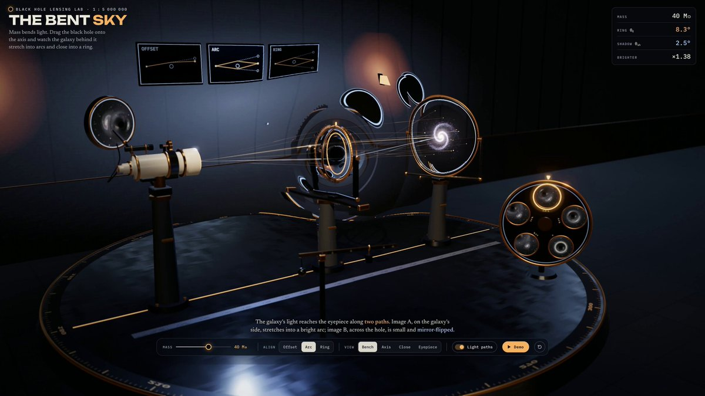
>
> [前往原帖播放视频](https://x.com/Voxyz_ai/status/2103117246860345550)

Vox asked Opus 5.5 to explain gravitational lensing: one prompt, then three overnight polish rounds, 5 hours 28 minutes end to end, about $90 at API prices. The polish rounds are the product.

**Count your follow-ups and post every prompt with the work. Receipts convince people; "one prompt" makes them suspicious.**

---

### Lab equipment: pick your engine

Opus 5.5 can write for every engine below. Name the one you want in the prompt, or it will choose for you.

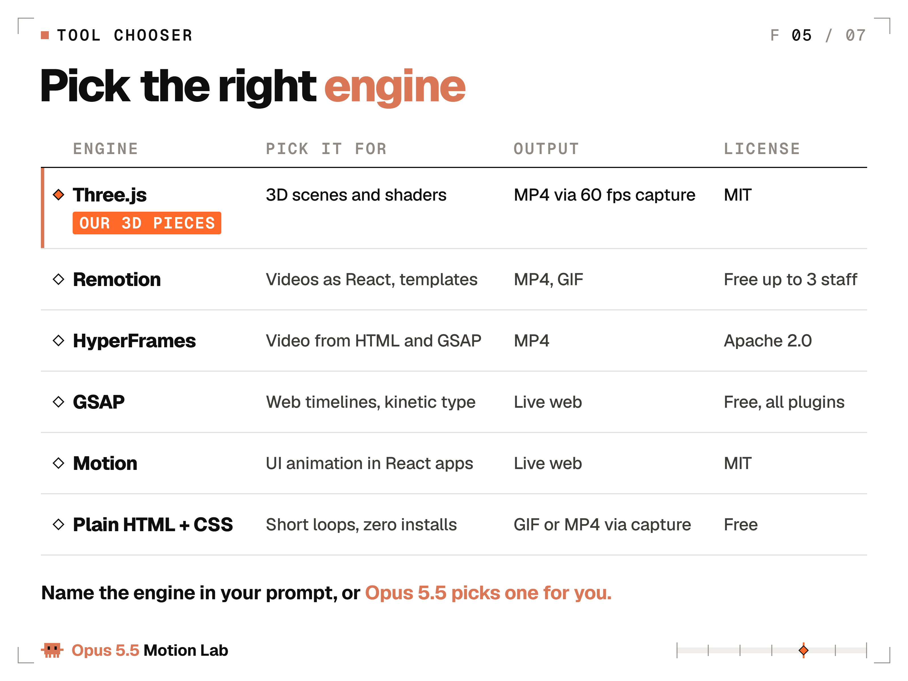

**Three.js** is what this lab's three showcase pieces use: 3D scenes, lights, materials and shaders on WebGL, drawn by the GPU (r186 shipped September 24). For video, drive time from the frame number, never the clock. Give the camera numbers too: a field of view of 35 to 50 degrees is a good starting point.

**Remotion** turns video into React components, frame-exact, with official Agent Skills for Claude Code. Free for individuals and companies of up to 3 employees; bigger companies need a company license.

**HyperFrames** by HeyGen was open-sourced on April 17, 2026 under Apache 2.0. Agents write HTML, CSS and GSAP timelines, and its CLI renders the MP4. No company-license rule.

**GSAP** is the web's timeline library and is now 100% free, including SplitText, MorphSVG, DrawSVG and ScrollTrigger. Its license only bars building a no-code animation builder that competes with Webflow.

**Motion** (formerly Framer Motion) animates React apps under the MIT license. It animates live interfaces and has no video renderer.

**Plain HTML and CSS** needs zero installs and covers 2D loops under 10 seconds: type, shapes and UI. The renderer above turns it into a GIF or an MP4.

```python
# Remotion: video as React components
npx create-video@latest          # pick a template, name it my-video
cd my-video
npm i
npx remotion skills add          # Agent Skills for Claude Code
npm run dev                      # Remotion Studio in your browser
npx remotion render MyComp out/video.mp4   # MyComp = your composition id

# HyperFrames: HTML + GSAP in, MP4 out (needs Node 22+ and FFmpeg)
npx hyperframes init my-video
cd my-video
claude plugin marketplace add heygen-com/hyperframes
claude plugin install hyperframes@hyperframes
npx hyperframes preview
npx hyperframes render
```

The lab's rule of thumb: one idea under 10 seconds, plain HTML. A series, a template or a data-driven video, Remotion. If you think in web pages and GSAP, HyperFrames. Anything 3D, Three.js. And when the motion lives inside a product instead of a video, Motion or GSAP.

Then put the engine in the OUTPUT line of the template, with its numbers. "A Remotion composition, 1920 x 1080, 30 fps, 450 frames" leaves Opus nothing to guess.

> Chubby♨️@kimmonismus·[9月24日](https://x.com/kimmonismus/status/2102844654169575547)翻译自 英语我想快速用 Opus 5.5 制作一部关于 AI 历史的短视频，从“Attention is all you need”到 AGI。  
>   
> 没有库存素材，没有图像或视频生成器：每一帧都从代码中渲染。  
>   
> 这部 3 分钟的影片 100% 在 Claude Code 中由 Claude 用代码制作：约 7400 行 React/TypeScript（Remotion），每张图像都用 SVG 和 Canvas
>
> 
>
> [前往原帖播放视频](https://x.com/kimmonismus/status/2102844654169575547)

Chubby's 3-minute history of AI: "every frame is rendered from code", made with Claude Code and Remotion, about 7,400 lines of React and TypeScript, no stock footage, no image or video generators. About 196K views. The same approach scales from a 6-second loop to a 3-minute film.

> Meng To@MengTo·[9月23日](https://x.com/MengTo/status/2102760783344189761)翻译自 英语Opus 5.5 达到了一个新高度。我对 three.js 的细节细节感到由衷的印象深刻。  
>   
> 我生成了一个可玩的船艇场景，穿越日本景观，带有动态天气、日夜照明、逼真的纹理和 3D 角色。  
>   
> 实时网站：[https://valley.mengto.here.now](https://t.co/YMW4Zp52In)  
>   
> 水面反射、物理效果、风景和建筑都令人疯狂。我可以整天看这个。
>
> 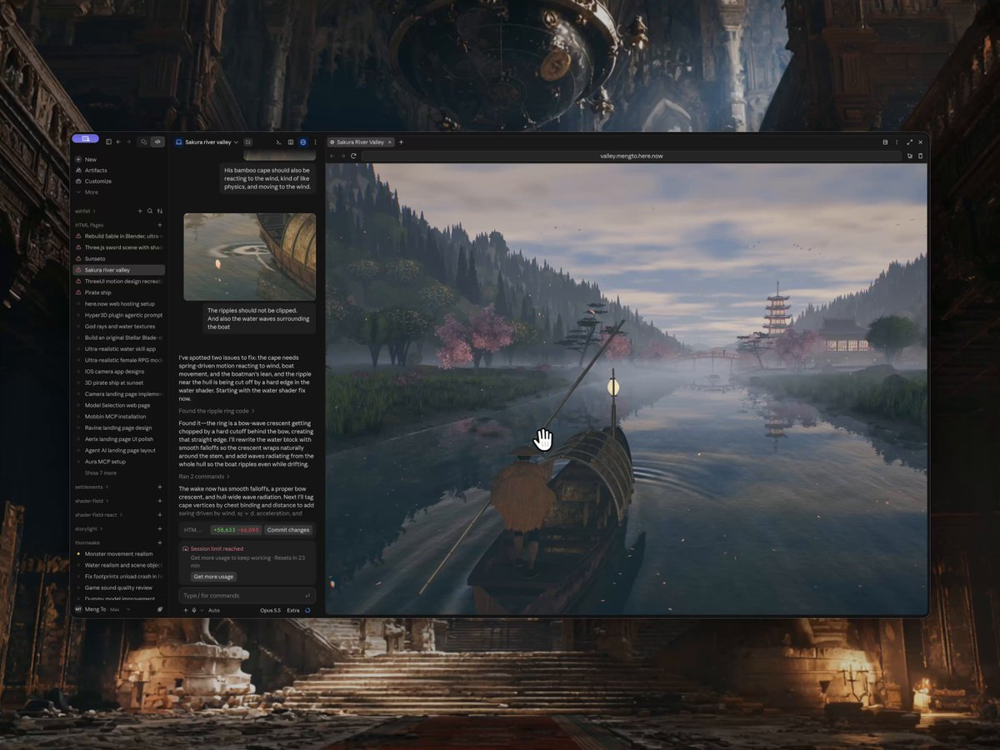
>
> [前往原帖播放视频](https://x.com/MengTo/status/2102760783344189761)

Meng To's playable boat ride through Japanese scenery, with weather, day and night, and water reflections, built in Three.js and seen about 473K times. When the piece is 3D, name Three.js and let Opus build the scene.

---

### The last mile: sound, loops and export for X

The part tutorials usually skip, and the part viewers notice first.

**Sound.** The feed plays video muted until someone taps, so the picture has to work in silence first. When you add sound, mix music and effects, normalize to -14 LUFS (a common loudness target for web video) and put each visual hit 1 frame before its sound, never after.

A sound that arrives before its picture feels wrong sooner than one that arrives a little late. Real life runs in the same order: light beats sound.

The three lab videos follow that rule to the sample: every sound synthesized in code with the Web Audio API, each hit peaking 1 frame after its picture, mixed to -14 LUFS with peaks at -1 dBTP. Opus 5.5 can't listen, so it checked the sync by decoding the finished MP4 and lining each hit up with its frame.

```python
# Music + sound effects, mixed, normalized to -14 LUFS, muxed under the picture
ffmpeg -i out/anim.mp4 -i music.wav -i sfx.wav -filter_complex "[1:a][2:a]amix=inputs=2:duration=first,loudnorm=I=-14:TP=-1:LRA=11[a]" -map 0:v -map "[a]" -c:v copy -c:a aac -b:a 192k -shortest -movflags +faststart out/final.mp4
```

**Loops.** Render frames 0 to N-1, never N. Frame N is frame 0 again, and showing it twice is the hiccup people see at the seam. Drive every loop from phase = frame / N with whole-number cycles.

A square that turns exactly 90 degrees per loop, or a wave that completes exactly 2 cycles, lands back on its first frame. For organic drift, sample noise along a circle, so it comes back to where it started.

Make frame 0 a finished composition, too. It's the first thing on screen while a GIF loads.

**Export.** MP4 for posts, GIF for X Articles and inline loops. One palette for the whole GIF keeps colors from flickering between frames.

```python
# MP4 for an X post: H.264 High, yuv420p, starts playing at once
ffmpeg -framerate 24 -i out/frames/%04d.png -c:v libx264 -profile:v high -pix_fmt yuv420p -crf 18 -movflags +faststart out/anim.mp4

# GIF for an X Article: one palette for the whole clip, 1200 px wide
ffmpeg -framerate 24 -i out/frames/%04d.png -vf "scale=1200:-1:flags=lanczos,split[a][b];[a]palettegen=stats_mode=diff[p];[b][p]paletteuse=dither=bayer:bayer_scale=5:diff_mode=rectangle" -loop 0 out/anim.gif

# Loop check: play it three times back to back and watch the seam
ffmpeg -stream_loop 2 -i out/anim.mp4 -c copy out/loop_check.mp4
```

The X limits that matter, from X's media docs and Help Center:

| Spec | GIF | Video |
| --- | --- | --- |
| Size limit | 15 MB | 140 s without Premium |
| Frame size | up to 1280 x 1080 | 1920 x 1080 for 16:9 |
| Frames and speed | at most 350 frames | up to 60 fps |
| Format | one palette, loop forever | H.264 High, yuv420p, AAC audio |
| Lab default | 1200 px wide, 24 fps | CRF 18, faststart |

At 24 fps, the 350-frame cap means a GIF tops out at about 14.5 seconds. A 4 to 6 second loop is 96 to 144 frames, well under it.

One timing trap in GIF exports: delays are stored in hundredths of a second, so a 24 fps frame (41.7 ms) can't be stored exactly. Round every frame to 40 ms and the loop runs 4% fast, off your beat grid. The fix: five frames at 40 ms, then one at 50 ms, which keeps a 6-second loop at exactly 6.00 seconds.

Pick the canvas before the first frame, because changing it later means re-directing every shot. The common sizes: 1920 x 1080 for 16:9, 1080 x 1080 for 1:1, 1080 x 1350 for 4:5 and 1080 x 1920 for 9:16. X accepts video between 1:3 and 3:1.

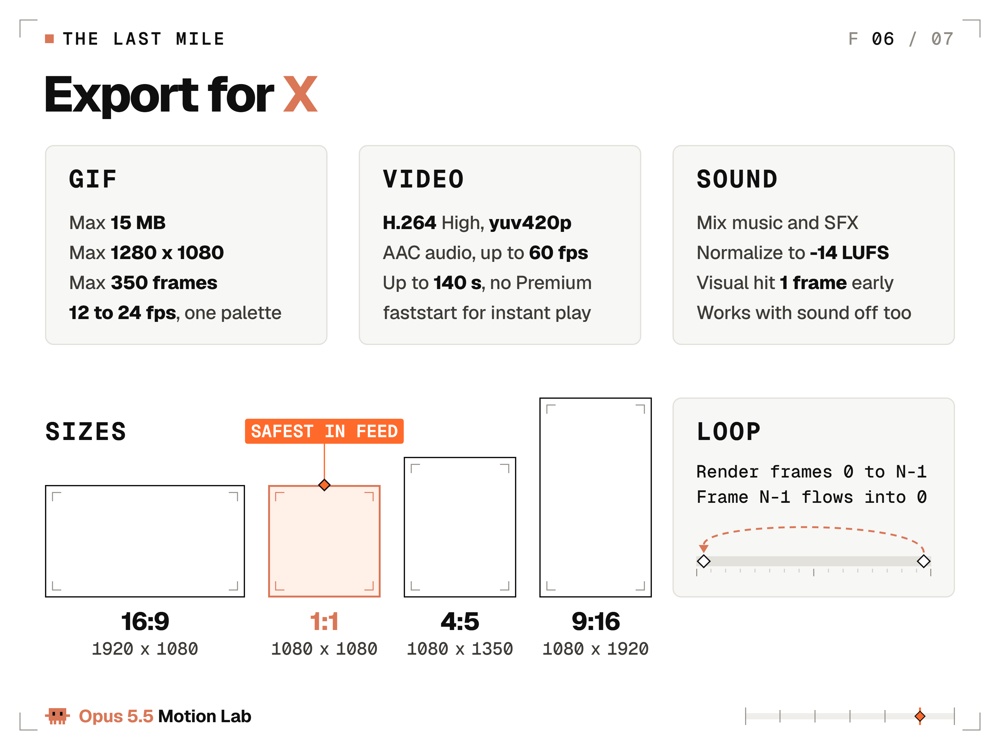

> Leon Lin@LexnLin·[9月27日](https://x.com/LexnLin/status/2104148233106723099)翻译自 英语我让 Claude Code (Opus 5.5) 为一个假日历 app 制作一个发布视频，天哪，妈的，你看到的 AND 听到的所有东西都是代码生成的  
> 一个提示，它烹饪了大约 8 小时  
> 名称、logo、UI、动画、配乐、音效  
>   
> 开源，仓库在回复中 :)
>
> 
>
> [前往原帖播放视频](https://x.com/LexnLin/status/2104148233106723099)

Leon Lin asked Claude Code on Opus 5.5 for a launch video for a made-up calendar app: name, logo, UI, animation, soundtrack and sound effects, all in code, from one prompt in about 8 hours. It passed 85K views. Sound can be code too.

---

### When an experiment breaks

The same failures come back in every project. Here they are, each with the prompt that fixes it.

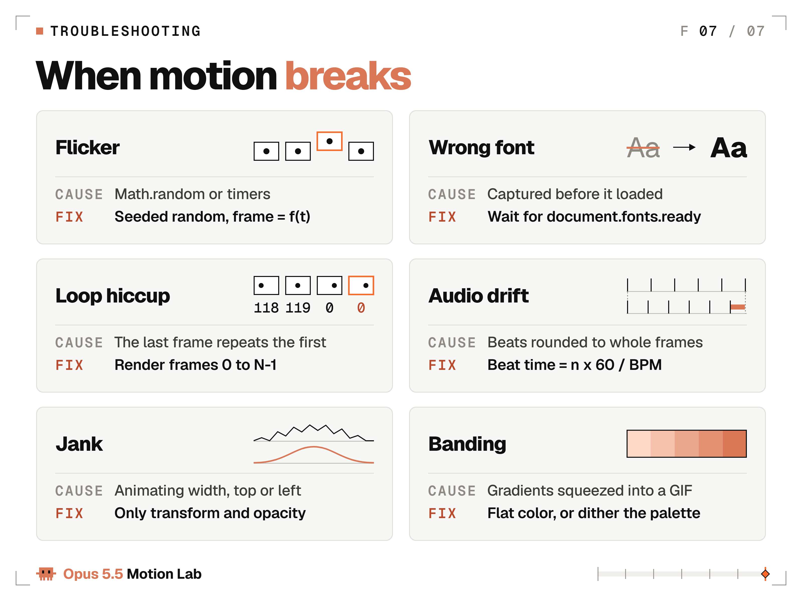

| Symptom | Paste this fix |
| --- | --- |
| Flicker or jitter | Make every value a pure function of t. Replace Math.random with a seeded generator. Remove timers and CSS transitions. |
| Wrong or fallback font | Load the font with display=block and wait for document.fonts.ready before the first frame. |
| Hiccup at the loop seam | Render frames 0 to N-1 only. Drive the loop from phase = frame / N with whole cycles. |
| Audio drifts off the beat | Compute each beat as n x 60 / BPM and round per beat. Never add a rounded frame count. |
| Jank or dropped frames | Animate only transform and opacity. No width, height, top or left. |
| Banding in the GIF | No gradients. Flat colors only, or dither the palette. |
| Blurry or shimmering text | Snap resting text to whole pixels. Render at 2x and scale down. |
| Text moves before you can read it | Hold every text state 0.3 s per word plus 0.5 s before it moves. |
| Everything moves at once | One hero move at a time. Others start 150 ms later at 60% of its travel. |

If a fix doesn't hold, ask Opus to render the two frames on either side of the problem and describe the difference. Spotting what changed between two images is exactly what its sharper vision is for.

```python
The fix at frame 84 did not hold. Render frames 83 and 85 as PNGs, put them side by side and list every difference you can see. Find the line of code that causes it, fix only that line, then render both frames again.
```

When a fix works, add it to the render contract. The contract is the lab's memory: every line in it is a failure you never have to see again.

---

### Experiment 3 is yours

The lab is open. Tonight's run:

1. Copy the opening-shot prompt and swap its words for your product or your name.
2. Run it on Opus 5.5 at medium effort, in the Claude app or in Claude Code.
3. Render stills at frames 0, 24, 48, 72 and 96, and write two notes with frame numbers.
4. Fix, re-render, and repeat until you run out of notes.
5. Export with the GIF command and post it with your prompt and every follow-up in the first reply.

Keep the numbers on the first run and change only the words. On the second run, change one number at a time, so you can see what each one does.

The model is the same for everyone. The numbers you give it are yours.

**I post every new piece with its exact prompt and every follow-up, picture and sound. No fake one-shots.   
Follow** [**@flxrnc**](https://x.com/@flxrnc) **so the next one lands in your feed, and bookmark this article so the numbers are here when you need them.**
