# Opus 5.5 动效实验室：让 Claude 像动画工作室一样制作动效

作者：Florence（[@flxrnc](https://x.com/flxrnc)）  
发布：2026-09-30T15:00:31.000Z

[查看原帖](https://x.com/flxrnc/status/2105311836190978392?s=46) · [英文原文](原文.md)

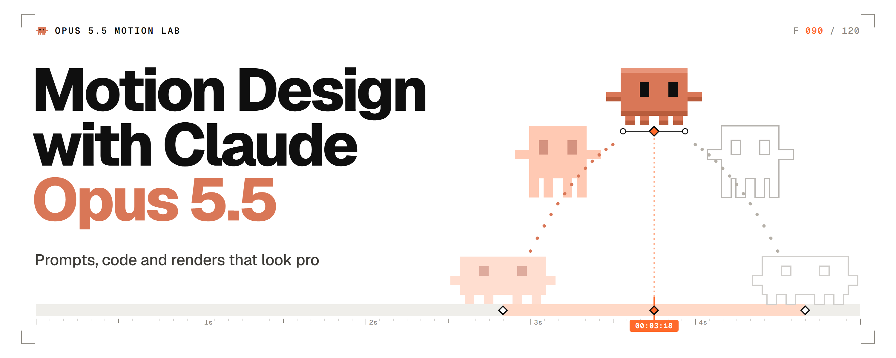

实验室里的每段动画都由 Claude Opus 5.5 制作。每个案例都附上实际用过的提示词，以及为做成它而发送的每条后续指令。这里记录的是一段可以核对的动效制作过程。

Opus 5.5 于 9 月 22 日发布后，动态里很快挤满了标着「一句提示词」的动效作品。有些确实只有一行。观看量最高的那条音乐视频，作者先口述了五分钟，模型又跑了 12 个小时。几乎没人发中间过程：第二条提示词、第三条提示词，或者那条「第 84 帧的峰值来晚了」的反馈。

这篇文章记录的就是那个中间过程。三段由 Opus 5.5 制作的动画，画面和声音都有，附上每条提示词和后续指令。你会看到让成片成立的数字，以及如何从一个空目录做出能发到 X 的循环视频。

**开场镜头：一团液态铬流进标题。它的提示词写满了数字。**

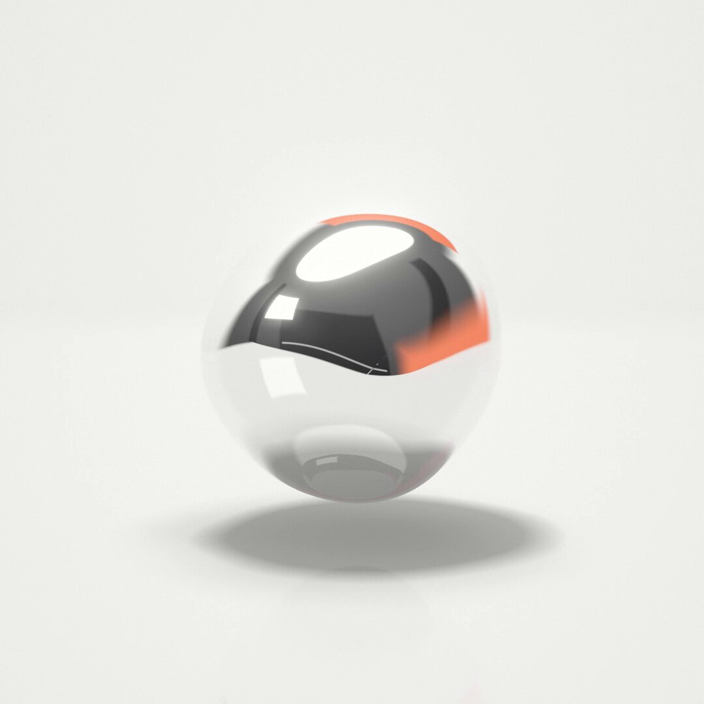

[前往原帖播放视频](https://x.com/flxrnc/status/2105311836190978392?s=46)

6 秒一循环。一团铬液被压扁、拉长，收颈分成 7 滴，每一滴流进对应字形。一道高光扫过文字，字母再融回一团晃动的铬液。液体用着色器把单一形体做光线步进渲染，文字用真实的 Three.js `TextGeometry`，GPU 以 60 fps 渲染每一帧，并将子帧混合成运动模糊。

下面是实际粘贴到 Opus 5.5 的提示词。中文译文保留参数，英文可在本地原文中对照。

```text
液态铬：6 秒无缝循环，60 fps，1080×1080，一个 HTML 文件。只通过 jsDelivr importmap 使用 Three.js 0.160.0。

window.renderAt(t) 根据以秒为单位的 t 计算一切；所有运动与噪声以 6 秒为周期；有 ?t= 时不要启动 requestAnimationFrame；字体加载和烘焙完成后设置 window.__ready。相机做四分之一像素抖动，从 frac(t*60) 取 4 个偏移。

在全屏着色器中，把铬液、7 个液滴和文字作为同一个 SDF 进行光线步进。平滑最小值系数 k 为 0.35，液滴分离时降到 0.1；每滴经 mix(dropSDF, textSDF, K) 变成字形。文字：用固定版本的 examples/fonts 中的 helvetiker_bold，为“OPUS 5.5”逐个字形建 TextGeometry；size 0.52、height 0.12（r160 读 height，不读 depth）、倒角 0.03、倒角分段 10、曲线分段 24、字距 -0.04 em，小数点作视觉居中。在 GPU 上把同样的轮廓烘焙成 2048×512 的有符号距离纹理，再挤成与网格匹配的圆角盒体。3.3–4.7 秒交叉淡入真实网格（折痕法线，35 度），使用相同 GLSL，在 SDF 内追踪反射。

铬材质：F0 0.92，Schlick 菲涅耳，粗糙度 0.04，3 次反弹。

影棚：白色地面在 y = -0.8，柔和的顶光阴影，接触处压暗，反射 6%。z = 4 之外（相机侧）设为黑色，使字面反射暗色。以下角度为方位角和仰角，相机在 0 度：相机侧黑板覆盖 86×57 度；顶上和左上方柔光箱强度分别为 2.4、3.0；左右 75 度放黑色遮光板；背后放 D97757 轮廓灯条，方位角 149 度、仰角 24 度、强度 1.4；高光灯条宽 2 度、强度 6、倾斜 40 度，3.3–4.1 秒从左扫到右。

时间轴：
0–1.2 秒：铬液半径 0.62，每 1.5 秒起伏 3%，Simplex 噪声 0.05。
1.2–1.4 秒：压缩 10%。
1.4–2.1 秒：横向拉伸到 2.4 倍，收颈分成 7 滴，大小按字形面积定；每滴沿向上 0.2 的弧线飞到自己的字形位置，过冲 7%，沿速度方向拉长。
2.2–2.9 秒：液滴从左到右变成文字，间隔 3 帧，每滴用 0.4 秒；倒角先鼓到 0.07，再用弹簧收平。
2.9–4.8 秒：停留。
4.8 秒：先鼓起 6 帧，字母下塌 0.12 并软化，缓入流向中心；5.62 秒合并，随后晃动 3 次（14%，阻尼 0.25），一直延续到第 0 帧。

相机：30 度镜头，距离在 2.6 秒前从 5.6 拉到 7.2，停留时推进到 6.95，5.9 秒前回到 5.6；围绕停留姿态向两侧各转 7 度，相机仰角 6 度。

后期：泛光阈值 1.0、强度 0.3；色调曲线到 0.9 之前保持线性，之后平缓压缩高光；暗角 7%；按帧号播种的颗粒 1.5%。
```

有一行是 Three.js 里真会踩的坑。r160 的 `TextGeometry` 用 `height` 表示挤出深度，`depth` 会被 50 覆盖。原本要做 0.12 厚的字，最后会做成 50 厚。锁定版本，再写对参数名，就能避开这个问题。

后续共 10 条。第一版已经有从铬液到液滴、到文字、再融回去的完整编排。第 1 到第 5 条修正静帧和测量发现的问题：铬像白塑料，高光抹掉了 P，倒角让字粘在一起，液滴飞出画面。第 6 到第 9 条来自对 12 处过渡的逐帧检查，例如第 85 帧铬液突然冒出一个凸起。最后一条增加了让字面反射的地平线，使它读起来像铬，而不是平涂的炭灰。

```text
1. 材质像白塑料。字面只能看到黑地板，所以看不到高光；网格的封盖反射出弯折的碎片。把影棚设为 0.1 的深灰色，只在主体背后留一面 140 度宽的白色无缝背景，从下方 10 度到上方 40 度。白地面止于 z = 4，让朝相机侧的光线能打到黑板。把网格封盖法线压平。轮廓灯条为 12×40 度。铬液噪声频率 1.0。
2. 高光像一道眩光，把 P 擦掉了：改为宽 0.6 度、强度 3。轮廓光照不到文字：把 D97757 灯条移向后上方（方位 165 度、仰角 42 度、70×16 度），右侧再补一束柔和的 D97757 侧光，方位 55–125 度、仰角 -16–10 度，让朝右的倒角都能接到光。
3. 0.03 的倒角把每对相邻字形都粘到了一起。按实测轮廓排字，字间隔 0.09，词间隔 0.26；相机保持在 7.8，再推进到 7.55。网格倒角有斑点，用 SDF 梯度做着色，使它与光线步进渲染的文字一致。
4. 外侧液滴在第 112 帧附近飞出画面 8 px。起点设为相应字形位置的 40%，飞行用 u^2.4 缓动，让 7% 的过冲落在 1.97 秒；相机在 1.2–2.5 秒移动。
5. 文字成形时像迷彩，合并后的铬液像皱锡纸。把表面波纹设为 0.008，频率 3.2。
6. 第 85 帧铬液突然冒出凸起。让液滴在 1.2–1.65 秒从半径 -0.4 长出来，主铬液同样从 -0.4 恢复，让平滑最小值的吸引逐渐进入。
7. mix(sphere, letter) 过渡时会变成扁硬币。改为让每滴流进字形：每个字形烘焙一个 SDF 通道；在一个从液滴位置长出的球内揭示文字（平滑最大值 0.05，缓出，0.4 秒），同时收小液滴，用平滑最小值把两者连起来。字形完整后才启动鼓胀弹簧（阻尼 0.55，3 Hz）。融化时反过来，从 5.2 秒开始流走。
8. 高光扫到 O 太晚，离开最后一个 5 太早。让它在 3.3 秒碰到 O，在 4.1 秒离开最后一个 5；校准扫光方位角为 -0.083 到 0.302。
9. 字母消失时液滴还没出现，合并后的球也膨胀了。先让液滴长回来（4.88–5.1 秒，字形尺寸的 1.15 倍），再收回字母（5.0–5.35 秒），5.15 秒开始长出中央铬液。
10. 字面像平涂的炭灰。相机侧黑板内，在 -6 度加一条亮度 0.5 的细地平线灯条；把地面末端在 z = 3.6–4.0 之间柔化。
```

声音来自另一条提示词。Opus 5.5 听不见声音，所以按帧号给这段循环配乐：全部音效用 Web Audio API 合成，不用采样，每个重音比相应画面晚一帧。声音又改了 5 轮，依据都是解码后的音频测量。最早的几处重音峰值迟了 8 到 11 毫秒；相对于底乐的电平不均；限幅器压扁了最后的液体声；编码器还在接缝处加了 16 毫秒的填充。

```text
# 声音提示词
为这段 6 秒无缝循环（360 帧，60 fps）配乐。所有声音用 Web Audio API 合成，不用采样、不下载素材。每个重音在对应视觉事件后一帧落下。
底乐：120 BPM，四小节 3/4 拍，每小节 90 帧，从第 67、157、247、337 帧开始。底鼓在第 67、247、337 帧；反拍沙锤只在没有重音时出现；低音与铺底和弦为 Bm、G、A、D。
事件：压缩时的吸气声在第 84 帧达峰；第 84–112 帧是拉伸滑音；第 112、113、114、120 帧是收颈液泡声；第 136、138、141、145、147、150、153 帧是沿 D 大调五声音阶上行的注入声；第 200 帧是金属叮声（分音低于 8 kHz）；闪烁声从左移到右，到第 245 帧；液体声从第 288 帧增强，第 303 帧达峰；第 309 帧滴水；第 319、321、322、325 帧发出合并声；第 337 帧吸入并发出液体咕噜声，以 2.4 Hz 摇摆。
48 kHz 立体声 WAV，约 -14 LUFS，峰值 -1 dBTP，接缝无咔嗒声。与视频合并到 MP4。

# 声音的 5 条后续指令
1. 单独测量各重音：底鼓和咕噜声的峰值迟了 8–11 ms，原因包括 4 倍过采样的波形整形器和从相位 0 起振的正弦波；它们相对于底乐的电平不均（叮声 +10 dB、咕噜 +1 dB、滴水 -8 dB、点滴 +1 dB）。把每个有音高的重音做成音频缓冲区，让起音在恰好 (F + 1) × 800 个采样处抵达余弦波峰，去掉波形整形器。每个重音或同帧的两个重音，均比底乐高 3–6 dB（K 加权，取前 60 ms）。混音经过 150 Hz 高通后掉了 4.5 dB：超低音降 4 dB，底鼓降 1.5 dB，咕噜声下的底鼓降 4 dB，铺底升 1.5 dB。
2. 时序准确了，重音比变轻后的底乐高 6.5–9 dB：重音总线降 2.5 dB，两对收颈声各降 1.4 dB，U 和 S 的收颈声各降 1 dB，渐强降 1.2 dB，最后一处注入声降 0.5 dB；滴水升 2.5 dB，咕噜升 3 dB。使各重音比底乐高 3–6 dB。
3. 咕噜声各分音和底鼓在同一个采样处到峰值，限幅器削掉了 3.4 dB。把咕噜声的偶次谐波设为正弦相位，把其下方底鼓降 2.7 dB；让限幅压缩小于 1.5 dB，咕噜仍比底乐高 3–6 dB。
4. 正弦相位的谐波把咕噜声的最大波峰推迟了 4 ms。所有谐波改回余弦相位，使峰值落在第 270400 个采样；二次谐波设为 0.2，三次设为 0.08，去掉四次，咕噜声再降 0.5 dB。
5. MP4 音频的编码填充比画面多 16 ms，文件从突变处开始，循环播放器在 6.000 秒突然截断，静音 16 ms 后又突然重启。两次循环版保留无缝 WAV 母带；文章中的单次循环 MP4 只对前后各 96 个采样做 2 ms 的升余弦淡变。
```

从第一条提示词到循环成片约 2 小时，包含 12 次过渡检查。声音另花约 45 分钟。结尾的晃动穿过第 0 帧连续进行，因此看不到接缝。

液滴、灯光和运镜，每一项都能追溯到提示词或后续指令里的某个数字。这个循环浓缩了整套实验。

内容速览：

- **实验一**：同一个 3D 产品镜头，比较模糊提示词和具体制作指令。
- **工作原理**：Opus 5.5 为什么写代码来生成画面，这对你有什么帮助。
- **从零搭建**：免安装方案，以及 Mac 和 Windows 环境。
- **提示词结构**：一条具体的动效提示词需要哪些内容。
- **数字**：缓动、弹簧、时长、错峰和节拍网格。
- **实验二**：在一个 3D 吉祥物上实现预备动作、挤压与拉伸、动作重叠、跟随动作和弧线。
- **实验循环**：Opus 5.5 如何检查自己的帧。
- **工具**：Remotion、HyperFrames、GSAP、Motion、Three.js。
- **收尾**：声音、无缝循环、导出到 X。
- **常见问题**：会遇到哪些失败，各用哪条提示词来修。

用浏览器和 Claude 就可以起步，无需 After Effects。

---

### 实验一：模糊提示词与具体制作指令

发布首周被复制最多的一条动效提示词，英文只有 26 个词。它要求做一段 15 秒作品集短片，证明「你有多擅长动效设计」。9 月 24 日，拥有 885 个关注者的 kirill sh 把 Opus 5.5 和 GPT 6 Astra 的结果并排发布，观看超过 180 万次。

> kirill sh@shneural · [9 月 24 日](https://x.com/shneural/status/2103151003272962130)
>
> 用过 Opus 5.5 以后，再看 GPT 6 Astra 做的设计真的很难受。
>
> 给两个模型同一条提示：「做一条 15 秒、富有动感的动态图形短片，展示你有多擅长动效设计。就当是你简历里的作品集短片。全力发挥。」
>
> 完全不在一个水平，自己看。GPT 在这方面真的很差，OpenAI 的品味糟透了。
>
> 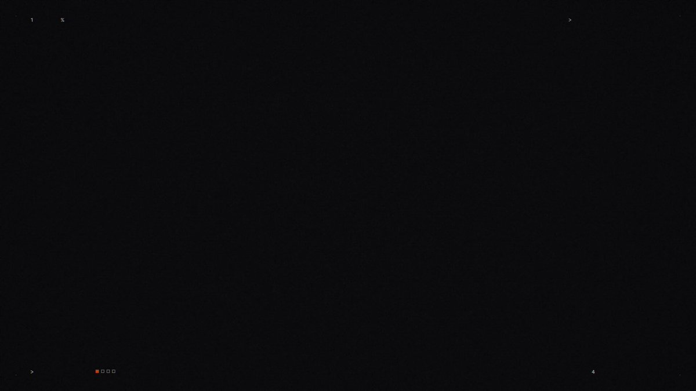
>
> [前往原帖播放视频](https://x.com/shneural/status/2103151003272962130)

这就是原帖。接下来几天有许多人复现。用它演示模型很合适，因为主题就是模型自己，没有一份必须准确实现的制作说明，结果也就无所谓偏题。

把同样的做法放到自己的发布项目上，情况就不同了。作品集短片有惯例，也没有客户。你自己的产品、文案和时间安排都有可能做错，一句话交代不了这些。

另一个极端是 Donald 制作的 Opus 5.5 音乐视频，观看量最高。功劳要分清：《Claude-Pop》这首歌及首版视频由 deckard 创作，于 9 月 9 日发布，当时 Opus 5.5 还没发布。Donald 做的是 Opus 5.5 版本。

> Donald@donaldjewkes · [9 月 24 日](https://x.com/donaldjewkes/status/2102801274173587569)
>
> 我用一条提示词和 Opus 5.5 做了这条视频。对着电脑讲了五分钟，Claude 工作了 12 小时，我醒来就看到了结果。完整提示词：
>
> 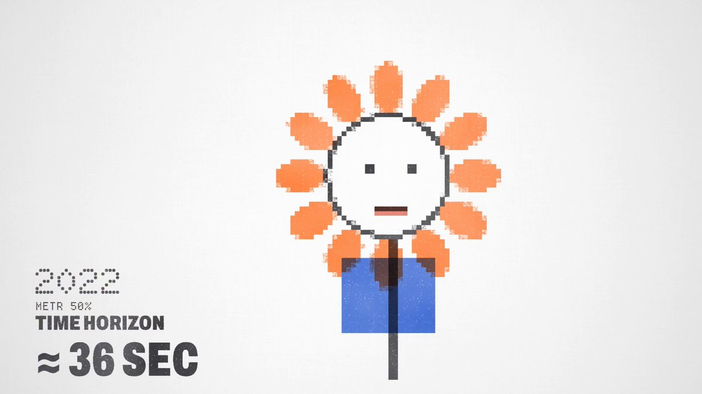
>
> [前往原帖播放视频](https://x.com/donaldjewkes/status/2102801274173587569)
>
> 引用 NotinReality@other__reality · 9 月 23 日
>
> 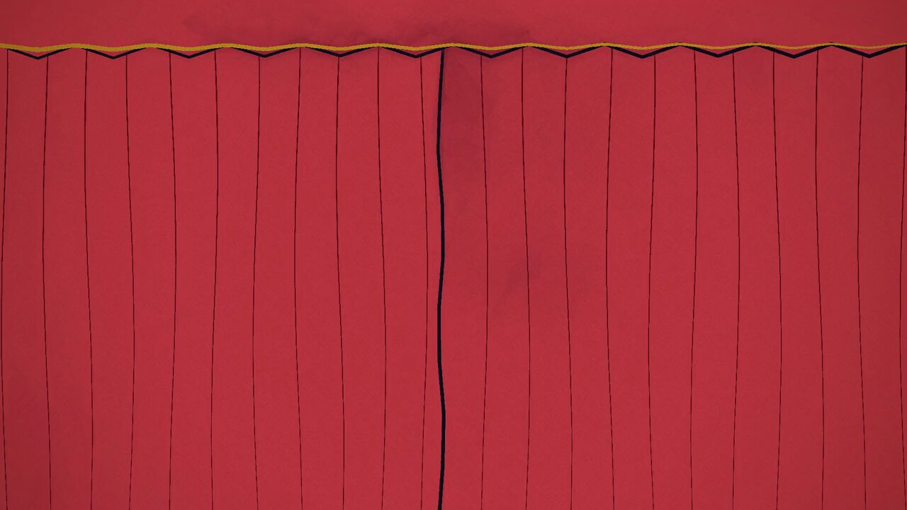
>
> 2:36 · 在我测试过的模型里，Claude Opus 5.5 的视觉设计最好。x.com/slimer48484/st…

观看超过 360 万次。Donald 称它为一条提示词，同时也说自己对着电脑讲了五分钟，Claude 随后跑了 12 小时。那条提示词其实是一份口述的制作说明，加上 12 小时的自主制作。真正起作用的是具体的制作指导。

于是实验室做了一个对照实验：同一个模型、同一个主体（一对无线耳机）、同样的技术要求（一个 HTML 文件，Three.js，每侧 960×1080，6 秒循环）。变量只有提示词的具体程度。

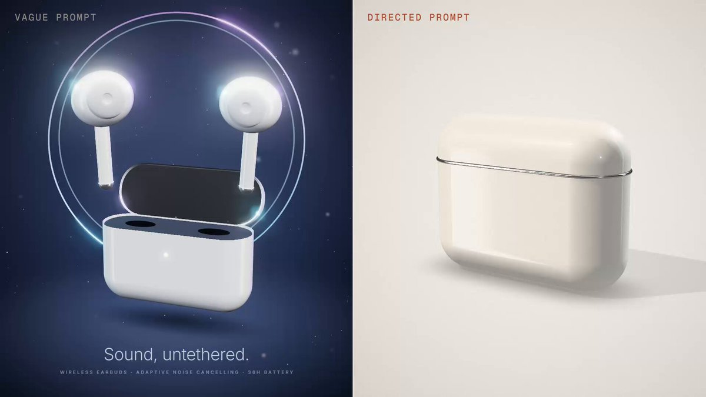

[前往原帖播放视频](https://x.com/flxrnc/status/2105311836190978392?s=46)

读提示词前，先把两侧都完整看一遍。左边是三个形容词的结果，右边是 448 个词的制作指令的结果。

提示词 A，模糊版（左）：

```text
为一对无线耳机制作一段酷炫的 3D 产品动画。画面要高级、现代。使用 Three.js，输出一个自包含 HTML 文件，960×1080，6 秒循环。
```

提示词 B，具体版（右）：

```text
目标：一条无线耳机的影棚产品片。充电盒打开，耳机升到观众眼前，最后利落地扣回去。
输出：一个自包含 HTML 文件，经 jsDelivr importmap 引入 Three.js 0.160.0，960×1080。
时间：6 秒循环，60 fps = 360 帧，120 BPM（每拍 30 帧），重音对齐节拍。

模型（1 单位 = 1 cm，用带倒角的基本体）：充电盒 6.0×4.6×2.2，边缘圆角 1.0，在 3.3 处分盖，后侧铰接，接缝倒角 0.06，沿缝一圈 0.045 的镀铬细线。内部为 D97757 的底板，两个深色椭圆槽。耳机：1.6×1.5×1.5 的椭球头、旋转成形的硅胶耳塞、长度 1.6 的椭圆耳机柄，尾端镀铬盖，深色网罩。耳机落座时头部与底板齐平。

外观：缎面陶瓷白 F4F1EC（粗糙度 0.38，清漆层 0.35）；铬材质（金属度 1，粗糙度 0.05）；D97757 只用于底板，墨色 1C1B1A，耳塞 E4E0DA。背景中心 F0EDE8，角落 DEDAD3，做抖动降阶处理。左前上主灯 FFF4E8、强度 3.0，阴影柔和；右下补光 E8EEF5、强度 0.6；右后上轮廓光 FFFFFF、强度 4.0。用代码建 PMREM 影棚环境（暖灰穹顶、顶灯与主灯柔光箱、轮廓灯条）作为反射。接触阴影不透明度 0.55。中性色调映射，暗角 8%，按帧播种的颗粒 2%。

镜头：
0.0–0.5 秒：宽 2.4 的影棚灯带（从 5.5 秒开始）从左扫到右，让闭合的盖子和接缝闪过高光。
0.72–0.95 秒：预备动作：盖子再向下压 1.5 度，盒体压缩 2%，停 3 帧。
1.0 秒：盖子弹到 100 度（阻尼 0.6，约 10% 过冲，在 1.4 秒前稳定）。
1.5 秒：耳机从槽内升起 4.0，右侧先起，左侧晚 4 帧（阻尼 0.7）。从上升第 8 帧起，向外倾 14 度，并用较松的弹簧转向相机 35 度（阻尼 0.5）；耳机柄摆过目标后稳定。
2.0 秒：相机推进。
2.4–4.0 秒：停留，耳机按周期 1 秒的正弦波上下浮动 0.05。3.0 秒第二道高光扫过耳机。
4.0 秒：耳机恢复直立（0.2 秒）并下降（easeInOutCubic，0.45 秒），落座时因磁吸再下沉 0.05。
4.75 秒：盖子落下（easeInCubic），恰在 5.0 秒合上，反弹 3 度，5.3 秒前稳定；盒体回弹 1.5%。
5.5 秒：下一道高光开始。

相机：fov 30，始终有运动。跨循环从 5.6 秒到 4.0 秒，方位角从 34 度变为 10 度（easeInOutSine），在 5.6 秒前返回（easeInOutCubic）。距离从 21 缓慢到 20.2，2.0 秒开始推进到 16（easeOutExpo，0.8 秒），4.0–5.6 秒返回（easeInOutCubic）。耳机升起时，仰角从 12 度到 19 度，注视高度从 2.3 到 4.2。

禁用：紫色或蓝色渐变、发光球、泛光、霓虹、镜头光晕、粒子、通用旋转转台、深色背景、文字。

验收：renderAt(t) 精确绘制时刻 t；只用带种子的噪声。为每个重音附近取静帧，确保第 359 帧顺畅衔接第 0 帧。
```

左侧有意不发后续指令。这是一个只看过提示词 A 的独立上下文直接给出的第一版：深蓝背景、发光光环、泛光、粒子、旋转耳机，以及凭空写出来的标语，基本踩遍了 B 的禁用清单。右侧经过 4 轮审片，共 15 条后续指令。标签和左右分屏是在渲染完成后加上的。

```text
# 第一轮：第一版完成后（静帧取 0、1.25、2.9、4.9 秒）
白盒子融进背景，铬看起来是灰的。把影棚穹顶光降到约三分之一，增强柔光箱，让背光侧变暗，铬上出现明暗条带。
打开的盖子像一块平板。挖空它：边沿 0.16，内腔深 0.62，内顶圆角 0.22。
深色圆网罩像眼睛，改成细长槽。
盒底冒出两块暗斑：耳机槽底在 0.3，超出底部圆弧；盒壁在该高度向内缩 0.29。把槽底抬到 0.5。
底板像鲑红色。粗糙度设为 0.7。

# 第二轮：测量像素后
正面和顶面的亮度一样，右侧融进背景。主灯移到 (-7, 12, 8)，轮廓灯移到 (2, 8, -12)，仍在左前上和右后上。顶灯柔光箱 2.2，曝光 0.8。
高光像泛光灯：灯条开关影响 178,864 个像素，因为高度 60 的灯条照亮了整面。让灯条只出现在反射里（用第二个 PMREM 查镜面反射，漫反射仍用静态影棚），恢复制作说明里的 2.4 宽。
曝光 0.9，主柔光箱 4.5，使陶瓷呈白色。底板镜面反射设为 0.3，避免掠射反光把 D97757 冲淡。
耳机槽做 0.07 的加工圆角。
耳机像老鼠头。把柄移到外侧，用短喷嘴和扁平硅胶罩替代球形耳塞，把网罩从头部移到柄上，避免它再次像眼睛。
镜头升得更快：2.3 秒前到较高的注视点，推进时给耳机头留出上方空间。

# 第三轮：分别隔离每道高光后
第一道高光太弱，撑不起开场。清漆粗糙度 0.08，灯条峰值 24，扫光改为 -80 到 0 度，第 0 帧时光带就在正面中央。
第二道高光让整个盖子内腔闪白（3.3 秒影响 207,791 个像素），因为灯条经过了平面的镜面反射方向。提高到仰角 8–61 度，宽 4.8，只让弧形头部和柄接到高光。
停留段相机停住了。2.8–4.0 秒加 0.4 的缓慢位移。左耳机的浮动比右耳机晚 4 帧，和升起时一致。

# 第四轮：逐帧精修
预备动作实际停了 4 帧（57–60）。弹簧恰在 1.0 秒从静止开始，所以踩节拍的那一帧仍是下压姿态。提前半帧释放（59.5/60 秒）：第 57–59 帧及其运动模糊子帧保持下压，第 60 帧成为打开的第一帧。
```

声音又用一条提示词，规则相同。分屏共用一条音轨，每个重音对齐右侧的节拍。声音经历了 4 轮测量和 12 条修正：第一版混音把 80% 的能量放到了手机扬声器放不出来的 60 Hz 以下，重音只比底乐高 0.5 到 1.6 dB。

```text
# 声音提示词
给 A/B 视频配乐。用 Web Audio API 以代码合成全部声音，不用采样、不下载。120 BPM，6 秒循环，60 fps 共 360 帧。底乐及每个重音均比对应的视觉事件晚一帧。
底乐：每 60 帧一个底鼓，十六分音符沙锤；低音与铺底从 F 开始，第 120 帧换降 B，第 240 帧换 G 小调，第 300 帧换 C。
只对应右半：
第 44–60 帧：反向渐强。
第 60 帧：盖子弹开，咔声、880 Hz 主体、120 Hz 低频闷响。
第 90、94 帧：磁吸爆音，空气抬升声延至第 119 帧。
第 96–120 帧：相机推进渐强。
第 180–216 帧、跨循环的第 330–30 帧：高光闪烁声。
第 240–267 帧：下降掠过声，第 270 帧：落座咔声。
第 285–300 帧：合盖前的呼啸，接咔声、200 Hz 钝响、70 Hz 闷响；第 306、312 帧补轻响。
重音比底乐高 3–6 dB，频率不超过 8 kHz，兼容单声道。渲染两遍，保留第二遍。48 kHz 立体声 WAV，约 -14 LUFS，峰值 -1 dBTP。合并进 MP4，再检查解码音频里的每个重音。

# 12 条声音后续指令
# 第一轮：测第一版（60 Hz 以下能量占 80.6%，150 Hz–6 kHz 占 3.5%，中位频率 58 Hz；重音比底乐高 0.5–1.6 dB；主体音峰值比目标帧迟 2.5–5 ms）
1. 超低音埋住了其他声音。降 B、G、C 升高八度（117、98、131 Hz）；低音滤波开到 900 Hz；底鼓缩到 80 ms，加一个 190 Hz 的敲击声。铺底升 5 dB，各重音升 6 dB，两次轻响比合盖低 6 和 10 dB。
2. 每个主体音和低频闷响从余弦相位开始，起音 0.5 ms，使第一个波峰落在目标帧后一帧。
3. 让推进渐强有清楚的峰值：60 ms 指数上升到第 121 帧，再用 25 ms 回落到运镜尾音。
4. 从合盖到第二次轻响（第 301–313 帧），底乐压低 4 dB。
5. 去除直流偏移：每个声道减去该声道的整循环均值。

# 第二轮：测第二版（全混音 -14.0 LUFS，200 Hz–6 kHz 的手机频段只有 -22.9 LUFS；K 加权的重音轨减底乐轨：弹盖 -0.3、两次爆音 -3.1/-5.2、落座 -6.9、合盖 +2.6、两次轻响 -0.8/-4.3、推进 -9.3 dB；底鼓峰值比目标帧后一帧晚 5 ms，弹盖闷响晚 2.4 ms）
6. 低音仍然撑着响度。正弦分量降到三分之一；锯齿波滤波开到 1200 Hz；低音降 2 dB，铺底升 4 dB，并提亮到 1600 Hz。
7. 让重音比底乐高 3–6 dB：推进渐强升 8 dB，落座咔声升 6 dB，爆音升 4 dB，两次轻响比合盖低 4 和 8 dB。
8. 调整所有有音高声音的相位，包括底鼓，让第一个波峰恰落在目标帧后一帧（余弦起始，起音 1 ms）。

# 第三轮：测第三版（手机频段 -17.5 LUFS，全频 -14.0 LUFS；手机频段重音减底乐：弹盖 6.4、两次爆音 5.6/3.5、落座 2.3、合盖 8.4、两次轻响 3.0/1.8、推进 3.0 dB；底鼓第一峰已在目标帧后一帧，但晚 2.5 ms 的第二波瓣更宽、响 10%；限幅最多压 4.4 dB）
9. 给底鼓做 3 ms 的瞬态，让电平在目标帧后一帧起的 3 ms 内降到 65%，敲击声升 3 dB，使第一峰最大。
10. 合盖降 2.5 dB，两次轻响维持原位（随后把第二声再升 3 dB）；落座咔声升 2 dB，推进渐强升 2 dB。
11. 底鼓第二波瓣仍响 6%，因为敲击的负半波叠在它上面。敲击衰减 4 ms，底鼓起音 0.5 ms。轻响主体音衰减 12 ms，避免前一个尾音反转后一个波瓣。

# 第四轮：在 Chrome 解码合并后的文章 MP4（偏移 -0.002 ms；每个重音都在目标帧后一帧再晚 0.0–1.3 ms；AAC 把真峰值从 -1.3 抬到 -0.4 dBTP）
12. 把 WAV 限制在 -2.2 dBTP，使解码后的 MP4 保持低于 -1 dBTP；响度维持 -14 LUFS。
```

左侧约 30 分钟，右侧连审片约 90 分钟，声音另花约 90 分钟。最后一条画面反馈正是逐帧检查才会抓住的错误：节拍上多停了一帧。

A 与 B 的区别：

- **「高级」落实为材质**：粗糙度 0.38、清漆层 0.35 的缎面陶瓷；粗糙度 0.05 的铬；Claude 橙仅用于底板。
- **「酷」落实为影棚**：指定主灯、补光、轮廓光的颜色和强度，用代码搭建反射环境，再加柔和接触阴影。画面不用发光效果。
- **「现代」落实为镜头**：30 度视野，相机保持运动；方位角从 34 度转到 10 度，2.0 秒用 `easeOutExpo` 做一次推进。
- **「动画」落实为节拍与弹簧**：120 BPM，盖子在 3 帧预备动作后以 0.6 的阻尼比弹开；耳机上升用 0.7，跟随摆动用更松的 0.5。
- **逐项写明禁用项**：泛光、发光球、霓虹、粒子、旋转转台、深色背景、文字。左边几乎每项都有。

形容词留下的空白容易被默认风格填满。**每把一个形容词换成可检验的数字，就有一项决定回到了你手里。**

---

### Claude Opus 5.5 如何制作动效

Opus 5.5 输出文本。动态里的每条动效短片，都是程序先绘制画面，再由浏览器记录。OrcaRouter 的 Gideon Frost 说，Claude Opus 5.5 写的是绘制像素的代码。

通常程序就是一个 HTML 文件。用浏览器打开就能播放。让无头浏览器逐帧定格、保存 PNG，ffmpeg 再把它们合成 GIF 或 MP4。

这种做法带来三点：

1. **每帧都能复现。** Eric Kang 在 Hugging Face 博客上的规则是「每个像素都是时间 t 的纯函数」。第 84 帧渲染两遍，得到同一张图。
2. **修改成本低。** 改一个数字重新渲染即可，不用每次重新抽取视频模型的结果。
3. **Opus 5.5 能检查自己的输出。** Anthropic 称，它用最低推理强度读密集图表时，比 Opus 5 用最高强度更准确，也更会识别两版示意图间的变化。动画的关键帧拼图就是这种图。

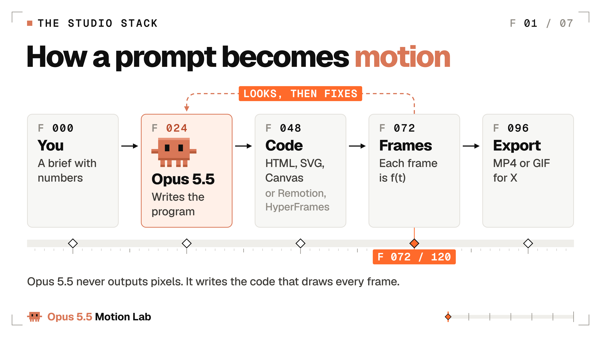

> Kevin Ngo@kevin_t_ngo · [9 月 23 日](https://x.com/kevin_t_ngo/status/2102437977435893771)
>
> Claude Opus 5.5 用 JavaScript 绘制了这段动画的每一帧。镇上的人都向 Claude 提请求，一个女孩却问它：「你爱什么？」
>
> 
>
> [前往原帖播放视频](https://x.com/kevin_t_ngo/status/2102437977435893771)

Kevin Ngo 在发布日发了这条 28 秒的故事片，观看超过 64 万次。它讲的是一整座小镇向 Claude 提请求。代码绘出的画面同样可以呈现角色和故事。

把这份渲染约定贴到任意动效提示词下面，让每帧都能渲染、检查和修正。

```text
# 渲染约定
输出一个自包含 HTML 文件。只使用提示词点名的库，并锁定版本。
除字体和上述固定版本的库外，不发起网络请求。
每一帧都必须是时间 t 的纯函数，t 以秒计。
如果用 JavaScript 驱动运动，暴露 window.renderAt(t)，精确绘制这一帧。
使用 CSS keyframes、Web Animations API、SVG、Canvas 2D 或 WebGL 制作动画。
不要用 Date.now，不用 setTimeout 或 setInterval 启动动画，不用未播种的 Math.random。
循环只渲染第 0 到 N-1 帧，第 N-1 帧必须顺畅过渡到第 0 帧。
```

每一行都在堵一个常见问题。时钟或计时器会让第 84 帧每次不一样；没有种子的随机数会使形体逐帧乱抖。

把循环的第 N 帧也渲染出来，相当于把首帧播了两次，接缝就会顿一下。这三类问题都列在文末的修正表里，因为迟早都会遇到。

---

### 从零搭建 Opus 5.5 实验室：免安装、Mac 和 Windows

有三条路径，看你愿意安装多少工具。

**路径 1：不安装，使用 Claude 应用。**

1. 打开 Claude，从模型菜单选 Opus 5.5。
2. 粘贴文章开头的开场镜头提示词。
3. Claude 写出 HTML，并在预览面板播放。
4. 用帧号提修改意见，例如「第 84 帧冲击的峰值来晚了，提前两帧」。
5. 下载文件，用 Chrome 打开并录屏。Mac 用 Cmd+Shift+5，Windows 用截图工具的视频模式。

可以先让应用在角落显示帧号，用空格键暂停，方便准确指出问题。最终录制前去掉帧号和暂停控制。

第一次发作品，录屏够用。但它无法精确控制每帧，也可能掉帧。打算放进作品集，就用路径 2 或 3。

**路径 2 和 3：在 Mac 或 Windows 上使用 Claude Code。**

Claude Code 可以渲染并打开各帧，再修改代码，中途不用你复制粘贴。先按 Anthropic 的 Claude Code 文档用单行安装命令装好，再搭实验室。

```bash
# macOS: Node, ffmpeg and a headless browser (Claude Code already installed)
brew install node ffmpeg
mkdir motion-lab && cd motion-lab
npm init -y
npm i -D playwright
npx playwright install chromium
claude            # then type /model and pick Opus 5.5
```

```powershell
# Windows 11, PowerShell: the same lab (open a NEW terminal after winget)
winget install OpenJS.NodeJS.LTS
winget install Gyan.FFmpeg
mkdir motion-lab; cd motion-lab
npm init -y
npm i -D playwright
npx playwright install chromium
claude            # then type /model and pick Opus 5.5
```

Windows 有两点。Windows PowerShell 5.1 没有 `&&`，所以上面的命令用分号。如果 PowerShell 拒绝运行 `npx`，改输 `npx.cmd`。

把下面的渲染器保存成 `render.mjs`。它用无头浏览器打开 HTML，在每帧对应时刻定格，并保存 PNG。文件 URL 由 `pathToFileURL` 生成，所以兼容 Windows 路径。

```javascript
// render.mjs   usage: node render.mjs anim.html 6 24   (file, seconds, fps)
// Freezes the page at t = i / fps and saves every frame as a PNG.
import { chromium } from 'playwright';
import { pathToFileURL } from 'node:url';
import { mkdirSync } from 'node:fs';

const [file = 'anim.html', secs = '6', fps = '24'] = process.argv.slice(2);
const FPS = Number(fps), N = Math.round(Number(secs) * FPS);   // frames 0 to N-1
mkdirSync('out/frames', { recursive: true });

const browser = await chromium.launch();
const page = await browser.newPage({ viewport: { width: 1200, height: 675 } }); // your canvas
await page.goto(pathToFileURL(file).href, { waitUntil: 'networkidle' });
await page.evaluate(async () => { await document.fonts.ready; });

for (let i = 0; i < N; i++) {
  await page.evaluate((t) => {
    if (window.renderAt) window.renderAt(t);
    document.getAnimations().forEach((a) => { a.pause(); a.currentTime = t * 1000; });
  }, i / FPS);
  await page.screenshot({ path: `out/frames/${String(i).padStart(4, '0')}.png` });
}
await browser.close();

// Then turn the frames into a video:
// ffmpeg -framerate 24 -i out/frames/%04d.png -c:v libx264 -pix_fmt yuv420p -crf 18 -movflags +faststart out/anim.mp4
```

执行 `node render.mjs anim.html 6 24`，`out/frames` 就会得到 144 张 PNG。代码末尾的 ffmpeg 命令把它们转成 MP4。每张图都取自精确的 t，机器慢也不会改变帧对应的时间。

本实验的 3D 展示片沿用这个思路，做了两处升级。浏览器用真实 GPU（这里是 RTX 4060 Ti），以 60 fps 渲染。每个输出帧还把分布在半帧时长内的多个子帧在线性光空间取平均，模拟电影 180 度快门的运动模糊。

之后很少需要自己敲命令。你可以跟 Claude Code 说：「用 render.mjs 渲染 anim.html，打开第 0、24、48 帧，先说你看见了什么，再动手。」它会接过后续工作。

再说推理强度。Opus 5.5 默认是 `medium`。Anthropic 称，在编程和知识工作评测中，`medium` 可以达到或超过 Opus 5 的 `high`，建议只在有实测收益的任务上使用 `xhigh` 或 `max`。实验室的规则是先用 `medium`，从零做的片子连续两次达不到要求才提高。

原文给出的快速模式（Claude Code 的 `/fast`）速度最高可达 2.5 倍，输入和输出价格分别为每百万 token 8 和 40 美元，常规模式为 4 和 20 美元。Pro、Max、Team、Enterprise 使用额度计费，不从套餐限额扣除。这适合速度比成本更重要的短时迭代。

> Shikhar@xikhar · [9 月 27 日](https://x.com/xikhar/status/2104001664793600012)
>
> 第三次迭代，使用 Opus 5.5 的 medium。它把 Blender、生成图像和 Three.js 变成了这个在浏览器里运行的世界。我很惊叹，感觉看到了游戏开发的未来。
>
> 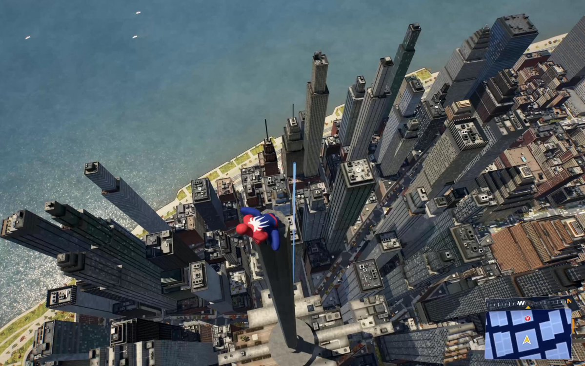
>
> [前往原帖播放视频](https://x.com/xikhar/status/2104001664793600012)

Shikhar 的 3D 浏览器世界观看超过 175 万次。Blender 素材、生成图像和 Three.js，加上 `medium` 和三轮迭代，就做出了发布周观看量很高的一条作品。

---

### 一条具体的动效提示词由什么组成？

每一行都替模型做一个原本留给它的决定。留给模型的决定越多，就越容易落到默认风格。

Anthropic 的 Opus 5.5 提示词指南直接说过：没有设计方向时，模型会退回到几种默认风格。「避免通用 AI 风格」太笼统，往往只是换了另一种默认风格。写出具体要避开的做法，检查第一版实际用了哪些，再补充清单。

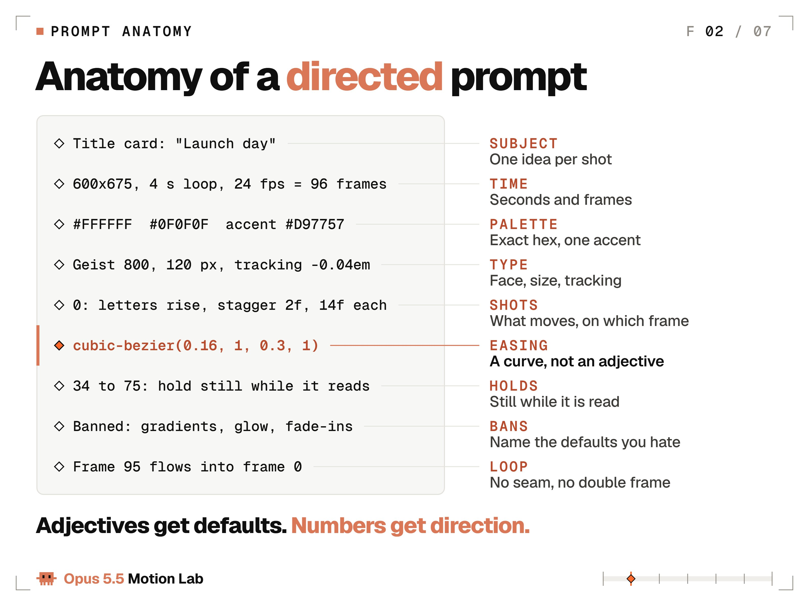

发送前填完模板的每一行：

```text
目标：用一句话说明观众应该感受到什么，或做什么。
输出：一个自包含 HTML 文件（或 Remotion、HyperFrames），宽×高。
时间：秒数×fps = 总帧数。是否循环。
外观：十六进制色板、一个强调色、字体、字重、字号和字距。
运动：缓动写 cubic-bezier，弹簧写阻尼比，时长按帧。
镜头：帧范围，每个镜头一个主动作，写清怎么接下一镜。
禁用：明确列出不想看到的默认做法。
验收：指定帧号导出静帧，拼图检查并修正，之后再完整渲染。
```

实验一的提示词 B 填了这个模板，又为 3D 加上「模型」和「相机」。

先写目标。如果一句话都说不清观众该感到什么或做什么，Opus 就没法把它做成动效，换缓动曲线也救不了。接下来写时间，因为其他数字都要根据帧数安排。

镜头清单承载叙事。每镜写好帧范围、一个主动作和交接方式：踩节拍直接切，用同形物体匹配剪辑，或者用遮罩擦除。默认直接切，只有明确理由才加转场。

验收这行比看起来重要。它让 Opus 先检查静帧，再渲染整条片。这也是后面实验室循环的起点。

实验室初始禁用清单：

- 紫色或蓝色渐变、发光、镜头光晕。
- 单纯装饰用的漂浮粒子。
- 所有元素同时淡入。
- 每个元素都边淡入边往上滑。Anthropic 的前端设计 Skill 指出，这是容易被看成 AI 生成的默认做法。
- 所有元素都居中。
- 阅读时仍在移动的文字。

清单要持续更新。每次看第一版，把模型仍然用了的默认做法记进去。这是 Anthropic 对网页设计的建议，同样适用于动效。

每个镜头只突出一个主动作。那份 Skill 提到，经过编排的一刻比四处散落的效果更有冲击力。其他东西可以等待、压暗到 40%，或保持不动。

给其余动作分层。次要动作走主动作距离的 50% 到 70%，晚 100 到 200 ms 启动。环境动作低于主动作距离的 5%，按慢正弦波运行，始终不停。

> Rexan Wong 的趋势拆解获得约 60 万次观看。他说，真正让成片显得专业的是你提供的上下文。

---

### 动效数字速查

动效设计师用曲线和帧来沟通，所以也把这些给 Opus 5.5。下面列出可用数字及来源。

**缓动。** 以下数值来自 Andrey Sitnik 的 Easings 参考。

| 名称 | cubic-bezier | 用途 |
| --- | --- | --- |
| ease-out-expo | 0.16, 1, 0.3, 1 | 文字和标志揭示 |
| ease-out-quint | 0.22, 1, 0.36, 1 | 从容利落的入场 |
| ease-in-out-quart | 0.76, 0, 0.24, 1 | 位移和镜头推进 |
| ease-in-expo | 0.7, 0, 0.84, 0 | 快速退场 |
| ease-out-back | 0.34, 1.56, 0.64, 1 | 带过冲的俏皮弹出 |

入场用缓出，退场用缓入，退场时长缩短 40% 到 50%（Material 3 有 400 ms 入场配 200 ms 退场的例子）。横跨画面用缓入缓出。线性曲线只用在旋转、进度条和循环相位上。普通位移一用线性，就会显得机械。

**弹簧。** 每个库的参数名不同，阻尼比可以跨库比较，公式见下面的代码。1.0 没有反弹，0.7–0.85 有收住的质感，0.4–0.6 俏皮，低于 0.3 像卡通。

Remotion 的默认弹簧（质量 1、阻尼 10、刚度 100）折合 0.5；react-spring 的默认值（张力 170、摩擦 26）折合 1.0。Material 3 有条好规则：位置和尺寸可以弹，不透明度和颜色不要弹。

```javascript
// motion.js: one tokens file, imported everywhere, no inline numbers
export const EASE = {
  enter: 'cubic-bezier(0.16, 1, 0.3, 1)',    // ease-out-expo
  move:  'cubic-bezier(0.76, 0, 0.24, 1)',   // ease-in-out-quart
  exit:  'cubic-bezier(0.7, 0, 0.84, 0)',    // ease-in-expo
  pop:   'cubic-bezier(0.34, 1.56, 0.64, 1)' // ease-out-back
};
export const MS = { feedback: 150, move: 400, hero: 750, exit: 240 };
export const STAGGER = { letter: 30, word: 90, item: 60 };

// Damping ratio from any library's numbers: 1 = no bounce
export const dampingRatio = (k, d, m = 1) => d / (2 * Math.sqrt(k * m));

// A spring as a pure function of time, from 0 to 1.
// zeta: damping ratio (1 no bounce, 0.7 premium, 0.5 playful). f: speed in Hz.
export function spring(t, zeta = 0.7, f = 2) {
  if (t <= 0) return 0;
  const w = 2 * Math.PI * f;
  if (zeta >= 1) return 1 - Math.exp(-w * t) * (1 + w * t);   // no bounce
  const wd = w * Math.sqrt(1 - zeta * zeta);
  return 1 - Math.exp(-zeta * w * t) *
    (Math.cos(wd * t) + (zeta * w / wd) * Math.sin(wd * t));
}
```

弹簧函数无需模拟。它直接返回任意 t 的进度，所以第 84 帧可以独立渲染，不用算前 84 帧。这正是渲染约定要求的。把文件给 Opus 5.5，再加一句：「只用这些动效变量，别在其他位置写数字。」

**时长和错峰。** 界面反馈用 100–200 ms。Nielsen Norman Group 给出的感知阈值是 100 ms，接近即时。其余是实验室的起点：界面位移 200–500 ms，主元素揭示 600–900 ms，字母错开 1 帧，词错开 60–120 ms，列表项错开 40–80 ms。上一项完成 30% 到 50% 时就启动下一项。完全串行显得僵，同时启动又粗糙。

视频用帧来写。24 fps 每帧约 42 ms，所以 400 ms 位移约 10 帧，750 ms 揭示约 18 帧。

**节拍网格。** 每拍帧数 = fps × 60 / BPM。120 BPM、24 fps 时是 12 帧；128 BPM、30 fps 时是 14.06 帧。用时间算每个节拍，再单独取整。如果每拍都加取整后的 14 帧，32 拍后就偏了两帧。

踩节拍切镜，每小节（4 拍）换一次布局。每一拍都换所有东西，观众会累。

**停留。** 屏幕文字至少每词 0.3 秒，再加 0.5 秒。两个英文单词的标题要留 1.1 秒。停留时可以慢慢推进 2%，保持画面有活力，文字仍然可读。

**镜头。** 运镜用最柔的曲线，比如 `ease-in-out-quart`；物体用更利落的曲线。做视差时，可以从前景 1.0、中景 0.5、背景 0.2 的相对速度起步。

**对比度和闪烁。** 包括动态背景在内，每帧文字对比度都至少 4.5:1，每秒闪烁不超过 3 次。两项数字均来自网页无障碍标准 WCAG。

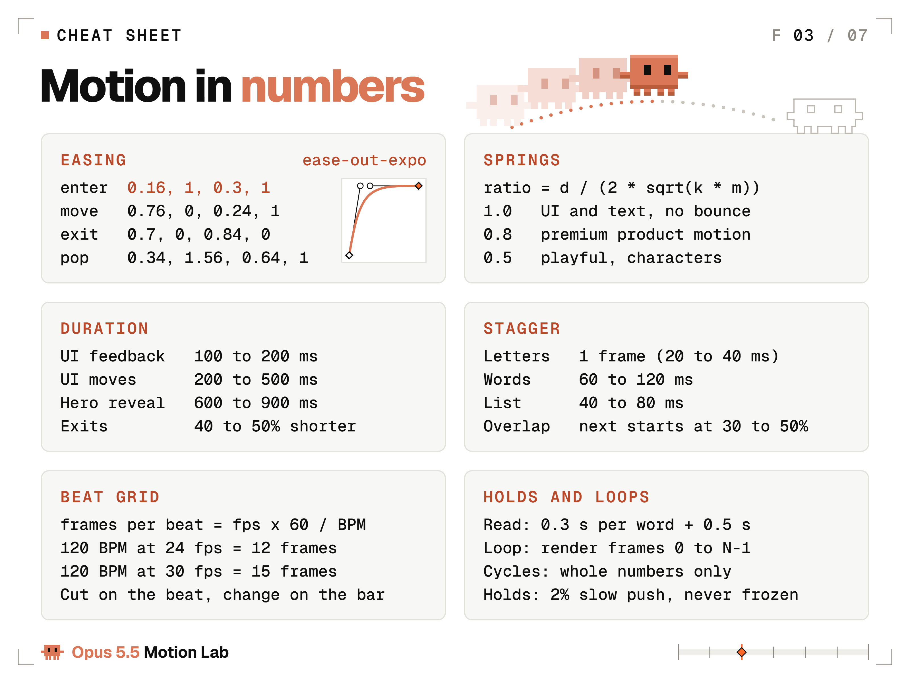

这张图可以截图保存。

---

### 实验二：把五项动画原则用在 3D 吉祥物上

Frank Thomas 和 Ollie Johnston 在 1981 年的《生命的幻象》中写下迪士尼动画的 12 项原则。短循环里最管用的是其中五项，每项都能写成帧数和尺寸。这个实验给 Opus 5.5 一只用体素重建的像素 Claude 吉祥物、一间微缩影棚和一组数字。

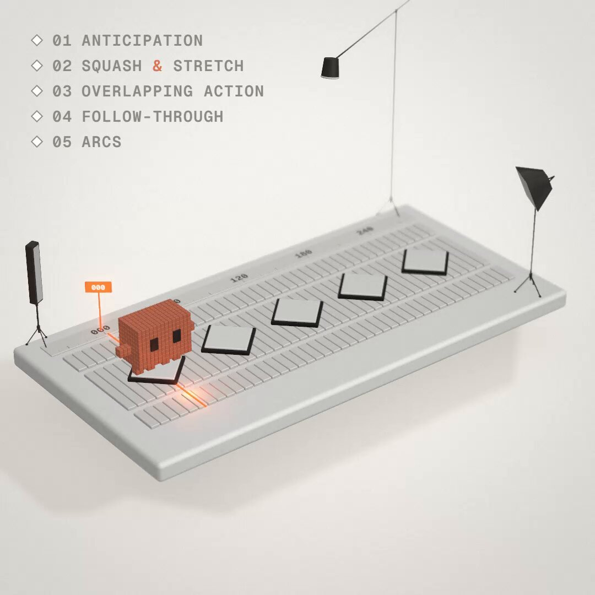

[前往原帖播放视频](https://x.com/flxrnc/status/2105311836190978392?s=46)

8 秒一循环。三盏灯先后亮起，吉祥物沿着做成动效时间轴的地面跳过几个标记，最后沿一条虚线弧翻回首个标记。每项原则的标签在动作发生的那帧亮起，播放头跟着帧走。成片用 Three.js 制作，由 GPU 以 60 fps 渲染，并混合子帧实现运动模糊。

提示词：

```text
制作一个演示 3D 动画原则的循环。一个 HTML 文件，通过 jsDelivr importmap 引入 Three.js 0.160.0，从 Google Fonts 引入 Geist Mono。1080×1080，8 秒、60 fps（480 帧），第 480 帧等于第 0 帧。window.renderAt(t) 只根据 t 绘制任意帧，只用有种子的随机数。

布景：微缩影棚。F4F2EE 背景上悬一块 12×6 的白板，板面是一条时间轴：3 条轨道，帧格宽 0.25、颜色 EFEEEA；一把标有帧号的标尺；中间轨道有 5 个关键帧菱形，间距 2（白填充，0F0F0F 描边）。周围架一盏主柔光灯、一条轮廓灯和一盏装在吊臂上的顶灯。
主角：用边长 0.1 的体素做像素 Claude 吉祥物。D97757 身体 14×10×8，两只 3×2 的手臂，四条 2×3 的腿，0F0F0F 的 2×3 眼睛；粗糙度 0.45，清漆 0.3。

灯光，0–1 秒：0.1 秒开启 3200 K 主灯，带柔和阴影；0.4 秒开启 7500 K 轮廓灯；0.7 秒开启 5000 K 顶灯。每盏灯启动时闪烁 3 帧，吉祥物的眼睛瞄向它。
跳跃，1–5 秒：跳 4 次，依次到第 2–5 个菱形，落在第 105、165、225、285 帧。每跳先蹲 11 帧（1.2×0.75），起跳时拉伸到 0.85×1.28，腾空 25 帧，落地压缩到 1.25×0.7，再以阻尼 0.55 回弹；手臂晚 4 帧，腿晚 6 帧。每次落地将菱形点亮为 FF6A2B，帧格起伏 0.08，溅出 12 个体素火花。FF6A2B 的播放头带点光源匀速移动，在落地帧经过对应菱形。
翻转，5–6.4 秒：从第 5 个到第 1 个菱形画出虚线弧；先深蹲 18 帧，再沿高度 3.5 的弧做 360 度翻转，第 384 帧落地，播放头在下方倒回。
标签：左上角，Geist Mono 28 px。用 8E8A83 列出 01 ANTICIPATION（预备）、02 SQUASH & STRETCH（挤压与拉伸，& 为 D97757）、03 OVERLAPPING ACTION（动作重叠）、04 FOLLOW-THROUGH（跟随）、05 ARCS（弧线）。每行在对应帧变为 0F0F0F，并点亮 FF6A2B 菱形：69（第一次下蹲）、140（拉伸）、200（四肢滞后）、285（手臂收稳）、303（绘制弧线）。
结尾：停留，7.2 秒眨眼；第 468 帧灯、菱形、标签立刻熄灭。
相机：FOV 18，仰角 30 度，8 秒内环绕 ±10 度，跟随跳跃推进 25%，翻转落地瞬间再推进 4%。
后期：发光物体加泛光，景深对准吉祥物；颗粒 2%，暗角 10%，背景做抖动降阶。
```

有 4 条后续指令。第一版已经包含体素吉祥物、时间轴、5 个菱形、播放头、3 盏灯、标签、弧线和翻转。后续集中改外观与构图：色调发白、道具挡标签、轮廓灯只看见侧边、顶灯开启不明显。另外对 480 帧逐帧读取场景参数，和提示词比对了 71 项，从第 432 帧眨眼到脚是否踩到标记。首轮有 6 项失败，最终渲染前都修好了。

```text
1. 画面发白又拥挤。调色，使受光正面为 D97757、亮起的菱形为 FF6A2B；降低补光，让关灯状态约为 50%，每次亮灯都明显。把主灯降低到右前方 28 度，冷轮廓光移到左后方，给可见侧勾边。广角镜头退到 44 单位，白板和三个灯架都入画；在板下加软阴影；火花放大到 0.075–0.12，标尺数字也放大。
2. 逐帧问题：道具不要进入标签区。镜头按 45% 的幅度跟随跳跃；顶灯从右后角吊臂挂在 5.8 高处，高于翻转。点亮的菱形从表面发柔光；播放头的灯移到轨道前沿，线从菱形下穿过。虚线弧从吉祥物头顶上方开始；三脚架的脚都要留在白板上。手臂收稳幅度加大、速度放慢（2.2 Hz，阻尼 0.22），让跟随动作读得出来。
3. 轮廓灯的面板转向相机，让亮灯看得清。
4. 顶灯亮起也要明显：缩成 34 度、45 cd 的光池，灯罩加一圈发光边。
```

声音再用一条提示词，规则相同。声音第一版就满足数值，因此没有后续指令。Web Audio 增益节点启动时满音量、压缩器带来 6 ms 延迟等技术修正另有记录。

```text
# 声音提示词
给这段 8 秒循环配乐，60 fps 共 480 帧。用 Web Audio API 以代码合成，不用采样、不下载。120 BPM、4 小节、F 大调。每个重音比对应画面晚一帧。
底乐：铺底 A3、E4 对应主灯，C5 对应顶灯，G5 对应轮廓灯，跟随相应灯的闪烁。从第 45 帧起用八分音符沙锤，第 60 帧起加底鼓和低音，四小节根音依次为 F、D、降 B、F；底鼓和沙锤在第 330–420 帧休止，低音保持 C，第 384 帧换到 F。
开关声：灯在第 6、24、42 帧亮，第 468 帧灭。
下蹲第 69、129、189、249、312 帧：吱呀声、吸气上升声。
起跳第 80、140、200、260、330 帧：向上的掠过声。
落地第 105、165、225、285、384 帧：橡胶压缩声，音高由压缩比例决定，加火花叮声，第 384 帧最大。
标签提示音 A5、C6、D6、F6、A6 分别在第 69、140、200、285、303 帧。
第 303–318 帧为虚线轻响，第 330–384 帧为翻转呼啸，第 432 帧为眨眼短音。
48 kHz 立体声 WAV，约 -14 LUFS，峰值 -1 dBTP。无缝循环，与视频合并为 MP4。
```

从第一条提示到最终循环，包括渲染，约 2 小时。声音约 70 分钟。71 项检查全部通过：标签在指定帧亮起，每次落地都在计划的那帧踩到标记。

清单里的五项原则，以及每个动作都用到的另外两项，可以这样写进提示词：

| 原则 | 作用 | 提示词写法 |
| --- | --- | --- |
| 预备动作 | 正式动作前蓄力 | 先蹲 11 帧（1.2×0.75） |
| 挤压与拉伸 | 体现重量和速度 | 起跳拉伸到 0.85×1.28，落地压缩到 1.25×0.7 |
| 动作重叠 | 四肢比躯干晚启动 | 手臂晚 4 帧，腿晚 6 帧 |
| 跟随动作 | 身体停下后，局部还在动 | 手臂以 2.2 Hz、阻尼 0.22 收稳（第 2 条后续） |
| 弧线 | 让运动更自然 | 沿高 3.5 的虚线弧翻转 |
| 慢入慢出 | 加速后柔和停稳 | 以阻尼 0.55 回弹 |
| 时间安排 | 通过帧数体现重量 | 每跳腾空 25 帧，翻转前下蹲 18 帧 |

标签本身也能用来验收。提示词把它们固定到第 69、140、200、285、303 帧。如果动作来晚了，你会看到标签先亮、动作后到。

提示词还写清哪些东西不能改。吉祥物保留像素比例：身体 14×10、手臂 3×2、腿和眼睛都是 2×3，体素边长 0.1、身体厚度 8 个体素。这条限制让角色到了 3D 仍能认出来。在意的风格都需要类似的约束。

布景本身就在演示时序。动效工具用关键帧和播放头让动画师检查节奏。这里把两者做进地面，让播放头在每次落地时经过对应菱形。自己的项目也可以让 Opus 在迭代时加播放头和帧号，最终渲染时关掉。

其余动画原则仍然适用。「场面调度」对应每镜一个主动作。手机上更需要夸张：把关键姿态比直觉再放大 10% 到 30%，因为信息流会把所有东西缩小。

---

### 实验循环：渲染、看图、修改

第一次渲染是草稿。接下来的循环是：出静帧、看静帧、按帧号写反馈、修正，只重渲染改过的部分。两到四轮很正常。

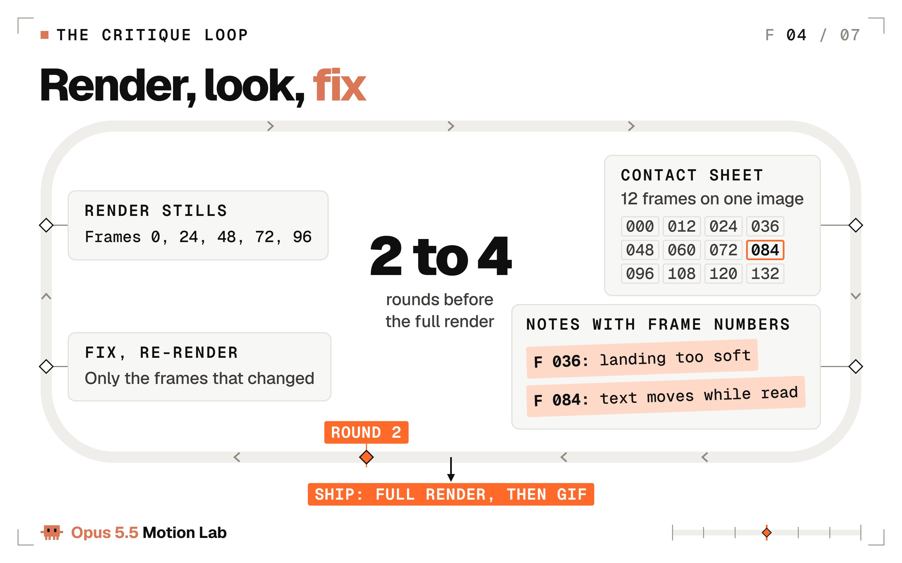

降低迭代成本的办法是用 URL 定格任何一帧。在 HTML 结束的 `body` 标签前放入下面代码，打开 `anim.html?t=2.5`，就能看到 2.5 秒那一帧。Opus 可以截取并检查。

```html
<script>
// Paste right before </body>. Open anim.html?t=2.5 to see the exact frame at 2.5 s.
(function () {
  var q = new URLSearchParams(location.search);
  if (!q.has('t')) return;
  var t = parseFloat(q.get('t')) || 0;
  function freeze() {
    if (typeof window.renderAt === 'function') window.renderAt(t);
    document.getAnimations().forEach(function (a) { a.pause(); a.currentTime = t * 1000; });
  }
  freeze();
  if (document.fonts && document.fonts.ready) document.fonts.ready.then(freeze);
  window.addEventListener('load', freeze);
})();
</script>
```

要一次看整条片，把 12 帧拼成一张关键帧图。Opus 可以像读分镜一样读它。

```bash
# Contact sheet: every 12th frame, 4 across, 3 down
ffmpeg -framerate 24 -i out/frames/%04d.png -vf "select='not(mod(n\,12))',scale=400:-1,tile=4x3" -frames:v 1 out/contact.png
```

动画师常用的两种视图也能让反馈更准。洋葱皮用低透明度叠帧：间距均匀说明动作机械，越靠近关键姿态间距越紧，说明缓动起效。速度图绘制逐帧位置：直线表示线性位移，尖角表示突然启动或急停。Opus 5.5 两种都能画，也都能读。

下面是可直接粘贴的后续指令。每条都指向帧和画面证据。

```text
渲染第 0、24、48、72、96 帧的静帧。站在观众角度，用一句话描述每帧。和镜头清单对得上吗？修正不一致的地方。
每 12 帧取一张做关键帧拼图。标出所有有两个东西同时动的帧，修正动效层级。
用 25% 透明度叠加第 24–47 帧。越靠近关键姿势，帧间距应该越小。调整缓动直到满足。
把主元素每帧的 x 位置和缩放绘成 PNG。找出线性移动或突然停住的位置，再用现有动效变量修正。
像资深动效设计师一样审片：按影响给出 10 条反馈，每条含帧号和具体代码改动。落实前 5 条。
画面太忙。删掉 30% 的动作，只保留能引导视线的运动。
结尾太突然。加 36 帧停留和 2% 的推进，最后用阻尼比 0.8 的弹簧收稳。
```

每轮选一两条。七条一起发，局部修正容易变成重写。

收到主观感受时，先把它换成可执行的反馈：

- **「更醒目一点」**：6 帧内缩放 1.0 → 1.08 → 1.0，峰值踩拍。
- **「高级一点」**：入场用 `ease-out-quint`，弹簧阻尼比 0.8，文字不要过冲。
- **「拖沓」**：每次停留减少 12 帧，即 120 BPM、24 fps 的一拍，确保切镜还在节拍网格上。
- **「有点乱」**：一次只做一个主动作。其余动作晚 150 ms，位移为主动作的 60%。
- **「像 AI 做的」**：列出它用了哪些默认做法，逐条禁用，再渲染。

从日志中整理的实验记录：

| 实验 | 提示词英文词数 | 创意后续 | 帧数 |
| --- | --- | --- | --- |
| 开场液态铬 | 416 | 10 | 360 |
| 实验一模糊版 | 27 | 0（有意保留） | 360 |
| 实验一具体版 | 448 | 15 | 360 |
| 实验二 3D 吉祥物 | 399 | 4 | 480 |

创意后续指改变画面外观或动作的反馈。捕获接口、字体加载等技术修正也有记录，单独计算。

声音最后做，每个片子根据帧号写一条提示词。液态铬改了 5 次，实验一改了 12 次，吉祥物没有改。指令都和视频一起列出。

只要其他作者也把过程如实记录，数字往往差不多。

> Miles@uxmiles · [9 月 29 日](https://x.com/uxmiles/status/2104618175803609305)
>
> 作为设计工作室的创始人，我不太情愿承认这一点，但 Opus 5.5 做动效和宣传视频好得离谱。这条视频只用了三条提示词。
>
> 
>
> [前往原帖播放视频](https://x.com/uxmiles/status/2104618175803609305)

Miles 经营设计工作室。他的发布视频用了 3 条提示词，观看超过 59 万次。他说 Opus 5.5 做动效好得离谱。专业人士也会数提示词，3 条已经是不错的成绩。

> Vox@Voxyz_ai · [9 月 24 日](https://x.com/Voxyz_ai/status/2103117246860345550)
>
> 我让 Opus 5.5 做一个交互式黑洞实验室，解释引力透镜。第一版用了一条提示词，之后在我睡觉时又动态迭代三轮。醒来看到的结果是：总共 5 小时 28 分钟，按 API 价格算 90 美元。
>
> [https://blackhole.voxyz.ai](https://t.co/BE1xui93rF)
>
> 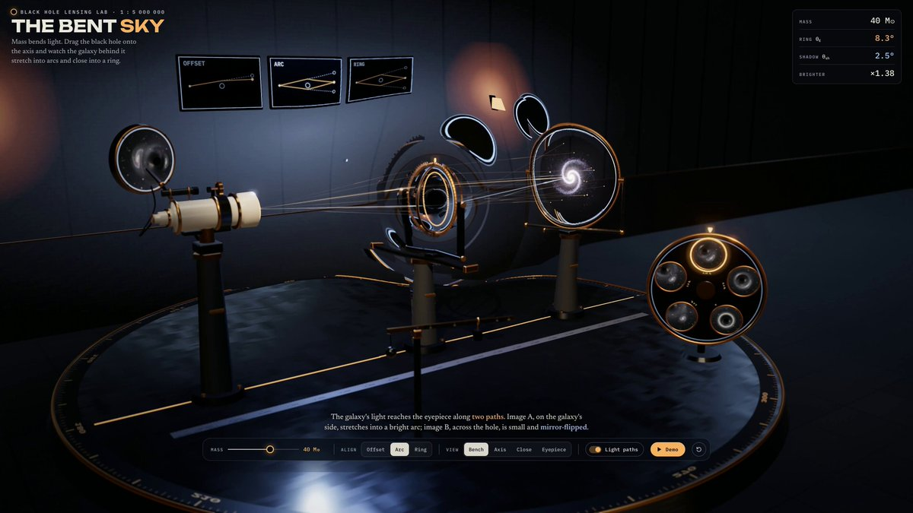
>
> [前往原帖播放视频](https://x.com/Voxyz_ai/status/2103117246860345550)

Vox 用一条提示词起步，又在夜里做了三轮精修。全程 5 小时 28 分钟，按 API 价格约 90 美元。最终效果离不开那三轮精修。

**数清后续指令，发布作品时附上每条提示词。过程记录更能让人信服。**

---

### 实验室工具：选择引擎

Opus 5.5 能为下面每种引擎写代码。提示词里点名你想用的引擎，否则它会替你选。

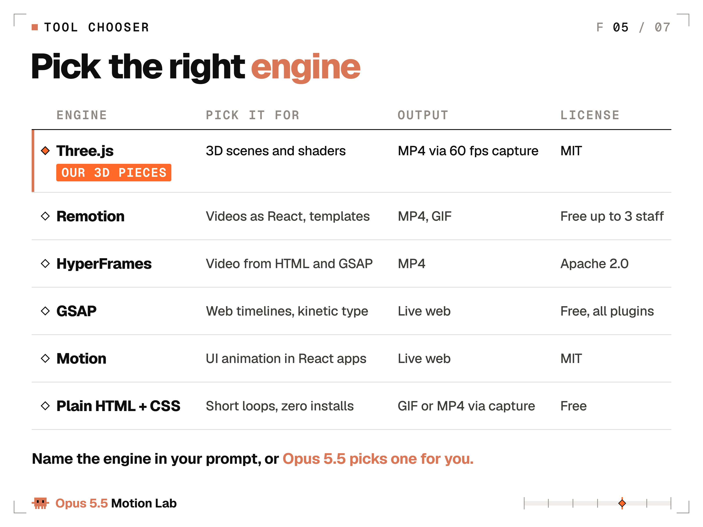

**Three.js** 用于实验室的三个展示案例。它在 WebGL 中由 GPU 绘制 3D 场景、灯光、材质和着色器（原文记载 r186 于 9 月 24 日发布）。做视频时用帧号驱动时间，别用系统时钟。相机也写明数值，35–50 度视野可作为起点。

**Remotion** 用 React 组件做可精确到帧的视频，并为 Claude Code 提供官方 Agent Skills。按原文所述，个人和员工不超过 3 人的公司可免费使用，规模更大的公司需要企业许可证。

**HyperFrames** 由 HeyGen 于 2026 年 4 月 17 日以 Apache 2.0 开源。代理写 HTML、CSS 和 GSAP 时间轴，CLI 负责渲染 MP4。原文指出它没有企业许可证门槛。

**GSAP** 是网页动画时间轴库。原文称其全部功能免费，包括 SplitText、MorphSVG、DrawSVG、ScrollTrigger；许可限制涉及构建与 Webflow 竞争的无代码动画编辑器。

**Motion** 以前叫 Framer Motion，采用 MIT 许可，用来给 React 应用做实时界面动效，本身没有视频渲染器。

**纯 HTML 和 CSS** 不用安装工具，可以做十秒内的 2D 循环，包括文字、形状和界面。上面的渲染器可以转成 GIF 或 MP4。

```bash
# Remotion: video as React components
npx create-video@latest          # pick a template, name it my-video
cd my-video
npm i
npx remotion skills add          # Agent Skills for Claude Code
npm run dev                      # Remotion Studio in your browser
npx remotion render MyComp out/video.mp4   # MyComp = your composition id

# HyperFrames: HTML + GSAP in, MP4 out (needs Node 22+ and FFmpeg)
npx hyperframes init my-video
cd my-video
claude plugin marketplace add heygen-com/hyperframes
claude plugin install hyperframes@hyperframes
npx hyperframes preview
npx hyperframes render
```

实验室的经验：十秒内只讲一个点，用纯 HTML；系列、模板或数据视频用 Remotion；习惯按网页和 GSAP 思考就用 HyperFrames；3D 用 Three.js。动效如果要跑在产品内部，用 Motion 或 GSAP。

在模板的「输出」一行写清引擎和数字，例如「一个 Remotion composition，1920×1080，30 fps，共 450 帧」。这样 Opus 无需猜测。

> Chubby♨️@kimmonismus · [9 月 24 日](https://x.com/kimmonismus/status/2102844654169575547)
>
> 我想快速用 Opus 5.5 做一条 AI 历史短片，从《Attention Is All You Need》讲到 AGI。不用库存素材、图像或视频生成器，每帧都用代码渲染。3 分钟片子在 Claude Code 中全由代码做出：约 7,400 行 React/TypeScript（Remotion），用 SVG 和 Canvas 绘制图像。
>
> 
>
> [前往原帖播放视频](https://x.com/kimmonismus/status/2102844654169575547)

Chubby 的三分钟 AI 历史片，每一帧都由代码渲染，用 Claude Code 和 Remotion，约 7,400 行 React 与 TypeScript。没有库存素材，也没有图像或视频生成器，约 19.6 万次观看。同样的做法可以从 6 秒循环扩展到 3 分钟短片。

> Meng To@MengTo · [9 月 23 日](https://x.com/MengTo/status/2102760783344189761)
>
> Opus 5.5 又进了一步。我很佩服 Three.js 场景的细节。我做了一个可玩的船艇场景，驶过日本景观，有动态天气、昼夜灯光、写实纹理和 3D 角色。
>
> 实时网站：[https://valley.mengto.here.now](https://t.co/YMW4Zp52In)
>
> 水面反射、物理效果、风景和建筑都让人惊叹。我能看一整天。
>
> 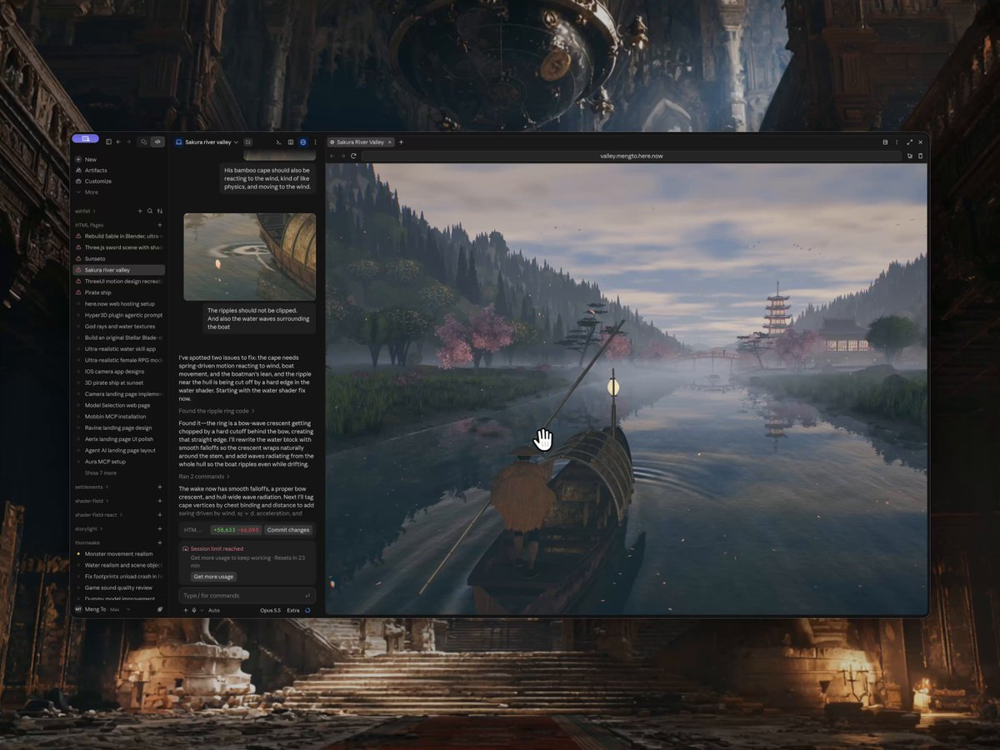
>
> [前往原帖播放视频](https://x.com/MengTo/status/2102760783344189761)

Meng To 用 Three.js 做了一个可玩的日本风景泛舟场景，包含天气、昼夜和水面反射，约 47.3 万次观看。项目是 3D，就点名 Three.js，让 Opus 搭场景。

---

### 收尾：声音、循环和导出到 X

教程常跳过这部分，观众却最先注意到。

**声音。** 信息流默认静音，用户点开前，画面要能独立成立。加声音时，把配乐和音效混在一起，归一化到 -14 LUFS（网页视频常见响度目标），每个视觉重音比对应声音早一帧。

声音比画面先到，更容易让人察觉不对。现实里也是光先到，声音随后。

实验室的三条片把这条规则精确到了采样：Web Audio API 合成声音，重音峰值比画面晚一帧，混音 -14 LUFS，峰值 -1 dBTP。Opus 5.5 听不见，因此解码成品 MP4，对照每个重音和帧的位置来检查同步。

```bash
# Music + sound effects, mixed, normalized to -14 LUFS, muxed under the picture
ffmpeg -i out/anim.mp4 -i music.wav -i sfx.wav -filter_complex "[1:a][2:a]amix=inputs=2:duration=first,loudnorm=I=-14:TP=-1:LRA=11[a]" -map 0:v -map "[a]" -c:v copy -c:a aac -b:a 192k -shortest -movflags +faststart out/final.mp4
```

**循环。** 只渲染第 0 到 N-1 帧。第 N 帧是第 0 帧，播放两次会在接缝处卡一下。用 `phase = frame / N` 驱动循环，并安排整数个周期。

一个每轮刚好旋转 90 度的正方形，或者每轮走完两个周期的波，结束时都能回到第一帧。要做自然漂移，可以沿圆周取样噪声，使它回到起点。

第 0 帧本身也要构图完整，因为 GIF 加载时首先显示它。

**导出。** 普通帖子用 MP4，X 长文章或内嵌循环用 GIF。整条 GIF 用同一色板，防止帧间颜色闪烁。

```bash
# MP4 for an X post: H.264 High, yuv420p, starts playing at once
ffmpeg -framerate 24 -i out/frames/%04d.png -c:v libx264 -profile:v high -pix_fmt yuv420p -crf 18 -movflags +faststart out/anim.mp4

# GIF for an X Article: one palette for the whole clip, 1200 px wide
ffmpeg -framerate 24 -i out/frames/%04d.png -vf "scale=1200:-1:flags=lanczos,split[a][b];[a]palettegen=stats_mode=diff[p];[b][p]paletteuse=dither=bayer:bayer_scale=5:diff_mode=rectangle" -loop 0 out/anim.gif

# Loop check: play it three times back to back and watch the seam
ffmpeg -stream_loop 2 -i out/anim.mp4 -c copy out/loop_check.mp4
```

原文根据 X 媒体文档和帮助中心列出的限制：

| 规格 | GIF | 视频 |
| --- | --- | --- |
| 大小或时长 | 15 MB | 无 Premium 时 140 秒 |
| 帧尺寸 | 最高 1280×1080 | 16:9 为 1920×1080 |
| 帧数与速度 | 最多 350 帧 | 最高 60 fps |
| 格式 | 单一色板，永久循环 | H.264 High、yuv420p、AAC 音频 |
| 实验默认值 | 宽 1200 px，24 fps | CRF 18、faststart |

24 fps 时，350 帧上限相当于约 14.5 秒。4–6 秒循环只需 96–144 帧，远低于上限。

GIF 的帧延迟以百分之一秒保存，无法精确存下 24 fps 的 41.7 ms。每帧都取整为 40 ms，循环会快约 4%，脱离节拍。让 5 帧各为 40 ms，再给 1 帧 50 ms，就能让 6 秒循环保持 6.00 秒。

第一帧前就定下画布，后改尺寸会迫使你重做每镜的安排。常用 16:9 为 1920×1080，1:1 为 1080×1080，4:5 为 1080×1350，9:16 为 1080×1920。原文列出 X 视频宽高比范围为 1:3 到 3:1。

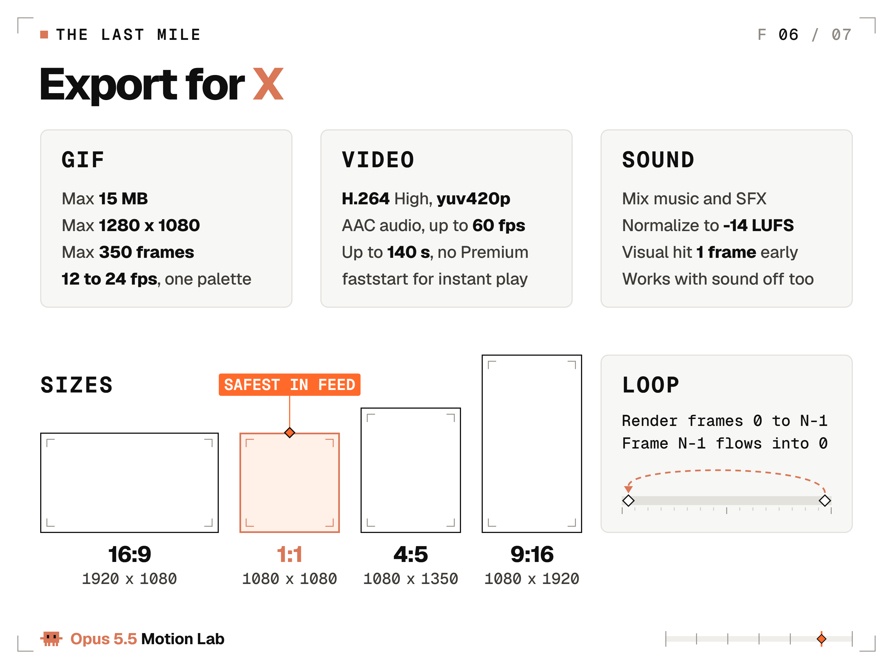

> Leon Lin@LexnLin · [9 月 27 日](https://x.com/LexnLin/status/2104148233106723099)
>
> 我让 Claude Code（Opus 5.5）为一个虚构的日历应用做发布片。你看到和听到的全部由代码生成。用了一条提示词，大约跑了 8 小时。名称、标志、界面、动效、配乐和音效都有。已开源，仓库在回复里。
>
> 
>
> [前往原帖播放视频](https://x.com/LexnLin/status/2104148233106723099)

Leon Lin 让 Claude Code 中的 Opus 5.5 为虚构日历应用做了发布片。从一条提示词起步，约 8 小时用代码做出所有视听内容，观看超过 8.5 万次。声音也能由代码制作。

---

### 实验出问题时

每个项目都会遇到相似故障。下表按现象给出可直接粘贴的修正。

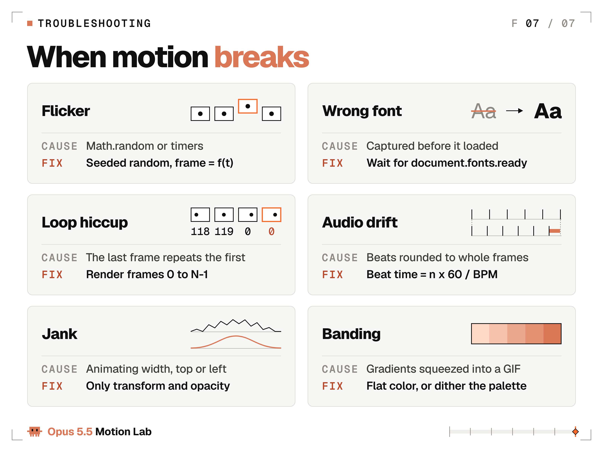

| 现象 | 可粘贴的修正 |
| --- | --- |
| 闪烁或抖动 | 让所有值都成为 t 的纯函数。用带种子的生成器替代 `Math.random`，去掉计时器和 CSS transition。 |
| 字体错误或回退 | 用 `display=block` 加载字体，第一帧前等 `document.fonts.ready`。 |
| 循环接缝卡顿 | 只渲染第 0 到 N-1 帧，以 `phase = frame / N` 驱动整数周期。 |
| 音频渐渐脱拍 | 每拍单独用 `n × 60 / BPM` 计算并取整。不要累加已取整的帧数。 |
| 卡顿或掉帧 | 只动画 `transform` 和 `opacity`，避免 `width`、`height`、`top`、`left`。 |
| GIF 出现色带 | 去掉渐变，使用纯色，或者给色板加抖动。 |
| 文字模糊或闪动 | 静止文字吸附到整数像素。以 2 倍分辨率渲染，再缩小。 |
| 文字还没读完就动了 | 每个文字状态至少停留每词 0.3 秒，再加 0.5 秒。 |
| 所有东西同时动 | 每次只做一个主动作。其他动作晚 150 ms 开始，位移为主动作的 60%。 |

修复没生效时，让 Opus 渲染问题前后两帧，并描述不同。识别两幅图之间的变化，正适合它的视觉能力。

```text
第 84 帧的修复没有生效。把第 83 和 85 帧渲染成 PNG，并排放置，列出每处能看到的差异。找到导致问题的那一行代码，只改那一行，然后重渲染两帧。
```

修好后，把规则加到渲染约定里。约定保存了实验室的经验，每加一条，就少重复踩一次坑。

---

### 实验三由你来做

今晚可以这样跑一遍：

1. 复制开场提示词，把字换成你的产品名或名字。
2. 在 Claude 应用或 Claude Code 里，用 Opus 5.5 的 `medium` 运行。
3. 导出第 0、24、48、72、96 帧，写两条带帧号的反馈。
4. 修正、重新渲染，反复做，直到没有新的反馈。
5. 用 GIF 命令导出。发布时，在第一条回复里放提示词和每条后续指令。

第一遍保留数字，只换文字。第二遍每次只改一个数字，这样就能看出它的作用。

大家用的是同一个模型。你给它的数字由你决定。

**我会随每件新作品发布实际提示词和每条后续指令，包括画面与声音。** 关注 [**@flxrnc**](https://x.com/@flxrnc)，下一篇就会出现在动态里。收藏这篇文章，需要时可以回来查数字。
