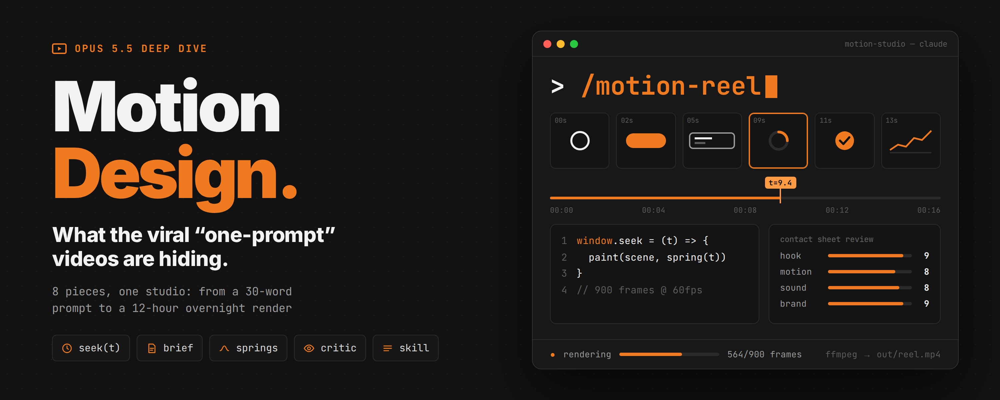

# Opus 5.5 动效设计：爆火的「一句提示词」视频藏了什么？

作者：seeco（[@seeconvm](https://x.com/seeconvm)）  
发布：2026-10-02T18:57:16.000Z

[查看原帖](https://x.com/seeconvm/status/2106096193235259564?s=46) · [英文原文](原文.md)



**Opus 5.5 在 9 月 22 日发布。才过几个小时，就有人发出了产品发布短片、作品集短片和完整的音乐视频。它们都由代码渲染而成，配文也都写着「一句提示词」。**

**我花了一周拆解这些视频。确实有几个从 30 个词起步。最出色的那些，起步时手里已经有一份 9,500 字符的制作说明、一个 Skills 文件夹和两个 API 密钥。作者睡觉时，任务还在继续跑，整整跑了 12 小时。**

**接下来把整套流程逐项讲清楚，免得你的第一次尝试看起来又像一支大家都发过的演示片。**

---

### 内容速览

1. 逐帧函数：Opus 写代码，由浏览器渲染成画面。
2. 制作环境：用 10 分钟配置 Claude Code、ffmpeg 和无头浏览器。
3. 制作说明：把模糊的感觉写成可执行的制作文档。
4. 参考素材：借用成熟的视觉语言，跳过默认风格。
5. 状态清单：让一个形体在整段叙事里不断变形。
6. 弹簧和声音：动作有重量，声音和画面走同一条时间轴。
7. 审片：让 Opus 给自己的关键帧拼图打分，先修最差的三处。
8. Skill：把流程封装起来，下次一条命令就能开工。

---

### 1. 逐帧函数：Opus 为什么写程序来生成视频？

Opus 5.5 无法直接输出 MP4。你在动态里看到的每一条短片，都是它先写程序，再由其他工具把程序变成一张张画面。

整个方法的核心，是一个回答单一问题的函数。

```text
seek(t) → 精确绘制屏幕在第 t 秒应显示的画面
```

一条 15 秒、60 fps 的视频需要 900 帧。无头浏览器调用这个函数 900 次，逐帧捕获画面，再由 ffmpeg 合成一个文件。

整个过程不依赖计时器。要画第 240 帧，可以直接画，无需先播放第 0 到 239 帧。标题进场过早，改一个数字再渲染即可。

让 Opus 自己选，它往往会走零依赖路线：一个 `index.html`，用 Playwright 逐帧捕获，再用 ffmpeg 编码。Tommy Rossi 发现，即使已经安装了 Remotion 和 HyperFrames，Opus 也会跳过它们。如果你想用某个框架，就直接点名。

**代码的局限：** 照片级写实场景、复杂角色和自然运动，仍适合用实拍素材或视频模型。产品片、界面动效、数据叙事、文字动画和发布讲解片，最能发挥 `seek(t)` 的优势。

---

### 2. 制作环境：为什么只用聊天应用，成片容易平庸？

聊天应用可以写出动画。要渲染、听声音、检查自己生成的帧，需要 Claude Code 这类能操作终端的代理。

这条反馈回路，决定了你的作品是有机会走红，还是只收到一句「有点一般」。

```bash
brew install node ffmpeg python          # apt on Linux
pip install numpy librosa soundfile
mkdir motion-studio && cd motion-studio && npm init -y
npm i -D playwright && npx playwright install chromium
npx skills add remotion-dev/skills       # optional, framework route
npx skills add heygen-com/hyperframes    # optional, framework route
claude --model claude-opus-5-5
```

然后在项目根目录放一个 `CLAUDE.md`。Claude Code 每次运行都会读取它，团队自己的制作规则就不必反复说明。

```text
## 渲染约定
- 由 window.seek(t) 绘制时刻 t 的画面，其他机制不得驱动画面。
- 渲染模式下禁用 CSS transition、setTimeout 和 requestAnimationFrame。
- 只使用带种子的噪声，禁用 Math.random。

## 视觉
- 禁用居中标题配渐变背景、所有元素统一淡入、角落标签、界面发光。
- 一款展示字体、一款界面字体、一种强调色。
- 每 2 到 4 秒让画面出现新内容。

## 声音
- 未提供音轨时，用代码合成配乐与音效，目标响度 -14 LUFS。

## 提交前
- 每拍渲染一帧并拼成检查图，打分，修复最差的三处。
```

**推理强度设置：** Opus 5.5 默认从 `medium` 开始。走红的单次生成案例用的都是 `xhigh` 或 `max`。小修小补用 `medium`，新片用 `xhigh`，如果发布短片全靠前三秒抓住观众，可以用 `max`。

---

### 3. 制作说明：一句凭感觉的提示词，把所有决定都留给了模型

如果你只说「做个惊艳的产品视频」，模型会用它知道的最稳妥的默认选项填补每个空白。居中摆放的渐变标题就是这么来的。

那条出名的一句话提示词，也有它的用途。

```text
做一条 15 秒、富有动感的动态图形短片，展示你有多擅长动效设计。把它当成你简历里的作品集短片。全力发挥。
```

「作品集短片」给 Opus 指定了一个有成熟惯例的类型。把模型自己当主角，省去了做错产品细节的问题。15 秒能容纳 6 到 8 个镜头，而「全力发挥」又在 `xhigh` 的基础上强调了投入程度。

用它跑一次，确认制作环境能工作，就可以往前走了。几百个人输入同一句话，得到了彼此相似的短片。athemeroy 数据集把这种现象称为「制作说明传染」（brief contagion）。

如果真有产品要卖，开始渲染前就得给 Opus 一份制作文档。Claude Code 团队的 Thariq 说得很直接：帖子写着一次生成，实际提示词却有约一万个字符，里面还有 Skills、示例和密钥。

```text
影片：观众要记住的一句话、受众、时长、交付格式。
素材：真实标志、真实界面截图、品牌字体与色彩、音频。
视觉：参考中要保留什么，哪些老套做法要避开。
硬性约束：禁止捏造产品界面或指标。
交付：分镜、关键帧拼图、最终视频、封面帧、源文件。
```

**Tony Dinh 的 TypingMind 短片：** 额外三行就起了作用：产品网址，必须使用真实截图、标志和素材，以及「一定要有音乐」。Opus 自己访问网站并收集素材，用不到 30 分钟做完。一年前，一条类似的发布短片花了他大约 1,200 美元。

**Rob Hallam 的后续操作：** 第一条片做完后，他在同一个对话里请模型做一条产品广告。这次更快，因为渲染器、音频合成和导出流程都现成可用。每个品牌保留一场独立会话。

**密钥：** 放进 `.env`，提示词里只写变量名。achxvi 公开 Pocketsflow 提示词时用了一个玩笑式占位符，原因就在这里。

---

### 4. 参考素材：为什么「一句提示词」短片长得都差不多？

你没有提供视觉语言，Opus 就会用它自己的视觉语言，结果是毫不相干的几条片也像同一个系列。

Rexan Wong 看过几十条走红的视频，反复发现同一个现象：直接点明风格，比描述风格更有效；给一张参考帧或一条参考视频，还可以一次交代节奏、字体排版和转场。

三类参考尤其有用：你喜欢的视频里的一张画面，交给 Opus 用 ffmpeg 切分分析的一条短视频，或者一份你自己的旧作品文件夹。Pleometric 的 TikTok 信息流作品从另一条热门动画的一帧发展而来；他做 Donald 风格短片时，则引用自己的 PC-98 图集，那是别人拿不到的参考库。

```text
参考：./refs/launch.mp4
1. 用 ffmpeg 每隔 0.5 秒抽一帧并分析。
2. 写 docs/style_guide.md，记录十六进制色板、字体、镜头时长、转场、运镜和颗粒。
3. 按该风格写 docs/shotlist.md，主题为 [SUBJECT]，片长 [DURATION] 秒。
4. 借用视觉语言，避开参考中的主体、标志和文案。
5. 先把两份文件给我看，等我确认后再写代码。
```

做产品片时，也可以让 Opus 从线上产品取真实画面，再由你自己审核素材清单。缺了素材，代理应该停下来问你，避免自己画一张足以以假乱真的图。

**库的选择：** Pleometric 建议使用 p5.js，Opus 最后却自己写了一个纸张效果渲染器。把想要的画面和约束说清楚，让模型选实现手段。

**到哪里找参考：** [whatships.com](https://whatships.com) 上的发布视频、Dribbble 的动效作品、竞品发布短片。

---

### 5. 状态清单：一个持续变形的形体，胜过十种特效

「拉近、变形、加粒子」列出了画面在做什么。分镜还得说明，观众每一秒知道了什么。

```text
00–02 秒  开场吸引：一个值得观众停下来的画面。
02–05 秒  问题：把不便直接演给观众看。
05–09 秒  亮相：用一次真实交互引出产品。
09–13 秒  证据：用一个界面或数字佐证主张。
13–16 秒  收尾：清爽的结束画面和看得清的行动号召。
```

发布首周，被收藏最多的提示词是一份 XML 规格。[@twoclipping](https://x.com/@twoclipping) 的界面变形作品用它拿到了 90.7 万次观看和 1.9 万次收藏。[@verbove](https://x.com/@verbove) 的 MakerMap 短片把同一种结构用在了真实产品上。

两者背后的构思相同：让同一个容器在各个状态间改变尺寸、圆角和颜色；用光标的实际点击带动每次变化；末帧与首帧一致，保证可以循环播放。

```text
标志 → 行动按钮 → 输入邮箱 → 加载动画 → 成功勾号 → 仪表盘 → 图表自动绘制 → 提示框 → ⌘K 命令面板 → 轻提示 → 标志
```

每个节拍都需要入场状态、出场状态和存在的理由。如果代理说不清第四个镜头为什么要有，就把它删掉。

**叙事版：** NFT_Chen 让 Opus 写出一套卡通视频编辑器，带时间轴、波形和导出按钮，然后把整部短片放在这套界面里演。虚构界面就像片场布景，每个元素都有明确的状态。

---

### 6. 弹簧和声音：为什么有些动效看起来廉价？

固定的缓动曲线会让物体从 A 滑到 B。有重量感的运动会加速，略微越过目标，然后稳定下来。

闭式解弹簧可以实现这种手感，同时仍是时间的纯函数，`seek(t)` 因此保持确定性。如果一个值反复换目标，比如光标的位置或容器的宽度，每次变化叠加一个弹簧，别把整个弹簧重新启动。

```text
track(t) = v0 + Σ (v_i − v_(i−1)) × spring(t − t_i)
```

这样，第 812 帧可以直接渲染，无需模拟第 0 到 811 帧。

不同物体有各自的运动规则。小界面元素迅速就位，只略微过冲；面板落定；镜头几乎不着痕迹地滑动；大标题干脆落下，留足阅读时间；吉祥物则可以有意弹跳。如果每个东西都过冲，画面就没有一个动作显得精准。

声音和画面走同一条时间轴。Rob Hallam 原以为自己作品里的音频是后期加上的，实际上它由代码直接合成。[@oozn](https://x.com/@oozn) 的乔布斯传记短片在 Node 中合成配乐，23 次转场对齐到 120 BPM。

如果用自己的音轨，先测量，再做动画。

```bash
python beats.py song.wav > beats.json   # librosa: bpm, beats, downbeats, hits
```

在节拍上切换状态，在强拍上安排关键变化，点击声和呼啸声放在对应的打击点上。

**闭眼测试：** 闭上眼听一遍。如果脱离画面后，声音本身听不出节奏和结构，声音设计还没做完。

---

### 7. 审片：为什么 Opus 需要看自己渲染的帧？

Opus 5.5 能看图，可以检查自己刚渲染出的画面。走红的几条短片都有这个习惯。

[@mablesjoseph](https://x.com/@mablesjoseph) 公开谈过自己的水彩短片：调用了模型 163 次，做了近 7 小时。Drew 在发布当天做的作品拿到了 170 万次观看，也能看出经过了好几轮修改。

不用反复看十遍完整导出，让 ffmpeg 先生成供检查的画面。

```text
关键帧拼图  每秒取 2 帧，每行排 6 帧。
连续帧条    最快的动作附近连续取 12 帧。
手机检查    把帧缩到 360 px 宽。
循环检查    连续播放两遍。
确定性      把第 300 帧渲染两次，两张图的哈希必须相同。
```

然后给 Opus 一项有明确检查标准的审片任务。

```text
只根据实际渲染的帧判断，忽略原本想做成什么样。
给以下项目打 1 到 10 分：前 2 秒的吸引力、手机端可读性、动作、多样性、音画同步、品牌准确度。
列出最严重的 3 个缺陷，给出时间戳、证据和可局部实施的修正。
修正并重新渲染对应片段，反复检查，直至所有项目达到 8 分以上。
```

**重点排查：** 文字重叠、元素该缓动却直直滑过去、角落标签、缩放后模糊的文字、一拍内没有任何动作、循环接缝处的卡顿。

---

### 8. Skill：为什么下一条短片可以从一句话开始？

如果只有一段聊天记录保存了这部片子的制作过程，那次只是碰巧做成了。把决定写进文件，下次运行时才能读取。

```text
motion-studio/
  brief.md         目标和产品事实
  style_guide.md   色板、字体、动效、禁用的默认做法
  shotlist.md      节拍、状态、时间戳、镜头目的
  assets/          已确认的标志、界面、声音
  src/             可按时间定位的画面构成和动效代码
  reviews/         关键帧拼图和问题记录
  out/             每种格式各一份导出
```

**通宵任务需要明确的检查点。** Donald 口述了五分钟就去睡觉，醒来时已经有了一条 142 秒的音乐视频，后来拿到了 210 万次观看。他的提示词大约有 9,500 个字符。[@pradeepXkapoor](https://x.com/@pradeepXkapoor) 的机器人短片《Pip》则使用了约 19,000 字符的制作说明。

```text
检查点 1：确认参考和产品素材。
检查点 2：确认风格指南和镜头清单。
检查点 3：每个镜头都有静帧，并已审查。
检查点 4：生成 960×540 的动态分镜，配临时音轨。
检查点 5：完成全片、精修和声音。
检查点 6：核对交付格式、循环、封面帧和 README。
```

在两个检查点之间，代理可以连续工作几个小时。缺少界面截图时要停下来补；参考不清楚时，先问一句或做一帧试样，避免做出 900 张精细却错误的画面。

**先生成，再描摹：** 这是 Donald 的关键做法。Seedance 2.5 先渲染有人物和物理效果的基础镜头，再由 Opus 用 JavaScript 在上面重绘整部片，观众最终只看到代码绘制的那一层。John Heibel 的 PDoom 仓库（约 1,100 星）演示了子代理版本：Opus 先写 `ANIMATION_GUIDE.md`，让多个代理并行制作九个章节。

**画幅：** 每种宽高比都从同一条时间轴生成。竖屏用更大的字和更少的元素，方形画面减少停留时间，横屏交代更多空间关系。

把这整套流程封装成 Skill，之后一行指令就能启动。

```text
/motion-reel for [URL], 20s, vertical, reference ./refs/frame.png
```

**把它做成服务：** achxvi 已经在卖这种服务，包含音乐、任意风格的吉祥物、产品功能、结尾推广、任意语言和最多三次修改。他的 38 秒竖屏产品片花了 45 分钟。

**可以克隆的仓库：** 音乐视频制作流程用 [PDoomVideo](https://github.com/JohnHeibel/PDoomVideo)，项目起步用 [ClaudeAnimationBase](https://github.com/JohnHeibel/ClaudeAnimationBase)。

---

### 一张表看懂整套制作流程

| 环节 | 缺了会怎样 | 怎么解决 |
| --- | --- | --- |
| 逐帧函数 | 渲染出现漂移，每次修改都得从头开始 | `seek(t)`、带种子的噪声、禁用计时器 |
| 制作环境 | 模型看不到、听不到自己的输出 | Claude Code、Playwright、ffmpeg、`CLAUDE.md` |
| 制作说明 | 空白处全被稳妥的默认选项填满 | 一句话目标、真实素材、硬性约束 |
| 参考素材 | 成片和别人的长得一样 | 从参考帧或视频写出 `style_guide.md` |
| 状态清单 | 只有特效，没有叙事 | 为每拍写明入场状态、出场状态和目的 |
| 弹簧和声音 | 动效廉价，声音浮在画面上 | 闭式解弹簧、`beats.json`、合成音效 |
| 审片 | 第一次渲染就被当作成片交付 | 关键帧拼图、评分、修复最差的三处 |
| Skill | 每条视频都从零开始 | 制作目录、检查点、`/motion-reel` |

---

### 这件事为什么值得关注？

一年前交给代理公司制作、花费约 1,200 美元的发布短片，现在有了 Skill 和审片流程，一个下午就能做完。

一句提示词很快就能给出第一版，这让它在信息流里走红。更值得关注的是，第十条片会比第一条更好，因为制作说明、渲染器和审片清单可以一轮轮积累。

下一次发布，换掉产品说明和素材，其他部分都可以复用。

---

### 最值得记住的几点

提示词大约只占结果的一成，剩下的来自围绕它搭起来的流程。

可以直接跳到任意时间点，是必须满足的一条规则：每一帧都能单独渲染，每次结果都一样。

产品素材必须真实。Opus 可以设计镜头怎么动，产品仪表盘则要用真实画面。

人们往往跳过审片循环，因为第一次渲染已经看起来有了进展。每条走红的作品都经历过审片。

**如果现在就检查一张关键帧拼图，你的流程会先在哪一步暴露问题？**

**能读到这里，你对代码渲染视频的了解已经超过许多发布这类视频的人。**

还有许多内容可以展开，从角色设定手册，到一套完整的先生成再描摹流程。

我会在 [@seeconvm](https://x.com/@seeconvm) 继续拆解。

更多内容即将更新。
