# Opus 5.5 Loop Lab: 3D motion loops made from code. (prompt is below)

作者：anstap（[@anstapnever](https://x.com/anstapnever)）  
发布：2026-10-14T15:28:45.000Z

[查看原帖](https://x.com/anstapnever/status/2110392373377380473?s=46)

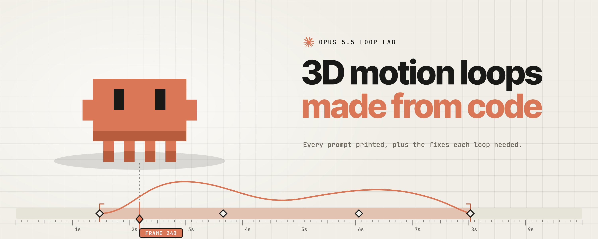

I made three 3D loops with Opus 5.5 where every frame is code, and I'm printing every prompt I used. The first one puts a vague prompt next to a detailed one for the same perfume bottle. The other two are a pebble that changes material and a small city that builds itself.

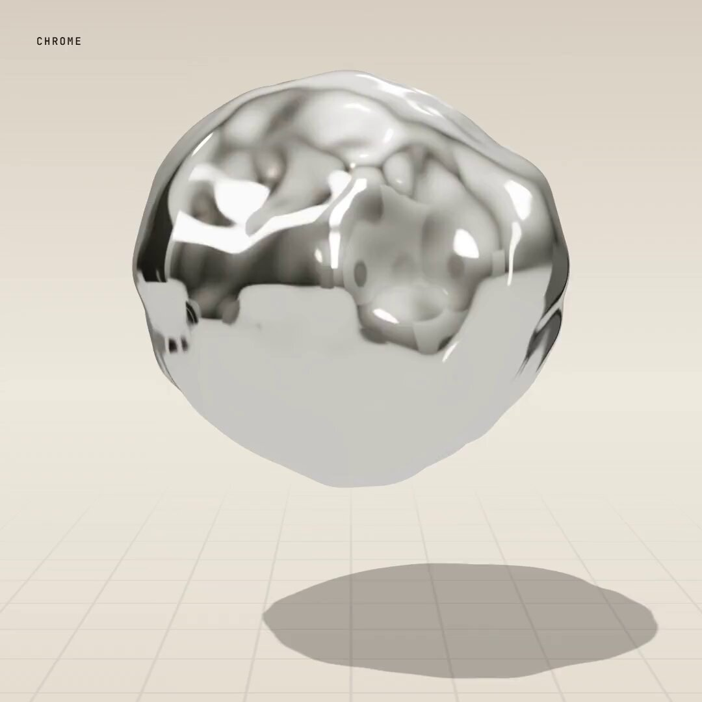

[前往原帖播放视频](https://x.com/anstapnever/status/2110392373377380473?s=46)

Below the clips you'll find the setup for Windows and Mac, a render script, a cheat sheet of motion and material numbers you can screenshot, and the follow-up messages each render needed.

You don't need After Effects. A browser and Claude are enough to start, and Claude Code makes it faster.

You need access to Opus 5.5 in the Claude app for the quick path, or Claude Code on a paid plan for the full one. There's nothing else to buy.

---

What's inside:

- Experiment 1: the same 3D perfume bottle from a vague prompt and from a directed one, side by side
- How it works: why Claude writes a program, not a video
- Setup from zero: no install, or Claude Code on Windows and Mac
- Prompt anatomy: the lines a directed motion prompt needs
- The numbers: easing, springs, durations, stagger, beat grid
- The material and light cookbook: real values for chrome, gold, glass and water
- Experiment 2: one object, four materials: chrome, gold, glass and clay
- Experiment 3: a floating voxel city that builds itself and takes itself apart
- The loop: render, look, fix
- Engines: Three.js, Remotion, HyperFrames, GSAP
- The last mile: sound, clean loops, export for X

The feed is full of clips captioned "one prompt". Some of them were one line and many weren't, so I'm printing the actual prompts here, along with the fixes each render needed. Your first render will be a draft, and that's normal.

---

## Experiment 1: the same bottle, two prompts

I asked the same model for the same product in the same format twice, once vaguely and once with every detail spelled out.

The product is a glass perfume bottle with a brass cap, as a 6-second loop in real 3D. Watch a full loop of each side before you read the prompts.


[前往原帖播放视频](https://x.com/anstapnever/status/2110392373377380473?s=46)

Both sides were generated in a fresh Claude Code session with Opus 5.5 at high effort, one prompt each and no follow-ups. Each side is the HTML file exactly as Claude wrote it, rendered frame by frame. The two prompts share one technical line (Three.js r170 and [window.seek](https://window.seek)(t)). The rest of Prompt B is direction. It's one run per prompt, so read it as one example, not a benchmark.

**Prompt A, vague (left side):**

```text
Create a premium animated product video of a glass perfume bottle using Three.js. Make it look luxurious and realistic. One self-contained HTML file, 1080x1080, 6-second seamless loop. Import Three.js r170 from jsDelivr as an ES module, and expose window.seek(t) that renders exactly time t in seconds, with nothing driven by the clock.
```

**Prompt B, directed (right side):**

```text
GOAL: a product loop for "NOCTA N°7", an amber perfume in a square glass bottle with a brass cap. The viewer should feel quiet luxury: heavy glass, warm liquid, one sweep of light.
FORMAT: one self-contained HTML file, 1080x1080, 6 seconds, 60 fps = 360 frames, a seamless loop: frame 359 flows into frame 0. Import Three.js r170 from jsDelivr (importmap: three -> https://cdn.jsdelivr.net/npm/three@0.170.0/build/three.module.js, three/addons/ -> https://cdn.jsdelivr.net/npm/three@0.170.0/examples/jsm/). Expose window.seek(t) that renders exactly time t in seconds. Nothing is driven by the clock, no Math.random, wait for fonts before the first render. Canvas sized to the window, pixel ratio 1, preserveDrawingBuffer true.

RENDERER: WebGLRenderer with antialias, sRGB output, ACESFilmic tone mapping at exposure 1.0, PCFSoftShadowMap. Environment: PMREMGenerator.fromScene(new RoomEnvironment(), 0.04), scene.environmentIntensity 0.7. Background: a vertical gradient from D8D0C2 at the top through EFE9DE at 55% to E6DFD2 at the bottom. The floor is a plane with ShadowMaterial at opacity 0.28, never a lit floor of another color, so the shadow sits straight on the background.

SUBJECT:
- Glass: RoundedBoxGeometry 1.2 x 1.5 x 0.62, radius 0.1, 8 segments. MeshPhysicalMaterial transmission 1, ior 1.5, thickness 0.9, roughness 0.02, attenuationColor E8D2A0, attenuationDistance 4.
- Liquid: RoundedBoxGeometry 1.0 x 1.0 x 0.44 inside the glass. It must be an OPAQUE MeshPhysicalMaterial (a transmissive object cannot be seen through another transmissive one): color E39A3A, roughness 0.12, clearcoat 1, a small emissive 6B3A08 at 0.35 so it glows from inside.
- Cap: a lathe-turned brass cylinder, radius 0.26, height 0.42, a 0.02 chamfer on both edges, a thin collar ring below. metalness 1, color F9E596, roughness 0.22, clearcoat 0.3.
- Plaque: a matte black 0.6 x 0.3 plate on the front face of the bottle, with "NOCTA" in Cormorant Garamond 600, letter spacing 0.2em, gold F9E596, and a small "N°7" under it. Draw the text on a canvas texture at 2048 px wide.
- Plinth: black stone RoundedBoxGeometry 2.6 x 0.35 x 1.8, radius 0.06, roughness 0.18, clearcoat 1.

LIGHT: key DirectionalLight FFF1E0 intensity 2.4 at (-4, 5, 4) casting shadows, shadow map 2048, shadow radius 7, bias -0.0004, normalBias 0.02. Fill FFFFFF intensity 0.5 at (5, 2, 3). Rim CFE0FF intensity 2.2 at (1, 3, -5). Two emissive panels that only exist to be reflected: a 4 x 2 softbox at (-4, 3.2, 3) at brightness 6, and a thin 0.5 x 4 strip at (4.2, 1.8, 1.5) at brightness 4. Chrome and glass need something to reflect.

CAMERA: PerspectiveCamera fov 32, 6.4 units from the bottle, 1.9 high, looking at (0, 1, 0).

MOTION (6 s loop):
- the bottle turns one full 360 degrees at constant speed. Linear is correct here because it is the loop phase.
- the camera pushes in 6% and back on ease-in-out-sine.
- the hero move, 1.5 to 3.5 s: the thin strip light slides left to right across the glass, so one bright vertical highlight travels over the glass and the liquid. It returns on the same ease from 3.5 to 5.5 s. Everything else stays calm.

BANNED: default gray MeshStandardMaterial without an environment map, a lit floor of another color than the background, harsh black shadows, neon colors, lens flare, glow, particles, sharp 90 degree edges, any title or text over the video.

CHECK: render stills at frames 0, 90, 150, 210 and 270 and look at them before you finish. The liquid must be visible through the glass, the cap must show reflections of the softboxes, the floor must have no visible horizon line. Frame 359 must flow into frame 0.
```

What Prompt A produced: a flat green stage, a barrel-shaped cap and a liquid that reads as one solid orange block. The glass barely looks like glass, the plinth shows no reflection and nothing makes the eye stop. It's a correct product render, but it doesn't look like an ad.

What Prompt B produced: a warm golden stage with soft bokeh, a clear glass body with a visible liquid line, a brass cap with a crisp edge, a mirror-polished plinth that reflects the bottle, and a brand line under it. The light does most of the work: one key, a warm backdrop and panels that exist only to be reflected.

What changed between A and B:

| Prompt A said | Prompt B said instead |
| --- | --- |
| "premium" | a gradient background, ACES tone mapping at exposure 1.0, an environment map |
| "luxurious" | glass with IOR 1.5 and thickness 0.9, brass F9E596 at roughness 0.22, a liquid that glows from inside |
| "realistic" | a key, a fill and a rim with colors and positions, plus two panels that exist only to be reflected |
| nothing about the camera | fov 32, 6.4 units away, a 6% push on a sine |
| nothing about motion | one hero move: a strip light sliding over the glass from 1.5 to 3.5 s |
| nothing to avoid | a banned list: a lit floor of another color, harsh shadows, glow, text over the video |

Two lines in Prompt B exist because the first test render of this scene failed in exactly these ways. The liquid is opaque because Three.js doesn't draw a transmissive object through another transmissive one: a see-through liquid inside see-through glass vanishes. The floor is a ShadowMaterial because a lit floor never quite matches the background, and you get a visible horizon line behind the product.

Follow-ups for Prompt B, ready to paste. Each points at frames, not feelings:

```text
1. Render stills at frames 0, 90, 150, 210 and 270. Describe each in one sentence as a viewer would. Does it match the shot list? Fix what doesn't.
2. The cap looks dull. Lower its roughness to 0.15 and move the 4 x 2 softbox so the cap shows a clean bright band at frame 0.
3. The glass looks milky. Put a dark flag behind the bottle on the left and keep one bright strip on the right, so the edges of the glass get contrast.
4. The light sweep is too fast. Keep it from 1.5 to 3.5 s but ease it with ease-in-out-cubic and make the highlight half as wide.
5. Frame 359 and frame 0 differ. Compare them numerically and fix the difference.
```

> Mia@MiaAI\_lab·[9月23日](https://x.com/MiaAI_lab/status/2102490829306634560)翻译自 英语我让 Claude Opus 5.5 创建了 100 个 HTML 文件  
>   
> 规则很简单：  
> - 看起来惊艳  
> - 零重复设计  
> - 完全进入创意模式  
>   
> CLAUDE OPUS 5.5 是我测试过的最好的模型！！！  
>   
> 这个实验之前最好的结果是 Fable 5.1，但 Opus 5.5 是下一个级别。  
>   
> 许多文件包含完整的可玩游戏！  
>   
> 零损坏文件。我简直被震撼了！🤯

Why it's here: 100 HTML pages from one model with rules like "zero repeated designs", prompts published. It shows how fast a model's defaults converge when you don't constrain it, and how much a rules list changes the output.

---

## How it works: Claude writes a program, not a video

Claude can't output an MP4, only text, so every clip in this article is a small program that Claude wrote and something else turned into frames.

The program is usually one HTML file. Open it in a browser and it plays. Point a headless browser at it, freeze it at one exact moment per frame, save the images, and ffmpeg stitches them into a video.

Anthropic describes its own Claude Motion the same way: Claude writes each animation as code, with no video model involved, so you can change any word, number or timing and export an MP4. It's in beta for Team and Enterprise plans.

> Claude@claudeai·[10月9日](https://x.com/claudeai/status/2108271552991252810)翻译自 英语Claude 仪表板和 Claude 动态现已进入测试阶段。  
>   
> 请让 Claude 将您的数据转化为实时仪表板，将您的想法转化为动画解释视频。
>
> 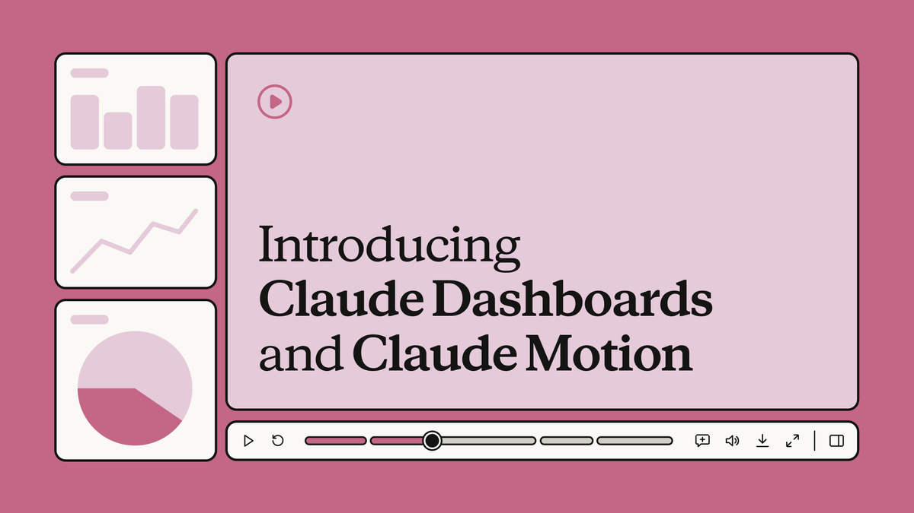
>
> [前往原帖播放视频](https://x.com/claudeai/status/2108271552991252810)

Why it's here: this is the official version of the idea in this article. Everything below is how to do the same thing yourself, with the prompt in your hands.

Because every frame is code, you can render frame 84 twice and get the same image twice. Fixing something means changing one number and rendering again, with no re-rolling a video model and hoping. And Claude can look at its own work: give it a contact sheet of the render and it will tell you what's wrong with frame 84.

---

## Setup from zero

There are two ways in, depending on how much you want to install.

### Path 1: no install, in the Claude app

1. Open Claude and pick Opus 5.5 in the model menu.
2. Paste a prompt from this article.
3. Ask for one self-contained HTML file. Claude writes it and plays it in the preview.
4. Ask for fixes with frame or second numbers: "the pop at 2.0 s lands late, move it 4 frames earlier".
5. Record the preview. On Windows, press Win+Shift+R to use the Snipping Tool's video mode. On a Mac, press Cmd+Shift+5.

A screen recording is fine for a first post, but it isn't frame-exact and can drop frames. For anything you want to look sharp, use Path 2.

### Path 2: Claude Code, on Windows or Mac

Claude Code can render the frames, open them, and fix the code without you copying anything around.

One requirement first: Claude Code needs a paid Claude plan (Pro, Max, Team or Enterprise) or a Console account. The free [claude.ai](https://claude.ai) plan doesn't include it.

Install it in PowerShell, from Anthropic's setup docs:

```text
irm https://claude.ai/install.ps1 | iex
```

You can also use winget install Anthropic.ClaudeCode. Open a new terminal afterwards and check it:

```text
claude --version
```

On a Mac or Linux, the installer is curl -fsSL <https://claude.ai/install.sh> | bash.

Then the lab tools. Node and ffmpeg first, then a browser Claude can drive:

```text
# Windows 11, PowerShell. Open a NEW terminal after winget finishes.
winget install OpenJS.NodeJS.LTS
winget install Gyan.FFmpeg
mkdir motion-lab; cd motion-lab
npm init -y
npm i -D playwright
npx playwright install chromium
claude
```

```text
# macOS
brew install node ffmpeg
mkdir motion-lab && cd motion-lab
npm init -y
npm i -D playwright
npx playwright install chromium
claude
```

Two Windows notes. Windows PowerShell 5.1 has no &&, so the commands above use a semicolon. If PowerShell refuses to run npx, type npx.cmd instead.

Pick the model and effort inside Claude Code. These commands are from the official docs:

```text
/model claude-opus-5-5
/effort medium
```

Opus 5.5 defaults to medium effort. The levels are low, medium, high, xhigh and max, and max applies to the current session only. A sensible habit: medium for fixes and re-renders, higher only when a from-scratch piece misses twice.

> Stephan Livera@stephanlivera·[9月25日](https://x.com/stephanlivera/status/2103315922098470926)翻译自 英语Opus 5.5 全力以赴 - “制作一段动态的 15 秒动态图形视频，展示你是一位多么出色的动态设计师，就好像这是你简历中的作品集。全力以赴。”
>
> 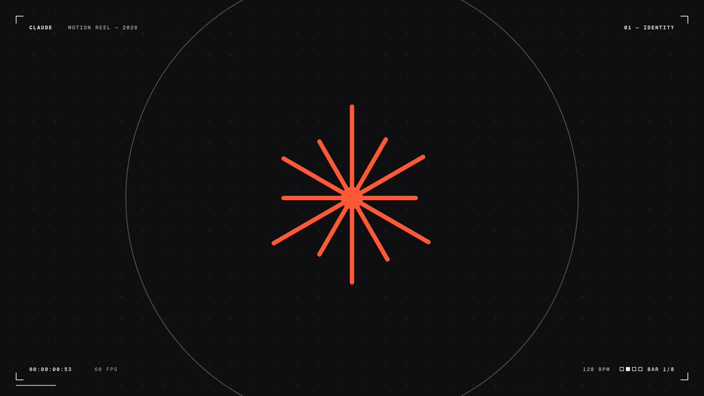
>
> [前往原帖播放视频](https://x.com/stephanlivera/status/2103315922098470926)

Why it's here: a one-line motion prompt run at max effort, with 2.2M views. It's a model demo, not a brief: the subject is the model itself, so nothing can come out wrong.

---

### The renderer

Save this as render.mjs. It opens your HTML in a headless browser, asks the page to draw one exact moment, saves the frame, and pipes everything into ffmpeg. Four subframes per frame are averaged, which gives real motion blur.

```text
// render.mjs   usage: node render.mjs loop.html 6 60 1080 1080
// The page must expose window.seek(t) that draws exactly time t (seconds).
import { chromium } from 'playwright';
import { spawn } from 'node:child_process';
import { pathToFileURL } from 'node:url';
import { mkdirSync } from 'node:fs';

const [file = 'loop.html', secs = '6', fps = '60', w = '1080', h = '1080', sub = '4'] =
  process.argv.slice(2);
const FPS = Number(fps), SUB = Number(sub), N = Math.round(Number(secs) * FPS); // frames 0..N-1
mkdirSync('out', { recursive: true });

const browser = await chromium.launch();
const page = await browser.newPage({
  viewport: { width: Number(w), height: Number(h) },
  deviceScaleFactor: 1,
});
await page.goto(pathToFileURL(file).href, { waitUntil: 'load' });
await page.evaluate(async () => { await document.fonts.ready; });
if (!(await page.evaluate(() => typeof window.seek === 'function'))) {
  throw new Error('The page has no window.seek(t). Add the render contract to the prompt.');
}

// SUB subframes per output frame, spread over half a frame (a 180 degree shutter).
// ffmpeg averages each group of SUB frames into one: that average is the motion blur.
const vf = `tmix=frames=${SUB},select='eq(mod(n\\,${SUB})\\,${SUB - 1})',setpts=N/${FPS}/TB`;
const ff = spawn('ffmpeg', [
  '-y', '-f', 'image2pipe', '-framerate', String(FPS * SUB), '-i', '-',
  '-vf', vf, '-r', String(FPS),
  '-c:v', 'libx264', '-crf', '16', '-pix_fmt', 'yuv420p', '-movflags', '+faststart',
  'out/silent.mp4',
], { stdio: ['pipe', 'inherit', 'inherit'] });

for (let i = 0; i < N; i++) {
  for (let k = 0; k < SUB; k++) {
    const t = (i + 0.5 * (k / SUB)) / FPS;
    await page.evaluate((tt) => window.seek(tt), t);
    const png = await page.screenshot({ type: 'png' });
    if (!ff.stdin.write(png)) await new Promise((r) => ff.stdin.once('drain', r));
  }
  if (i % FPS === 0) console.log(`frame ${i} of ${N}`);
}
ff.stdin.end();
await new Promise((r) => ff.on('close', r));
await browser.close();

// Add sound afterwards:
// ffmpeg -i out/silent.mp4 -i out/audio.wav -c:v copy -c:a aac -b:a 192k -shortest out/loop.mp4
```

3D scenes render much faster on a real graphics card. If a frame takes more than a second, ask Claude to check which GPU the headless browser is using (WEBGL\_debug\_renderer\_info shows it) before you wait for the whole render.

### The render contract

Paste this under any motion prompt. Each line closes one way a render goes wrong.

```text
RENDER CONTRACT
Output one self-contained HTML file. Use only libraries the prompt names, pinned to a version.
No network requests except fonts and those pinned libraries.
Every frame is a pure function of time t, in seconds.
Expose window.seek(t) that draws exactly that frame, and nothing may move between calls.
No Date.now, no setTimeout or setInterval, no requestAnimationFrame while rendering, no CSS transitions.
Randomness is seeded: write a small seeded generator, never Math.random.
Loops: the last frame must flow into the first. Render frames 0 to N-1 only.
```

A clock or a timer makes frame 84 come out different on every run. Unseeded randomness makes shapes jitter between frames. Rendering the last frame of a loop shows the first frame twice, which is the hiccup at the seam.

---

## Prompt anatomy: the lines a directed motion prompt needs

A directed prompt isn't long for the sake of being long. Each line takes one decision away from the model, and the model's own decisions are the default look.

The template. Fill every line before you press enter:

```text
GOAL:   what the viewer should feel or do, in one sentence
FORMAT: one self-contained HTML file, width x height, seconds x fps = frames. Loop: yes or no
BEAT:   BPM, frames per beat, which events land on beats
LOOK:   palette in hex with one accent, typeface and weight, sizes, tracking
STAGE:  where every element sits, in pixels
SHOTS:  a time range per shot, one hero move per shot, how each shot hands off
MOTION: easing as a cubic-bezier or a named curve, springs as a damping ratio, durations in frames
BANNED: the defaults you never want to see, by name
CHECK:  stills at named frames, a contact sheet, fix, then the full render
```

Write GOAL first. If you can't say in one sentence what the viewer should feel, no easing curve will rescue the piece. Then FORMAT, because every other number hangs off the frame count.

SHOTS is where the story lives. Give each shot a range, one hero move and a handoff. Treat every transition as a decision.

The ban list is a living list. After every first render, name what the model used anyway and add it. The usual suspects:

- purple or blue gradients, glow, lens flares
- floating particles as decoration
- everything fading in at once
- fade-and-slide-up on every element
- centered-everything layouts
- text that moves while you read it

One hero per shot. Secondary moves travel 50 to 70% as far as the hero and start 100 to 200 ms after it. Ambient motion stays under 5% of the hero's travel, runs on a slow sine and never stops.

> zero@twoclipping·[9月25日](https://x.com/twoclipping/status/2103273003555402193)翻译自 英语opus 5.5 在动态设计方面简直太牛逼了  
>   
> 整个视频全是代码，0 After Effects  
>   
> 我将开源这些动态设计的提示模板  
>   
> 偷走它来重现这些 ↓  
>   
> <inputs>  
> 向我询问：8 到 12 个我希望形状变成的 UI 状态（例如按钮、加载器、播放器、滑块、开关、标签、图表、命令面板、通知），纯黑白或一种强调色，以及一首约
>
> 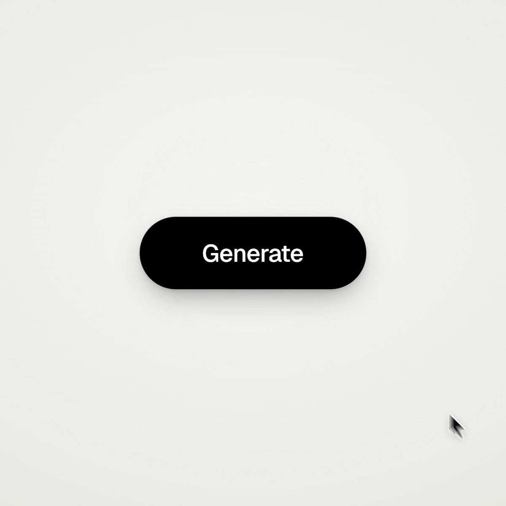
>
> [前往原帖播放视频](https://x.com/twoclipping/status/2103273003555402193)

Why it's here: a UI morph loop with its prompt template open-sourced in the thread. It passed 1 million views and is the cleanest public example of a prompt that lists states instead of vibes.

---

## The numbers

Motion designers talk in curves and frames, so give Claude curves and frames. Screenshot this section.

### Easing

These are the standard values from [easings.net](https://easings.net), as CSS cubic-bezier.

| Name | cubic-bezier | Use it for |
| --- | --- | --- |
| ease-out-expo | 0.16, 1, 0.3, 1 | text and logo reveals |
| ease-out-quint | 0.22, 1, 0.36, 1 | premium entrances |
| ease-out-cubic | 0.33, 1, 0.68, 1 | UI that responds to touch |
| ease-in-out-cubic | 0.65, 0, 0.35, 1 | moves across the screen |
| ease-in-out-quart | 0.76, 0, 0.24, 1 | camera moves, long travels |
| ease-in-out-sine | 0.37, 0, 0.63, 1 | ambient loops, breathing |
| ease-in-expo | 0.7, 0, 0.84, 0 | fast exits |
| ease-out-back | 0.34, 1.56, 0.64, 1 | a playful pop with overshoot |

Rules that cost nothing: enter with ease-out, exit with ease-in and make exits shorter, move across the screen with ease-in-out. Use linear only for rotation, progress bars and the phase of a loop. Linear easing on a move is the fastest way to make a render look like a render.

### Springs

Every library names its knobs differently. One number translates between all of them: the damping ratio.

```text
// damping ratio from any spring's numbers: stiffness k, damping c, mass m
const dampingRatio = (k, c, m = 1) => c / (2 * Math.sqrt(k * m));
```

| Damping ratio | Feels like |
| --- | --- |
| 1.0 and above | no bounce at all |
| 0.7 to 0.85 | premium, a hair of overshoot |
| 0.4 to 0.6 | playful |
| under 0.3 | a cartoon |

Position and size can bounce, but opacity and color shouldn't.

### Motion tokens as code

Put the numbers in one file and tell Claude to use only this file.

```text
// motion.js : no inline numbers anywhere else
export const EASE = {
  enter: (x) => (x >= 1 ? 1 : 1 - Math.pow(2, -10 * x)),                  // ease-out-expo
  move:  (x) => (x < 0.5 ? 8 * x ** 4 : 1 - ((-2 * x + 2) ** 4) / 2),     // ease-in-out-quart
  exit:  (x) => (x <= 0 ? 0 : Math.pow(2, 10 * x - 10)),                  // ease-in-expo
  pop:   (x) => { const c1 = 1.70158, c3 = c1 + 1;                         // ease-out-back
                  return 1 + c3 * (x - 1) ** 3 + c1 * (x - 1) ** 2; },
};

// A spring as a pure function of time: 0 to 1.
// zeta = damping ratio, hz = speed. No simulation, so frame 812 renders without frames 0 to 811.
export function spring(t, zeta = 0.7, hz = 2) {
  if (t <= 0) return 0;
  const w = 2 * Math.PI * hz;
  if (zeta >= 1) return 1 - Math.exp(-w * t) * (1 + w * t);
  const wd = w * Math.sqrt(1 - zeta * zeta);
  return 1 - Math.exp(-zeta * w * t) *
    (Math.cos(wd * t) + (zeta * w / wd) * Math.sin(wd * t));
}

// A value that gets a new target several times: one spring per change, each from its own start time.
// The motion stays continuous and any frame still renders on its own.
export function track(t, keys, zeta = 0.7, hz = 2) { // keys: [[time, value], ...]
  let v = keys[0][1];
  for (let i = 1; i < keys.length; i++) v += (keys[i][1] - keys[i - 1][1]) * spring(t - keys[i][0], zeta, hz);
  return v;
}

export const MS = { feedback: 150, move: 400, hero: 750, exit: 240 };
export const STAGGER_FRAMES = { letter: 1, word: 4, item: 3 };
```

Durations, stagger, holds

| What | Starting point |
| --- | --- |
| UI feedback | 100 to 200 ms. Around 100 ms feels instant |
| UI moves | 200 to 500 ms |
| Hero reveal | 600 to 900 ms |
| Letters | 1 frame apart |
| Words | 60 to 120 ms apart |
| List items | 40 to 80 ms apart |
| Next element starts | when the previous one is 30 to 50% done |
| A held word on screen | at least 0.3 s per word plus 0.5 s |

Say it in frames when you render video. At 60 fps one frame is about 16.7 ms: a 400 ms move is 24 frames and a 750 ms reveal is 45.

### The beat grid

```text
frames per beat = fps x 60 / BPM
60 fps at 120 BPM = 30 frames per beat   (a half beat is 15, a bar is 120)
```

When the result isn't a whole number, compute every beat from time and round each one. Adding a rounded value again and again drifts away from the music. Cut on the beat and change the layout on the bar. Changing everything on every beat wears the viewer out.

### Contrast and flashes

Keep text at 4.5:1 contrast on every frame, including over moving backgrounds, and never flash more than three times per second. Both numbers come from WCAG, the web's accessibility standard.

---

## The material and light cookbook

Most prompts just say "metallic" or "glass" and let the model guess. The values below are real ones, and if you give Claude numbers it paints physically plausible surfaces.

### Metals

Base color for a physically based material, in sRGB, from Google's Filament documentation:

| Metal | Base color (R, G, B) | Hex |
| --- | --- | --- |
| Silver | 0.97, 0.96, 0.91 | #f7f4e8 |
| Aluminum | 0.91, 0.92, 0.92 | #e8eaea |
| Titanium | 0.76, 0.73, 0.69 | #c1baaf |
| Iron | 0.77, 0.78, 0.78 | #c4c6c6 |
| Platinum | 0.83, 0.81, 0.78 | #d3cec6 |
| Gold | 1.00, 0.85, 0.57 | #ffd891 |
| Brass | 0.98, 0.90, 0.59 | #f9e596 |
| Copper | 0.97, 0.74, 0.62 | #f7bc9e |

Set metalness to 1 for all of them. Roughness is the lever: 0.05 is a mirror, 0.3 to 0.4 is brushed, 0.5 to 0.6 is satin. These roughness values are starting points, not measurements.

### Non-metals

A non-metal reflects a small, fixed amount of light straight on. That amount follows from the index of refraction (IOR):

```text
F0 = ((IOR - 1) / (IOR + 1)) squared
```

| Material | IOR | F0 |
| --- | --- | --- |
| Water | 1.33 | 0.02 |
| Glass, most plastics | 1.5 | 0.04 |
| Diamond | 2.42 | 0.17 |

The default for a non-metal is 4%, which is IOR 1.5. For glass, name the IOR and ask for a transmissive material, then ask for a caustic on the floor: a bright shape on the surface the glass focuses light onto.

### Light

A clean starting rig. Name it like this in a prompt:

| Light | Role | Starting value |
| --- | --- | --- |
| Key | the main shape, from upper front left | 45 degrees up, 45 degrees to the side, warm 5600 K |
| Fill | lifts the shadows | opposite side, low, a quarter to a third of the key |
| Rim | separates the subject from the background | behind and above, cool 7500 K |

The ratio between key and fill decides the mood: about 2:1 is soft, 4:1 is dramatic. Reflections need something to reflect, so give chrome a studio: softboxes overhead, a dark panel on the camera side and one bright strip. A mirror in a black void reflects black.

> Ann Nguyen@ann\_nnng·[10月11日](https://x.com/ann_nnng/status/2109257723246501895)翻译自 英语让 Claude Opus 5.5 创建这个 CD 塑料壳效果，带有开盖动画  
>   
> 它做得如此出色，我无法要求更多  
>   
> 无需 3D 模型，只需 three.js 配合着色器
>
> 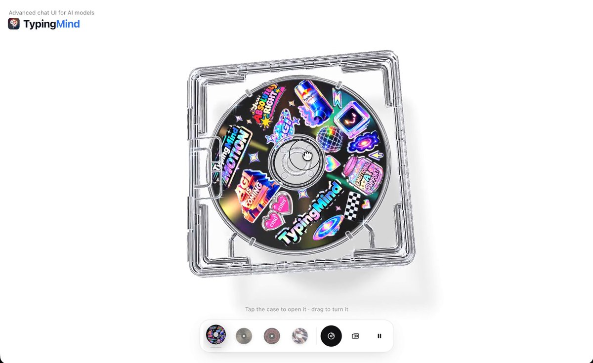
>
> [前往原帖播放视频](https://x.com/ann_nnng/status/2109257723246501895)

Why it's here: a CD jewel case with an opening lid, no 3D models, only Three.js and shaders. A good example of one material doing the work: clear plastic with proper edge highlights and a lid that opens like a real hinge.

> Simba@SimbasJungles·[10月11日](https://x.com/SimbasJungles/status/2109095401273938072)翻译自 葡萄牙语我用 Opus 5.5 设计了我的整个 Airbnb。  
>   
> 我发送了一些基础照片和 2D 平面图，加上一些 Pinterest 的参考资料，然后要求它使用 Blender 和 Unreal Engine 5 创建一个 3D 世界。
>
> 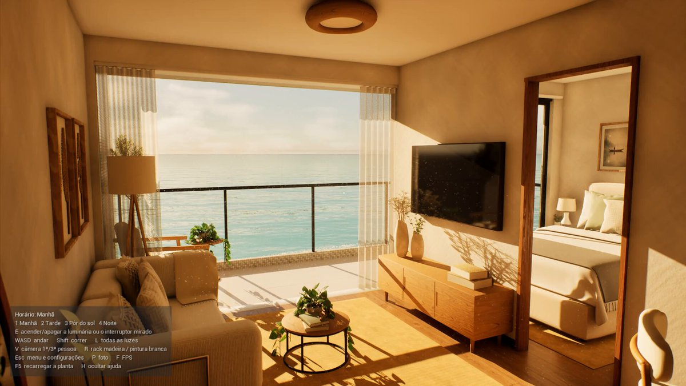
>
> [前往原帖播放视频](https://x.com/SimbasJungles/status/2109095401273938072)

Why it's here: a whole apartment modeled from a few photos, a 2D plan and some Pinterest references. When the subject is a real place, give the model references and a plan, not adjectives.

---

## Experiment 2: one object, four materials

One pebble, four materials: chrome, gold, glass and clay. The material changes with a sweeping wipe every three beats, and each time the material is the only star. At the end the pebble flows into the Claude spark with OPUS 5.5 under it, then flows back so the loop closes. This is the cookbook from the section above, running in a real scene.


[前往原帖播放视频](https://x.com/anstapnever/status/2110392373377380473?s=46)

Here's the first prompt. It's long because the scene has four materials, a studio and a wipe, and every number is a decision you don't want the model to make for you:

```text
GOAL: one object, four materials: chrome, gold, glass, clay. The same pebble changes its material four times with a sweeping wipe, and each time the material is the only star. The viewer should feel a studio test shot of a rare object.
FORMAT: 1080x1080, 8 seconds, 60 fps = 480 frames, a seamless loop: frame 479 flows into frame 0. All noise is seeded, no Math.random, nothing driven by the clock.
BEAT: 120 BPM, one beat = 30 frames. A material holds for 4 beats (120 frames). Wipes start on beats 0, 4, 8 and 12 of the loop (frames 0, 120, 240, 360) and take 24 frames.

RENDERER: WebGLRenderer with antialias, sRGB output, ACESFilmic tone mapping at exposure 1.0, PCFSoftShadowMap, localClippingEnabled true. Environment: PMREMGenerator.fromScene(new RoomEnvironment(), 0.04), scene.environmentIntensity 0.8. Background: a vertical gradient from D8D0C2 at the top through EFE9DE at 55% to E6DFD2 at the bottom. The floor is a plane with ShadowMaterial at opacity 0.25 so the shadow sits straight on the background.

SUBJECT: one organic pebble. IcosahedronGeometry radius 1, detail 6, vertices displaced along their normals by 3 octaves of seeded value noise (amplitude 0.18, base frequency 1.1), normals recomputed, no flat shading. It floats 0.9 above the floor and bobs 0.05 on a sine that closes over the loop. Four meshes share the same geometry, one per material:
1. Chrome: color F7F4E8, metalness 1, roughness 0.05.
2. Gold: color FFD891, metalness 1, roughness 0.32, clearcoat 0.4.
3. Glass: transmission 1, ior 1.5, thickness 1.2, roughness 0.02, dispersion 0.3, attenuationColor DFF1F2, attenuationDistance 3.
4. Clay: color C26B4E, roughness 0.8, metalness 0, sheen 0.3.

STUDIO: key softbox 4 x 2 at upper left, brightness 6. A thin vertical strip at the right, 0.5 x 4, brightness 4. A black flag, a 3 x 4 matte black plane behind left of the pebble, so the glass and chrome get a dark shape to reflect. Rim light cool CFE0FF 2.2 from behind. Key DirectionalLight FFF1E0 2.4 casting shadows, shadow map 2048, radius 7, bias -0.0004, normalBias 0.02. These panels exist only to be reflected. Glass is invisible without bright and dark shapes behind it, so also place a dark strip and a light strip on the floor behind the pebble.

WIPE: at each material change the old material is replaced by the new one with a vertical plane that sweeps across the frame from left to right in world space (ease-in-out-quart, 24 frames). Use clippingPlanes on both meshes with complementary planes, so the same geometry never leaves a hole. A hairline bright seam (an emissive 0.01 thick disc or a thin line) rides the cut.

MOTION: the pebble turns one full 360 degrees around y over 8 s at constant speed, plus a 12 degree wobble around x on a sine that closes over the loop. At each wipe it squashes to 1.07 and settles on a spring at damping ratio 0.5 over 24 frames. The camera is a PerspectiveCamera, fov 28, 7 units away, 0.4 high, and orbits plus and minus 12 degrees on a sine that closes over the loop.

LABEL: top left, an HTML text overlay on top of the canvas at (56, 56): the material name in JetBrains Mono 500 at 16 px, letter spacing 0.14em, color 111111: CHROME, GOLD, GLASS, CLAY. The word swaps when the wipe reaches it, letters changing 1 frame apart.

SOUND: 120 BPM, synthesized in code. A soft filtered noise whoosh on each wipe, rising for 300 ms. A different hit for each material: chrome is a short sine ping at 1760 Hz, gold is a warm bell at 880 Hz, glass is a high tick at 3136 Hz with a very fast decay, clay is a soft thud at 110 Hz. A quiet pad underneath. The loop point is silent so there is no click. Keep the whole mix about -17 LUFS.

BANNED: default gray MeshStandardMaterial without the environment, a lit floor of another color than the background, harsh black shadows, neon colors, lens flare, glow, particles, sharp edges, text other than the label.

CHECK: render stills at frames 60, 180, 300, 420 (mid-hold of each material) and 12, 132, 252, 372 (mid-wipe). Look at them. Chrome must reflect the softboxes, glass must read as glass, the wipe must not show a hole or a flicker. Compare frame 479 and frame 0 numerically.
```

Four rounds of review stills went into the first version. Then one more message made version 2: the glass was a milky white blob and a hard black streak sat on the floor, so the message tints the glass, moves the flag and strips into the environment scene, and adds a quiet floor grid and the logo ending. It's printed here as sent, with the logo line from the cover note added:

```text
FIX 1, glass: it reads as a milky white blob. Keep transmission 1 but tint it so it reads on the light background: attenuationColor 9FC9C0, attenuationDistance 1.5, thickness 1.4, ior 1.6, clearcoat 1, roughness 0, envMapIntensity 2.0. The edges must catch bright highlights from the strip and the softbox.

FIX 2, black streak on the floor: the dark flag and the dark strips stand in the visible scene. Move them out of it into a separate studio scene used only for the environment (PMREMGenerator.fromScene(studioScene, 0.02)). They stay in the reflections and never show in the picture.

BACKGROUND GRID: a faint perspective grid on the floor. A plane just above the shadow catcher, a canvas texture of 1 px lines in 111111 at 7% opacity, cells of 0.5 units, fading to transparent with distance from the pebble (radial alpha). The grid must be visible but quiet, with no moire and no shimmer when the camera moves. It stays when the pebble becomes the logo.

LOGO: the official Claude spark as an SVG (the file behind claude.ai/favicon.svg), viewBox 248 x 248, loaded with SVGLoader from three/addons/loaders/SVGLoader.js and extruded with ExtrudeGeometry. Its orange is D97757. Do not redraw it by eye.

TIMELINE (120 BPM, one beat = 30 frames, 600 frames = 20 beats). Frames:
0 to 90: chrome pebble, turning.
90 to 180: gold. The wipe starts at frame 90 and takes 24 frames.
180 to 270: glass. Wipe starts at frame 180.
270 to 360: clay. Wipe starts at frame 270.
360 to 420, REFORM: the same pebble vertices flow onto the surface of a puffy 3D Claude spark (an extruded relief about 0.35 deep with a rounded bevel, facing the camera, about 560 px wide on screen, centered at (540, 470)). No crossfade between two objects: the pebble itself becomes the logo. Ease-in-out-quart. Map every vertex to its closest point on the logo mesh once at load, cache it, so the morph reads as one blob flowing into the shape and not an explosion. During the morph the material goes from clay C26B4E to the logo's orange D97757, roughness 0.55, sheen 0.3, clearcoat 0.3. The turn decelerates so the logo faces the camera exactly at frame 420 (rotation equal to 0 modulo 360).
420 to 540, LOGO HOLD: the logo faces the camera with a gentle sway of plus and minus 4 degrees on a sine. The key softbox glides across its surface once.
432 onward: the text OPUS 5.5 under the logo, centered at (540, 900), Inter 500 at 72 px, letter spacing 0.14em, color 111111. Letters appear 1 frame apart, each rising 8 px on ease-out-expo.
540 to 600, RETURN: the text disappears letter by letter, 1 frame apart. The logo flows back into the pebble on the same ease, and a chrome wipe replaces the orange material (24 frames), so that frame 599 flows into frame 0 (chrome pebble). The turn picks its speed up again so the velocity at frame 599 equals the velocity at frame 0.

LABEL (top left): CHROME, GOLD, GLASS and CLAY as before. The label vanishes letter by letter at frame 360 and returns at frame 540 as CHROME.

SOUND (additions): a rising filtered sweep for the reform (frames 360 to 420). A soft chord in G major on frame 420 (G3, B3, D4, G4), a short tick for each letter of OPUS 5.5, a reverse whoosh for the return. The loop point stays silent so there is no click. The whole mix is still about -17 LUFS.

CHECK: render stills at frames 45, 135, 225, 315 (mid-hold of each material), 375, 390, 405 (reform), 480 (logo hold with the text) and 570 (return). Look at them. The glass must read as glass, the black streak must be gone, the grid must be quiet, the logo must be recognizable and clean (no melted edges, no holes), and the text must be sharp. Compare frame 599 and frame 0 numerically.
```

Typical follow-ups for this one:

```text
1. The glass pebble is almost invisible. Add a dark strip and a light strip on the floor behind it, and raise the thickness to 1.4.
2. The chrome looks gray. Raise scene.environmentIntensity to 1.0 and make the key softbox twice as bright, so there is a clear white band across the pebble.
3. The wipe shows a hole for a frame. Check that both meshes use the same geometry and that their clipping planes are exactly complementary.
4. The seam line flickers. Make it 0.012 thick and render it with depthTest off, 1 frame later than the plane.
5. Frame 479 differs from frame 0. Close the orbit, the wobble and the bob on the same loop phase and compare the frames numerically.
```

---

## Experiment 3: a floating city that builds itself

A small slab hangs in a studio. A voxel city grows on it from the center outward, floor by floor, and the spire goes up last. Then the city takes itself apart in reverse so the loop closes. The key light slowly swings around, so the long soft shadows glide across the roofs.

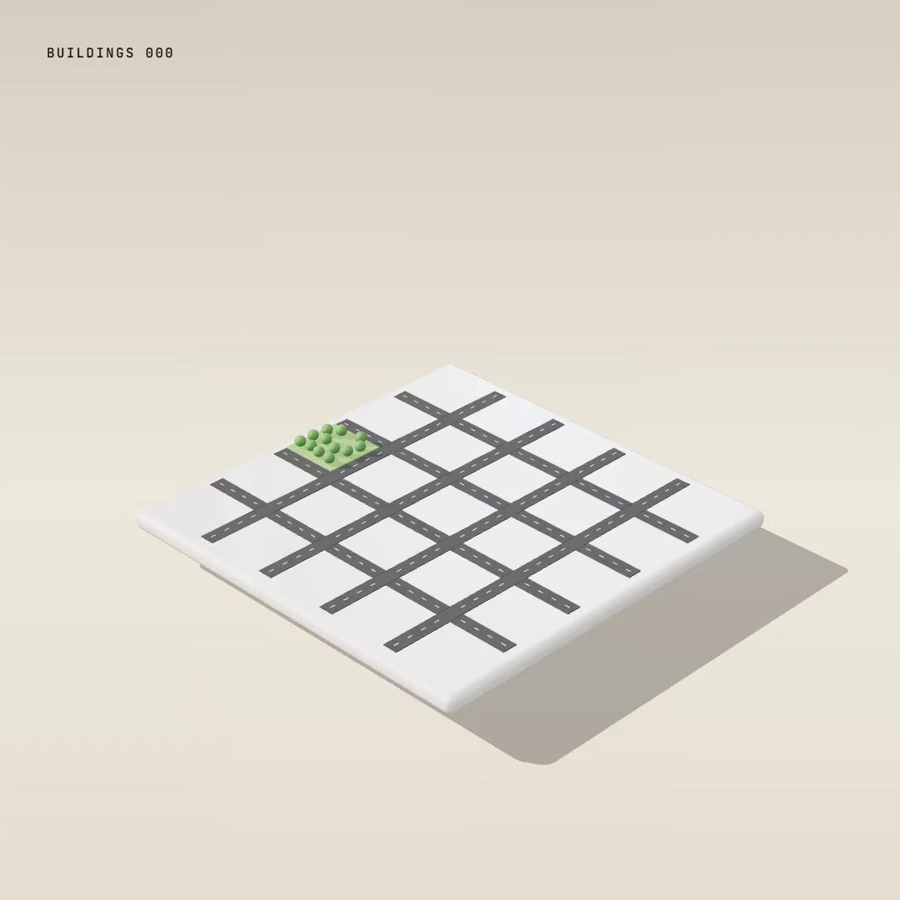

[前往原帖播放视频](https://x.com/anstapnever/status/2110392373377380473?s=46)

The prompt:

```text
GOAL: a small floating diorama of a voxel city that builds itself in 4 seconds and takes itself apart in 2. The viewer should feel a time-lapse of a city being born, then a clean reset, shot like a product on a studio table.
FORMAT: 1080x1080, 8 seconds, 60 fps = 480 frames, a seamless loop: frame 479 flows into frame 0 (an empty slab at rest). All randomness seeded, nothing driven by the clock.
BEAT: 120 BPM, one sixteenth note = 7.5 frames. A building's last floor lands on the nearest sixteenth.

RENDERER: WebGLRenderer with antialias, sRGB output, ACESFilmic tone mapping at exposure 1.0, PCFSoftShadowMap. Environment: PMREMGenerator.fromScene(new RoomEnvironment(), 0.04), scene.environmentIntensity 0.5. Background: a vertical gradient from D8D0C2 at the top through EFE9DE at 55% to E6DFD2 at the bottom. The floor is a plane with ShadowMaterial at opacity 0.25, so the slab's shadow sits straight on the background.

SLAB: RoundedBoxGeometry 26 x 1.2 x 26, radius 0.5, MeshPhysicalMaterial color F4F1EA, roughness 0.35, clearcoat 0.6. It floats 1.8 above the floor and bobs 0.06 on a sine that closes over the loop.

CITY: a 5 x 5 grid of blocks. A block is 4 x 4 tiles of 1 unit, and roads are 1 unit wide between blocks, so the pitch is 5 units and the grid fills the slab. Roads are dark 4A4A4A boxes 0.05 high with a thin dashed center line. The block at the west edge is a park: a flat green 8DB36A box with 12 round trees (spheres of radius 0.35, 6FA35C) scattered with a seeded generator. Every other block holds 4 buildings of 2 x 2 tiles. A building is a stack of floors, each floor a RoundedBoxGeometry 1.8 x 0.46 x 1.8 with radius 0.05, placed on a 0.5 pitch so a thin dark gap shows between floors (this gap is what makes it read as voxels). Floors are MeshStandardMaterial, roughness 0.55, in six muted colors: E8D5B5, D9A07A, B8C4CF, 9AA8B5, C26B4E, F2F0EB. Heights fall off with distance from the center block: up to 28 floors near the center, 4 to 8 at the edges, with seeded variation. In the exact center a stepped spire: 3 setbacks, 32 floors tall, with a thin brass antenna on top (metalness 1, F9E596). Use one InstancedMesh for all floors.

LIGHT: key DirectionalLight FFF1E0 at intensity 2.6 from upper left, casting soft shadows, shadow map 4096, camera bounds plus and minus 20, radius 5, bias -0.0004, normalBias 0.03. A HemisphereLight at 0.35. A cool rim light CFE0FF at 1.6 from behind. The key light swings 25 degrees around the city on a sine that closes over the loop, so the long shadows glide across the roofs.

CAMERA: PerspectiveCamera with a long lens, fov 22, looking along the (18, 15, 18) direction at the middle of the city. Do not hard-code the distance: fit it with a binary search so that the four slab corners, the spire tip and the shadow stay inside 86% of the frame at both extreme yaw angles, then center the city vertically. Yaw plus and minus 6 degrees on a sine that closes over the loop.

TIMELINE:
0 to 0.33 s (frames 0-20): the slab settles from scale 0.92 to 1.0 on a spring at damping ratio 0.6, with the roads and the park already on it.
0.33 to 4.2 s (frames 20-252): buildings rise from the center outward. A building starts at frame 20 + 36 x (distance from the center block, in blocks). Floors appear one after another, 1.2 frames apart, each popping from scale y 0 to 1 on a spring at damping ratio 0.5. The top floor lands with a 3% squash. The spire starts last, around frame 150, and builds more slowly, one floor every 2.5 frames, with the antenna growing last.
4.2 to 5.5 s (frames 252-330): hold. A slow 10% push-in, the key light keeps gliding, nothing else moves.
5.5 to 7.3 s (frames 330-438): the city takes itself apart. The spire first, then buildings from the edges inward, floors vanishing from the top down, each building over about 40 frames.
7.3 to 8.0 s (frames 438-480): the slab bobs once on a spring and rests. The camera is back at exactly its first position by frame 479.

LABEL: top left, an HTML text overlay on top of the canvas at (56, 56) in JetBrains Mono 500 at 16 px, letter spacing 0.14em, color 111111: "BUILDINGS 000", counting up as buildings finish and down as they disappear. Digits roll 1 frame apart.

SOUND: 120 BPM, synthesized in code. A short soft marimba pop for every building that lands, its pitch rising with the distance from the center, quantized to sixteenths. A low drone that rises across the build. A bigger hit when the spire finishes. A reverse suck-in during the take-down. The loop point is silent so there is no click. Keep the whole mix about -17 LUFS.

BANNED: flat unlit colors, a lit floor of another color than the background, harsh black shadows, neon colors, glow, particles, lens flare, sharp 90 degree edges, windows drawn as pictures, text other than the label.

CHECK: render stills at frames 0, 60, 150, 250, 300, 360, 420 and 470. Look at them. Shadows must be soft and legible, floors must show the dark gap, no building may float or overlap a road. Compare frame 479 and frame 0 numerically.
```

Two rounds of review stills, then the full render. Between the rounds the colors of the tallest buildings and the spire changed, and the rest held. No follow-up message was needed.

Typical follow-ups for this one:

```text
1. The buildings look like flat colored boxes. Make the dark gap between floors 0.04 wide and add 4% brightness variation per floor with the seeded generator.
2. The shadows are harsh. Raise the shadow radius to 7 and lower the key intensity by 15%.
3. The build looks like it starts everywhere at once. Make the start frame depend strictly on the distance from the center and add a 6 frame pause before the first ring.
4. The spire pops in. Grow it one floor every 2.5 frames and let the antenna appear only after the last setback.
5. The take-down is slower than the build. Run it over 108 frames and start from the highest buildings.
6. Frame 479 and frame 0 differ in the camera. Close the yaw and the push-in on the same loop phase.
```

> Edgex@SahilExec·[10月6日](https://x.com/SahilExec/status/2107444680732668320)翻译自 英语Claude Opus 5.5 基本上用 3D 重建了 Terraria。  
>   
> 8 天。  
> 346K 行 C# 代码。  
> 3,369 个物品。  
> 313 个敌人 & 首领。  
> 自定义引擎。没有 Unity。没有 Godot。  
>   
> 最疯狂的部分？  
>   
> 创建者说他们没写任何代码。  
>   
> AI 游戏开发变得荒谬了。
>
> 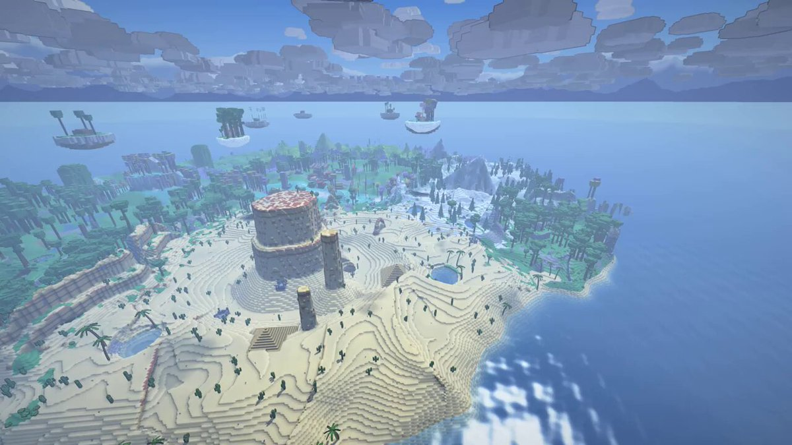
>
> [前往原帖播放视频](https://x.com/SahilExec/status/2107444680732668320)

Why it's here: a whole game built with Claude. The claim is the author's, I haven't verified it, but it shows how far the same "describe the world, then build it in pieces" approach goes beyond a loop.

---

## The loop: render, look, fix

The first render is a draft. The loop that finishes it: render stills, look at them, write notes with frame numbers, fix, and re-render only what changed. Two to four rounds is normal.

Freeze any frame by its URL. Paste this right before the closing body tag, open loop.html?t=2.5, and you are looking at the exact frame at 2.5 seconds. Claude can screenshot it and read it.

```text
<script>
// Open loop.html?t=2.5 to see the exact frame at 2.5 s.
(function () {
  var q = new URLSearchParams(location.search);
  if (!q.has('t')) return;
  var t = parseFloat(q.get('t')) || 0;
  function freeze() { if (typeof window.seek === 'function') window.seek(t); }
  freeze();
  if (document.fonts && document.fonts.ready) document.fonts.ready.then(freeze);
  window.addEventListener('load', freeze);
})();
</script>
```

To see the whole clip at once, make a contact sheet. Claude reads it like a storyboard:

```text
# Contact sheet: 2 frames per second, 6 across
ffmpeg -i out/loop.mp4 -vf "fps=2,scale=270:-1,tile=6x4" -frames:v 1 out/contact.png

# Phone test: how it reads at 360 px wide
ffmpeg -i out/loop.mp4 -vf "fps=1,scale=360:-1,tile=5x2" -frames:v 1 out/phone.png

# Seam check: play the loop twice back to back and watch the join
ffmpeg -stream_loop 1 -i out/loop.mp4 -c copy out/loop_twice.mp4
```

The follow-ups that work best, ready to paste. Each points at frames, not feelings:

```text
Render stills at frames 0, 60, 120, 180, 240 and 300. Describe each in one sentence as a viewer would. Does that match the shot list? Fix what does not.
Make a contact sheet of every 12th frame. Mark every frame where two things move at once, then fix the hierarchy.
Plot the hero's x position and scale per frame as a PNG chart. Show me where the motion is linear or stops dead, then fix it with our tokens.
Review this like a senior motion designer: 10 notes ordered by impact, each with a frame number and the exact code change. Apply the top 5.
It is too busy. Remove 30% of the motion and keep only the moves that guide the eye.
The ending is abrupt. Add a 36 frame hold with a 2% push, then let it settle on a spring at damping ratio 0.8.
```

Pick one or two per round. Pasting all six at once makes Claude fix everything a little and nothing well.

---

## Engines: pick one, or let Claude choose

Claude can write for every engine below. Name the one you want in the prompt, or it will choose for you.

| Engine | What it is | Good for |
| --- | --- | --- |
| Plain HTML, Canvas and CSS | one file, no dependencies | loops, UI, graphics |
| Three.js | 3D in the browser on WebGL. Current release r186 (24 Sep 2026) | 3D scenes, lights, materials, shaders |
| Remotion | video as React components | series, templates, data-driven videos. Check its license page: larger companies need a company license |
| HyperFrames | HTML, CSS and GSAP rendered to video, built for agents. Apache-2.0 | thinking in web pages |
| GSAP | an animation library, free to use including its plugins under a "No Charge" license | timelines and complex sequences |

For 3D, drive time from the frame number, never the clock, and give the camera numbers: a field of view of 35 to 50 degrees is a good starting point.

> The Bugged Dev@thebuggeddev·[9月28日](https://x.com/thebuggeddev/status/2104402407358919124)翻译自 英语如果物理学一直都这么容易可视化和学习，我们可能会拥有比以往更多的物理学家。  
>   
> AI 让学习变得更容易理解，而且真正有趣。  
>   
> 这是一个使用 Claude Opus 5.5 构建的电磁场可视化。  
>   
> 我认为我从未像这样简单地看到它的可视化后，更好地理解过这个主题 😅
>
> 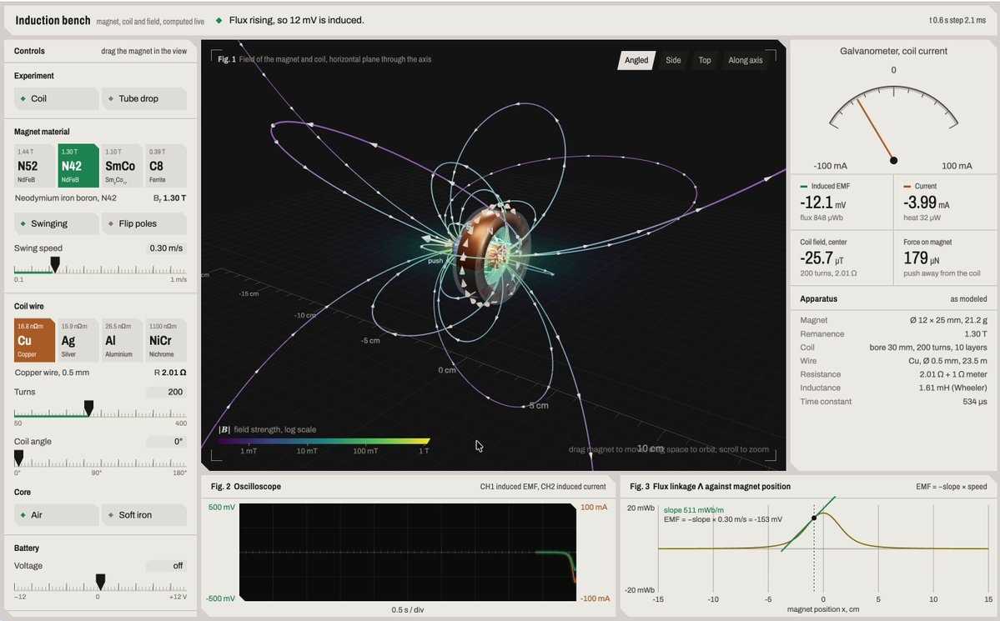
>
> [前往原帖播放视频](https://x.com/thebuggeddev/status/2104402407358919124)

Why it's here: not every piece is a video. An electromagnetic field visualization built with Opus 5.5, made to be understood, not just watched. When the point is to explain, a visualization beats a logo animation.

> Jeroen van Welsenes@Guronnimo·[10月8日](https://x.com/Guronnimo/status/2108095076929085510)翻译自 英语自己建了个网站，这样我就能在不外出情况下触碰草地  
>   
> 用 Opus 5.5 一击必杀
>
> 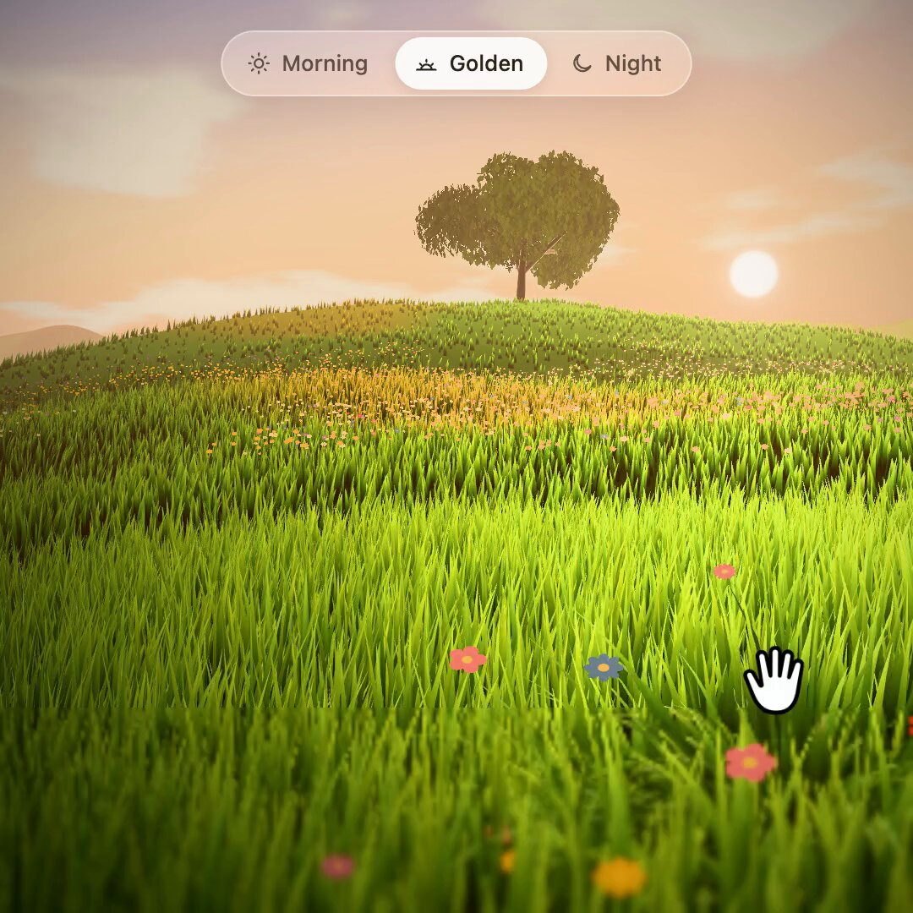
>
> [前往原帖播放视频](https://x.com/Guronnimo/status/2108095076929085510)

Why it's here: a whole website as one shot. A reminder that the same code that makes a loop makes a place.

---

## The last mile: sound, clean loops, export for X

Tutorials skip this part, and it's the part viewers notice first.

### Sound

The feed plays video muted until someone taps. The picture has to work in silence first. When you add sound, two rules carry most of the weight:

- put each hit on the frame it happens, or one frame after, never before
- pick one loudness target and keep it. Many web platforms normalize around -14 LUFS. A softer mix around -17 LUFS leaves room for a loud ear. Peak no higher than -1 dBTP

Ask for sound in the same prompt that asks for the picture, with the same beat grid, and tell Claude to synthesize everything in code so there's no license to worry about.

```text
# Measure the loudness of any file
ffmpeg -i out/loop.mp4 -af loudnorm=I=-16:TP=-1.5:LRA=11:print_format=json -f null -
```

Check the audio after encoding, not before. AAC adds a small delay, and a loop that clicks at the seam is a loop viewers scroll past.

> codila@0xCodila·[10月10日](https://x.com/0xCodila/status/2108621038141546616)翻译自 英语终于……我制作了一个音效设计提示，可以修复 Opus 5.5 和 Fable 5.5 的音乐和动态设计  
>   
> 区别他妈的太不可思议了……  
>   
> 不再是廉价的合成器哔哔声：SFX → 音乐 → 时机 → 一个提示搞定  
>   
> 发送给 Opus 5.5 和 Fable 5.5，然后以后再感谢我。下面读读如何从中赚钱 ↓
>
> 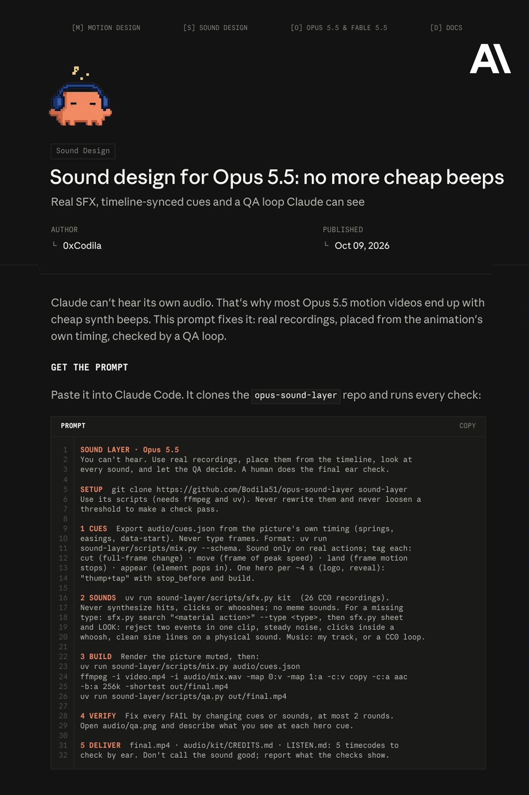
>
> 引用codila@0xCodila·10月5日
>
> 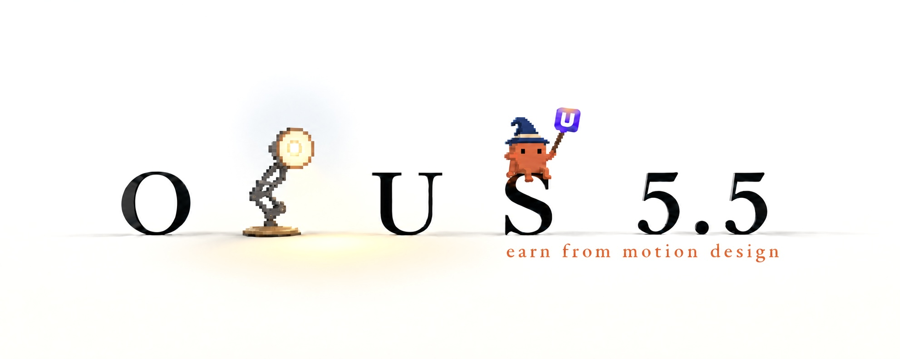
>
>  文章How to Get Money for Creating Motion Design with Opus 5.5 & Fable 5.5 (From Scratch)Why is everyone hyping Opus 5.5/Fable 5.5 for motion design, but nobody talking about the SERIOUS money you can make with it?  
>   
> Probably, I'll be the first to tell you about it... So listen:  
>   
> -...翻译自 英语这可能是2026年仅用AI赚钱的最简单方法……  
>   
> 公司已经在为使用Opus 5.5和Fable 5.5制作的15秒视频提供约500美元的报酬  
>   
> 在这篇文章中，我将带你一步步建立一个动态工作室，并从零分享报价：

Why it's here: a single prompt for sound design in motion pieces: effects, music and timing in one place. Compare its structure with the SOUND blocks in the prompts above.

> Kevin Ngo@kevin\_t\_ngo·[9月25日](https://x.com/kevin_t_ngo/status/2103482164193165711)翻译自 英语我让 Claude Opus 5.5 创作了一首钢琴曲。  
>   
> 使用 JavaScript 绘制的动画。
>
> 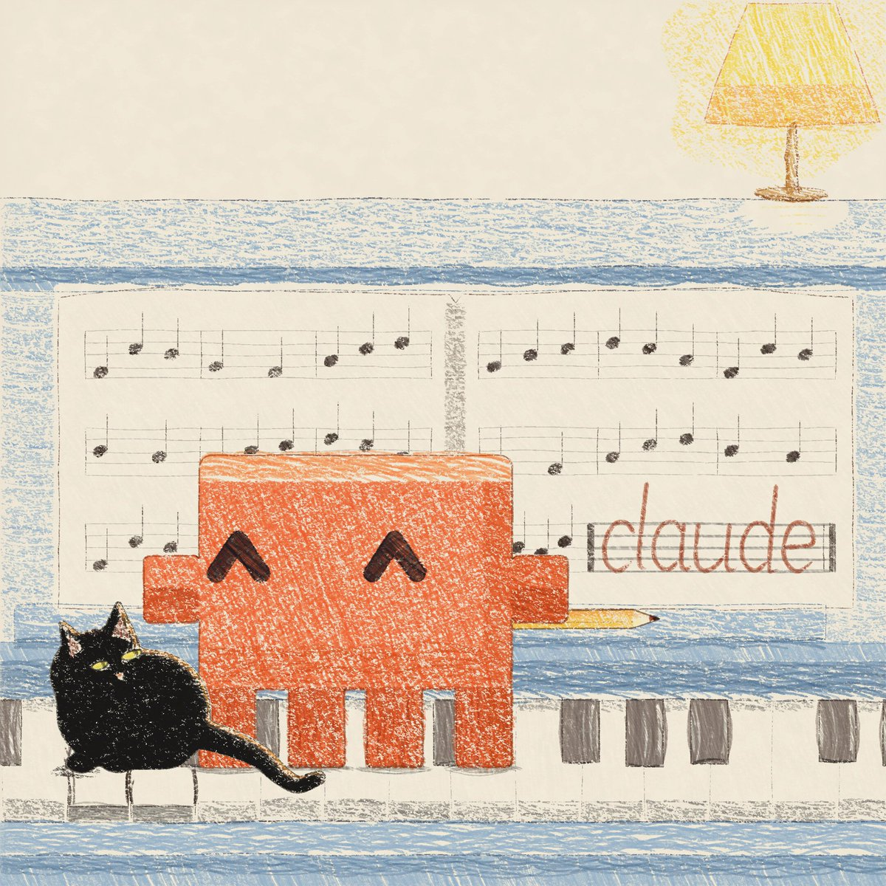
>
> [前往原帖播放视频](https://x.com/kevin_t_ngo/status/2103482164193165711)

Why it's here: a piano piece composed by Claude, with the animation drawn in JavaScript. Music written as code can carry a piece by itself.

### Clean loops

- the last frame flows into the first. Render frames 0 to N-1, never N
- a value that moves through the seam keeps its velocity, not just its position
- sound that ends on a tail needs a gap or a fade at the seam, or the loop clicks

### Export for X

```text
ffmpeg -i out/silent.mp4 -i out/audio.wav -c:v copy -c:a aac -b:a 192k -shortest out/loop.mp4
```

Encode with H.264 and yuv420p, plus -movflags +faststart (the renderer above already does). Keep the first frame meaningful: it becomes the preview. If the clip should loop forever, post the loop itself and let the player repeat it.

Save this for the next time you open a blank prompt, and start from the template instead of adjectives.

---

**Save it so you don't lose it, and follow** [**@anstapnever**](https://x.com/@anstapnever) **to get more alpha.**
