# Opus 5.5 循环实验室：用代码制作 3D 动效循环

作者：anstap（[@anstapnever](https://x.com/anstapnever)）  
发布：2026-10-14T15:28:45.000Z

[查看原帖](https://x.com/anstapnever/status/2110392373377380473?s=46) · [英文原文](原文.md)

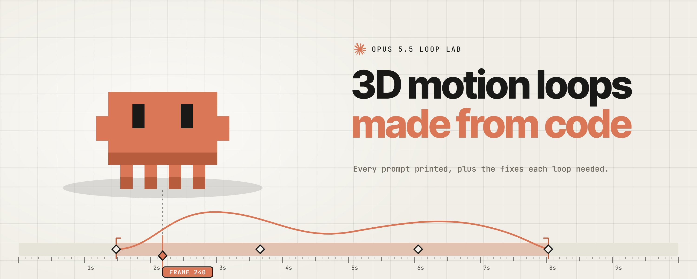

我用 Opus 5.5 做了三个 3D 循环，每帧都由代码生成，实际用过的提示词都附在这里。第一个用同一瓶香水对照模糊版和具体版提示词。另两个是一块会换材质的鹅卵石，以及一座自己搭起来的小城市。


[前往原帖播放视频](https://x.com/anstapnever/status/2110392373377380473?s=46)

视频下面有 Windows 和 Mac 的搭建步骤、渲染脚本、可以截图保存的动效和材质参数，以及每段渲染用到的后续指令。

浏览器加 Claude 就能起步，无需 After Effects。用 Claude Code 会更快。

快速路径需要在 Claude 应用中能使用 Opus 5.5；完整路径需要能用 Claude Code 的付费套餐。除此之外不用买别的。

---

内容速览：

- 实验一：同一只 3D 香水瓶，并排比较模糊提示词和具体指令。
- 工作原理：Claude 如何通过程序生成视频。
- 从零搭建：免安装，或在 Windows 和 Mac 上用 Claude Code。
- 提示词结构：具体的动效提示词需要哪些行。
- 数字：缓动、弹簧、时长、错峰、节拍网格。
- 材质和灯光配方：铬、金、玻璃、水的参数。
- 实验二：同一物体依次换成铬、金、玻璃和黏土。
- 实验三：一座自己组装、再自己拆解的悬浮体素城市。
- 迭代：渲染、看图、修改。
- 引擎：Three.js、Remotion、HyperFrames、GSAP。
- 收尾：声音、无缝循环、导出到 X。

动态里满是配着「一条提示词」的视频。确实有些只有一行，很多远不止一行。我把实际提示词和每次渲染所需的修正都列出来。第一次渲染只是草稿，很正常。

---

## 实验一：同一只香水瓶，两条提示词

我让同一个模型用同一格式做了两次同一个产品。一遍说得很笼统，一遍交代所有细节。

产品是一只黄铜盖的玻璃香水瓶，要做成真正 3D 的 6 秒循环。读提示词前，先各看完一轮。

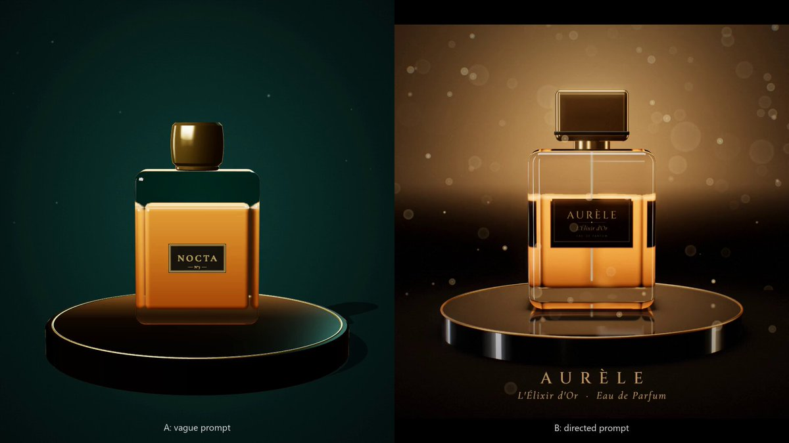

[前往原帖播放视频](https://x.com/anstapnever/status/2110392373377380473?s=46)

两侧各用一个全新的 Claude Code 会话，模型为 Opus 5.5、推理强度 `high`，各发一条提示词，不追加修改。两侧都将 Claude 原样输出的 HTML 逐帧渲染。提示词共享一条技术要求：Three.js r170 和 `window.seek(t)`。B 额外写清制作方向。每条提示词只跑了一次，适合当作案例。

**提示词 A，模糊版（左侧）：**

```text
用 Three.js 为玻璃香水瓶制作一段高端产品动画，效果奢华、写实。一个自包含 HTML 文件，1080×1080，6 秒无缝循环。以 ES module 方式从 jsDelivr 引入 Three.js r170，暴露 window.seek(t)，精确渲染以秒为单位的时刻 t，任何东西都不由时钟驱动。
```

**提示词 B，具体版（右侧）：**

```text
目标：给“NOCTA N°7”做一段产品循环。琥珀色香水装在方形玻璃瓶里，上面是黄铜盖。观众应感到克制的奢华：厚重的玻璃、温暖的液体、一道扫过的光。
规格：一个自包含 HTML 文件，1080×1080，6 秒，60 fps = 360 帧。第 359 帧顺畅接到第 0 帧，形成无缝循环。经 jsDelivr 引入 Three.js r170（importmap：three → https://cdn.jsdelivr.net/npm/three@0.170.0/build/three.module.js；three/addons/ → https://cdn.jsdelivr.net/npm/three@0.170.0/examples/jsm/）。暴露 window.seek(t)，精确渲染以秒为单位的 t。时钟不驱动任何东西，禁用 Math.random，首次渲染前等字体就绪。画布匹配窗口大小，像素比 1，preserveDrawingBuffer 为 true。

渲染器：带抗锯齿的 WebGLRenderer，sRGB 输出，ACESFilmic 色调映射、曝光 1.0，PCFSoftShadowMap。环境使用 PMREMGenerator.fromScene(new RoomEnvironment(), 0.04)，scene.environmentIntensity 为 0.7。背景是纵向渐变：顶部 D8D0C2，55% 位置 EFE9DE，底部 E6DFD2。地面用不透明度 0.28 的 ShadowMaterial 平面，避免用另一个受光颜色的地面，让阴影直接落在背景上。

主体：
- 玻璃：RoundedBoxGeometry，1.2×1.5×0.62，圆角半径 0.1，8 段。MeshPhysicalMaterial，transmission 1、ior 1.5、thickness 0.9、roughness 0.02、attenuationColor E8D2A0、attenuationDistance 4。
- 液体：玻璃内部的 RoundedBoxGeometry，1.0×1.0×0.44。必须用不透明 MeshPhysicalMaterial（一个透射物体不能透过另一个透射物体被看到）：color E39A3A、roughness 0.12、clearcoat 1，加少量 6B3A08 自发光，强度 0.35，使它从内部亮起来。
- 瓶盖：车削成形的黄铜圆柱，半径 0.26、高 0.42，两端倒角 0.02，下方加薄箍环。metalness 1、color F9E596、roughness 0.22、clearcoat 0.3。
- 铭牌：瓶身正面一块 0.6×0.3 的哑黑板；“NOCTA”用 Cormorant Garamond 600，字距 0.2em、金色 F9E596，下方放小号“N°7”。用宽 2048 px 的 Canvas 纹理绘制文字。
- 底座：黑石 RoundedBoxGeometry，2.6×0.35×1.8，圆角半径 0.06、roughness 0.18、clearcoat 1。

灯光：主 DirectionalLight 为 FFF1E0、强度 2.4，位置 (-4, 5, 4)，投射阴影。阴影图 2048、shadow radius 7、bias -0.0004、normalBias 0.02。补光 FFFFFF、强度 0.5，位置 (5, 2, 3)。轮廓光 CFE0FF、强度 2.2，位置 (1, 3, -5)。再加两个只供反射的发光面板：4×2 的柔光箱在 (-4, 3.2, 3)、亮度 6；0.5×4 的细灯条在 (4.2, 1.8, 1.5)、亮度 4。铬和玻璃都需要有东西可反射。

相机：PerspectiveCamera，fov 32，离瓶子 6.4 单位，高 1.9，朝向 (0, 1, 0)。

动效（6 秒循环）：
- 瓶子匀速旋转一整圈 360 度。这里使用线性，因为驱动的是循环相位。
- 相机按 ease-in-out-sine 推进 6%，再退回。
- 主动作在 1.5–3.5 秒：细灯条在玻璃前从左滑到右，一道亮竖线扫过玻璃与液体。3.5–5.5 秒用同样的缓动返回。其余保持安静。

禁用：没有环境贴图的默认灰色 MeshStandardMaterial、与背景不同色的受光地板、硬黑阴影、霓虹色、镜头光晕、发光、粒子、锋利的 90 度边缘、视频上叠加的标题或文字。

检查：出第 0、90、150、210、270 帧的静帧，检查后再收尾。透过玻璃能看到液体，瓶盖能反射柔光箱，地面没有可见地平线。第 359 帧顺畅接到第 0 帧。
```

提示词 A 产出了平绿背景、桶形瓶盖，以及看起来像一整块橙色固体的液体。玻璃几乎不像玻璃，底座没有反射，也没有值得视线停留的地方。产品画出来了，广告的感觉没有出来。

提示词 B 产出了温暖金色的布景、柔和的散景、能看清液位的玻璃瓶、边缘利落的黄铜盖、能照出瓶身的镜面底座，以及下方一行品牌字。大部分效果来自灯光：一盏主灯、暖背景和只为反射存在的面板。

A 与 B 的差别：

| A 的写法 | B 的具体要求 |
| --- | --- |
| 「高级」 | 渐变背景、曝光 1.0 的 ACES 色调映射、环境贴图 |
| 「奢华」 | IOR 1.5、厚度 0.9 的玻璃；粗糙度 0.22 的 F9E596 黄铜；由内发光的液体 |
| 「写实」 | 主灯、补光、轮廓灯的颜色和位置，再加两个只供反射的面板 |
| 没写相机 | fov 32，距离 6.4 单位，正弦缓动推进 6% |
| 没写动效 | 一个主动作：1.5–3.5 秒灯条扫过玻璃 |
| 没写禁用项 | 禁用异色受光地板、硬阴影、发光和叠字 |

B 有两条来自第一次试渲染的失败。液体用不透明材质，是因为 Three.js 不会透过一个透射物体绘制另一个透射物体。半透明液体装进半透明玻璃，会看不见。地面用 `ShadowMaterial`，是因为受光地板的颜色很难与背景完全一致，产品后面会多出一条地平线。

给 B 的后续指令可以直接粘贴，每条都指向具体帧：

```text
1. 渲染第 0、90、150、210、270 帧的静帧。站在观众角度用一句话描述每帧。与镜头清单一致吗？修正不一致的地方。
2. 瓶盖暗淡。粗糙度降到 0.15，移动 4×2 柔光箱，让第 0 帧瓶盖上出现干净的亮带。
3. 玻璃像乳白色。瓶子左后侧放一块暗遮光板，右侧留一条亮带，让玻璃边缘有对比。
4. 扫光太快。保持 1.5–3.5 秒，用 ease-in-out-cubic 缓动，高光宽度减半。
5. 第 359 帧与第 0 帧有差异。做数值比较并修掉差异。
```

> Mia@MiaAI_lab · [9 月 23 日](https://x.com/MiaAI_lab/status/2102490829306634560)
>
> 我让 Claude Opus 5.5 创建了 100 个 HTML 文件，规则是看起来惊艳、设计不重复、放开创意。Opus 5.5 是我测试过最好的模型。此前最好的是 Fable 5.1，这次又上了一层。很多文件里是可以完整游玩的游戏，一个坏文件都没有。

放这个例子，是因为同一个模型在「不重复设计」等限制下做了 100 页，提示词也公开了。它能说明不加限制时模型多容易退回相似默认风格，以及规则清单能带来多大差异。

---

## 工作原理：Claude 如何用程序生成视频

Claude 只能输出文本，不能直接给 MP4。这篇文章里的每条视频都先由 Claude 写一个小程序，再由别的工具把它转成帧。

程序通常是一个 HTML 文件，浏览器打开就能播放。用无头浏览器在每一帧对应的精确时刻定格并保存，再由 ffmpeg 把图像合成视频。

Anthropic 对自家的 Claude Motion 也是这样描述的：Claude 用代码写动画，不经过视频模型，所以可以改任意文字、数字或时间，再导出 MP4。原文称当时 Team 和 Enterprise 套餐可用测试版。

> Claude@claudeai · [10 月 9 日](https://x.com/claudeai/status/2108271552991252810)
>
> Claude 仪表盘与 Claude Motion 已开始测试。可以让 Claude 把数据做成实时仪表盘，把想法做成动画讲解视频。
>
> 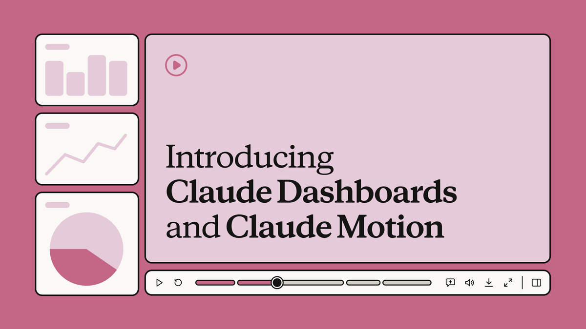
>
> [前往原帖播放视频](https://x.com/claudeai/status/2108271552991252810)

这是这个思路的官方产品版本。下面讲如何掌握提示词，自己做出类似流程。

每帧都由代码决定，所以把第 84 帧渲染两遍，会得到同一张图。修改时只需改一个数字再渲染。Claude 也能检查自己的输出，把关键帧拼图给它，就能让它指出第 84 帧出了什么问题。

---

## 从零搭建

有两条路径，取决于你愿意安装多少工具。

### 路径 1：不安装，使用 Claude 应用

1. 打开 Claude，在模型菜单选 Opus 5.5。
2. 粘贴这篇文章中的一个提示词。
3. 要求一个自包含 HTML 文件。Claude 会写出来并在预览中播放。
4. 用帧号或秒数提修改，例如「2.0 秒的弹出太晚，提前 4 帧」。
5. 录制预览。Windows 按 Win+Shift+R，使用截图工具的视频模式。Mac 按 Cmd+Shift+5。

首次发帖时，录屏够用。但它不能精确控制每帧，也可能掉帧。想要更清晰、稳定的结果，用路径 2。

### 路径 2：在 Windows 或 Mac 上使用 Claude Code

Claude Code 可以渲染并打开各帧，再直接修改代码，你不用来回复制。

原文给出的使用条件是付费 Claude 套餐（Pro、Max、Team 或 Enterprise）或 Console 账户，免费的 [claude.ai](https://claude.ai) 套餐不包含 Claude Code。

按 Anthropic 的设置文档，在 PowerShell 安装：

```powershell
irm https://claude.ai/install.ps1 | iex
```

也可以运行 `winget install Anthropic.ClaudeCode`。安装后打开新终端检查：

```bash
claude --version
```

Mac 或 Linux 的安装命令是 `curl -fsSL https://claude.ai/install.sh | bash`。[查看安装脚本](https://claude.ai/install.sh)

然后安装实验室工具：先 Node 和 ffmpeg，再装 Claude 可以控制的浏览器。

```powershell
# Windows 11, PowerShell. Open a NEW terminal after winget finishes.
winget install OpenJS.NodeJS.LTS
winget install Gyan.FFmpeg
mkdir motion-lab; cd motion-lab
npm init -y
npm i -D playwright
npx playwright install chromium
claude
```

```bash
# macOS
brew install node ffmpeg
mkdir motion-lab && cd motion-lab
npm init -y
npm i -D playwright
npx playwright install chromium
claude
```

Windows 有两点。Windows PowerShell 5.1 没有 `&&`，所以上面的命令用分号。如果 PowerShell 拒绝运行 `npx`，改用 `npx.cmd`。

在 Claude Code 里选择模型和推理强度。原文引用的官方命令：

```text
/model claude-opus-5-5
/effort medium
```

Opus 5.5 默认 `medium`。档位是 `low`、`medium`、`high`、`xhigh`、`max`，其中 `max` 只对当前会话生效。一个习惯是修正、重渲染用 `medium`；从零做的新片两次没做对，再提高强度。

> Stephan Livera@stephanlivera · [9 月 25 日](https://x.com/stephanlivera/status/2103315922098470926)
>
> 让 Opus 5.5 全力发挥：做一条 15 秒、富有动感的动态图形短片，展示你有多擅长动效设计。就当是你简历里的作品集。
>
> 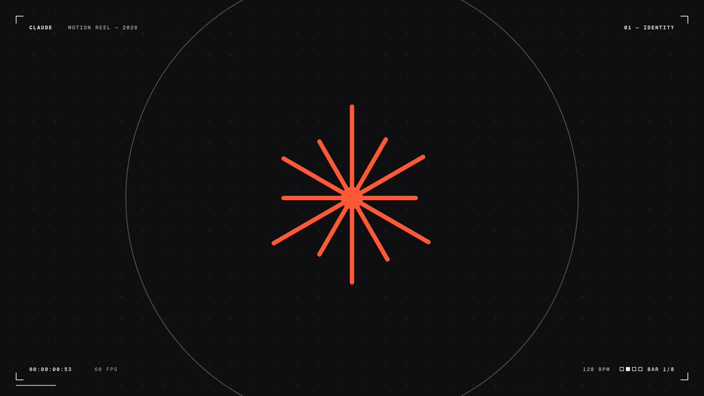
>
> [前往原帖播放视频](https://x.com/stephanlivera/status/2103315922098470926)

这条单行动效提示词以 `max` 运行，拿到 220 万次观看。它适合演示模型，因为主题就是模型本身，没有必须对准的产品说明。

---

### 渲染器

把下面代码保存为 `render.mjs`。它用无头浏览器打开 HTML，让页面绘制一个精确时刻，抓取图像，并把图像通过管道传给 ffmpeg。每个输出帧将 4 个子帧取平均，形成运动模糊。

```javascript
// render.mjs   usage: node render.mjs loop.html 6 60 1080 1080
// The page must expose window.seek(t) that draws exactly time t (seconds).
import { chromium } from 'playwright';
import { spawn } from 'node:child_process';
import { pathToFileURL } from 'node:url';
import { mkdirSync } from 'node:fs';

const [file = 'loop.html', secs = '6', fps = '60', w = '1080', h = '1080', sub = '4'] =
  process.argv.slice(2);
const FPS = Number(fps), SUB = Number(sub), N = Math.round(Number(secs) * FPS); // frames 0..N-1
mkdirSync('out', { recursive: true });

const browser = await chromium.launch();
const page = await browser.newPage({
  viewport: { width: Number(w), height: Number(h) },
  deviceScaleFactor: 1,
});
await page.goto(pathToFileURL(file).href, { waitUntil: 'load' });
await page.evaluate(async () => { await document.fonts.ready; });
if (!(await page.evaluate(() => typeof window.seek === 'function'))) {
  throw new Error('The page has no window.seek(t). Add the render contract to the prompt.');
}

// SUB subframes per output frame, spread over half a frame (a 180 degree shutter).
// ffmpeg averages each group of SUB frames into one: that average is the motion blur.
const vf = `tmix=frames=${SUB},select='eq(mod(n\\,${SUB})\\,${SUB - 1})',setpts=N/${FPS}/TB`;
const ff = spawn('ffmpeg', [
  '-y', '-f', 'image2pipe', '-framerate', String(FPS * SUB), '-i', '-',
  '-vf', vf, '-r', String(FPS),
  '-c:v', 'libx264', '-crf', '16', '-pix_fmt', 'yuv420p', '-movflags', '+faststart',
  'out/silent.mp4',
], { stdio: ['pipe', 'inherit', 'inherit'] });

for (let i = 0; i < N; i++) {
  for (let k = 0; k < SUB; k++) {
    const t = (i + 0.5 * (k / SUB)) / FPS;
    await page.evaluate((tt) => window.seek(tt), t);
    const png = await page.screenshot({ type: 'png' });
    if (!ff.stdin.write(png)) await new Promise((r) => ff.stdin.once('drain', r));
  }
  if (i % FPS === 0) console.log(`frame ${i} of ${N}`);
}
ff.stdin.end();
await new Promise((r) => ff.on('close', r));
await browser.close();

// Add sound afterwards:
// ffmpeg -i out/silent.mp4 -i out/audio.wav -c:v copy -c:a aac -b:a 192k -shortest out/loop.mp4
```

真实显卡能显著加快 3D 渲染。如果每帧耗时超过一秒，先让 Claude 检查无头浏览器在用哪块 GPU（`WEBGL_debug_renderer_info` 能显示），再决定是否等待整条片。

### 渲染约定

贴到任意动效提示词下方。每行都防止一类渲染故障。

```text
渲染约定
输出一个自包含 HTML 文件。只使用提示词点名的库，并锁定版本。
除字体和上述锁定版本的库外，不发起网络请求。
每一帧都是时间 t 的纯函数，t 以秒计。
暴露 window.seek(t)，精确绘制该帧。两次调用之间不得有运动。
渲染时禁用 Date.now、setTimeout、setInterval、requestAnimationFrame 以及 CSS transition。
随机性必须带种子：写一个小型带种子生成器，不用 Math.random。
循环：末帧顺畅过渡到首帧，只渲染第 0 到 N-1 帧。
```

系统时钟或计时器会让第 84 帧每次不同；无种子随机数会让物体在帧间抖动。渲染到重复的循环终点，会把首帧播两次，接缝就会顿一下。

---

## 提示词结构：具体动效指令需要哪些行？

每行都替模型决定一件事。留给模型的决定越多，越容易落入它的默认风格。

发送前填完模板：

```text
目标：用一句话写出观众该感受到什么，或做什么。
规格：一个自包含 HTML 文件，宽×高，秒数×fps = 帧数。是否循环。
节拍：BPM、每拍帧数、哪些事件踩拍。
外观：十六进制色板、一个强调色、字体和字重、字号、字距。
场面：以像素为单位写清每个元素的位置。
镜头：每镜的时间范围、一个主动作、如何接到下一镜。
运动：用 cubic-bezier 或曲线名表示缓动，用阻尼比表示弹簧，用帧表示时长。
禁用：逐项点名不想看到的默认做法。
检查：指定帧号出静帧、拼图、修正，再完整渲染。
```

先写目标。如果一句话说不清观众应该感受到什么，任何缓动曲线都救不了成片。再写规格，其他数字都要根据总帧数来定。

叙事放在镜头清单里。每镜要有范围、一个主动作和交接方式。每次转场都应该出于明确的决定。

禁用清单要持续更新。看过第一版后，把模型仍然用了的做法记进去。常见的有：

- 紫色或蓝色渐变、发光、镜头光晕。
- 装饰用的漂浮粒子。
- 所有东西同时淡入。
- 每个元素都边淡入边往上滑。
- 所有元素都居中。
- 阅读时仍在移动的文字。

每镜只突出一个主动作。次要动作走主动作的 50% 到 70%，晚 100 到 200 ms 起步。环境动作不超过主动作位移的 5%，用缓慢正弦波持续运行。

> zero@twoclipping · [9 月 25 日](https://x.com/twoclipping/status/2103273003555402193)
>
> Opus 5.5 做动效太强了。整个视频用代码完成，不用 After Effects。我会公开动效提示词模板。可以用它复现：
>
> `<inputs>`：先问我 8 到 12 个希望形状变成的界面状态，例如按钮、加载器、播放器、滑块、开关、标签、图表、命令面板或通知；问我要纯黑白还是一种强调色，以及一首约……
>
> 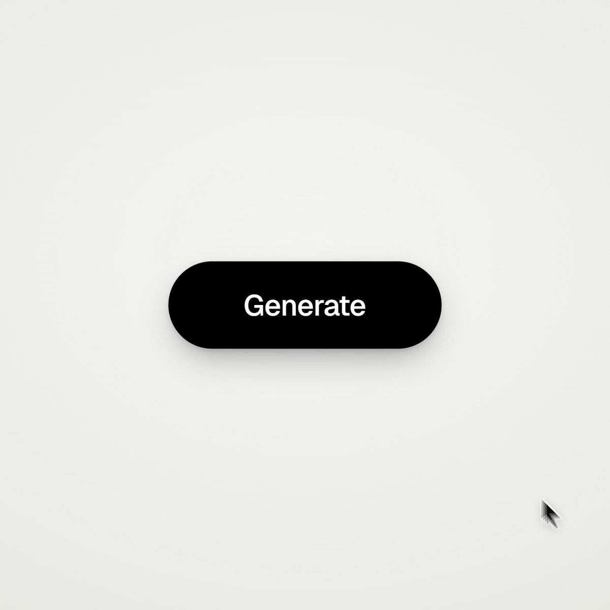
>
> [前往原帖播放视频](https://x.com/twoclipping/status/2103273003555402193)

这段界面变形循环在帖子里公开了提示词模板，观看超过 100 万次。它清楚展示了如何把提示词写成状态清单。

---

## 常用数字

动效设计师用曲线和帧沟通，也把这些给 Claude。这一节可以截图留存。

### 缓动

以下是 [easings.net](https://easings.net) 给出的标准 CSS cubic-bezier 数值。

| 名称 | cubic-bezier | 用途 |
| --- | --- | --- |
| ease-out-expo | 0.16, 1, 0.3, 1 | 文字和标志揭示 |
| ease-out-quint | 0.22, 1, 0.36, 1 | 从容利落的入场 |
| ease-out-cubic | 0.33, 1, 0.68, 1 | 响应触摸的界面 |
| ease-in-out-cubic | 0.65, 0, 0.35, 1 | 横跨画面的位移 |
| ease-in-out-quart | 0.76, 0, 0.24, 1 | 运镜、长距离移动 |
| ease-in-out-sine | 0.37, 0, 0.63, 1 | 环境循环、呼吸 |
| ease-in-expo | 0.7, 0, 0.84, 0 | 快速退场 |
| ease-out-back | 0.34, 1.56, 0.64, 1 | 有过冲的俏皮弹出 |

几条不费力的规则：入场缓出，退场缓入且更短，横跨画面用缓入缓出。线性只用在旋转、进度条和循环相位上。普通位移一用线性，就会显得机械。

### 弹簧

每个库的参数名不同，阻尼比可以跨库比较。

```javascript
// damping ratio from any spring's numbers: stiffness k, damping c, mass m
const dampingRatio = (k, c, m = 1) => c / (2 * Math.sqrt(k * m));
```

| 阻尼比 | 观感 |
| --- | --- |
| 1.0 及以上 | 完全不反弹 |
| 0.7–0.85 | 从容，只有少量过冲 |
| 0.4–0.6 | 俏皮 |
| 低于 0.3 | 卡通 |

位置和尺寸可以弹，不透明度和颜色不要弹。

### 将动效参数集中到代码

把数字放进同一个文件，让 Claude 只从这里取值。

```javascript
// motion.js : no inline numbers anywhere else
export const EASE = {
  enter: (x) => (x >= 1 ? 1 : 1 - Math.pow(2, -10 * x)),                  // ease-out-expo
  move:  (x) => (x < 0.5 ? 8 * x ** 4 : 1 - ((-2 * x + 2) ** 4) / 2),     // ease-in-out-quart
  exit:  (x) => (x <= 0 ? 0 : Math.pow(2, 10 * x - 10)),                  // ease-in-expo
  pop:   (x) => { const c1 = 1.70158, c3 = c1 + 1;                         // ease-out-back
                  return 1 + c3 * (x - 1) ** 3 + c1 * (x - 1) ** 2; },
};

// A spring as a pure function of time: 0 to 1.
// zeta = damping ratio, hz = speed. No simulation, so frame 812 renders without frames 0 to 811.
export function spring(t, zeta = 0.7, hz = 2) {
  if (t <= 0) return 0;
  const w = 2 * Math.PI * hz;
  if (zeta >= 1) return 1 - Math.exp(-w * t) * (1 + w * t);
  const wd = w * Math.sqrt(1 - zeta * zeta);
  return 1 - Math.exp(-zeta * w * t) *
    (Math.cos(wd * t) + (zeta * w / wd) * Math.sin(wd * t));
}

// A value that gets a new target several times: one spring per change, each from its own start time.
// The motion stays continuous and any frame still renders on its own.
export function track(t, keys, zeta = 0.7, hz = 2) { // keys: [[time, value], ...]
  let v = keys[0][1];
  for (let i = 1; i < keys.length; i++) v += (keys[i][1] - keys[i - 1][1]) * spring(t - keys[i][0], zeta, hz);
  return v;
}

export const MS = { feedback: 150, move: 400, hero: 750, exit: 240 };
export const STAGGER_FRAMES = { letter: 1, word: 4, item: 3 };
```

时长、错峰与停留：

| 项目 | 起始值 |
| --- | --- |
| 界面反馈 | 100–200 ms，约 100 ms 感觉接近即时 |
| 界面位移 | 200–500 ms |
| 主元素揭示 | 600–900 ms |
| 字母 | 错开 1 帧 |
| 单词 | 错开 60–120 ms |
| 列表项 | 错开 40–80 ms |
| 下一项开始 | 上一项完成 30% 到 50% 时 |
| 屏幕文字停留 | 至少每词 0.3 秒，再加 0.5 秒 |

渲染视频时用帧表达。60 fps 每帧约 16.7 ms，400 ms 位移是 24 帧，750 ms 揭示是 45 帧。

### 节拍网格

```text
每拍帧数 = fps × 60 / BPM
60 fps、120 BPM 时每拍 30 帧（半拍 15 帧，一小节 120 帧）。
```

结果不是整数时，从时间算出每拍的帧位置，再分别取整。重复加一个取整值，会逐渐脱离音乐。踩拍切镜，每小节换布局。每拍都换所有东西，观众会累。

### 对比度和闪烁

包括动态背景在内，每帧的文字对比度都至少 4.5:1，闪烁每秒不超过三次。两项数字均来自网页无障碍标准 WCAG。

---

## 材质和灯光配方

只写「金属」或「玻璃」，剩下的就得让模型猜。给出具体数值，Claude 就能画出物理上合理的表面。

### 金属

以下是 Google Filament 文档中基于物理的材质的 sRGB 基础色：

| 金属 | 基础色（R、G、B） | 十六进制 |
| --- | --- | --- |
| 银 | 0.97, 0.96, 0.91 | #f7f4e8 |
| 铝 | 0.91, 0.92, 0.92 | #e8eaea |
| 钛 | 0.76, 0.73, 0.69 | #c1baaf |
| 铁 | 0.77, 0.78, 0.78 | #c4c6c6 |
| 铂 | 0.83, 0.81, 0.78 | #d3cec6 |
| 金 | 1.00, 0.85, 0.57 | #ffd891 |
| 黄铜 | 0.98, 0.90, 0.59 | #f9e596 |
| 铜 | 0.97, 0.74, 0.62 | #f7bc9e |

这些金属的 `metalness` 均设为 1。粗糙度决定效果：0.05 像镜面，0.3–0.4 像拉丝，0.5–0.6 像缎面。这些是起始值。

### 非金属

正对非金属表面时，它反射的光比例较小，且由折射率 IOR 决定。

```text
F0 = ((IOR - 1) / (IOR + 1)) squared
```

| 材质 | IOR | F0 |
| --- | --- | --- |
| 水 | 1.33 | 0.02 |
| 玻璃、大部分塑料 | 1.5 | 0.04 |
| 钻石 | 2.42 | 0.17 |

非金属默认反射 4%，对应 IOR 1.5。做玻璃时，写出 IOR 并要求透射材质，再让玻璃在地面产生焦散，也就是折射后聚在表面上的亮斑。

### 灯光

可以在提示词里这样指定初始布光：

| 灯光 | 作用 | 起始值 |
| --- | --- | --- |
| 主灯 | 从左前上方塑造主要形体 | 向上 45 度、向侧面 45 度，暖色 5600 K |
| 补光 | 抬起阴影 | 对侧低处，强度为主灯的四分之一到三分之一 |
| 轮廓光 | 把主体和背景分开 | 后上方，冷色 7500 K |

主灯与补光的比例决定氛围。约 2:1 比较柔和，4:1 更戏剧化。反射必须有内容可反，所以给铬搭个影棚：上方柔光箱、相机侧暗板、一条亮灯带。把镜子放在黑色虚空里，只会反射黑色。

> Ann Nguyen@ann_nnng · [10 月 11 日](https://x.com/ann_nnng/status/2109257723246501895)
>
> 让 Claude Opus 5.5 做了一个会开盖的 CD 塑料盒。效果好得没法再要求更多。无需 3D 模型，只用 Three.js 和着色器。
>
> 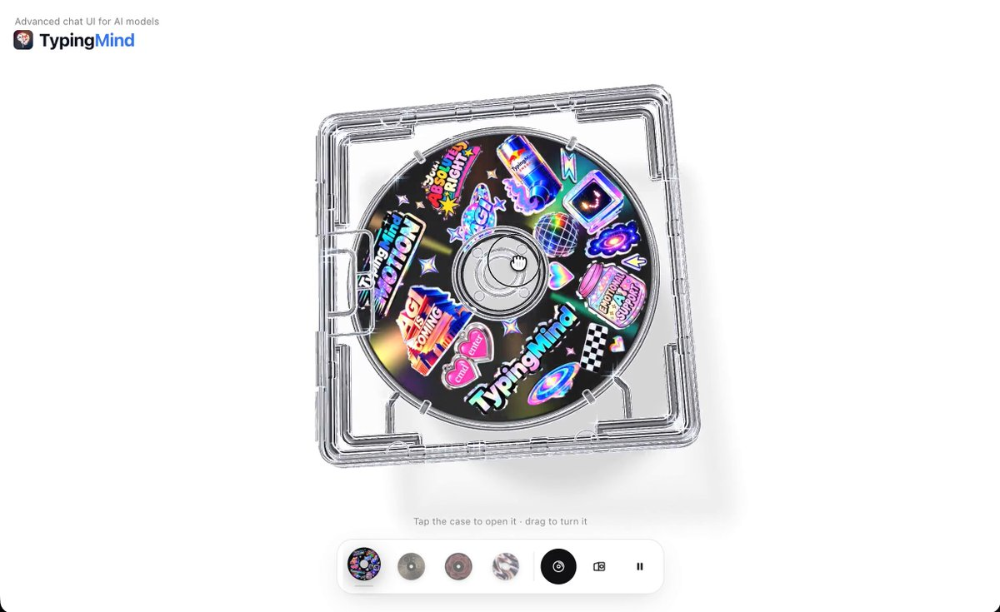
>
> [前往原帖播放视频](https://x.com/ann_nnng/status/2109257723246501895)

一个开盖的 CD 盒，只用 Three.js 和着色器，不用 3D 模型。透明塑料有正确的边缘高光，盒盖像真的铰链那样打开。这个例子说明，光把一种材质做对，就能撑起画面。

> Simba@SimbasJungles · [10 月 11 日](https://x.com/SimbasJungles/status/2109095401273938072)
>
> 我用 Opus 5.5 设计了整个 Airbnb。给了几张基础照片、2D 平面图和一些 Pinterest 参考，让它用 Blender 和 Unreal Engine 5 做一个 3D 世界。
>
> 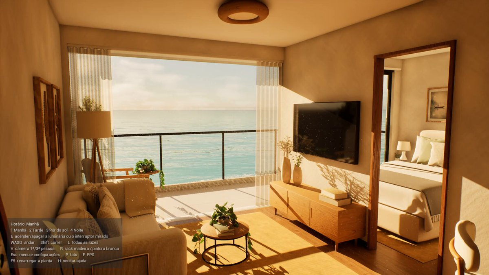
>
> [前往原帖播放视频](https://x.com/SimbasJungles/status/2109095401273938072)

几张照片、一张平面图和 Pinterest 参考，就建出了整套公寓。主体是真实地点时，给模型参考与平面图更有用。

---

## 实验二：一个物体，四种材质

一块鹅卵石换四种材质：铬、金、玻璃、黏土。每三拍由一道横扫的擦除来换材质，每次都只突出材质。最后石头流成 Claude 星芒标志，下方是 OPUS 5.5，再流回原样完成循环。上面的材质配方就在这个场景里跑了一遍。

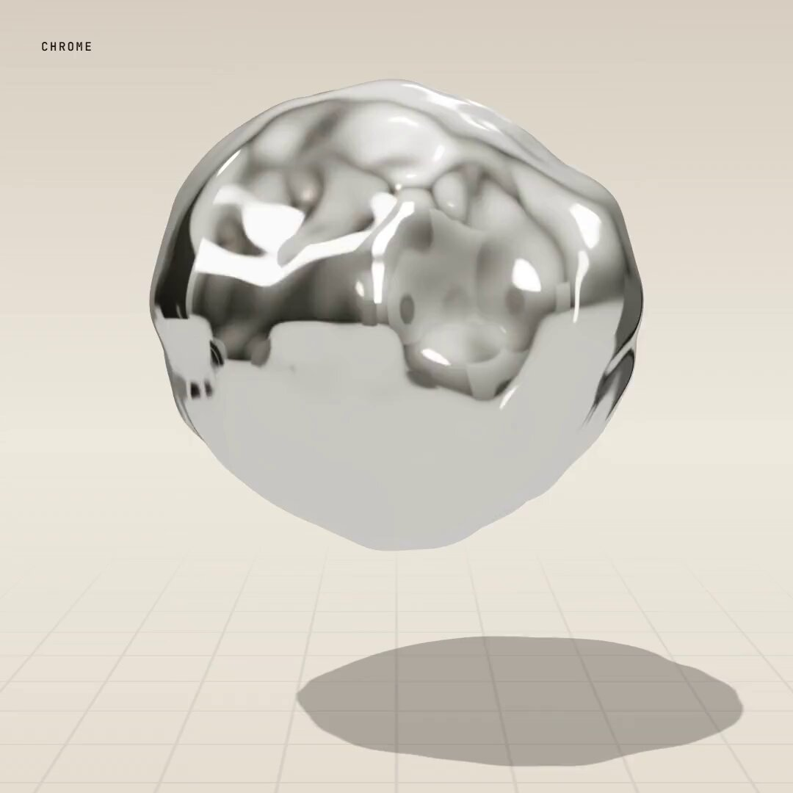

[前往原帖播放视频](https://x.com/anstapnever/status/2110392373377380473?s=46)

第一条提示词较长，因为场景包含四种材质、一间影棚和擦除过渡。每个数字都对应一项预先做好的决定。

```text
目标：一个物体，四种材质：铬、金、玻璃、黏土。同一块鹅卵石用横扫擦除换四次材质，每次只突出材质本身。看起来像在影棚里试拍一件稀罕物。
规格：1080×1080，8 秒，60 fps = 480 帧。第 479 帧顺畅接第 0 帧。噪声带种子，不用 Math.random，不用时钟驱动。
节拍：120 BPM，每拍 30 帧。每种材质保留 4 拍（120 帧）。擦除在第 0、4、8、12 拍启动（第 0、120、240、360 帧），各 24 帧。

渲染器：带抗锯齿的 WebGLRenderer，sRGB 输出，ACESFilmic 色调映射、曝光 1.0，PCFSoftShadowMap，localClippingEnabled true。环境用 PMREMGenerator.fromScene(new RoomEnvironment(), 0.04)，scene.environmentIntensity 0.8。背景纵向渐变：顶部 D8D0C2、55% 处 EFE9DE、底部 E6DFD2。地面用不透明度 0.25 的 ShadowMaterial 平面，让阴影直接落在背景上。

主体：一块自然形状的鹅卵石。IcosahedronGeometry，半径 1、细分 6；沿顶点法线做 3 个八度的带种子值噪声位移（振幅 0.18、基频 1.1），重新计算法线，不用平面着色。它悬浮于地面上方 0.9，按闭合的正弦波上下浮动 0.05。四个网格共享同一几何体，每个一种材质：
1. 铬：color F7F4E8，metalness 1，roughness 0.05。
2. 金：color FFD891，metalness 1，roughness 0.32，clearcoat 0.4。
3. 玻璃：transmission 1，ior 1.5，thickness 1.2，roughness 0.02，dispersion 0.3，attenuationColor DFF1F2，attenuationDistance 3。
4. 黏土：color C26B4E，roughness 0.8，metalness 0，sheen 0.3。

影棚：左上主柔光箱 4×2、亮度 6；右侧细竖灯条 0.5×4、亮度 4。鹅卵石左后方放 3×4 的哑黑遮光板，让玻璃和铬有暗形可反射。冷轮廓光 CFE0FF、强度 2.2，从背后照。主 DirectionalLight FFF1E0、强度 2.4，投影；阴影图 2048、半径 7、bias -0.0004、normalBias 0.02。这些面板只供反射。玻璃背后没有明暗形体就看不见，因此还要在鹅卵石后方地面放一条暗带和一条亮带。

擦除：换材质时，用世界空间中的竖直平面从左扫到右，把旧材质替换成新材质（ease-in-out-quart，24 帧）。两个网格都用 clippingPlanes，裁切面互补，避免同一几何体出现洞。裁切边缘跟一条极细的亮缝，可用厚 0.01 的发光圆片或细线。

动作：鹅卵石在 8 秒内绕 y 轴匀速转一整圈 360 度，同时绕 x 轴按闭合正弦晃动 12 度。每次擦除时压缩到 1.07，再用阻尼比 0.5 的弹簧在 24 帧内收稳。相机用 PerspectiveCamera，fov 28，距离 7、高 0.4，按闭合正弦在 ±12 度内环绕。

标签：画布左上 (56, 56) 叠加 HTML 文字。JetBrains Mono 500、16 px、字距 0.14em、色 111111。材质名为 CHROME、GOLD、GLASS、CLAY。擦除到达时换词，字母各错开一帧。

声音：120 BPM，用代码合成。每次擦除配 300 ms 渐强的柔和滤波噪声。每种材质有一个不同重音：铬用 1760 Hz 短促正弦叮声；金用 880 Hz 暖铃；玻璃用 3136 Hz、极快衰减的高频轻响；黏土用 110 Hz 软闷响。底下铺轻声。循环点静音以避免咔嗒声。整段约 -17 LUFS。

禁用：无环境的默认灰色 MeshStandardMaterial、异色受光地板、硬黑阴影、霓虹色、镜头光晕、发光、粒子、锋利边缘及标签以外的文字。

检查：出第 60、180、300、420 帧（各材质停留中点）和第 12、132、252、372 帧（擦除中点）的静帧。铬要反射柔光箱，玻璃要像玻璃，擦除不能出洞或闪动。数值比较第 479 帧与第 0 帧。
```

第一版看了四轮静帧，又用一条消息做出第二版。之前玻璃像乳白色团块，地上还有一条硬黑线。那条消息给玻璃上色，把遮光板和灯条搬进环境场景，加了低调的地面网格与标志结尾。下面包含封面备注中的标志要求。

```text
修正 1，玻璃：目前像乳白色团块。transmission 保持 1，加色使它在浅背景上可辨：attenuationColor 9FC9C0、attenuationDistance 1.5、thickness 1.4、ior 1.6、clearcoat 1、roughness 0、envMapIntensity 2.0。边缘要接到灯条和柔光箱的亮高光。

修正 2，地上的黑线：暗遮光板和暗带出现在可见场景里。移到独立的影棚环境场景，只用于 PMREMGenerator.fromScene(studioScene, 0.02)。保留反射，画面里看不到道具。

地面网格：在接影平面稍上方放一个平面，Canvas 纹理用宽 1 px、色 111111、不透明度 7% 的线。格子边长 0.5，离鹅卵石越远越透明，用径向 alpha。网格可见但低调，相机运动时不能有摩尔纹或闪动。鹅卵石变成标志时网格仍在。

标志：用官方 Claude 星芒 SVG（claude.ai/favicon.svg 背后的文件），viewBox 248×248。通过 three/addons/loaders/SVGLoader.js 的 SVGLoader 加载，用 ExtrudeGeometry 挤出。橙色 D97757，不要凭目测重画。

时间轴（120 BPM，每拍 30 帧，600 帧 = 20 拍）：
第 0–90 帧：旋转的铬鹅卵石。
第 90–180 帧：金材质，第 90 帧开始擦除，用 24 帧。
第 180–270 帧：玻璃，第 180 帧开始擦除。
第 270–360 帧：黏土，第 270 帧开始擦除。
第 360–420 帧，重塑：把同一块鹅卵石的顶点流动到鼓胀的 3D Claude 星芒表面，挤出浮雕约 0.35 厚，圆润倒角，面朝相机，屏幕上约 560 px 宽，中心 (540, 470)。不做双物体交叉淡入，鹅卵石本身变成标志。用 ease-in-out-quart。加载时给每个顶点计算并缓存标志网格上的最近点，让变形像一个团块流成新形状，避免炸开。期间材质由黏土 C26B4E 过渡到标志橙 D97757，roughness 0.55、sheen 0.3、clearcoat 0.3。逐渐降速，第 420 帧标志恰好面向相机（旋转角度模 360 等于 0）。
第 420–540 帧，停留：标志面朝相机，正弦摆动 ±4 度。主柔光箱在它表面滑过一次。
从第 432 帧起：在标志下方居中 (540, 900) 显示 OPUS 5.5。Inter 500、72 px、字距 0.14em、色 111111。字母各错开一帧，用 ease-out-expo 向上 8 px 出现。
第 540–600 帧，返回：文字逐字消失，各错开一帧。标志以相同缓动流回鹅卵石，铬擦除替换橙色（24 帧），使第 599 帧顺畅接到第 0 帧的铬鹅卵石。旋转重新加速，使第 599 帧与第 0 帧速度相等。

左上标签仍用 CHROME、GOLD、GLASS、CLAY。第 360 帧起逐字消失，第 540 帧恢复为 CHROME。

声音新增：第 360–420 帧重塑时用上升的滤波扫频。第 420 帧一个轻柔 G 大调和弦（G3、B3、D4、G4）；OPUS 5.5 每个字母一个短音；返回时用反向掠过声。循环点静音，避免咔嗒声；整段仍约 -17 LUFS。

检查：出第 45、135、225、315 帧（材质中点），第 375、390、405 帧（重塑），第 480 帧（带字的标志停留）和第 570 帧（返回）。玻璃要像玻璃，黑线消失，网格低调，标志干净可辨、边缘不融烂、不出现洞，文字清晰。数值比较第 599 帧与第 0 帧。
```

这个案例常用的后续指令：

```text
1. 玻璃鹅卵石几乎看不见。后方地面加一暗一亮两条带，thickness 提到 1.4。
2. 铬像灰色。scene.environmentIntensity 提到 1.0，主柔光箱加亮到两倍，让石头上出现清晰白带。
3. 擦除时有一帧出现洞。检查两个网格共享几何体，并且裁切面完全互补。
4. 接缝线闪烁。厚度设 0.012，关闭 depthTest，比裁切面晚一帧渲染。
5. 第 479 帧与第 0 帧不同。让环绕、摇摆和浮动在同一循环相位闭合，再数值比较。
```

---

## 实验三：一座自己搭起来的悬浮城市

一块小底板悬在影棚里。体素城市从中心向外一层层长起，最后竖起尖塔。接着按相反方向拆掉城市，闭合循环。主灯缓慢绕动，拉长的柔和阴影从屋顶滑过。

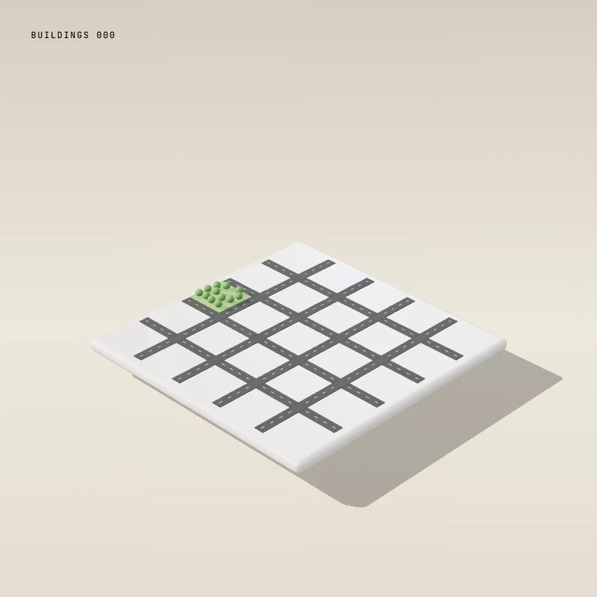

[前往原帖播放视频](https://x.com/anstapnever/status/2110392373377380473?s=46)

提示词：

```text
目标：一座小型悬浮体素城市微缩模型，4 秒搭起，2 秒拆掉。观众应看到一座城市诞生的延时效果，再干净复位，像在影棚桌上拍产品。
规格：1080×1080，8 秒，60 fps = 480 帧。第 479 帧顺畅回到第 0 帧（静止的空底板）。随机性带种子，不用时钟驱动。
节拍：120 BPM，十六分音符为 7.5 帧。每栋建筑最后一层落在最近的十六分音符上。

渲染器：带抗锯齿的 WebGLRenderer，sRGB 输出，ACESFilmic 色调映射、曝光 1.0，PCFSoftShadowMap。环境 PMREMGenerator.fromScene(new RoomEnvironment(), 0.04)，scene.environmentIntensity 0.5。背景纵向渐变：顶部 D8D0C2、55% 处 EFE9DE、底部 E6DFD2。地面是不透明度 0.25 的 ShadowMaterial 平面，让底板阴影直接落到背景上。

底板：RoundedBoxGeometry 26×1.2×26、半径 0.5，MeshPhysicalMaterial color F4F1EA、roughness 0.35、clearcoat 0.6。悬在地面上方 1.8，按闭合正弦浮动 0.06。

城市：5×5 个街区。每个街区由 4×4 块边长 1 的地砖组成，街区间道路宽 1，节距 5，整片网格铺满底板。道路为 4A4A4A、高 0.05 的深色盒体，细虚线居中。西侧边缘一块做公园：平绿盒体 8DB36A，12 棵圆树（半径 0.35 的球，6FA35C），由带种子生成器散布。其余每区 4 栋楼，每栋占 2×2 格。楼由楼层堆叠，每层用 RoundedBoxGeometry 1.8×0.46×1.8、圆角 0.05，以 0.5 间距堆放，露出细暗缝，体现体素结构。楼层用 MeshStandardMaterial，roughness 0.55，六种低饱和色 E8D5B5、D9A07A、B8C4CF、9AA8B5、C26B4E、F2F0EB。离中心越远越低：中心附近最高 28 层，边缘 4–8 层，按种子变化。正中心是三级退台的 32 层尖塔，顶端细黄铜天线（metalness 1，F9E596）。所有楼层用一个 InstancedMesh。

灯光：左上主 DirectionalLight FFF1E0、强度 2.6，投柔影；阴影图 4096、相机边界 ±20、半径 5、bias -0.0004、normalBias 0.03。HemisphereLight 强度 0.35；后方冷轮廓光 CFE0FF、强度 1.6。主灯按闭合正弦绕城摆 25 度，让长影扫过屋顶。

相机：PerspectiveCamera 长焦，fov 22，沿 (18, 15, 18) 方向看向城市中央。不要写死距离。二分查找合适距离，使偏航两端时底板四角、尖塔顶和阴影都落在画面的 86% 范围内，然后垂直居中。按闭合正弦偏航 ±6 度。

时间轴：
0–0.33 秒（第 0–20 帧）：底板由 0.92 缩放用阻尼比 0.6 的弹簧回到 1.0，道路与公园已在板上。
0.33–4.2 秒（第 20–252 帧）：楼从中心向外升起。每栋起始帧 = 20 + 36×距中心街区的距离（以街区为单位）。楼层依次出现，错开 1.2 帧；各层用阻尼比 0.5 的弹簧，把 y 缩放从 0 弹到 1。顶层落下时压缩 3%。尖塔约在第 150 帧最后启动，速度慢些，每 2.5 帧一层，天线最后长出。
4.2–5.5 秒（第 252–330 帧）：停留，慢慢推进 10%；主灯继续移动，其余静止。
5.5–7.3 秒（第 330–438 帧）：城市自行拆解。尖塔先拆，再由外围向里逐栋拆。楼层从上往下消失，每栋约 40 帧。
7.3–8.0 秒（第 438–480 帧）：底板弹簧浮动一次后静止，第 479 帧相机精确回到初始位置。

标签：画布左上 (56, 56) 叠加 HTML 文字，JetBrains Mono 500、16 px、字距 0.14em、色 111111：“BUILDINGS 000”。建筑完成时加数，消失时减数，各位数字错开一帧滚动。

声音：120 BPM，代码合成。每栋建筑落定时一个轻柔的马林巴短音，离中心越远音高越高，对齐到十六分音符。搭建期间低音持续上升，尖塔完成时一个更强的重音，拆解时一个反向吸入声。循环点静音避免咔嗒声，整体约 -17 LUFS。

禁用：无光的平涂色、与背景不同色的受光地面、硬黑阴影、霓虹、发光、粒子、镜头光晕、尖锐 90 度边、画成平面图的窗户、标签以外的文字。

检查：出第 0、60、150、250、300、360、420、470 帧。阴影应柔和且清楚，层间暗缝可见，楼不悬空、不压道路。数值比较第 479 帧和第 0 帧。
```

看了两轮静帧后才完整渲染。两轮间调整了最高建筑和尖塔的颜色，其他部分已符合要求，不用再发后续指令。

这个案例常用的后续指令：

```text
1. 建筑像平涂彩盒。把层间暗缝设为 0.04，用带种子生成器给每层加 4% 的亮度差。
2. 阴影太硬。阴影半径提到 7，主灯降 15%。
3. 各处像同时开建。起始帧严格按离中心距离决定，第一圈前停 6 帧。
4. 尖塔突然弹出。每 2.5 帧长一层，最后一处退台完成后才出现天线。
5. 拆得比建得慢。拆解用 108 帧，从最高的楼开始。
6. 第 479 帧和第 0 帧相机不同。让偏航和推进在同一循环相位闭合。
```

> Edgex@SahilExec · [10 月 6 日](https://x.com/SahilExec/status/2107444680732668320)
>
> Claude Opus 5.5 基本用 3D 重做了 Terraria。8 天，34.6 万行 C#，3,369 个物品，313 个敌人和首领。自定义引擎，没有 Unity 或 Godot。最夸张的是，创作者说他们一行代码也没写。
>
> 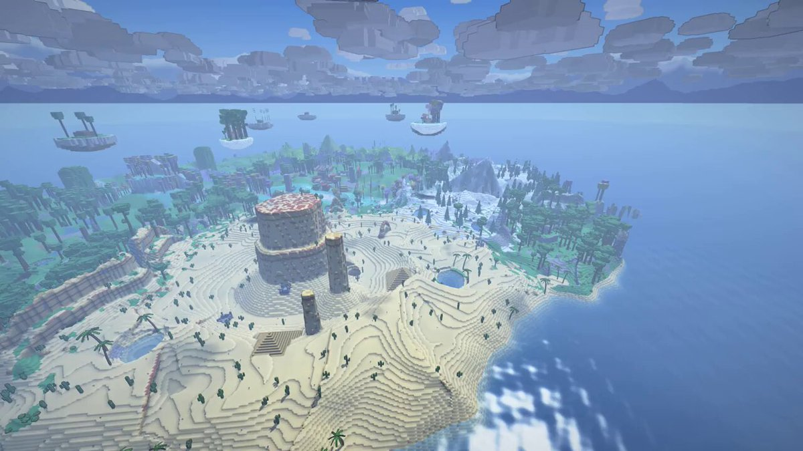
>
> [前往原帖播放视频](https://x.com/SahilExec/status/2107444680732668320)

据作者所说，这是用 Claude 做成的整款游戏。原文作者没有独立核实，但它说明「描述世界，再分块搭建」的思路可以用在循环动画以外。

---

## 迭代：渲染、看图、修改

第一次渲染是草稿。完成它要循环做几件事：出静帧、看图、用帧号写反馈、修正，只重渲染改过的部分。两到四轮很正常。

用 URL 定格任意一帧。在结束的 `body` 标签前放入下面代码，打开 `loop.html?t=2.5`，就能看到 2.5 秒的准确画面，Claude 可以截取并检查。

```html
<script>
// Open loop.html?t=2.5 to see the exact frame at 2.5 s.
(function () {
  var q = new URLSearchParams(location.search);
  if (!q.has('t')) return;
  var t = parseFloat(q.get('t')) || 0;
  function freeze() { if (typeof window.seek === 'function') window.seek(t); }
  freeze();
  if (document.fonts && document.fonts.ready) document.fonts.ready.then(freeze);
  window.addEventListener('load', freeze);
})();
</script>
```

想一次看整条片，就做一张关键帧拼图。Claude 可以像读分镜一样读它。

```bash
# Contact sheet: 2 frames per second, 6 across
ffmpeg -i out/loop.mp4 -vf "fps=2,scale=270:-1,tile=6x4" -frames:v 1 out/contact.png

# Phone test: how it reads at 360 px wide
ffmpeg -i out/loop.mp4 -vf "fps=1,scale=360:-1,tile=5x2" -frames:v 1 out/phone.png

# Seam check: play the loop twice back to back and watch the join
ffmpeg -stream_loop 1 -i out/loop.mp4 -c copy out/loop_twice.mp4
```

可直接粘贴的后续指令，每条都指向具体画面：

```text
渲染第 0、60、120、180、240、300 帧的静帧。用观众的视角各写一句描述。是否符合镜头清单？修正不符之处。
每隔 12 帧取一张，拼成关键帧图。标出两个物体同时动的帧，修正动作层级。
把主元素每帧的 x 位置和缩放画成 PNG 图表。指出哪里线性移动或突然停住，再用现有动效变量修正。
像资深动效设计师一样审片：按影响排序写 10 条反馈，每条含帧号和具体代码改动。落实前 5 条。
太忙了。删掉 30% 的动作，只留下引导视线的动作。
结尾太突然。加 36 帧停留和 2% 的相机推进，再用阻尼比 0.8 的弹簧收稳。
```

每轮挑一两条。六条同时发，Claude 容易每处都改一点，却没有一处改好。

---

## 引擎：自己指定，或让 Claude 选择

下面每种引擎 Claude 都能写。在提示词里点名想用的引擎，否则它会替你选。

| 引擎 | 简介 | 适用场景 |
| --- | --- | --- |
| 纯 HTML、Canvas 和 CSS | 单文件、无依赖 | 循环、界面、图形 |
| Three.js | 浏览器里的 WebGL 3D，原文当时的版本为 r186（2026 年 9 月 24 日） | 3D 场景、灯光、材质、着色器 |
| Remotion | 用 React 组件做视频 | 系列、模板、数据视频。许可见官网，原文指出规模较大的公司需要企业许可证 |
| HyperFrames | 面向代理，将 HTML、CSS 和 GSAP 渲染成视频，Apache-2.0 | 习惯用网页来构思的人 |
| GSAP | 动画库，原文称包括插件在内按「No Charge」许可免费使用 | 时间轴和复杂动画序列 |

做 3D 时，用帧号驱动时间，别用时钟。相机也给数字：35–50 度视野可以作为起点。

> The Bugged Dev@thebuggeddev · [9 月 28 日](https://x.com/thebuggeddev/status/2104402407358919124)
>
> 如果物理学一直这么好可视化、这么容易学，可能会有更多物理学家。AI 让学习更易懂、更有趣。这是用 Claude Opus 5.5 做的电磁场可视化，我以前没像这样理解过这个主题。
>
> 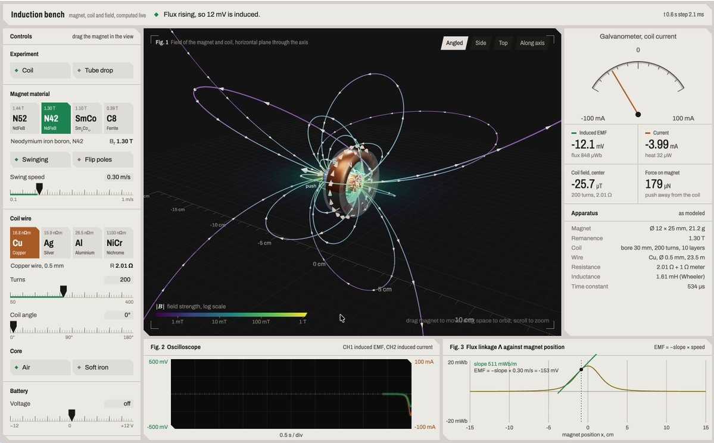
>
> [前往原帖播放视频](https://x.com/thebuggeddev/status/2104402407358919124)

作品也可以是交互可视化。这一项用 Opus 5.5 表达电磁场，目的在于让人理解。需要解释时，可视化比一段标志动画更有效。

> Jeroen van Welsenes@Guronnimo · [10 月 8 日](https://x.com/Guronnimo/status/2108095076929085510)
>
> 用 Opus 5.5 一次做了个网站，这样我不用出门也能摸到草。
>
> 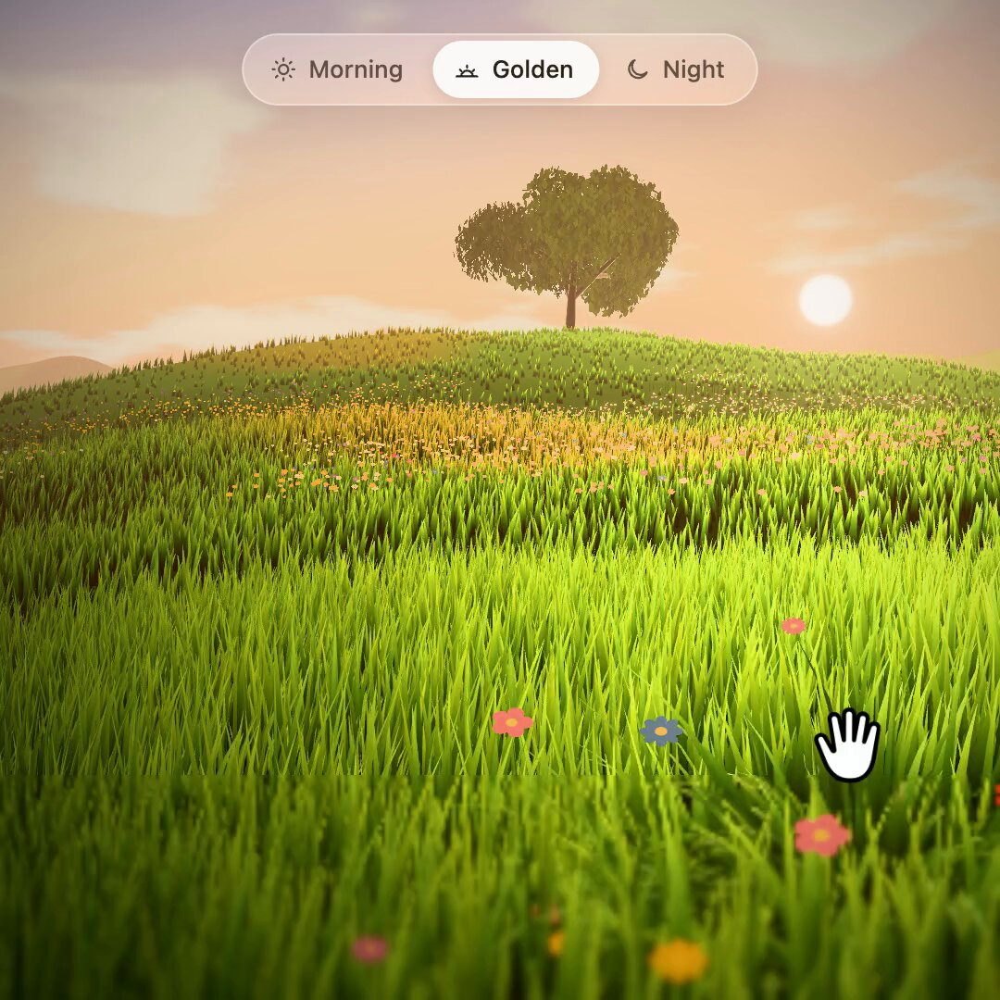
>
> [前往原帖播放视频](https://x.com/Guronnimo/status/2108095076929085510)

一次生成整个网站。能做出循环的代码，也能搭一个让人进去的地方。

---

## 收尾：声音、无缝循环和导出到 X

教程常跳过这部分，观众却最先注意到。

### 声音

信息流默认静音，用户点开前，画面要能独立成立。加声音时，有两条规则：

- 重音放在画面事件的同一帧或后一帧，别放到前一帧。
- 选定响度目标并保持。许多网页平台在约 -14 LUFS 归一化；约 -17 LUFS 的柔和混音给响度留出余量。真峰值不高于 -1 dBTP。

把声音和画面写在同一条提示词里，用同一节拍网格。让 Claude 用代码合成声音，就无需为第三方音频素材处理许可。

```bash
# Measure the loudness of any file
ffmpeg -i out/loop.mp4 -af loudnorm=I=-16:TP=-1.5:LRA=11:print_format=json -f null -
```

编码后再检查音频。AAC 会引入一点延迟，循环接缝一响，观众可能就划走了。

> codila@0xCodila · [10 月 10 日](https://x.com/0xCodila/status/2108621038141546616)
>
> 我做了一条声音设计提示词，用于改善 Opus 5.5 和 Fable 5.5 的音乐与动效。区别大得惊人。音效、音乐、时序，一条提示词搞定，不再是廉价合成器哔哔声。发给 Opus 5.5 或 Fable 5.5 试试。下面谈怎么从中赚钱。
>
> 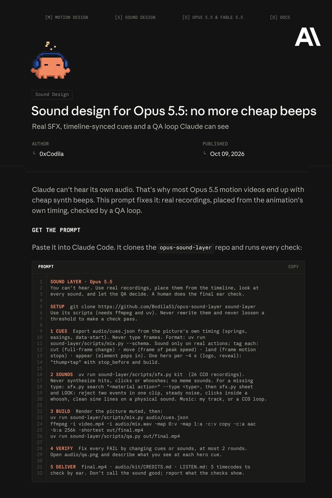
>
> 引用 codila@0xCodila · 10 月 5 日
>
> 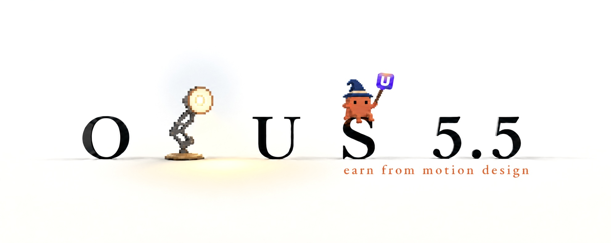
>
> 《用 Opus 5.5 和 Fable 5.5 做动效赚钱：从零开始》。为什么人人在讨论两款模型的动效，却没人谈它能赚多少钱？作者称有公司为用它们制作的 15 秒视频支付约 500 美元，并在文章中介绍如何从零搭建工作室和报价。

这个例子把音效、音乐与时间安排放在同一条提示词里。可以对照上面案例的「声音」部分看它的组织方式。

> Kevin Ngo@kevin_t_ngo · [9 月 25 日](https://x.com/kevin_t_ngo/status/2103482164193165711)
>
> 我让 Claude Opus 5.5 写了一首钢琴曲，动画由 JavaScript 绘制。
>
> 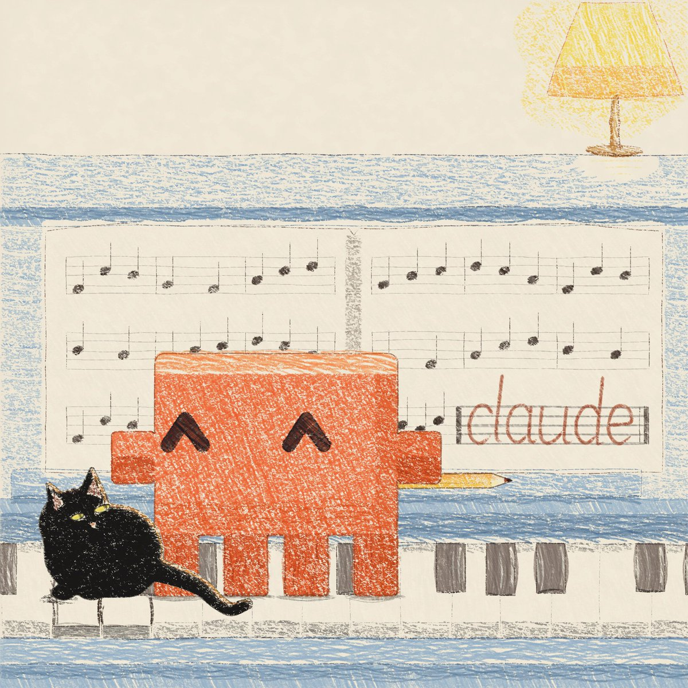
>
> [前往原帖播放视频](https://x.com/kevin_t_ngo/status/2103482164193165711)

Claude 作曲，JavaScript 绘制画面。代码写的音乐也能撑起一件作品。

### 无缝循环

- 末帧顺畅过渡到首帧，只渲染第 0 到 N-1 帧。
- 跨接缝的运动，位置和速度都要连续。
- 音频尾音在接缝处留空或做淡变，避免咔嗒声。

### 导出到 X

```bash
ffmpeg -i out/silent.mp4 -i out/audio.wav -c:v copy -c:a aac -b:a 192k -shortest out/loop.mp4
```

用 H.264 和 yuv420p 编码，带 `-movflags +faststart`。上面的渲染器已这么做。首帧要有意义，它会成为预览。如果希望无限循环，就上传循环片段本身，让播放器重复。

下次打开空白提示词时，先从模板起步。

---

**收藏这篇，关注** [**@anstapnever**](https://x.com/@anstapnever) **获取更多经验。**
