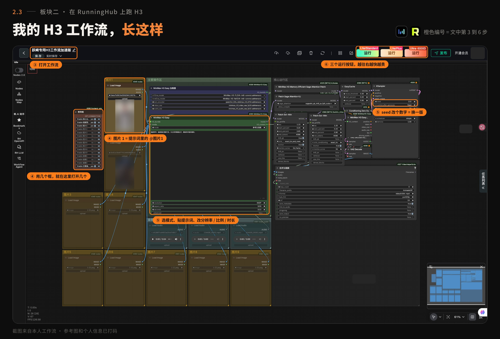
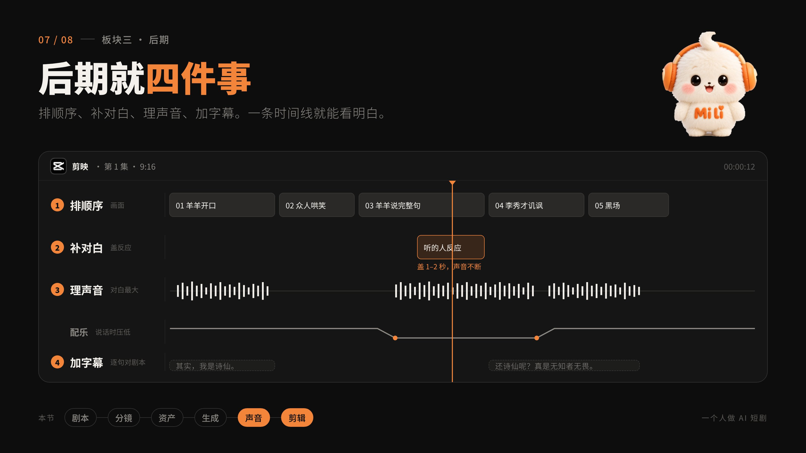

# 用 Claude + H3 一个人拍 AI 短剧：一手实战教程，附全流程提示词和技能包

作者：Miller（[@tuyetloanp81840](https://x.com/tuyetloanp81840)）  
发布：2026-11-08T07:11:19.000Z

[查看原帖](https://x.com/tuyetloanp81840/status/2119326884505043274?s=46)


一集 5 分钟、角色会开口说话的 AI 短剧，视频这一步我算下来 27 块多。

同样的量，用 Seedance 2.5 按火山方舟的官方价跑，要 1,360 块左右。

先说结果 👇

- 一个人、不用买显卡，做出角色会开口说话的短剧
- 视频一段约 2 毛，一集 5 分钟不到 30 块；想更精细，加工后一段 3 毛多到 1 块 5
- 从剧本到剪辑，每一步都有可直接复制的提示词，一共 8 段
- 我调好的 H3 工作流直接放出来，打开就能用
- 动漫风的漫剧、真人写实的仿真人短剧都能用，画风在提示词里自己选

这篇里的分工是这样的：

- 编剧、分镜：Claude（没有的话 DeepSeek 也行）
- 美术，出人物、场景、道具图：ChatGPT 里的 GPT Image，即梦、Nano Banana 也可以
- 摄影加演员：MiniMax H3，在 RunningHub 上跑
- 剪辑：剪映
- 你：制片人，定故事、挑镜头、拍板

一个人就是一个剧组。顺序只有一句话：**先定演员，再开拍，最后剪成片。**


怎么读这篇：

- 第一次做：先看下面的「新手路线」，一小时做出 10 秒
- 想做完整的一集：按板块一、二、三往下走
- 想让画面更好看：翻到后面的「进阶」
- 想直接拿工具：文末有光影速查页，还有一个能装进 Claude 的短剧技能包

---

## 第一次做，先走这条路：一小时做出 10 秒

后面三个板块讲的是完整的一集。但第一次做，别一上来就做 5 分钟。

先做一个 10 秒左右的片段：**一个角色、一个场景、一句台词。** 跑通一次，你就知道每一步大概是什么样子，再回来做完整的一集。

**1. 写一句台词（5 分钟）**

用板块一 1.1 的剧本提示词，但只要一场戏、一个角色、一两句台词。比如：羊羊站在书院庭院中央，淡淡地说：「其实，我是诗仙。」

**2. 出两张图（15 分钟）**

用板块一 1.3 的提示词，只出两张：角色一张（全身、正面、白底，记得写鞋子），场景一张（画面里不能有人）。身份板、道具、分镜，第一次都先跳过。

**3. 写视频提示词（5 分钟）**

把台词和两张图的用途交给 Claude，用板块二 2.2 的提示词，只写一段。

**4. 在 RunningHub 上跑（20 分钟）**

按板块二 2.3 的 6 步走，先跑 5 秒预览，满意了再出 10 秒。一段约 100 RH币，可以先用每天签到送的免费币试；抽 3 次卡，花钱也不到 1 块。

**5. 剪映加字幕，导出（10 分钟）**

导入片段，识别字幕，对一遍台词，导出 9:16。


做完这一段，你就跑通了整套流程。

之后想做完整的一集，再按三个板块往下做：分镜、身份板、反应镜头、剪辑单，都是片子做长了以后才需要的东西。

---

## 板块一：前期资产，先把剧本和「演员」定下来

很多人一上来就去生视频，结果每一段角色长得不一样，剧情也接不上。

问题不在视频模型，在前期。前期就三件事：**剧本、分镜、资产图**。

这一步只花文字和图片的钱，改一个字不要钱。到了视频那一步，改一次就是抽一次卡的钱。能在这里解决的问题，都在这里解决。

### 1.1 剧本：只写镜头拍得到的东西

AI 视频模型看不懂「他心里很难过」，它只看得懂「他低下头，手指攥紧了衣角」。

所以给 AI 用的剧本，和给人看的小说不一样。记住三条：

**1. 心理活动要变成动作、表情，或者内心独白。**

不写「评判老师心里不服」，写「评判老师眯起眼，慢慢捋着胡须」。

**2. 格式固定，声音类型标好。**

场景、动作、台词、音效各有写法。当面说的、心里想的、人不在画面里但声音还在的，在剧本里就分开标，后面 AI 才分得清哪句是画面、哪句要说出来。

**3. 一集 5 分钟，围绕一个主冲突。**

开头 3 秒出冲突，结尾停在悬念上。按每 10 个字台词约 2 秒算，一集台词 750 到 1,000 字就够了。

羊羊这场戏写出来是这样的（节选）：

```
本集出场人物：羊羊、评判老师、李秀才、赵书生、围观群众

1-1 古镇书院庭院 [外] [日]
△ 羊羊一身朴素布衣，站在院中央，神情波澜不惊。
【音效】人群里的窃窃私语、低笑声。
羊羊：（平淡）其实，我是诗仙。
△ 众人一愣，随即爆发出一阵哄笑。
李秀才：（上下打量，满脸讥讽）还诗仙呢？真是无知者无畏。
△ 评判老师眯起眼，慢慢捋着胡须。
评判老师（内心独白）：无论此人吟诵何诗，只要老夫在场，他绝不可能赢。
```

可直接复制 👇（发给 Claude 或 DeepSeek）

```
你是短剧编剧，熟悉抖音、视频号上的节奏。把下面的故事改成一集约 5 分钟的短剧剧本。

要求：
1. 开头先列出本集出场人物。
2. 每场戏开头写场景题头：场号 场景名 [内/外] [日/夜]，例如：1-1 古镇书院庭院 [外] [日]。
3. 画面和动作每行用「△」开头，只写镜头拍得到的东西。不写「他心里想」，心理活动改成动作、表情，或者内心独白。
4. 台词格式：角色名：（情绪/动作）台词。心里的话写成「角色名（内心独白）：」，人不在画面里、声音还在的写成「角色名（画外音）：」。
5. 重要的声音写成【音效】……
6. 台词总量 750–1,000 字。开头 3 秒内出现冲突，结尾停在悬念上，不要提前和解。
7. 每句单独一行，只输出剧本，不要解释和分析。

故事：
（粘贴小说片段或你的故事梗概）
```

手上只有一个点子、还没有故事？先让它写 3 版 300 字的故事梗概，挑一版，再用上面这段改成剧本。

### 1.2 分镜：进阶，新手可以先跳过

剧本写的是「发生了什么」，分镜写的是「观众看到什么」：每个镜头拍多大、多长、谁在画面里。

新手可以先跳过，直接拿剧本去板块二写提示词，也能出片。对白多、想控制节奏的时候，再拆一张分镜表。

切镜头记住四条：

**1. 换人说话就切。**

一问一答不要一个镜头拍到底，要在说话的人和听的人之间来回切。羊羊这句话可以这样拆：

1. 羊羊开口「其实，我是诗仙。」：近景，2 秒
2. 众人一愣，接着哄笑：全景，2 秒
3. 李秀才「还诗仙呢？真是无知者无畏。」：近景，2 秒
4. 羊羊不动声色：近景，1 秒

**2. 情绪变了就切。** 平静到震惊、震惊到愤怒，每次变化一个镜头。

**3. 大动作拆三步。** 准备、执行、结果。一个镜头塞一整串动作，AI 很容易做乱。

**4. 换场景、跳时间，必须切。** 中间留 1 到 2 秒转场。

每个镜头多长，下面的提示词里都写好了，记住两个数就行：台词按每 10 个字约 2 秒，听的人的反应 1 秒左右。

分镜表拆完，再把连续的 2–4 个镜头合成一段「素材」（5–15 秒），板块二就按「段」来生成。

可直接复制 👇（把上一步的剧本一起发给 Claude）

```
你是有 20 年经验的分镜导演。把下面的剧本拆成分镜表。

切镜规则：
1. 换人说话就切：说话的人 → 听的人的反应 → 说话的人。长台词中途也要切到听的人。
2. 角色情绪每变一次，给一个独立镜头。
3. 大动作拆成准备 → 执行 → 结果，复杂动作拆 3–5 个镜头。
4. 换场景、跳时间必须切，两个场景之间加 1–2 秒转场镜头。
5. 不要连续 3 个镜头用同一种景别。

时长：远景/全景 3–4 秒，中景 2–3 秒，近景/特写 2–3 秒；台词按每 10 个字约 2 秒；反应镜头 1 秒左右；高潮 3–5 秒；单个镜头不超过 10 秒。

输出一张表，列：镜号 | 时长 | 景别 | 机位和运动（固定/推/拉/摇/跟） | 画面内容 | 台词和音效 | 入镜角色
「画面内容」写成一段话，包含：画风、环境、人物位置、动作、表情、光线、构图。

表格之后，把连续的 2–4 个镜头合成一段素材，每段 5–15 秒，标明「素材段落 1：镜头 1–3」这样的对应关系。

画风：（3D 国漫 / 2D 动漫 / 真人写实，选一个）
剧本：
（粘贴在这里）
```

### 1.3 资产图：先「选角」，再开拍

资产图就是你的演员、片场和道具。H3 一次能喂 9 张参考图，喂进去的图越干净，每一段里的人就越像同一个人。

**人物图，五条规矩：**

1. 全身、正面、白底，双手垂下，不拿东西，不做表情
2. 一定要写鞋子，不写 AI 很容易出半身图
3. 写清身高、体型、年龄、脸型、发型、服装，和年代对得上
4. 成年角色约 8 头身，反派也别丑得太极端
5. 群众演员不用单独设计

形象定下来以后，再出一张「角色身份板」：正面、侧面、背面全身，加几个表情和姿势。视频模型拿到它，就能从各个角度认出这个人。

人物用 AI 设计的形象，不要拿真人照片、尤其是明星照片当参考：平台会拦，也有肖像权风险。

**场景图，三条规矩：**

1. 画面里不能有人
2. 和人物用同一种画风
3. 对话戏出三张：正打（从 A 这边看过去）、反打（从 B 这边看过去），加一张看清所有人站位的大全景。反打在正打图上改就行，提示词在下面

**道具图，两条规矩：**

1. 纯白底，没有背景，没有人
2. 写实际尺寸，比如「茶杯直径约 8 厘米，一只手能握住」，不然视频里会忽大忽小

可直接复制 👇（第一段：把剧本发给 Claude，让它列出全部资产和出图提示词）

```
你是 AI 出图设计师。根据下面的剧本，列出所有需要出图的人物、场景、道具，分别写出图提示词。只要提示词，不要出图。

人物：全身正面，白底，双手自然垂下，手里不拿东西，没有表情。写清身高、体型、年龄、脸型、眼睛、发型、发色、服装和鞋子，符合故事年代。成年角色约 8 头身，反派也不要丑得太极端。群众演员不用写。
场景：画面里不能有人。对话场景按人物站位各写一张正打、一张反打，再写一张能看清所有人站位的大全景。
道具：纯白底，没有背景和人物，写出实际尺寸（比如「直径约 8 厘米，一只手能握住」）。

画风：（3D 国漫，UE5 渲染质感 / 2D 动漫 / 真人写实，选一个）。所有人物、场景、道具保持同一种画风。

剧本：
（粘贴在这里）
```

可直接复制 👇（第二段：人物图定下来以后，把图和这段一起发给生图模型，出角色身份板）

```
参考这张人物图，做一张 16:9 的角色身份板。白色或米白色背景，没有环境、道具、水印。

- 中间偏左放一张大的正面全身像；周围留出间距，放背面、侧面全身，坐姿、蹲姿各一张，再放 3 个表情特写。
- 所有图互相不重叠，脸、手、脚都不能被裁掉。
- 所有角度保持同一张脸、同一个发型、同一套衣服、同样的身体比例。
- 角落加一个简洁的角色卡：名字、身份、性格关键词。
- 风格干净、简约，像动画工作室的角色设定页，不是海报。
```

可直接复制 👇（第三段：正打场景图出好后，出反打）

```
保持这张场景的画风、光线和陈设风格不变，生成从相反方向看过去的画面：左右内容互换，前后内容互换，原来远处的门和屋外背景，换成一面符合这栋建筑风格的墙。画面里不要有人。
```


到这里，前期就齐了：一份剧本、一张分镜表（可选）、每个主角一张身份板、每个场景两三张图、关键道具各一张。

开拍前花两分钟，对一遍这四个问题：

- 每个主角都有身份板吗，几个角度是同一张脸吗？
- 场景图里有没有混进人？
- 道具写尺寸了吗？
- 台词总量有没有超过 1,000 字？

下一步，把它们喂给 H3，让角色动起来、开口说话。

---

## 板块二：视频生成，让角色动起来、开口说话

资产图都准备好了，下一步就是把图变成会动、会说话的片段。

这一步我用的是 MiniMax 的 H3，在 RunningHub 上跑。先说为什么不用现在最火的 Seedance 2.5。

### 2.1 为什么选 H3：便宜，还能一次出声音

先用一句话介绍一下这两个东西：

- **H3**：MiniMax 今年 7 月 31 日发布的视频模型，一段最长 15 秒，画面和声音（对白、音效）一次生成，8 月 3 日开源。
- **RunningHub**：一个在线跑 ComfyUI 工作流的网站。别人搭好的工作流，你上传图片、填好提示词就能用，不用自己买显卡、装软件。

老实说，论画面质感和复杂动作，Seedance 2.5 更强。

但做短剧，一集 5 分钟要几十段素材，还要一遍遍抽卡，单价差一点，乘下来就是很大一笔钱。我算了一笔账：

- RunningHub 专业版现在限时 99 元一个月（原价 159），选「币多多」套餐送 54,000 RH币，1 RH币大约 0.0018 元
- 生成一段 5–10 秒的视频约 100 RH币，也就是 **一段 2 毛左右**
- 一集 5 分钟的短剧，按 50 段素材（一段平均 6 秒）、每段抽 3 次卡算，一共约 150 次生成、15,000 RH币，**视频这一步 27 块多**
- 同样的量（5 分钟 × 抽 3 次 = 900 秒）换成 Seedance 2.5 720p：按火山方舟官方页的示例价（不喂参考视频，5 秒 7.56 元，约 1.51 元/秒），要 1,360 元左右；在 RunningHub 上跑 Seedance 2.5，按 8 月上线时的限时价（720P 约 0.49 元/秒），也要 440 元左右
- 每月 99 元的会员送的币，按这个算法能做 3 集半左右，也就是 18 分钟左右的成片


当然，一段 2 毛是「能用」的档位，出来是 640P。想更精细，就在第一次生成（一采）的基础上再加工。同一段 10 秒镜头，我实测了三档：

- **省钱档**：只做一采，640P，约 100 RH币，一段 2 毛。练手、跑剧情用
- **精细档**：一采 + 超分放大（和原片叠一半），1920 宽，约 185 RH币，一段 3 毛多。发作品用
- **极致档**：二采，整段再精细采样一遍，1920 宽，约 795 RH币，一段 1 块 5 左右。交付、关键镜头用

【确认：185 和 795 是不是含一采的总价】

在我看来，加工过的效果完全可以和 Seedance 2.0 比。就算一集 50 段选中的镜头全部做到极致档，每段多花 1 块多，一集也就多六七十块，加起来还不到 Seedance 官方价的十分之一。

H3 官方 API 是按秒收费的：768P 约 0.5 元/秒，2K 约 0.8 元/秒，一段 10 秒的 768P 就要 5 块左右。我这边一段 2 毛，为什么便宜这么多？三个原因：H3 是开源的，我的工作流用的是 RunningHub 发布的 H3 量化版（INT8），加了几个加速节点，跑得快；RunningHub 按机器运行时间收费，跑得越快越便宜；我平时出 640P，比 768P 还小一点。  


H3 还有两个我很看重的地方：

1. **角色一致性**：一次最多能喂 9 张参考图，角色的身份板、场景图、道具图都可以放进去。
2. **一个工作流三种用法**：参考生视频、图生或首尾帧、数字人，日常出片、补镜头、对口型都能用（2.3、2.4 会讲）。

### 2.2 视频提示词：一段只讲一件事

短剧和普通 AI 短片最大的区别是：**角色要说话，剧情要一场接一场。**

所以提示词要比「一个人在走路」细得多。课件里的规则，我精简成六条：

**1. 一段只讲一件事。** 5 到 15 秒，只处理一个动作、一次情绪转折或一句关键台词。

**2. 先写站位，再写动作。** 谁在左、谁在右，门在哪边，道具在谁手里。不写清楚，下一段人就会瞬移。

**3. 动作接上一段的结尾。** 上一段已经站起来了，这一段就从站着开始。

**4. 台词一字不改，声音分三种写：**

- 当面开口：羊羊说：「其实，我是诗仙。」
- 心里的话：评判老师内心独白：「无论此人吟诵何诗，只要老夫在场，他绝不可能赢。」
- 人不在画面里，声音还在：羊羊画外音：「……」

不分开写，AI 会让角色张着嘴把心里话念出来。

**5. 镜头别一直盯着说话的人。** 台词一长画面就死，中途切到听的人的反应，台词不断，这几秒改成「画外音」。一段里切不好的话，剪辑时补（3.2）。

**6. 每张参考图写清用途。** 我的工作流里，提示词框输入 @ 就能选素材：「@图片1 是羊羊的长相，@图片2 是书院庭院」，比一股脑扔进去效果好。


可直接复制 👇（发给 Claude，让它把剧本或分镜表改写成 H3 能用的提示词）

```
你是短剧导演，也是 AI 视频提示词工程师。把下面的剧本或分镜表改写成 MiniMax H3 能直接用的视频提示词。

规则：
1. 每段 5–15 秒，一段只处理一个动作、一次情绪转折或一句关键台词。不同场景、不同时间必须分段。
2. 每段开头先写【站位】：谁在左、谁在右，门在哪边，摄影机在哪一侧，关键道具在谁手里、朝哪个方向。
3. 动作接上一段的结尾，不重复上一段已经做完的动作。
4. 台词一字不改。声音分三种写：某某说：「」/ 某某内心独白：「」/ 某某画外音：「」。每句台词写清语气。
5. 参考素材按用途点名：@图片1 = 某某的长相，@图片2 = 场景，@图片3 = 道具……有声音参考的写 @音频1 = 某某的声音。
6. 写具体的光线和镜头：景别、机位、固定还是推拉；说台词时镜头固定，不推不拉。
7. 声音只写台词和看得见原因的音效（脚步声、关门声），不要背景音乐，不要字幕。
8. 先给每个说话的角色写一句固定的声音描述（年龄、音色、语速），之后每一段原样复制这一句。5 秒的段落最多放一两句台词。

每段按这个格式输出：
【素材段落 X】（X 秒）
【参考】@图片1：…… @图片2：……（有声音参考的话：@音频1 = 某某的声音）
【站位】……
【画面】0–X 秒：景别，机位，画面里发生什么，人物表情和动作。
【声音】某某说：「……」（语气）；音效：……
【禁止】不加剧本里没有的人，不出现现代物品（古装剧），道具不换手、不消失，人物不瞬移，不改台词，不要字幕和音乐。

剧本或分镜表：
（粘贴在这里）
```

### 2.3 在 RunningHub 上跑 H3：从注册到下载

我把自己调好的 H3 工作流放出来了，第一次用，按这 6 步走：

**第 1 步：注册。** 打开 runninghub.cn，用手机号注册登录。每天签到会送免费的 RH币，先拿它试跑。

**第 2 步：先别急着买会员。** 先用签到送的币，把前面的「新手路线」跑通，觉得好用再买 99 元的会员。会员是按月自动续费的，不想续记得关掉；会员送的币有有效期，用不完会过期，别囤。

**第 3 步：打开我的 H3 工作流。** 【工作流公开链接】。打开后，左边是 9 个图片框、3 个音频框和一个「禁用框」，中间是提示词框和参数，右边的运行区不用动。这个工作流用到了开源节点 ComfyUI-MiniMaxH3-Easy，感谢作者。



**第 4 步：上传参考图和声音。** 图片框的编号，就是提示词里 @图片1、@图片2 的编号：

- 图片 1：主角的身份板（板块一做的；走新手路线的话，放那张角色图就行）
- 图片 2：这一段的场景图，只放一张
- 图片 3 起：其他角色、关键道具，或者站位大全景
- 音频 1：角色的声音参考（2.4 讲），没有就不开
- 用几个框，就在「禁用框」里打开几个，其余保持关闭。默认只开了图片 1

**第 5 步：贴提示词，改几个参数。**

- 模式：日常出片选「参考生视频」；补镜头选「图生或首尾帧」（2.5 讲）；已经有配好的台词音频、只想对口型，选「数字人」（2.4 讲）
- 提示词：贴进去以后，用 @ 把素材重新点一遍，确保每张图都对上
- 分辨率：640P（省钱档；想更清楚走精细档）
- 画面比例：改成 9:16 竖屏（工作流默认是 16:9）
- 时长：第一次先填 5 秒

还有一个容易踩的坑：工作流里的 seed（随机种子）是固定的。固定的意思是，同样的图、同样的提示词，再跑一次结果几乎一样。所以想「抽卡」换一版，就把 seed 改个数字；只想微调提示词、别的不变，就保持 seed 不动。

**第 6 步：点运行，下载。** 右上角有三个运行按钮，对应三档机器，越往右越快、越贵【补：你平时点哪个按钮，一段大概扣多少币】。出来以后先看口型和长相，满意再下载。下载后按「段落号-第几次」命名，比如 03-2，剪辑时不会乱。

两个省钱的习惯：

- **先跑 5 秒预览，满意了再出 15 秒。**
- **多个角色先一个一个单独试。** 每个角色单独跑一段 5 秒，确认长相对了，再把几个人放到一起出长镜头。一上来就把几个人一起跑 15 秒，失败一次就白花一次钱。

### 2.4 角色声音：每段都是同一个人在说话

短剧最大的看点，是角色会开口。但如果羊羊这一段是清亮的少年音，下一段变成了低沉的大叔音，观众马上出戏。

三个办法，从简单到进阶：

**1. 声音描述写死，每段复制同一句。**

给每个主要角色写一句固定的声音描述，比如「羊羊：二十岁出头的男声，清亮，语速平稳，带一点不在乎」。每一段提示词都原样复制这一句，不要每次换说法。

**2. 第一段满意了，把声音剪出来当参考。**

H3 一次最多能喂 3 段音频参考，H3 的接入文档里写了，音频参考就是用来让同一个角色在不同片段里声音保持一致的。第一段生成满意以后，把这个角色说话的几秒剪出来（干净、没有背景音），后面每一段都传进去，提示词里写「@音频1 是羊羊的声音」。

**3. 先配音，再用「数字人」模式对口型。**

用配音工具先把这句台词配好（每次用同一个音色），再把模式切到「数字人」，传一条这句台词的音频。H3 会按这条声音生成说话的画面和口型，声音就不会变了。这个模式一次只能传一条驱动音频。

另外两个提醒：

- **一段别塞太多台词。** H3 的文档说，5 秒的片段放一两句话正好；台词太长、语气没写清、片段太短，口型都容易对不上。
- **只用自己的声音，或者有授权的声音做参考。** 不要拿明星、别人的声音去克隆。

### 2.5 穿帮了别急着重抽

AI 视频一定会有穿帮：手多了一根指头、道具突然变大、人走着走着换了张脸。

处理顺序是这样：

1. **能剪就剪。** 问题只出现在开头或结尾几帧的，剪掉就行。
2. **能补就补。** 问题出在中间某一段的，把出问题前的那一帧截下来，用生图模型改好（比如把变大的杯子改回原来的大小），再把这张图当首帧，让 H3 只补这一小段。我的工作流里也装了 H3 的首尾帧模型：模式切到「图生或首尾帧」，只开一个图片框传这张改好的图，就是从这一帧开始生成；传两张，就是首尾帧，指定开头和结尾。
3. **最后才重抽。** 重抽之前先改提示词或参考图，原样再抽一次，大概率还是错的。


另外三条预防：

- 一段视频只喂一张场景图。三张场景图都喂进去，AI 反而不知道该用哪张，场景会乱。
- 对话戏把板块一准备的「站位大全景」喂进去，能看清所有人站在哪，比写一大段文字还管用。
- 道具在提示词里也写一遍尺寸，和板块一道具图里写的一致。

---

## 板块三：后期，用剪映把片段剪成一集

素材都出来了，最后一步是把几十段片段剪成一集。

我用剪映，比达芬奇简单很多，常用功能免费版基本够用。电脑上用剪映专业版更方便。

后期就四件事：**排顺序、补对白、理声音、加字幕**。

### 3.1 粗剪：先排顺序，再修头尾

1. 按剧本顺序，把素材全部拖进时间线。做了分镜表的，就按素材段落的编号排。
2. 每段从头到尾看一遍。头尾那几帧有问题的，直接剪掉。这就是板块二 2.5 里说的「能剪就剪」。
3. 用首帧补出来的那一小段，插回原来出问题的位置。

节奏上，短剧比电影快：

- **开头 3 秒放冲突。** 第一个画面就是最抓人的那句话。羊羊这集，第一句就是「其实，我是诗仙」，后面紧跟着众人的哄笑。
- **没有新信息的画面别停太久。** 对话之间的空白也剪紧一点。
- **结尾停在悬念上。** 赵书生喊出「这诗说不定是他偷来的」，众人哗然，直接黑场，不要再往后拖。

### 3.2 对白戏：声音不断，画面切到听的人

板块一讲分镜时说过，对白戏要在说话的人和听的人之间来回切。可如果生成出来的一段，从头到尾都对着说话的人，怎么办？

在剪辑里补：

1. 把说话那段的声音单独分出来（剪映里选中片段，右键「分离音频」），声音留在原位，一直不断。
2. 在上面一层轨道，盖上一段「听的人」的反应镜头，比如李秀才瞪大眼睛、群众面面相觑，盖 1 到 2 秒。
3. 观众看到的是：前半句看着羊羊说，后半句切到别人的反应，声音一直是羊羊的。

反应镜头从哪来？生成的时候，顺手给每个主要角色多跑几段 3 到 5 秒的反应镜头，不说话，只做表情。按板块二的算法，一段 2 毛，一集多跑 10 段也就多花 2 块钱左右，剪辑时却好用得多。

### 3.3 声音：对白、音效、配乐分三层

H3 已经把对白和音效一起生成了，配乐留到剪映里统一加一首。如果让 AI 每段都配乐，几十段接起来会一会儿一个调，所以板块二的提示词里写了「不要背景音乐」。

三层声音，音量这样排：

- **对白最大**，观众必须听清
- **音效其次**，脚步声、关门声，跟着画面走
- **配乐最小**，有人说话的时候再压低一点（在配乐上打两个关键帧，说话那几秒把音量拉下去）

常见的两个问题：

- **几段对白忽大忽小。** 选中所有片段，用剪映的「响度统一」，一次调平。
- **同一个角色，个别几段声音不一样。** 生成时的办法在板块二 2.4 讲过；剪辑时发现漏网的，最省事的补救是只把这几句重抽，或者重新配一遍。

配乐用剪映音乐库或免版权音乐，商用前看一眼授权说明。

### 3.4 字幕：自动识别，再逐句对剧本

AI 画出来的字经常是错字、乱码，所以板块二让 H3 别出字幕，字幕在剪映里加。

1. 用剪映的「识别字幕」，自动把对白转成字幕。
2. 用「文稿匹配」，把剧本里的台词粘进去，它会自动对上时间，错字更少。
3. 逐句对一遍剧本。AI 念的台词偶尔会和剧本差一两个字，字幕要和声音一致：要么重抽这一段，要么把字幕改成它实际念的。

样式上：放在画面下方三分之一，别挡脸；一行别太长；内心独白换个颜色或加括号，观众一眼知道是心里话。

### 3.5 调色、画质、导出

**调色：** 几十段素材，颜色多少会有点不一样。选中全部片段，统一加同一个滤镜，或者统一调亮度和色温，整集看起来就是一部片子。

**画质：** 我的工作流一采出的是 640P。想更清楚，就是板块二说的精细档和极致档，加工后是 1920 宽；剪映里也有画质增强，一般要会员。

**导出：** 竖屏 9:16，1080P，30 帧，发抖音、视频号、X 都够用。

**发之前，最后两件事：**

1. 用手机全屏从头看一遍。对照板块二 2.5 的穿帮清单：手指、道具、人有没有换脸、门有没有换方向。
2. 标上「AI 生成」。2025 年 9 月 1 日起施行的《人工智能生成合成内容标识办法》第十条要求，用户发布 AI 生成的内容，要主动声明，并且用平台提供的标识功能标出来。发抖音、视频号的时候，把平台的 AI 生成声明勾上就行。

可直接复制 👇（素材都出来以后，把剧本和素材清单发给 Claude，让它出一份剪辑单）

```
你是短剧剪辑师。下面是这一集的剧本，和我生成好的素材清单（每段的编号、时长、内容、哪里有问题）。帮我出一份剪辑单。

要求：
1. 按剧情顺序排好素材，标出每段保留第几秒到第几秒、头尾各剪掉多少。
2. 有长台词一直对着说话人的地方，标出在第几秒盖哪一段反应镜头、盖多长，台词声音不断。
3. 列出还需要补生成的镜头：缺什么画面、多长、谁的反应。
4. 配乐分段：每段写情绪（紧张 / 轻松 / 反转）和开始、结束时间，有台词的地方标「配乐压低」。
5. 最后单独列出全部字幕，台词和剧本一字不差，每句标明是「说」「内心独白」还是「画外音」。
6. 开头 3 秒要有冲突，结尾停在悬念上；如果现在的顺序做不到，告诉我怎么调。

剧本：
（粘贴在这里）

素材清单：
（例：段落 1，8 秒，羊羊说「其实，我是诗仙」，第 7 秒手指变形）
```



到这里，一集短剧就做完了。

---

## 进阶：让画面从「能看」到「好看」

流程跑通以后，下一个问题一定是：怎么让画面更有电影感？

这部分是我做片子一直在用的一套光影和镜头方法。最管用的三条先放这里，整理好的速查页附在文末。

**1. 光要写具体，别只写「电影感」。**

AI 看不懂「高级感」，它看得懂四件事：光从哪边来（顺光、侧光、逆光），硬还是软，冷还是暖，亮还是暗。最简单的一招：把顺光改成侧光，脸一下子就立体了。

**2. 一场戏锁一套光。**

同一场戏，每一段都写同样的光：方向、冷暖、时间段都不变。上一段写「午后暖光」，下一段就别变成「冷白光」，不然剪在一起像两部片子。

羊羊这部剧，白天书院戏和夜里烛光戏，就是两套完全不同的光：白天是明亮的午后硬光，偏暖、通透；夜里是红烛从侧后方勾出轮廓，暗部留住层次。

**3. 一个镜头写全六样。**

运镜、景别、角度、主体、运动、光影。少写一样，AI 就自己猜，猜错了就是一次抽卡的钱。

可直接复制 👇（第一行是模板，换成你的镜头；第二行是羊羊吟诗到情绪最高点的那个特写）

```
模板：（运镜），（景别），（角度），（主体：谁、什么神情），（运动：动多少）；（光影：方向、软硬、冷暖、明暗）；（焦段），电影质感，真实皮肤纹理，暗部有层次，面部清晰不变形。

例子：固定镜头，面部特写，平视，羊羊神情激昂直视前方，几乎不动、仅眼神发亮微扬下巴；侧光，暖光转白亮，眼中光影闪烁，背景虚化；50mm，电影质感，真实皮肤纹理，暗部有层次，面部清晰不变形。
```

---

## 最后：AI 最常犯的 9 个错

做短剧踩的坑，基本都在这 9 条里，每条后面写了在哪一节解决：

1. **每一段角色长得不一样**：出一张角色身份板，每段都喂进去（1.3）
2. **场景一会儿一个样**：一段只喂一张场景图（2.5）
3. **人物瞬移、左右颠倒**：每段先写站位，再写动作（2.2）
4. **角色张着嘴念心里话**：台词分「说」「内心独白」「画外音」三种写（2.2）
5. **同一个角色，声音一会儿一个样**：声音描述写死，或者拿第一段的声音当参考（2.4）
6. **长台词画面发死**：中途盖一段听的人的反应镜头（3.2）
7. **抽卡抽来抽去都差不多**：工作流的 seed 是固定的，改个数字再跑（2.3）
8. **道具忽大忽小**：出图和提示词里都写实际尺寸（1.3）
9. **画面没有电影感**：光写具体，一个镜头写全六样（进阶）


最后，放一段我用这套流程做的成片 👇

【嵌入成片视频帖】

---

## 附：光影速查页和 Claude 技能包

**光影和镜头速查。** 写镜头提示词卡住的时候，我就翻这 25 页：光从哪边来、镜头拍多大、要不要动，基本都能查到。我把它做成了一个网页，可以在线看，也可以下载 PDF 👇

[miliagent.com/light](https://miliagent.com/light/)

**AI 短剧技能包。** 这篇的流程，我做成了 3 个 Claude 技能：写剧本、写提示词、H3 出片。装进 Claude，说一句「我要做一集 AI 短剧，带我一步一步来」，它就按这篇的步骤带你做。下载和安装方法都在资料库 👇

[miliagent.com/library](https://miliagent.com/library/)

---

文中 RunningHub 会员和 RH币的价格，是我 2026 年 11 月看到的；Seedance 2.5 在 RunningHub 上的价格是 8 月上线时的限时价；火山方舟和 MiniMax 的价格按官方公布的标准价算。平台会调价，以你看到的为准。

这篇比较长，建议先收藏，做的时候一段一段对着来。

你最想用 AI 拍一个什么故事？评论区用一句话说说梗概，我挑 3 个，帮你写好第一集的剧本。
