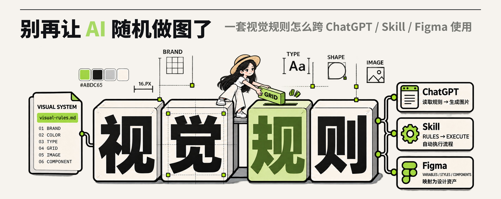
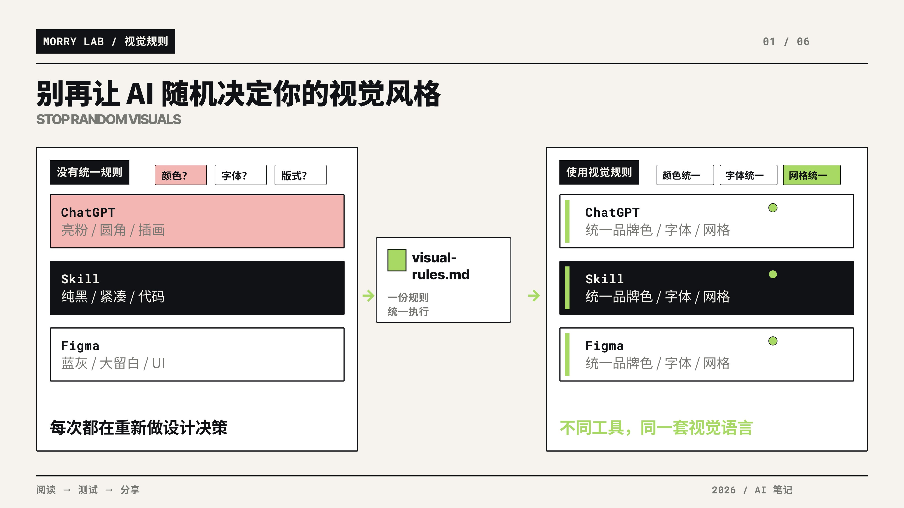
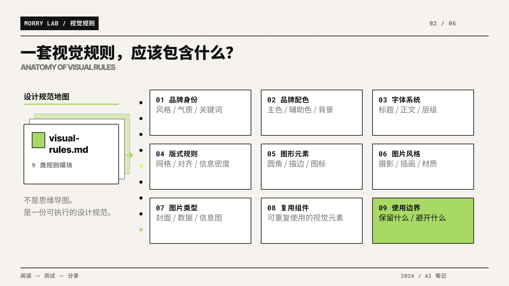
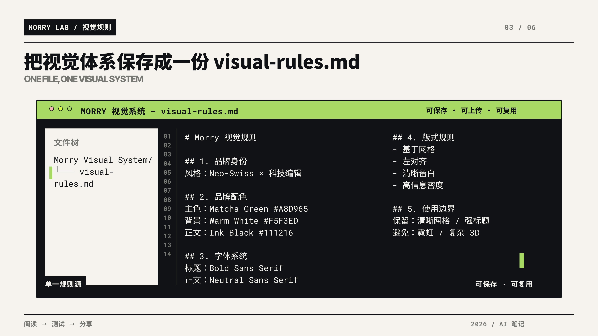
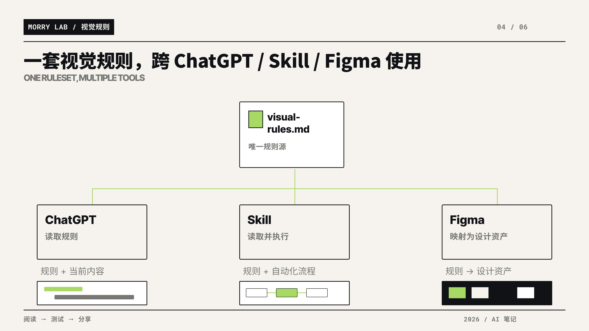
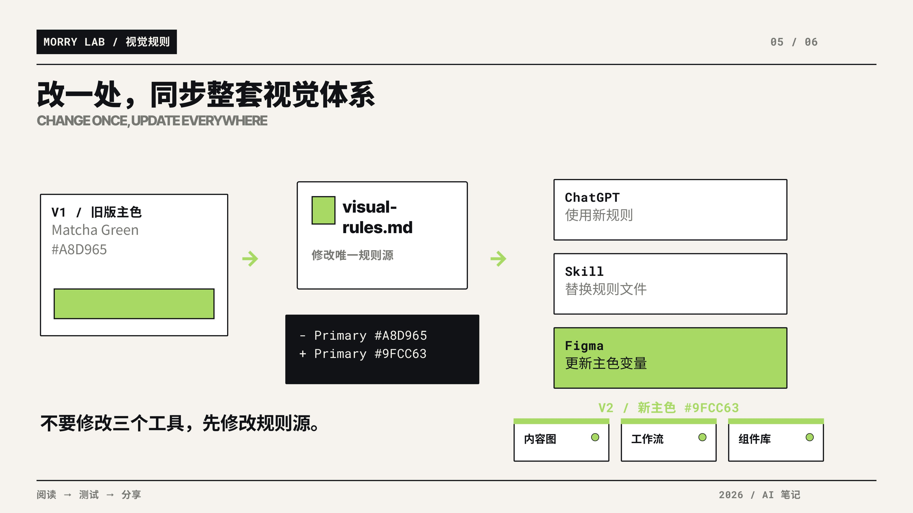
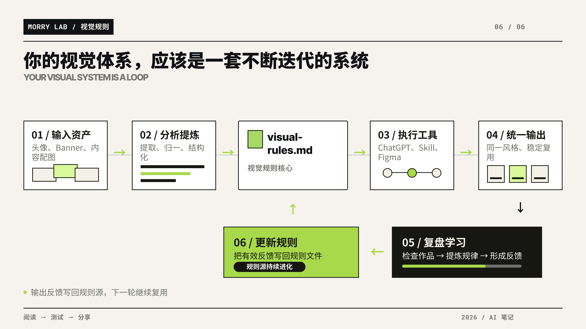
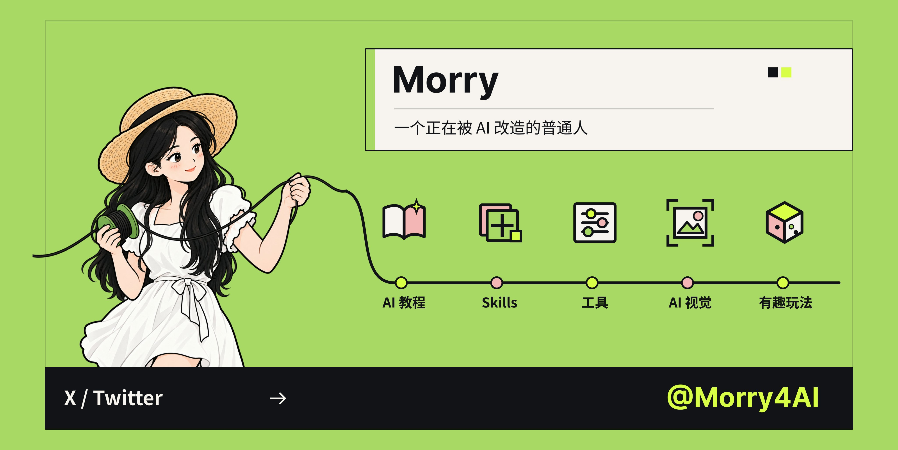

# 别再让 AI 随机做图了：一套视觉规则怎么跨 ChatGPT / Skill / Figma 使用

作者：Morry.AI（[@morry4ai](https://x.com/morry4ai)）

来源：[X 原文](https://x.com/morry4ai/status/2112429478471414101)



如果你经常用 AI 做图，应该遇到过这个问题：

今天用 ChatGPT 做，是一种风格。

明天换个 Skill，又变成另一种风格。

到了 Figma 里重新排版，颜色、字体、间距又对不上了。

每张图单独看可能都不错，但放到主页里，就像是 3 个人做的。

问题不是 AI 不会设计。

而是每次做图时，你都在重新让 AI 决定：

**这张图应该长什么样。**

所以在做完自己的个人视觉体系以后，我觉得还有很重要的一步：

**把视觉体系变成一套可以跨工具使用的「视觉规则」。**

而且这套规则不应该分别存在于 ChatGPT、Skill 和 Figma 里。

我们只维护一份文件：

> visual-rules.md

ChatGPT 读取它。

Skill 读取它。

Figma 根据它建立对应的设计资产。

以后视觉体系发生变化，也只修改这一份文件。

这篇教程，就来完整走一遍。



---

### **01｜先别急着保存 Prompt，先保存「规则」**

很多人想让 AI 保持统一风格，第一反应是：

写一条很长的 Prompt，然后每次复制。

这个方法当然能用。

但 Prompt 并不是最重要的东西。

真正应该保存下来的，是 Prompt 背后的**视觉规则**。

比如你喜欢「瑞士杂志风」。

如果只告诉 AI：

> 帮我生成一张瑞士杂志风格的图片。

AI 每次对「瑞士杂志风」的理解都可能不一样。

但如果继续把它拆开：

```
主色是什么？
背景用什么颜色？
标题使用什么字体？
标题和正文的层级是什么？
版式是左对齐还是居中？
留白应该有多少？
是否使用网格？
圆角多大？
插画是什么风格？
数据图表是什么风格？
哪些设计元素绝对不要出现？
```

原本模糊的「风格」，就开始变成一套可以执行的规则。

我习惯把它叫做：

**视觉规则 或 Visual Rules / Style DNA。**

它不是一张图片，也不是某一条 Prompt。

而是：

**你的图片为什么会长成这样的底层规则。**



---

### **02｜把视觉体系变成一份 Visual Rules 文件**

接下来，我们需要把原本存在于图片里的「视觉感觉」，真正变成一套可以被不同工具读取的规则。

如果你已经按照我之前的教程建立过个人视觉体系，可以把已有的：

**头像、Banner、内容配图、个人介绍卡片，以及你最喜欢的几张参考图**

一起提供给 ChatGPT。

如果还没有完整的视觉体系，也可以先提供几张最能代表你想要风格的参考图。

然后使用下面这段 Prompt：

```
我已经建立了一套自己的个人视觉体系。

接下来我会提供我的头像、Banner、内容配图、个人介绍卡片以及视觉参考图。

请分析这些视觉资产之间稳定、重复出现的视觉规律，反推出一套完整的 Visual Rules。

重点整理：

1.Brand Identity：整体风格、品牌气质、视觉关键词
2.Colors：主色、辅助色、背景色、文字色及 HEX 色值
3.Typography：字体类型、字重、字号层级、字距与排版规则
4.Layout：网格、对齐、留白、信息密度和常用版式
5.Graphic Elements：圆角、线条、描边、阴影、图标、辅助图形
6.Image Style：摄影、插画、材质和视觉表现方式
7.Image Types：封面、信息图、数据图表、插画分别遵守的规则
8.Components：反复出现、适合固定下来的视觉组件
9.Do / Don’t：必须保持和禁止出现的视觉元素

不要只描述图片“看起来是什么风格”。

尽量把每一项整理成明确、可执行、可复用的设计规则。

分析完成后，请检查不同规则之间是否存在冲突或重复，并进行统一。

最后直接生成一份完整的 Markdown 文件，文件名为：

visual-rules.md

这份文件将作为我的视觉体系唯一规则源，后续会提供给 ChatGPT、Skill 和 Figma 使用，因此请保证结构清晰，并尽量使用明确参数，而不是模糊的审美描述。
```

ChatGPT 会分析你提供的视觉资产，并最终生成：

visual-rules.md

里面可能是这样的结构：

```
# Morry Visual Rules

## 1. Brand Identity

Style:
Neo-Swiss Editorial × Tech Editorial

Keywords:
Minimal / Young / Smart / Editorial

## 2. Colors

Primary:
Matcha Green #A8D965

Background:
Off White #F7F7F2

Text:
Black #111111

## 3. Typography

Headline:
Bold Sans Serif

Body:
Neutral Sans Serif

Rules:
- 标题与正文形成明显层级
- 优先左对齐
- 避免装饰性字体

## 4. Layout

- 使用明确网格
- 保持充足留白
- 高信息密度，但避免拥挤

## 5. Image Types

### Cover
- 强标题
- 一个核心视觉主体
- 品牌绿色作为视觉锚点

### Infographic
- 明确信息层级
- 使用网格组织信息

### Data Visualization
- 数据优先
- 图表结构简洁
- 品牌绿色突出核心数据

### Illustration
- 编辑插画风格
- 避免商业图库感

## 6. Do / Don't

### DO
- Swiss Editorial
- Clean Grid
- Matcha Green
- Strong Typography

### DON'T
- Cyberpunk
- Neon Glow
- Commercial SaaS
- Complex 3D
```

当然，这只是一个简单示例。

真正使用的时候，可以比它详细得多。

但生成以后，不要急着直接使用。

自己再检查一遍：

哪些规则真正代表你？

哪些只是 AI 从某一张图片里偶然总结出来的？

哪些颜色、字号、圆角、间距还可以进一步明确？

把不重要的删掉，把模糊的规则改得更具体。

最后留下来的这份：

visual-rules.md

就是整套视觉体系最重要的文件。

从这里开始：

**图片不是规则源。**

**Prompt 也不是规则源。**

**visual-rules.md 才是。**



---

### **03｜把同一份规则交给 ChatGPT / Skill / Figma**

有了 visual-rules.md，接下来就不需要针对不同工具，重新设计三套风格。

只需要记住一个原则：

**规则不变，执行方式改变。**

⸻

**① ChatGPT：直接读取规则**

这是最简单的一种方式。

需要做图时，把 visual-rules.md 提供给 ChatGPT，然后告诉它：

接下来所有视觉设计任务，都以这份 Visual Rules 为视觉规范。

除非我明确提出修改，否则不要改变其中定义的品牌色、字体体系、版式原则和 Style DNA。

之后每次做图，就不需要重新写几十行风格描述。

只需要提供这一次真正发生变化的信息：

```
主题：AI Skill 教程
主标题：5 个值得收藏的 AI Skills
图片类型：封面
比例：3:4
用途：小红书
```

所以整个任务被拆成了两个部分：

**固定信息：visual-rules.md**

**变化信息：主题 / 内容 / 图片类型 / 比例 / 用途**

这也是我现在更推荐的 AI 做图方式。

不要每次都告诉 AI：

> 帮我设计一张好看的图。

而是告诉它：

> **按照我的规则，完成这张图。**

AI 从「视觉风格的决定者」，变成「视觉规则的执行者」。

⸻

**② Skill：把 Visual Rules 变成长期能力**

如果你已经开始使用 Skill，还可以再往前一步。

因为每次上传规则文件，本身也是重复工作。

所以可以创建一个属于自己的视觉 Skill。

比如我的可以叫：

**Morry Visual Creator**

然后把：

visual-rules.md

作为这个 Skill 的视觉规则文件。

Skill 本身则负责另一件事：

**定义执行流程。**

比如：

```
读取用户需求
↓
判断图片属于封面 / 信息图 / 数据图表 / 插画
↓
读取 visual-rules.md 中对应规则
↓
完成画面设计
↓
检查品牌色、字体、版式、Style DNA 是否符合规范
↓
输出图片
```

这样我们就把两件原本混在一起的东西分开了：

**Visual Rules = 设计规范**

**Skill = 执行流程**

以后修改视觉风格，不需要重新设计整个 Skill。

只需要更新它读取的规则文件。

如果 ChatGPT 直接做图解决的是：

**重复使用规则。**

那么 Skill 解决的就是：

**自动调用规则。**

⸻

**③ Figma：把规则变成设计资产**

Figma 和前两个稍微不同。

它不是简单上传一个 Markdown 文件，就自动完成所有设计。

所以这里要做一次转换：

**把 visual-rules.md 里的自然语言规则，映射成 Figma 里的设计资产。**

比如 Visual Rules 里写：

品牌主色：# A8D965

在 Figma 里，就把它建立成：

**Color Variable**

Visual Rules 里写：

一级标题使用粗体无衬线字体。

就在 Figma 里建立：

**Text Style**

Visual Rules 规定：

卡片统一使用 16px 圆角。

可以把它加入：

**Variable / Component**

如果你经常使用：

左侧标题 + 右侧视觉主体

这种结构。

还可以直接做成：

**Cover Template**

所以整个转换关系其实是：

```
Visual Rules
↓
Variables / Styles
↓
Components
↓
Templates
```

以后打开 Figma，就不再是：

选颜色 → 调字体 → 调圆角 → 排版 → 每次重新设计。

而是：

**调用已有规则 → 选择组件 / 模板 → 替换内容 → 微调 → 输出**

这样 ChatGPT、Skill 和 Figma，虽然执行方式完全不同，但底层遵守的是同一套视觉语言。



---

### **04｜视觉体系变了，只修改这一份文件**

视觉体系不是建立一次，就永远不动了。

你做的内容越来越多以后，一定会发现：

有些颜色不够好用。

有些字体不适合长文。

有些版式已经很少使用。

或者你发现了一种更适合自己的插画风格。

这个时候，不要分别去：

修改 ChatGPT Prompt；

修改 Skill 里的视觉描述；

再去修改 Figma；

然后还要想自己有没有漏掉什么。

正确的顺序应该是：

**先修改 visual-rules.md。**

比如用了半年以后，我决定把品牌绿色：

# A8D965

调整成：

# 9FCC63

那么先修改源文件：

```
## Colors

Primary:
Matcha Green #9FCC63
```

然后再同步到不同的执行端。

**ChatGPT**

之后使用新版 visual-rules.md。

新生成的图片按照新版规则执行。

**Skill**

更新 Skill 中的 visual-rules.md。

Skill 的工作流程不用改变。

它依然是：

读取需求 → 判断类型 → 读取规则 → 执行。

只是读取到的规则已经变成新版。

**Figma**

找到对应的 Primary Color Variable，把颜色更新成：

# 9FCC63

如果之前的组件和模板都正确引用了这个 Variable，相关设计也可以一起更新。

所以整个更新过程应该是：

```
修改源文件
↓
同步 ChatGPT
↓
更新 Skill
↓
更新 Figma
```

而不是：

三个工具分别维护三套不同的规则。

这就是为什么前面一定要有：

visual-rules.md

它相当于整个视觉体系的：

**Single Source of Truth。**

也就是：

**唯一规则源。**



---

### **05｜做完以后，你的做图流程会发生什么变化？**

以前用 AI 做图，大概是：

```
有内容
↓
找参考图
↓
想风格
↓
写 Prompt
↓
AI 生成
↓
觉得不对
↓
重新描述风格
↓
继续修改
↓
下一张图片重新开始
```

最大的问题其实不是慢。

而是：

**每次都在重新做设计决策。**

有了 Visual Rules 以后，整个流程会变成：

```
有内容
↓
判断图片类型
↓
调用 visual-rules.md
↓
ChatGPT / Skill / Figma 执行
↓
微调
↓
输出
```

以前是：

**每张图从 0 开始。**

现在是：

**每张图从你的视觉体系开始。**

这也是为什么我觉得，真正值得沉淀的不是某一条「万能 AI 绘图 Prompt」。

Prompt 会变。

模型会变。

工具也会变。

但一套属于自己的视觉规则，可以一直留下来。



---

### 

### **写在最后**

前面的 5 篇「搭建个人视觉体系」教程里，我分别讲了怎么建立自己的头像、Banner、内容配图和个人介绍卡片。

把这些东西做出来以后，其实还可以继续往前一步。

**把视觉资产背后的规律，变成一份真正属于自己的规则文件。**

颜色可以变成 Token。

排版可以变成 Template。

重复出现的设计可以变成 Component。

整套 Style DNA，可以变成 AI 和 Skill 都能理解的 Visual Rules。

最终你真正需要长期维护的，可能只是一份：

visual-rules.md

ChatGPT / Skill / Figma 都可以读取调用它。

以后出现新的 AI 做图工具，也可以直接把规则交给它。

**工具可以一直换，但你的视觉规则应该留在自己手里。**

我觉得这才是一套「个人视觉体系」真正开始变得好用的时候。


