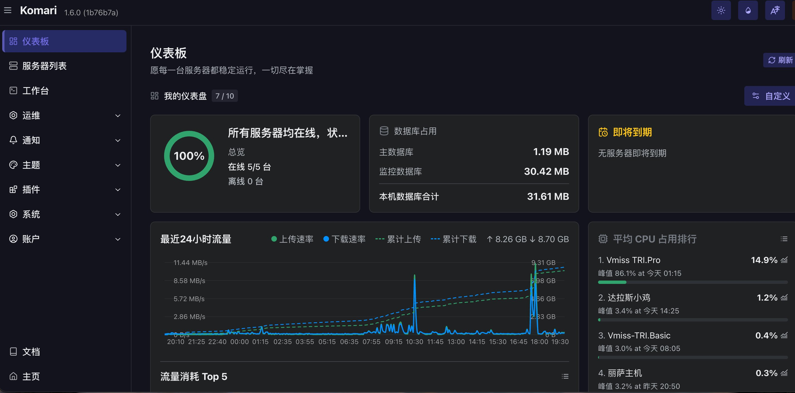
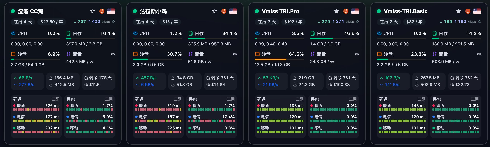
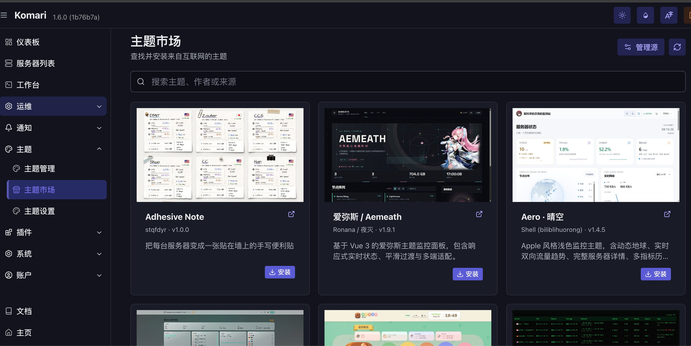

# VPS 买多了怎么管理？分享我正在用的开源探针 Komari，附 AI 部署教程

作者：贝吉塔Again™（[@0xjackkk](https://x.com/0xjackkk)）

来源：[X 原文](https://x.com/0xjackkk/status/2113596424248336670)

最近发了几张自己的 VPS 监控面板截图，没想到不少兄弟都挺感兴趣，一直问我用的什么面板。

其实也不是什么神秘玩意儿，就是 GitHub 上的开源项目 **Komari**。

既然大家喜欢，那就把项目和搭建方法一起分享出来。

平时喜欢折腾 VPS 的兄弟应该深有体会。

刚入坑的时候只有一两台机器，SSH 上去看看状态也不麻烦。

后来黑五抢一台、周年庆抢一台，洛杉矶、日本、香港各买几台，不知不觉就攒了一堆小鸡。😂

机器多了，管理起来就麻烦了。

哪台在线？哪台掉线？CPU 有没有跑满？内存还剩多少？流量用了多少？

总不能每天挨个 SSH 登录检查吧。

所以我比较推荐大家搭个自己的监控面板。

### 一、先看看 Komari 是什么

Komari 是一款免费开源的服务器监控工具。

简单理解，就是把你所有 VPS 的运行状态集中到一个网页里。

主要可以查看：

- 服务器在线、离线状态
- CPU 使用率
- 内存和硬盘占用
- 网络上传、下载速度
- 流量使用情况
- 服务器运行时间
- 历史监控数据

它采用面板 + Agent 的方式运行。

**主服务器安装 Komari 面板，其他 VPS 安装探针 Agent。**

面板负责收集和展示数据，Agent 负责把各台服务器的运行状态发送回来。

项目地址：

Komari 监控面板：
<https://github.com/komari-monitor/komari>

Komari Agent：
<https://github.com/komari-monitor/komari-agent>

喜欢这个项目的兄弟，可以顺手给原作者点个 Star。

### 二、搭建之前需要准备什么？

其实非常简单。

你只需要准备一台能够长期运行的 VPS，用来部署监控面板。

不需要什么高配置机器。

对于个人监控少量服务器的场景，通常可以先用一台 1核1G 的 Linux VPS 测试，实际资源需求取决于监控数量和数据保留时间。

其他被监控的 VPS，不需要安装完整面板，只需要运行 Agent。
[VPS选择可以参考我这条推文](https://x.com/compose/articles/edit/2113593994550611968)

比如你有五台机器：

VMISS 洛杉矶

DMIT 洛杉矶

绿云日本

搬瓦工

RackNerd

可以选其中一台作为主服务器部署面板，其他四台只安装 Agent。

如果希望主服务器也显示在监控列表里，可以在主服务器上同时安装 Agent。

不过我个人更建议把面板放在一台长期稳定、不会经常重装的机器上。

毕竟监控面板自己三天两头掉线，那就有点尴尬了。

### 三、第一步：部署 Komari 监控面板

现在有 AI 了，这一步其实不用自己研究半天命令。

直接把 Komari 的 GitHub 仓库交给 AI，让它按照官方文档部署就行。

我建议新手优先使用 Docker 部署，后面更新、迁移、备份也比较方便。

如果你用的是 Ubuntu 或 Debian，可以先准备 Docker 环境。

接着把下面这段话发给你常用的 AI 编程工具。

**AI 部署提示词：**

> 我要在一台 Linux VPS 上部署 Komari 服务器监控面板。官方仓库：<https://github.com/komari-monitor/komari>请先阅读项目最新 README 和官方部署文档。检查服务器系统、Docker 环境、端口占用及防火墙。优先使用官方推荐的 Docker Compose 方式部署。要求持久化保存数据库和配置文件，设置容器自动重启，并提供安全的更新和备份方法。如果需要公网访问，请配置 HTTPS 和访问保护。不要删除现有服务，也不要覆盖已有的 Nginx、Docker 容器或数据库。部署完成后验证面板可以正常访问，再告诉我后台初始化方式和访问地址。

如果你用的是 Codex、Claude Code 或其他能实际操作服务器的 AI 工具，授权它在自己的 VPS 上执行即可。

如果只是普通聊天 AI，就让它输出命令，你自己复制到 SSH 终端执行。

部署完成后，用浏览器打开你的 Komari 面板。

按照页面提示完成管理员初始化。

建议第一时间设置强密码，并做好 HTTPS。

### 四、第二步：给其他 VPS 安装探针

面板部署成功后，接下来就是把其他服务器接进来了。

这一步更简单。

登录 Komari 管理后台，找到添加节点或 Agent 管理入口。

创建一个需要监控的服务器。

比如：

VMISS-LA

GreenCloud-JP

DMIT-LA

RackNerd-US

创建完成后，面板会提供对应的 Agent 安装信息或命令。

**直接复制后台生成的安装命令，到对应 VPS 的 SSH 终端执行。**

Agent 仓库：

<https://github.com/komari-monitor/komari-agent>

安装成功后，Agent 会连接主面板并上报服务器状态。

稍等片刻，回到面板刷新，就能看到新机器了。

以后每买一台 VPS，只需要重复添加节点、安装 Agent 这两个步骤。

完全不用重新部署整个监控系统。

有一点特别提醒：

**每台机器的 Agent 凭证都要妥善保管，不要把带 Token 的安装命令截图公开。**

**如果后续需要加鸡，直接把新鸡的ip密码发给AI 让他加探针到面板服务器即可。**

### 五、第三步：把面板调整成自己喜欢的样子

Komari 支持主题扩展，可以根据自己的喜好调整界面。

比如深色背景、卡片布局、服务器分组等。

我个人比较喜欢简洁一点的。

一眼能看清楚服务器名称、在线状态、CPU、内存、网络速度就够了。

没必要搞得花里胡哨。

如果你有美国、日本、香港不同地区的 VPS，可以按地区命名。

例如：

US-LA-VMISS

US-LA-DMIT

JP-GREEN

HK-VPS

这样以后机器再多，也不会分不清哪台是哪台。

至于主题怎么安装，建议先看当前 Komari 版本的主题说明，避免直接安装来源不明的主题包。

主题可以选择自己喜欢的主题。

### 六、第四步：监控面板也要做好安全设置

这点很多新手容易忽略。

探针本来是用来监控服务器的，结果面板自己没做好安全防护，那就得不偿失了。

建议至少做好几件事。

**第一，管理后台不要裸奔。**

公网访问尽量配置 HTTPS，使用强密码，并限制不必要的访问权限。

**第二，不需要的远程管理功能就关闭。**

如果只是查看服务器状态，没必要开放所有远程控制能力。

**第三，定期备份面板数据。**

尤其是节点配置、监控历史和数据库。

**第四，更新前先备份。**

不要看见新版本就直接覆盖，先看看更新日志，有没有数据库迁移或不兼容变更。

**第五，别把敏感信息晒出去。**

公开分享探针截图前，注意隐藏管理入口、服务器真实 IP、Agent Token 等敏感信息。

### 七、探针能不能代替专业测速？

不能。

Komari 主要是监控服务器的运行状态。

它可以告诉你机器有没有掉线、CPU 是否跑满、网络有没有流量。

但不能单凭这些数据判断你的 CN2 GIA、9929、CMIN2 线路质量到底好不好。

如果想测线路，我之前还推荐过三个 GitHub 项目：

融合怪 ECS：
<https://github.com/oneclickvirt/ecs>

NodeQuality：
<https://github.com/LloydAsp/NodeQuality>

YABS：
<https://github.com/masonr/yet-another-bench-script>

简单理解：

**Komari 负责长期监控，ECS / NodeQuality / YABS 负责专项测评。**

两者配合起来，才更方便管理自己的 VPS。

### 八、最后说两句

Komari 这个项目我觉得挺适合 VPS 玩家。

免费、开源、能自己部署，也不用把所有服务器的监控数据交给第三方平台。

最重要的是搭建并不复杂。

现在有 AI 帮忙，很多以前需要折腾半天的东西，直接把 GitHub 仓库扔给 AI，就能省下不少时间。

不过也别什么命令都不看就让 AI 执行，涉及防火墙、Docker、SSH 和数据目录的操作，最好先确认一下。

我自己平时也喜欢折腾这些小玩意儿，后面发现有意思的开源项目，会继续分享给大家。

喜欢的兄弟自己拿去玩，搭好了也欢迎晒晒自己的面板。

**黑五又快到了，小鸡可以继续买，至少先把探针搭起来，别哪天机器掉了自己都不知道。😂**

[#VPS](https://x.com/search?q=%23VPS&src=hashtag_click) [#Komari](https://x.com/search?q=%23Komari&src=hashtag_click) [#GitHub](https://x.com/search?q=%23GitHub&src=hashtag_click) [#开源项目](https://x.com/search?q=%23%E5%BC%80%E6%BA%90%E9%A1%B9%E7%9B%AE&src=hashtag_click) [#Linux](https://x.com/search?q=%23Linux&src=hashtag_click) [#Docker](https://x.com/search?q=%23Docker&src=hashtag_click) [#云居民](https://x.com/search?q=%23%E4%BA%91%E5%B1%85%E6%B0%91&src=hashtag_click)
