# AI 设计词典（上篇）｜怎么描述画面

作者：Morry.AI（[@Morry4AI](https://x.com/Morry4AI)）

来源：[X 原文](https://x.com/Morry4AI/status/2112805095918489630)

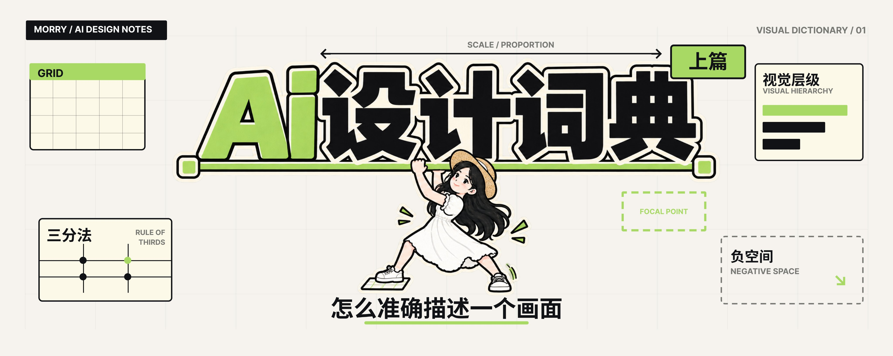

很多人用 AI 做图时，最容易卡住的不是不会写 Prompt。

而是：

**你知道哪里不对，却不知道该怎么描述。**

AI 给你一张图，你可能会说：

> 「主体太大了。」

> 「左边空一点。」

> 「画面有点乱。」

> 「标题再明显一点。」

> 「整体高级一点。」

这些话，人能大概理解，但对 AI 来说，边界还是太模糊。

所以我把 AI 设计中真正高频的视觉词汇整理成了一套**「AI 设计词典」**。

不是为了教你成为设计师，而是帮你认识那些**在 AI 设计中真正高频、能够让需求变得更准确的视觉词汇。**

——

整个系列分成三篇：

**01｜怎么描述画面**

解决「东西放在哪里、放多大、谁更重要」。

**02｜怎么描述视觉**

解决「字体、颜色、形状、材质和风格应该长什么样」。

**03｜怎么给 AI 设置设计边界**

解决「什么可以改、什么不能改、如何保持视觉一致」。

这一篇先从最基础的开始：

**怎么把一个画面说清楚。**

我会同时保留中文和英文。

**中文帮你理解，英文帮你更准确地调用 AI。**

---

## **01｜画幅与区域**

在告诉 AI「做什么」之前，最好先告诉它：

**在哪里做。**

——

### **画幅｜Canvas**

可以理解成整张设计的工作区域。

例如：

在一个横版 Canvas 中完成设计。

通常我们不需要专门强调这个词，但理解它以后，会更容易理解后面的画幅、边距和安全区域。

——

### **★★★★★ 宽高比｜Aspect Ratio**

这是 AI 做图最常用的词之一。

指画面的「宽 : 高」。

例如：

**1:1**｜方形

**3:4 / 4:5**｜竖版内容图

**16:9**｜横版配图

**5:2**｜超宽 Banner

所以不要只说：

给我做一张横图。

可以直接说：

生成一张宽高比（Aspect Ratio）为 16:9 的横版图片。

——

### **横版｜Landscape**

宽度大于高度。

常用于 Banner、文章配图、演示文稿等。

——

### **竖版｜Portrait**

高度大于宽度。

常用于小红书、海报、短视频封面等。

——

### **方形｜Square**

宽高接近 1:1。

常用于头像、社交媒体帖子等。

这三个词很基础，知道即可。

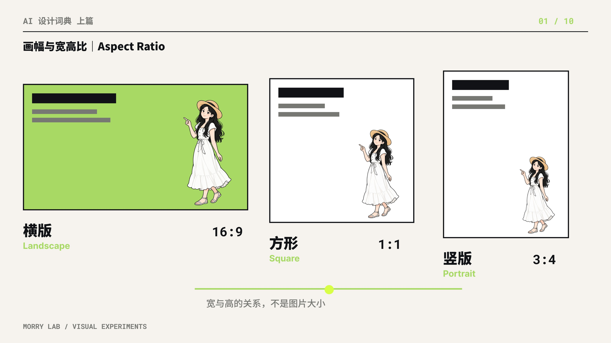

### **★★★★ 安全区域｜Safe Area**

指重要内容应该待在的安全范围。

尤其适合：

头像可能遮挡 Banner、平台会裁切图片、文字不能太靠边等场景。

例如：

所有标题和重要信息必须位于 Safe Area 内，不要靠近画面边缘。

——

### **★★★ 边距｜Margin**

内容与画面边缘之间的距离。

AI 很喜欢把文字和元素顶到边缘，这时候可以告诉它：

四周保留足够的 Margin，不要让文字贴近画面边缘。

——

### **★★ 满版｜Full Bleed**

让图片、颜色或视觉元素一直延伸到画面边缘。

比如一张照片完全铺满背景，就是典型的 Full Bleed。

使用 Full Bleed 图片作为背景，不保留外围白边。

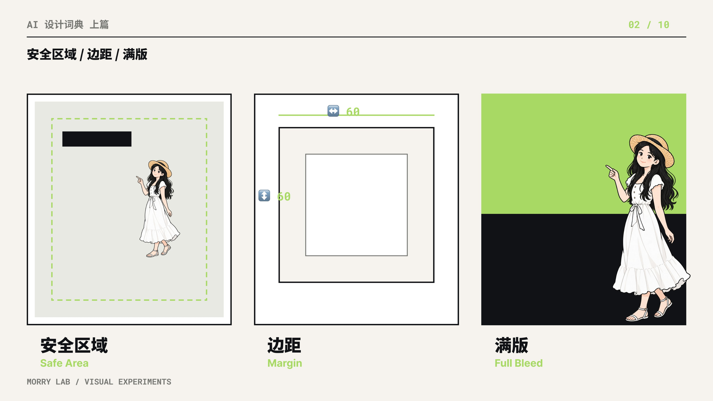

---

## **02｜构图**

确定画幅以后，下一个问题就是：

**东西怎么摆？**

这就是：

### **★★★★★ 构图｜Composition**

Composition 描述的是画面里不同元素之间的组织关系。

人物放左边还是右边？

标题放哪里？

主体居中还是偏移？

这些都属于构图。

所以「构图」其实是一个大概念。

下面这些词，才是在 AI 设计里真正好用的。

——

### **★★★★ 居中构图｜Centered Composition**

把主要视觉主体放在画面中心。

特点是稳定、直接、视觉中心明确。

比如：

使用 Centered Composition，将产品放在画面正中央。

——

### **★★★★ 非居中构图｜Off-center Composition**

主体故意偏离中心。

这样可以给另一侧留下文字或其他内容空间。

例如：

使用 Off-center Composition，人物放在右侧，为左侧标题留出空间。

做「人物 + 标题」类 Banner 时非常实用。

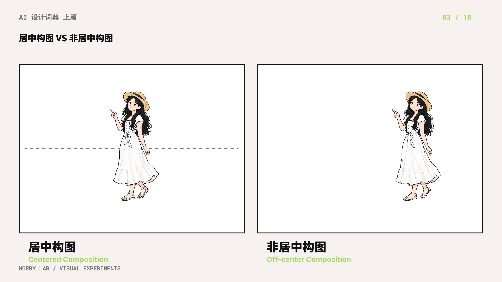

### **★★★★ 对称构图｜Symmetrical Composition**

画面两侧在视觉上保持接近平衡。

特点通常是：

**稳定 / 秩序 / 正式**

——

### **★★★★ 非对称构图｜Asymmetrical Composition**

左右并不完全一样，但通过大小、位置、颜色等方式维持视觉平衡。

特点通常是：

**更灵活 / 更现代 / 更有编辑设计感**

例如：

使用 Asymmetrical Composition，大标题位于左侧，小比例人物位于右下角。

注意：

**非对称 ≠ 随便摆。**

它依然需要视觉平衡。

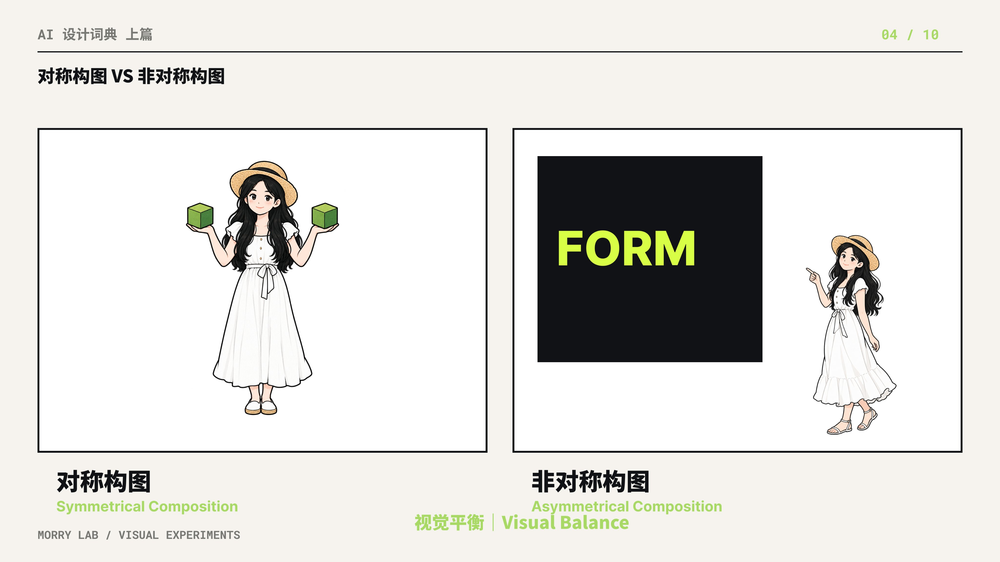

### **★★★ 三分法｜Rule of Thirds**

把画面横向和纵向各分成三份。

主体放在这些分割线或交点附近，而不是机械地放在正中央。

所以你可以告诉 AI：

人物位于画面右侧 1/3 区域。

这种描述通常比：

人物靠右一点。

准确得多。

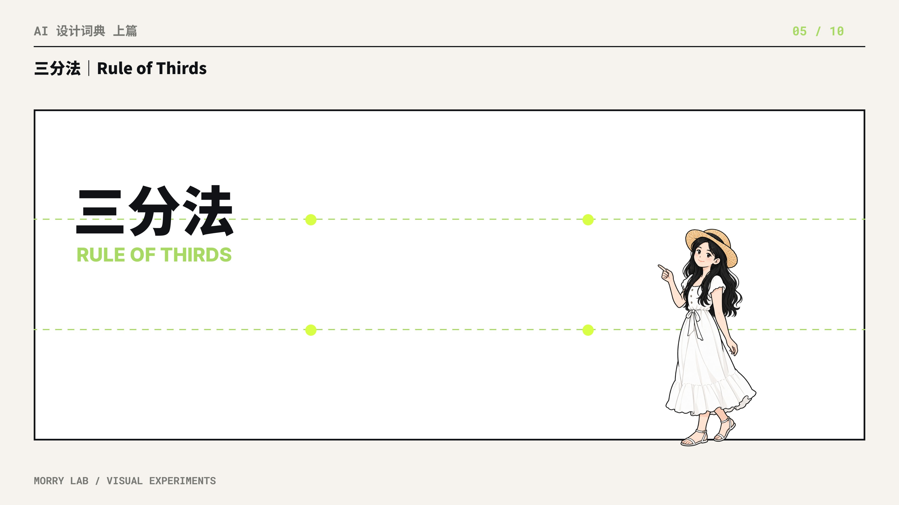

### **★★★★ 网格系统｜Grid System**

用一套隐形的网格组织文字、图片和其他元素。

它最大的作用是：

**让复杂内容依然保持秩序。**

尤其适合信息图、知识卡片、编辑设计。

例如：

使用清晰的 Grid System，让标题、正文和图形严格对齐。

——

### **★★★ 分栏布局｜Column Layout**

把画面分成几列。

例如：

**两栏布局｜Two-column Layout**

可以直接告诉 AI：

使用 Two-column Layout，左侧放文字，右侧放人物。

比「文字左边，人物右边」更接近完整的版式要求。

——

### **★★ 模块化布局｜Modular Layout**

把信息拆成多个独立模块，再按照统一规则排列。

特别适合：

知识卡片、功能介绍、教程步骤、信息图。

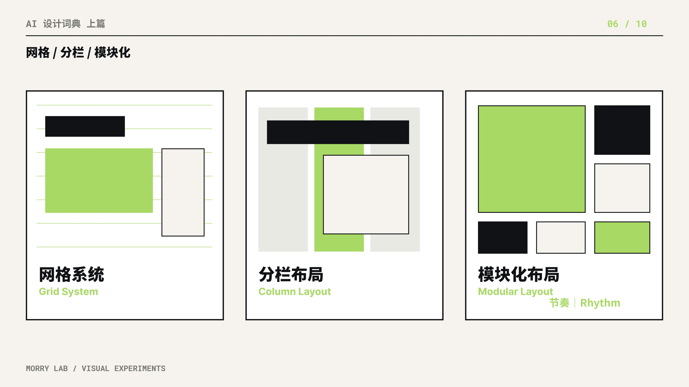

---

## **03｜位置与对齐**

构图确定大关系。

接下来要解决的是：

**具体放在哪里。**

——

### **★★★★★ 对齐｜Alignment**

这是非常重要、但普通用户很容易忽略的一个词。

很多 AI 生成的设计之所以看起来「不专业」，并不是颜色不好看，而是：

**元素没有对齐。**

——

### **左对齐｜Left Alignment**

文字或元素沿左侧统一排列。

——

### **右对齐｜Right Alignment**

沿右侧统一排列。

——

### **居中对齐｜Center Alignment**

以中轴线作为统一基准。

——

还可以使用：

**顶部对齐｜Top Alignment**

**底部对齐｜Bottom Alignment**

——

所以不要只告诉 AI：

把这些文字放左边。

可以说：

所有标题和正文采用 Left Alignment，并保持统一的左侧基线。

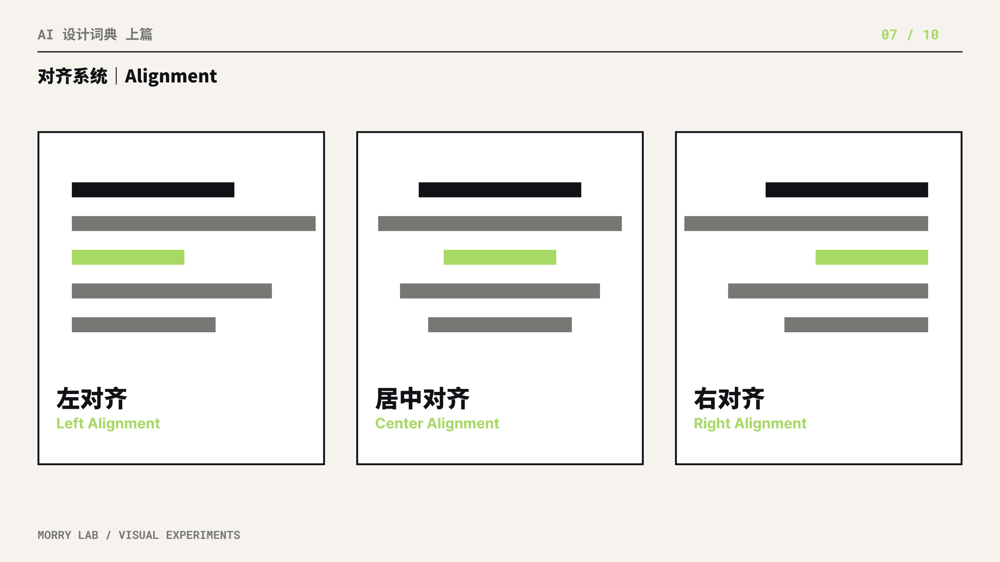

### **★★★★ 前景｜Foreground**

距离观看者最近的视觉层。

——

### **★★★ 中景｜Midground**

位于前景和背景之间。

——

### **★★★★ 背景｜Background**

位于视觉最底层。

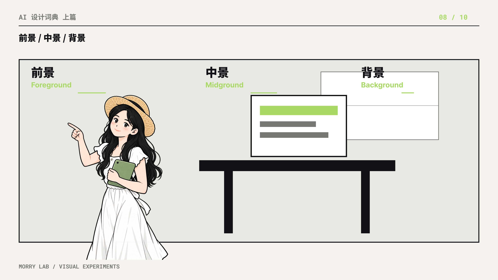

当你做有场景的插画、3D 或照片型设计时，这三个词非常有用。

例如：

人物作为 Foreground，建筑作为 Midground，天空作为 Background。

AI 会更容易理解不同元素之间的空间关系。

**一个非常实用的方法：直接用「区域」描述位置**

有时候甚至不需要专业术语。

直接说：

往往比：

稍微靠右一点。

有效得多。

**AI 设计中，能够量化的需求，尽量不要只用感觉描述。**

---

## **04｜空间与密度**

这一组词特别重要。

因为我们经常会对 AI 说：

「简单一点。」

但「简单」到底是什么？

很多时候，你真正想控制的是：

**空间和视觉密度。**

——

### **★★★★★ 负空间｜Negative Space**

主体周围主动留下来的空白区域。

它不是「没设计」。

而是利用空白突出主体、建立层级、控制画面密度。

例如：

人物集中在右侧，左侧保留约 40% Negative Space，用于标题排版。

这就比：

左边空一点。

准确很多。

——

### **★★★★★ 留白｜White Space**

White Space 和 Negative Space 很接近，但不一定真的是「白色」。

它更强调：

**元素之间主动留下的空间。**

标题和正文之间的距离、卡片之间的间隔、页面四周的空白，都属于 White Space。

简单理解：

**Negative Space 更关注主体周围形成的视觉空间；White Space 更常用于描述版式中的留白。**

——

### **★★★★★ 视觉密度｜Visual Density**

画面中单位空间内的信息和视觉元素有多少。

——

元素多、间距小、装饰多：

**High Visual Density｜高视觉密度**

——

元素少、间距大、留白多：

**Low Visual Density｜低视觉密度**

——

所以以后觉得 AI 做得太乱，可以试试：

降低 Visual Density，减少装饰元素，增加元素之间的 White Space。

比：

简洁高级一点。

有效得多。

——

### **★★★★ 间距｜Spacing**

元素之间的距离。

包括：

标题和正文、图片和文字、卡片和卡片之间的空间。

例如：

增加模块之间的 Spacing，让信息之间有更明显的分组。

——

### **★★★ 紧凑｜Compact**

元素排列更集中、间距较小。

——

### **★★★ 稀疏｜Sparse**

元素较少、空间更充足。

——

这两个词可以直接作为一组视觉方向使用：

Compact ↔ Sparse

当你不知道该怎么描述「再松一点」时，可以告诉 AI：

Make the layout more sparse.

——

### **★★★ 呼吸感｜Breathing Room**

这不是一个特别严格的专业设计术语，但在描述视觉时非常好用。

意思就是：

**不要让元素互相挤压，给内容留下足够空间。**

例如：

增加标题和主体之间的 Breathing Room。

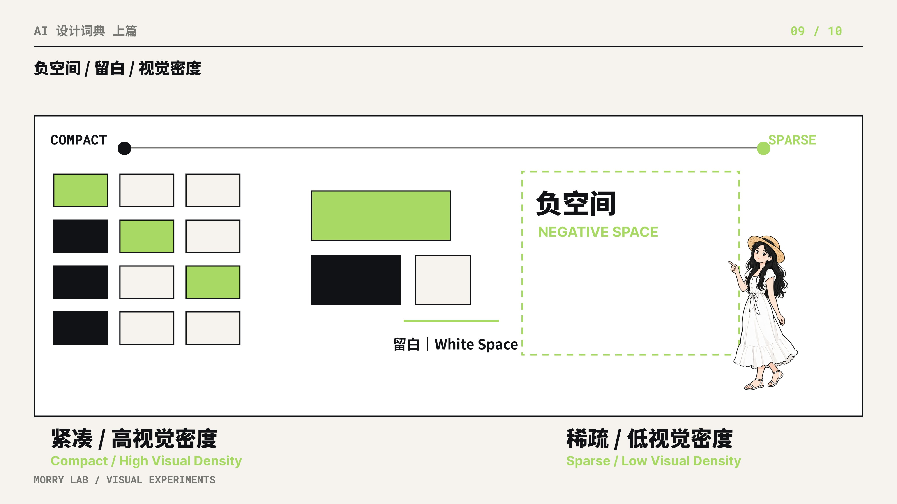

---

## **05｜层级与视觉重心**

最后一个问题：

**用户第一眼应该看到什么？**

如果所有元素都一样大、一样醒目，画面就没有重点。

这就是：

### **★★★★★ 视觉层级｜Visual Hierarchy**

决定用户：

**先看到什么 → 再看到什么 → 最后看到什么。**

——

例如一张教程封面：

**第一层级：主标题**

↓

**第二层级：人物 / 核心视觉**

↓

**第三层级：副标题**

↓

**第四层级：辅助信息**

所以可以直接告诉 AI：

主标题作为第一视觉层级，人物作为第二视觉层级，副标题作为第三视觉层级。

这比：

标题突出一点。

准确得多。

——

### **★★★★★ 视觉焦点｜Focal Point**

整张画面最吸引注意力的位置。

一张图最好有明确的 Focal Point。

它可能是：

一个人物、一台产品、一个数字、一句话。

例如：

让人物成为整个画面的 Focal Point。

——

### **★★★★ 视觉重量｜Visual Weight**

不同元素在视觉上给人的「重量感」。

通常：

**更大、更深、更粗、更高对比的元素**

会拥有更大的 Visual Weight。

所以两个元素即使大小相同，视觉重量也可能完全不同。

——

### **★★★★ 主导元素｜Dominant Element**

画面中占主导地位的元素。

与之对应：

**次要元素｜Secondary Element**

例如：

产品是 Dominant Element，文字和图标作为 Secondary Elements。

——

### **★★★★ 比例｜Proportion**

不同元素之间的大小关系。

例如：

人物与文字保持合理的 Proportion，不要让人物占满整个画面。

——

### **★★★★ 尺度｜Scale**

Scale 更强调某个元素自身的视觉大小，以及通过放大、缩小产生的视觉效果。

比如：

使用 Oversized Scale，让标题占据画面的大部分区域。

——

### **★★★★ 平衡｜Balance**

画面的视觉重量是否稳定。

平衡不意味着左右必须一样。

对称构图可以产生平衡，

非对称构图同样可以。

例如左边是一行巨大的标题，右边是一个较小但颜色非常鲜艳的人物，依然可能形成视觉平衡。

——

### **★★★ 节奏｜Rhythm**

通过重复、间隔、大小变化形成视觉规律。

例如连续排列的卡片、重复出现的圆形、大小交替的文字，都可能形成 Rhythm。

它更适合进阶使用，先理解即可。

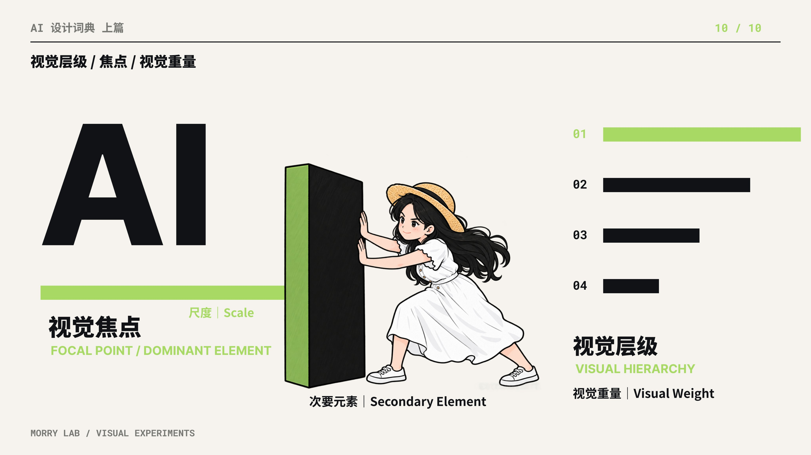

## **把这些词组合起来**

学这些词不是为了考试。

而是为了下一次 AI 给你一张不满意的图时，你不再只能说：

「感觉不太对。」

比如以前你可能会说：

> 做一张简单高级一点的横版图片，人物放右边，标题放左边，别太乱。

现在可以改成：

你会发现：

**需求没有变复杂，只是变准确了。**

这也是我认为普通人在使用 AI 设计时，最值得掌握这些视觉词汇的原因。

你不需要成为设计师。

但至少应该能够告诉 AI：

**东西放在哪里、多大、谁更重要、哪里应该空出来。**

---

### **最后，记住这 5 个维度**

以后不知道怎么描述一张画面，可以先检查：

**① 画幅｜Canvas & Aspect Ratio**

我要做多大的画面？

↓

**② 构图｜Composition**

整体怎么组织？

↓

**③ 位置｜Position & Alignment**

每个东西放在哪里？

↓

**④ 空间｜Space & Density**

哪里应该空？哪里应该密？

↓

**⑤ 层级｜Visual Hierarchy**

用户应该先看到什么？

把这五件事说清楚，

你基本就把一张图的「结构（Structure）」描述清楚了。

但现在我们只解决了：

**「东西放在哪里。」**

——

**下一篇：**

### **《AI 设计词典（中篇）｜怎么描述视觉》**

解决另一个问题：

**「这些东西，到底应该长什么样？」**

字体粗一点还是细一点？

颜色鲜艳还是克制？

圆角还是直角？

平面还是立体？

光滑还是有颗粒？

这些模糊的「感觉」，同样有一套可以准确描述的视觉语言。

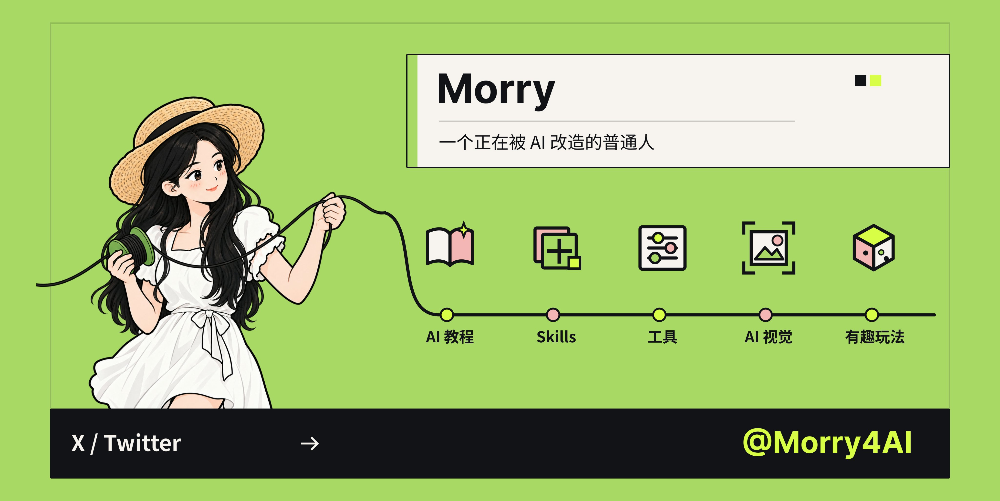
