# AI 设计词典 （中篇）｜怎么准确描述视觉效果

作者：Morry.AI（[@Morry4AI](https://x.com/Morry4AI)）

来源：[X 原文](https://x.com/Morry4AI/status/2113514783010148821)

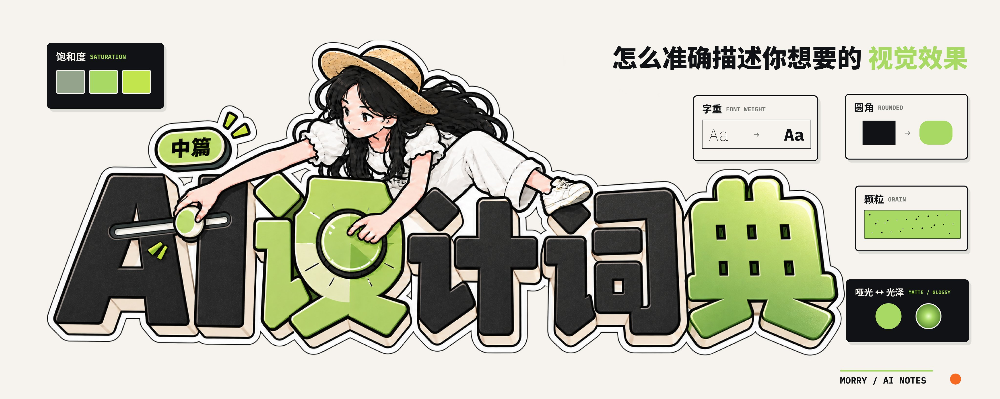

上一篇「AI 设计词典」，我们解决了一个问题：

**怎么准确描述一个画面。**

学会以后，你已经可以把一张图的「结构（Structure）」说清楚。

> Morry.AI@Morry4AI·[10月21日](https://x.com/Morry4AI/status/2112805095918489630)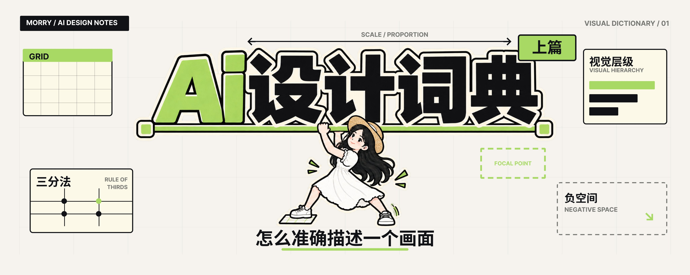 文章AI 设计词典（上篇）｜怎么描述画面 很多人用 AI 做图时，最容易卡住的不是不会写 Prompt。
> 而是：
> 你知道哪里不对，却不知道该怎么描述。
> AI 给你一张图，你可能会说：
> 「主体太大了。」
> 「左边空一点。」
> 「画面有点乱。」
> 「标题再明显一点。」...

但使用 AI 做设计时，我们还经常会说：

「字体高级一点。」

「绿色别这么艳。」

「整体柔和一点。」

「加一点质感。」

「做得更像杂志。」

这些词的问题是：

**人能大概理解，但 AI 还需要自己猜。**

所以这一篇继续整理一组 AI 设计中真正高频的视觉词汇。

不是为了让你背设计术语。

而是给你增加一些**控制 AI 视觉效果的旋钮**。

依然是：

**中文帮你理解，英文帮你更准确地调用 AI。**

---

## **01｜字体 Typography**

先从最常见的文字开始。

当你觉得：

「这个字体不对。」

真正需要调整的，可能不是「换一个好看的字体」。

而是：

**字体类型、粗细、宽窄、字距和行距。**

——

### **★★★★★ 衬线体｜Serif**

字形笔画末端带有额外的小笔画，也就是「衬线」。

通常容易产生：

**经典 / 编辑 / 文化 / 优雅**

的视觉感受。

常见于书籍、杂志、文化类设计。

例如：

英文标题使用 Serif，增加经典的编辑设计感。

——

### **★★★★★ 无衬线体｜Sans Serif**

没有明显衬线，结构通常更加简洁。

容易产生：

**现代 / 简洁 / 理性 / 科技**

的视觉感受。

UI、信息图、现代海报、科技内容里都非常常见。

可以先记住最基础的一组：

**Serif ↔ Sans Serif**

衬线 ↔ 无衬线

——

### **★★★★ 等宽字体｜Monospace**

每个字符占据相同宽度。

很容易让人联想到：

**代码 / 终端 / 工程 / 数据 / 技术文档**

所以做 AI、编程、工具类内容时很好用。

例如：

辅助信息使用 Monospace，增加技术文档感。

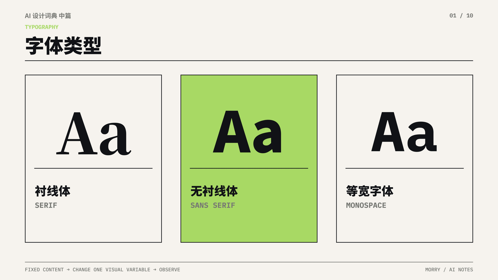

### **★★★★★ 字重｜Font Weight**

控制字体：

**细 ↔ 粗**

常见有：

Light → Regular → Medium → Bold → Heavy

如果标题看起来没有力量，不要只说：

「标题明显一点。」

可以说：

主标题使用 Heavy Font Weight，正文保持 Regular。

这同时也能帮助 AI 建立视觉层级。

——

### **★★★★ 窄体｜Condensed**

字体横向更加紧凑。

尤其适合：

**大标题 / 海报 / 空间有限的版面**

例如：

主标题使用 Bold Condensed Sans Serif。

几个词组合起来，字体方向就已经非常明确了。

——

### **★★★★★ 字距｜Tracking / Letter Spacing**

控制一整段文字中：

**字符之间有多紧或多松。**

可以理解成：

**Tight ↔ Loose**

紧 ↔ 松

例如：

主标题使用 Tight Tracking，让大字更加紧凑有力。

——

### **★★★★★ 行距｜Leading / Line Height**

控制：

**一行文字和下一行文字之间的距离。**

如果 AI 把多行标题挤在一起，可以直接说：

Increase the Line Height.

也就是增加行距。

——

所以字体其实可以先记住三个非常实用的控制杆：

**Font Weight｜字重：细 ↔ 粗**

**Tracking｜字距：紧 ↔ 松**

**Line Height｜行距：密 ↔ 疏**

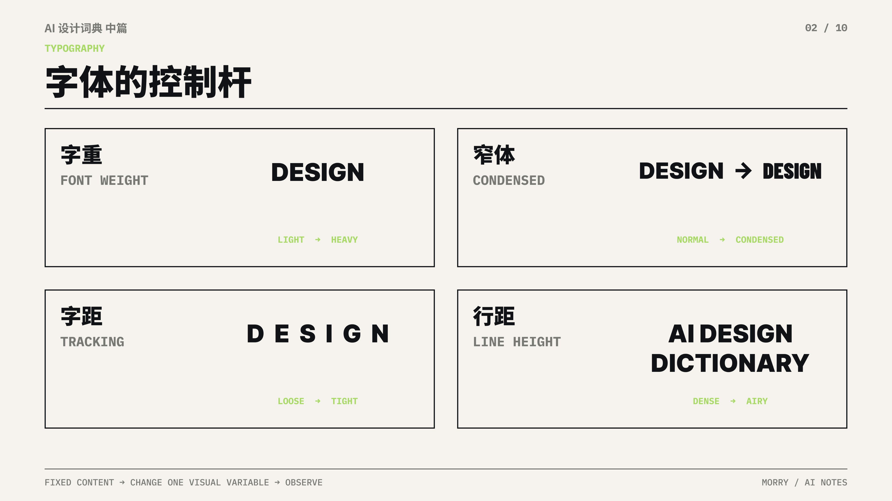

## **02｜颜色 Color**

接下来是 AI 设计里最容易被模糊描述的东西之一：

**颜色。**

很多人只会告诉 AI：

「用绿色。」

但荧光绿、墨绿、薄荷绿、抹茶绿，视觉感受完全不同。

所以控制颜色，至少要知道三个最基础的旋钮。

——

### **★★★★★ 色相｜Hue**

Hue 决定：

**它是什么颜色。**

红、橙、黄、绿、蓝、紫……

都是不同的 Hue。

如果你已经有固定品牌色，最准确的方法依然是直接提供 HEX / RGB 等色值。

例如：

Primary Color 使用 # A8D965。

——

### **★★★★★ 饱和度｜Saturation**

Saturation 控制：

**鲜艳 ↔ 克制**

高饱和：

High Saturation

颜色更加鲜艳、强烈。

低饱和：

Low Saturation

颜色更加柔和、克制，更接近灰色。

所以如果 AI 给你的绿色太刺眼，可以说：

降低绿色的 Saturation，保持原有 Hue。

比：

「绿色柔和一点。」

准确得多。

——

### **★★★★★ 明度｜Value / Brightness**

控制：

**亮 ↔ 暗**

同样一种绿色：

提高 Value，会更加明亮。

降低 Value，会更加深沉。

——

所以颜色最基础的三个旋钮就是：

**Hue｜是什么颜色**

**Saturation｜鲜艳还是克制**

**Value｜明亮还是深暗**

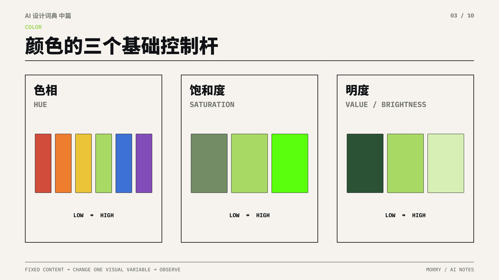

### **★★★★ 单色配色｜Monochromatic**

围绕一个主要 Hue，通过不同明度和饱和度形成整套配色。

例如：

浅绿 + 抹茶绿 + 深绿。

它们都来自同一个绿色体系。

适合做：

**统一、克制、品牌感比较强的视觉。**

### **★★★★ 互补色｜Complementary Colors**

使用色轮上相对的颜色。

例如：

蓝 ↔ 橙

红 ↔ 绿

通常可以形成比较明显的视觉对比。

如果需要强烈的视觉冲突，可以使用：

Complementary Color Scheme.

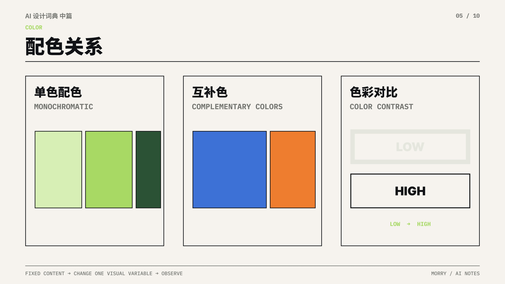

### **★★★★★ 主色｜Primary Color**

整个设计中占主导地位的颜色。

——

### **★★★★ 辅助色｜Secondary Color**

辅助主色建立更丰富的层级。

——

### **★★★★★ 强调色｜Accent Color**

只在少量关键位置出现，用来吸引注意力。

——

比如：

抹茶绿作为 Primary Color，米白作为基础背景，橙色只作为 Accent Color。

这就比：

「用绿色、白色和一点橙色。」

更加明确。

——

### **★★★★★ 色板｜Color Palette**

整套设计允许使用的颜色集合。

当你需要 AI 连续生成一组图片时，Color Palette 特别重要。

可以直接规定：

严格遵循现有 Color Palette，不自行增加新的颜色。

所以控制颜色，除了调 Hue / Saturation / Value，还可以进一步规定：

**谁是主色？**

**谁是辅助色？**

**谁只能少量出现？**

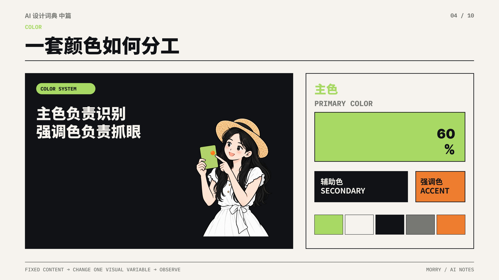

## **03｜形状 Shape**

颜色和字体确定以后，还有一个很容易被忽略的问题：

**画面里的东西是什么形状？**

同样的信息，

使用圆润、不规则的形状，

和使用直角、规则的几何形状，

最终视觉性格可能完全不同。

——

### **★★★★★ 几何形态｜Geometric**

使用圆形、矩形、三角形、规则线条等基本几何结构。

通常容易产生：

**理性 / 规则 / 秩序 / 现代**

的视觉感受。

瑞士设计、信息图、科技视觉里都很常见。

——

### **★★★★★ 有机形态｜Organic Shape**

不强调严格的几何规则。

轮廓更加自然、不规则、流动。

比如：

手绘曲线、不规则色块、植物轮廓。

所以可以记成：

**Geometric ↔ Organic**

规则 ↔ 自然

——

### **★★★★★ 圆角｜Rounded Corners / Corner Radius**

控制矩形边角：

**有多圆。**

圆角越大，视觉通常越柔和。

——

### **★★★★ 直角｜Sharp Corners**

边角保持锋利。

通常更容易产生：

**硬朗 / 理性 / 直接**

的感觉。

——

可以把它记成另一组：

**Rounded ↔ Sharp**

圆润 ↔ 锐利

所以以后你觉得 AI 的卡片「太像 SaaS」，可能真正需要说的是：

减少 Corner Radius，使用更多 Sharp Corners。

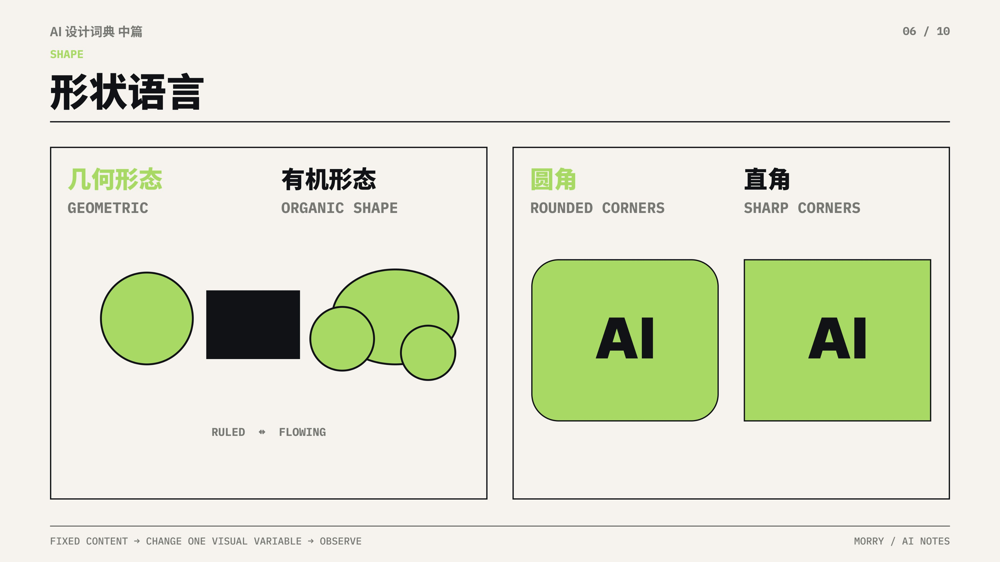

### **★★★★★ 描边｜Stroke / Outline**

围绕文字、图形或角色外部的线条。

比如做贴纸时经常会要求：

Thick White Outline

也就是：

**粗白色外描边。**

——

### **★★★★ 线宽｜Stroke Width**

控制描边：

**细 ↔ 粗**

如果一套设计里所有图标和图形的 Stroke Width 都不一样，很容易显得杂乱。

所以可以规定：

所有图形使用统一的 Stroke Width。

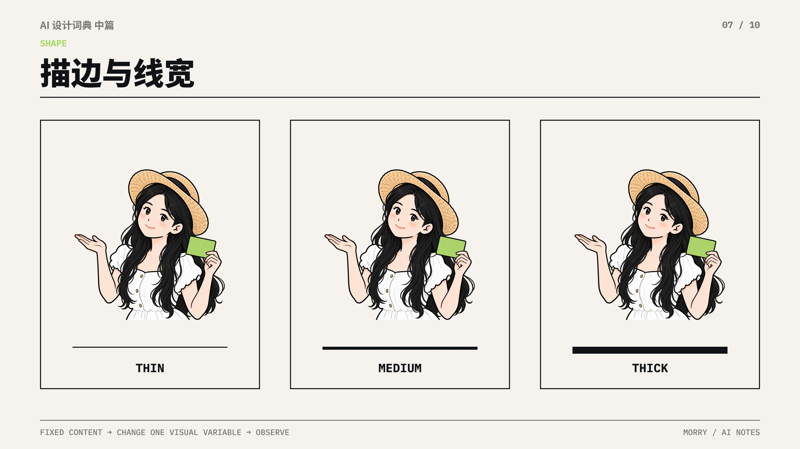

## **04｜材质与效果 Material & Effect**

接下来是 AI 最容易「用力过猛」的地方。

阴影、发光、渐变、玻璃、金属、颗粒……

如果什么效果都加一点，

最后很容易变成：

**效果很多，但没有明确的视觉规则。**

所以这里只保留几个真正高频的控制项。

——

### **★★★★★ 纹理｜Texture**

Texture 描述物体表面的视觉质感。

比如：

纸张、布料、塑料、木材、金属。

所以不要只告诉 AI：

「有质感一点。」

可以说：

添加轻微的 Paper Texture。

直接告诉它：

**是什么质感。**

——

### **★★★★ 颗粒｜Grain**

画面中细小、不规则的颗粒感。

常见于：

**复古 / 印刷 / 胶片 / 编辑设计**

例如：

添加非常轻微的 Grain，不影响文字清晰度。

关键词是：

**轻微。**

不是颗粒越多越有设计感。

——

### **★★★★★ 渐变｜Gradient**

颜色从一种状态平滑过渡到另一种状态。

Gradient 可以增加层次，

但它不是「科技感」的必要条件。

如果你的视觉体系本来更加平面、克制，也可以直接告诉 AI：

No Gradient.

有时候「不要什么」和「要什么」一样重要。

这一点会在下一篇详细讲。

——

### **★★★★★ 透明度｜Opacity**

控制一个元素：

**有多透明。**

100% Opacity：

完全不透明。

降低 Opacity：

元素逐渐变透明。

例如：

网格线使用较低 Opacity，不要抢夺主体的视觉注意力。

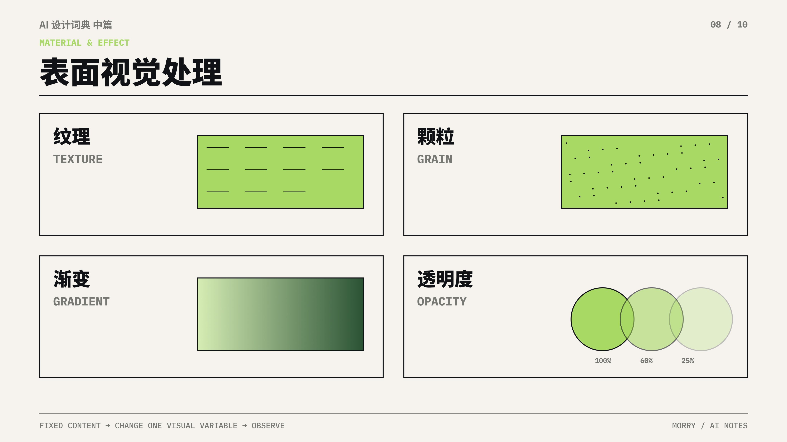

### **★★★★★ 阴影 / 投影｜Shadow / Drop Shadow**

Shadow 用来表现光线和空间关系。

Drop Shadow 则更常用于平面设计、UI、卡片等元素。

例如：

添加轻微 Drop Shadow，让卡片与背景产生空间分离。

如果阴影只是为了让元素「浮起来」，通常 Drop Shadow 就已经够用了。

——

### **★★★★ 柔光｜Soft Light**

光线过渡柔和，阴影边缘不明显。

整体更加：

**柔和 / 自然 / 平静**

——

### **★★★★ 硬光｜Hard Light**

光线方向更加明确，明暗边界更强。

整体更加：

**强烈 / 硬朗 / 戏剧化**

可以记成：

**Soft Light ↔ Hard Light**

柔和 ↔ 强烈

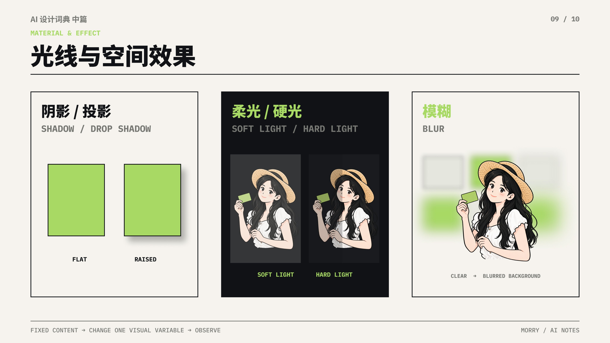

### **★★★★ 哑光 / 光泽｜Matte / Glossy**

控制物体表面的反光感。

Matte：

反射较弱，更柔和、克制。

Glossy：

反射明显，高光更强。

可以直接记成：

**Matte ↔ Glossy**

哑光 ↔ 光泽

尤其做 3D、产品、立体字体时非常好用。

——

## **05｜风格 Style**

最后才是大家最熟悉的：

**风格。**

我们经常会直接告诉 AI：

「做成瑞士风。」

「做成杂志风。」

「做成粗野主义。」

这些词当然有用。

但有一个非常重要的问题：

**风格名称应该是起点，而不是全部。**

因为同一句：

Swiss Style

不同 AI 依然可能给你完全不同的结果。

所以更准确的方法是：

**风格名称 + 前面四组具体规则**

——

### **★★★★★ 极简主义｜Minimalism**

核心不是：

**什么都不放。**

而是减少不必要的元素，只留下真正重要的信息。

常见特征：

**大量留白 / 元素较少 / 层级清晰 / 配色克制**

如果你想让 AI 做得「简单一点」，

Minimalism 往往比：

「高级简洁。」

更加明确。

——

### **★★★★★ 瑞士风格｜Swiss Style**

AI 设计中非常常见。

典型视觉特征包括：

**网格系统 / 无衬线字体 / 强对齐 / 非对称布局 / 清晰层级 / 克制配色**

如果你看过上一篇，会发现：

这些其实都是我们已经学过的视觉规则。

所以：

**Swiss Style 并不是一个魔法关键词。**

它本身就是一组规则的组合。

——

### **★★★★ 粗野主义 / 新粗野主义｜Brutalism / Neo-Brutalism**

Brutalism 强调：

**直接 / 原始 / 强烈 / 不刻意修饰**

常见：

粗大字体、强对比、硬边框、直接暴露结构。

Neo-Brutalism 则通常更加现代、数字化。

经常出现：

**粗描边 / 高对比 / 鲜艳色块 / 硬阴影 / 卡片结构**

两者知道大概区别即可，不需要为了使用 AI 去学习完整的设计史。

——

### **★★★★★ 编辑设计｜Editorial Design**

来自杂志和出版物的信息组织逻辑。

它不是一种固定的「滤镜」。

而是强调：

**字体、图片、网格、留白和信息层级之间的关系。**

如果你不想让 AI 做出来像普通宣传海报，

Editorial Design 是一个非常好用的方向。

——

### **★★★★★ 信息图｜Infographic**

核心不是某种固定风格。

而是：

**把信息视觉化。**

流程、关系、步骤、时间线、数据对比……

都可以使用 Infographic。

判断好坏的核心不是：

「漂不漂亮？」

而是：

**「能不能一眼看懂？」**

——

### **★★★★ 拼贴｜Collage**

把照片、文字、纸张、图形等不同媒介组合在一起。

可以是真实手工剪贴的感觉，

也可以是 Digital Collage｜数字拼贴。

适合需要更强编辑感、实验感的视觉。

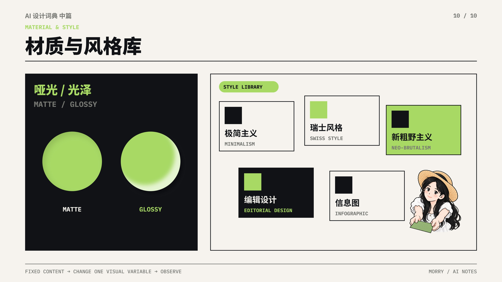

## **不要背词，把它们当成「视觉旋钮」**

到这里，你会发现：

这些名词真正有用的地方不是：

**知道它是什么意思。**

而是知道：

**它能控制什么。**

比如：

**Font Weight**

细 ←────→ 粗

**Tracking**

紧 ←────→ 松

**Saturation**

克制 ←────→ 鲜艳

**Value**

暗 ←────→ 亮

**Geometric / Organic**

规则 ←────→ 自然

**Rounded / Sharp**

圆润 ←────→ 锐利

**Soft Light / Hard Light**

柔和 ←────→ 强烈

**Matte / Glossy**

哑光 ←────→ 光泽

你不是在背 30 多个设计名词。

而是在给自己增加一排：

**可以控制 AI 视觉结果的旋钮。**

---

## **把这些词真正用起来**

以前，你可能会告诉 AI：

做得高级一点，有杂志感。

字体大一点。

绿色不要太艳。

再加一点质感。

现在可以改成：

```
整体采用 Editorial Design｜编辑设计方向。

主标题使用超粗 Sans Serif｜无衬线字体，采用 Heavy Font Weight｜字重，略微收紧 Tracking｜字距。

以抹茶绿作为 Primary Color｜主色，降低 Saturation｜饱和度；米白作为基础背景，黑色作为辅助色，不自行增加新的颜色。

图形以 Geometric｜几何形态为主，使用统一的 Stroke Width｜线宽和轻微 Rounded Corners｜圆角。

整体保持 Matte｜哑光质感，加入非常轻微的 Grain｜颗粒，光线使用 Soft Light｜柔光。
```

需求并没有变复杂。

只是：

**从感觉，变成了规则。**

---

## **最后，只需要记住 5 个维度**

以后不知道怎么描述自己想要的视觉效果，

先回答这五个问题：

### **① 字体｜Typography**

文字是什么类型？

粗还是细？

紧还是松？

### **② 色彩｜Color**

是什么颜色？

鲜艳还是克制？

明还是暗？

谁是主色，谁只是强调色？

### **③ 形状｜Shape**

规则还是自然？

圆润还是锐利？

线条粗还是细？

### **④ 材质与效果｜Material & Effect**

有没有纹理？

平面还是有阴影？

柔光还是硬光？

哑光还是光泽？

### **⑤ 风格｜Style**

前面这些规则组合起来，

最终属于什么视觉方向？

——

上一篇我们解决的是：

**Structure｜结构**

东西放在哪里。

这一篇解决的是：

**Style｜视觉**

东西长什么样。

下一篇：

### **《AI 设计词典 （下篇）｜怎么给 AI 设置设计边界》**

解决最后一个问题。

即使你把前面所有需求都描述得很清楚，

AI 依然可能：

擅自改变角色。

换掉品牌颜色。

添加新的视觉效果。

破坏上一张图的风格。

甚至把你明确要求保留的东西一起「优化」掉。

所以最后一篇要解决的，不再是：

**「我要什么」**

而是：

**「什么不能动」**

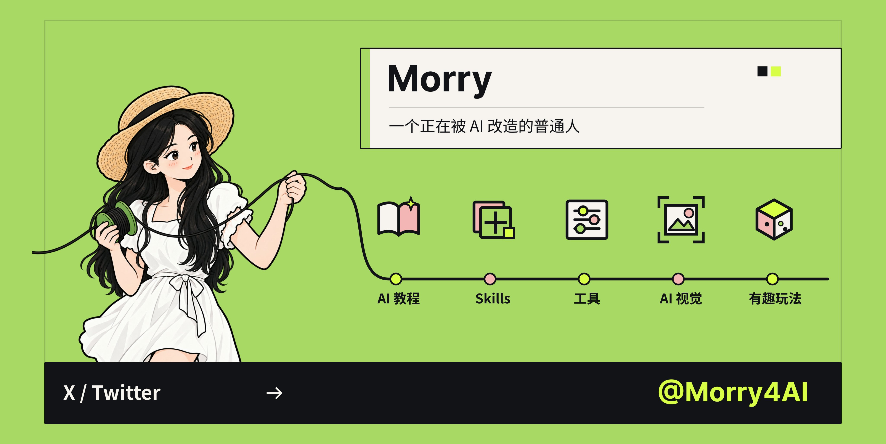
