# AI 设计词典（下篇）｜怎么给 AI 设置设计边界

作者：Morry.AI（[@morry4ai](https://x.com/morry4ai)）

来源：[X 原文](https://x.com/morry4ai/status/2114595668719509846)

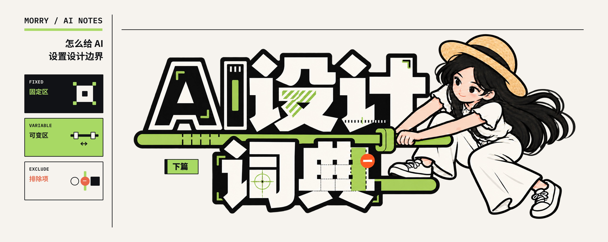

前两篇「AI 设计词典」，我们解决了两个问题：

第一篇：

**Structure｜结构**

东西放在哪里？

> Morry.AI@Morry4AI·[10月21日](https://x.com/Morry4AI/status/2112805095918489630)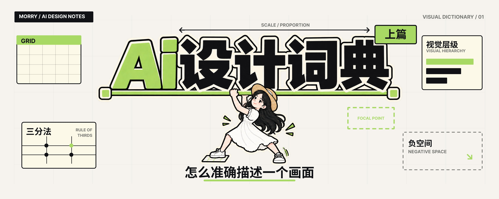 文章AI 设计词典（上篇）｜怎么描述画面 很多人用 AI 做图时，最容易卡住的不是不会写 Prompt。
> 而是：
> 你知道哪里不对，却不知道该怎么描述。
> AI 给你一张图，你可能会说：
> 「主体太大了。」
> 「左边空一点。」
> 「画面有点乱。」
> 「标题再明显一点。」...

第二篇：

**Style｜视觉**

东西长什么样？

> Morry.AI@Morry4AI·[10月23日](https://x.com/Morry4AI/status/2113514783010148821)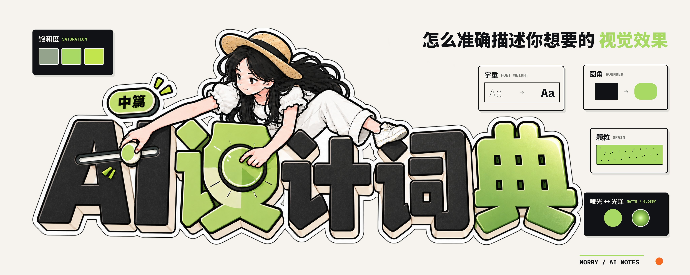 文章AI 设计词典 （中篇）｜怎么准确描述视觉效果 上一篇「AI 设计词典」，我们解决了一个问题：
> 怎么准确描述一个画面。
> 学会以后，你已经可以把一张图的「结构（Structure）」说清楚。
> 但使用 AI 做设计时，我们还经常会说：
> 「字体高级一点。」...

学会这些以后，你已经可以比较准确地告诉 AI：

主体放哪里、标题多大、用什么字体、什么颜色、什么材质、什么风格……

但实际用 AI 做设计，你很快还会遇到另一个问题：

**你说清楚了想要什么，不代表 AI 不会乱改。**

比如：

「基于这张图修改一下人物动作。」

结果 AI 连人物长相一起改了。

「把背景换成绿色。」

结果字体、颜色、构图也跟着变了。

「参考上一张图继续做一张。」

结果第二张完全换了一套风格。

甚至你已经有一套固定的视觉体系，它还是会非常积极地帮你：

**重新设计一遍。**

所以 AI 设计里还有一种非常重要的能力：

**不仅要告诉 AI“我要什么”，还要告诉它“什么不能动”。**

这就是这篇要解决的问题：

## **Control｜控制**

## 

## **01｜先搞清楚：Reference 不等于 Copy**

使用 AI 做设计，我们经常会上传参考图，然后告诉它：

「参考这张图。」

但这句话其实非常模糊。

因为 AI 并不知道：

**你到底想参考什么？**

可能是：

构图/颜色/字体/材质/光线/人物

也可能只是整体感觉。

所以使用参考图时，第一个需要学会的词就是：

### **★★★★★ 参考｜Reference**

Reference 的意思不是：

**复制这张图。**

而是：

> **把这张图作为某些设计决策的依据。**

所以比起：

参考这张图片进行设计。

更准确的是：

> 参考这张图片的构图和色板，但不要复制其中的人物和文字内容。

这样 AI 才知道：

**参考什么，不参考什么。**

### **★★★★★ 参考图｜Reference Image**

就是提供给 AI 的视觉参考。

但一张 Reference Image 可以承担完全不同的作用。

比如：

**风格参考｜Style Reference**

> 使用图片 A 作为风格参考，只参考它的视觉风格。

**构图参考｜Composition Reference**

> 使用图片 B 作为构图参考，只参考它的构图和元素比例。

**色彩参考｜Color Reference**

> 使用图片 C 作为色彩参考，沿用它的色板。

所以以后一次上传很多图片时，不要只说：

「参考这些图片。」

最好直接告诉 AI：

**每张图分别负责什么。**

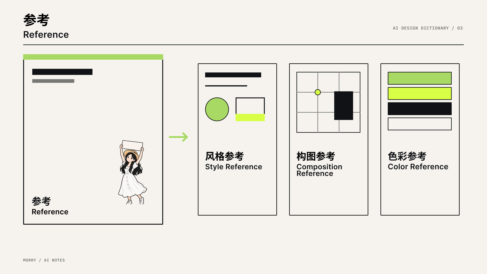

### **★★★★ 基于｜Based on**

当你已经有一个设计，希望 AI 在它的基础上继续工作时，非常常用。

比如：

> 基于现有设计继续修改，不要重新设计整体视觉。

这里的重点就是：

**不是从零开始。**

——

### **★★★★ 沿用｜Reuse**

当某些已经存在的设计规则需要继续使用时，可以直接告诉 AI：

> 沿用现有色板。

或者：

> 沿用现有字体体系。

它非常适合连续制作一套内容。

——

### **★★★★ 继承｜Inherit**

和 Reuse 很像，但更强调：

**把上一套规则带到新的设计里。**

比如：

> 继承上一张图片的视觉规则，在此基础上制作新的内容。

如果你已经建立了自己的视觉体系，这个概念会非常有用。

所以使用参考图时，真正需要说清楚的是：

**参考什么？**

**沿用什么？**

**继承什么？**

而不是简单丢一句：

「参考一下。」

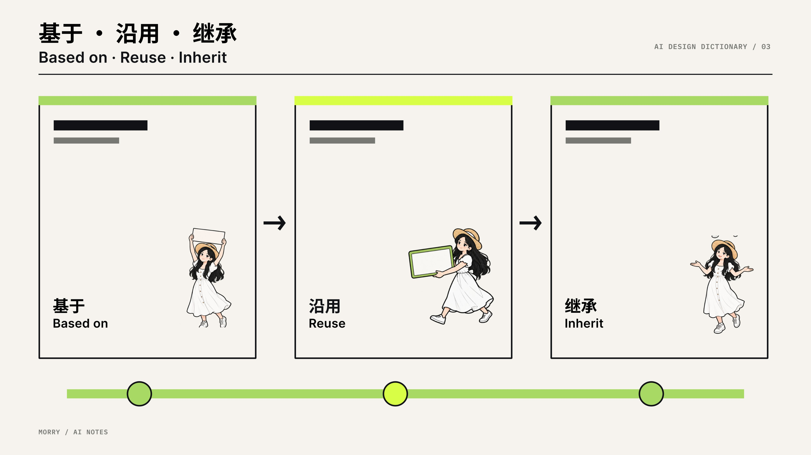

## **02｜告诉 AI：这些东西不要动**

接下来是 AI 设计里非常重要的一组词：

**保持。**

假设我已经有一个固定的 Morry 角色。

我只想：

**改变动作。**

最模糊的说法是：

换一个动作，其他不要变。

AI 大概能理解。

但如果这是一个长期使用的角色，我会把“不要变”的东西说得更加明确。

——

### **★★★★★ 保持｜Maintain**

Maintain 更强调：

**继续维持当前状态。**

例如：

> 保持现有视觉风格。

——

### **★★★★★ 保留｜Preserve / Retain**

Preserve 更适合表达：

**这个东西必须被保留下来。**

比如：

> 保留角色现有的五官、发型和人物比例。

或者：

> 保留原始构图，只修改背景内容。

——

### **★★★★★ 固定｜Fixed**

如果一个元素不应该随着每次生成而变化，可以把它定义成：

**固定项｜Fixed Elements**

比如我的视觉体系里：

Morry 的基础造型是固定的。

品牌绿色是固定的。

字体体系是固定的。

但人物动作不是。

于是可以告诉 AI：

> 把 Morry 的角色设计、品牌色和字体体系作为固定项，后续生成时不要改变。

——

### **★★★★★ 锁定｜Locked**

Locked 比 Fixed 更强。

它更接近：

**这一项不要重新设计。**

比如：

> 锁定 Morry 的人物外观，不要重新设计角色。

或者：

> 锁定现有色板，不要增加新的品牌颜色。

当 AI 特别喜欢“顺手优化”某个东西时，这个词很好用。

——

### **★★★★★ 不变｜Unchanged**

这是最直接的一种表达。

例如：

> 保持人物外观不变。

> 所有字体设置保持不变。

这几个词不用机械区分。

你只需要知道，它们共同解决一个问题：

**哪些东西已经确定了，不需要 AI 再设计一次。**

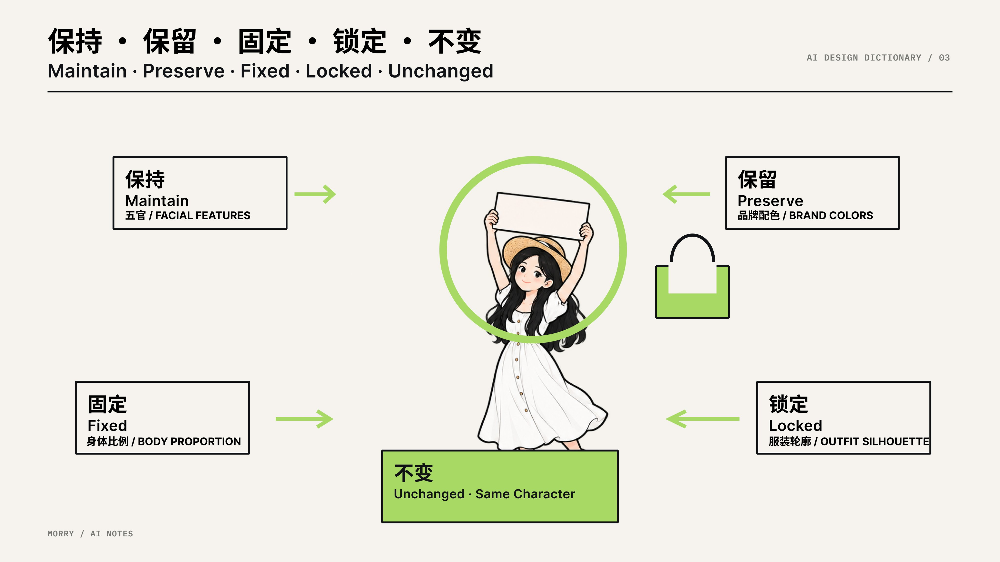

## **03｜不要只告诉 AI 什么不能变，还要告诉它什么可以变**

这是很多 Prompt 最容易漏掉的一部分。

比如你告诉 AI：

人物不能变。

品牌色不能变。

字体不能变。

风格不能变。

然后……

**那它到底还能改什么？**

所以一个完整的设计边界应该同时存在两部分：

**固定项｜Fixed Elements**

**可变项｜Variable Elements**

——

### **★★★★★ 固定项｜Fixed Elements**

就是：

**必须保持一致的部分。**

例如我做 Morry 系列配图时：

● Morry 基础角色造型

● 品牌绿色

● 字体体系

● Sticker Language

● 整体视觉 DNA

都属于固定项。

——

### **★★★★★ 可变项｜Variable Elements**

就是：

**这一次允许 AI 发挥的部分。**

例如：

● Morry 的动作

● 当前场景

● 构图

● 辅助图形

● 当前主题对应的视觉隐喻

于是一个非常简单但非常有效的 Prompt 结构就出现了：

**固定项：**

Morry 角色外形、品牌绿色、字体体系保持不变。

**可变项：**

可以根据当前主题改变 Morry 的动作、场景和构图。

这比一句：

「保持我的风格做一张新图。」

准确得多。

因为你已经把 AI 的：

**自由发挥范围**

划出来了。

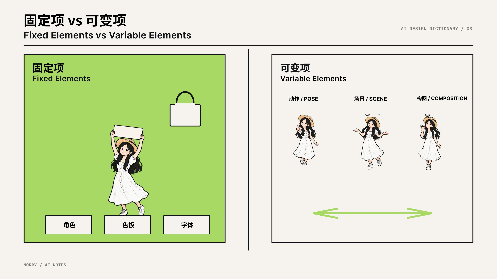

## **04｜Only：限制 AI 到底改哪里**

如果你只是修改现有图片，这个词尤其重要：

### **★★★★★ 仅｜Only**

Only 的作用非常简单：

**把修改范围缩小。**

例如：

> 仅修改人物动作。

或者：

> 仅替换背景。

再配合前面的“不变”：

> 只改变人物动作，人物外观、服装、颜色和背景全部保持不变。

就比：

「帮我换个动作，其他差不多保持一样。」

边界清楚得多。

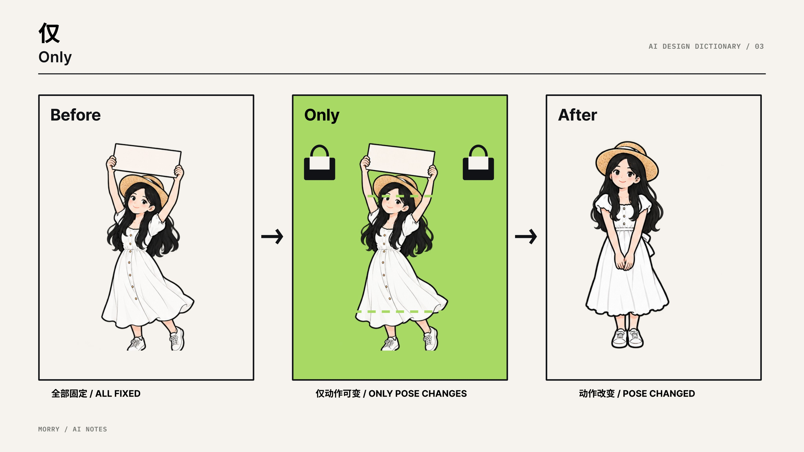

### **★★★★ 范围｜Range**

Range 用来规定：

**变化可以发生到什么程度。**

例如：

> 所有变化都限制在现有视觉体系内，不要引入新的设计语言。

——

### **★★★★ 限制｜Limit**

Limit 可以直接控制某个设计变量。

例如：

> 整张图片的颜色限制在 4 种以内。

或者：

> 限制装饰性元素的数量，只保留与主题直接相关的元素。

你会发现：

AI 设计开始从：

「给我做得简洁一点。」

变成：

> **「颜色不超过 4 种，装饰元素只保留必要部分。」**

这就是边界。

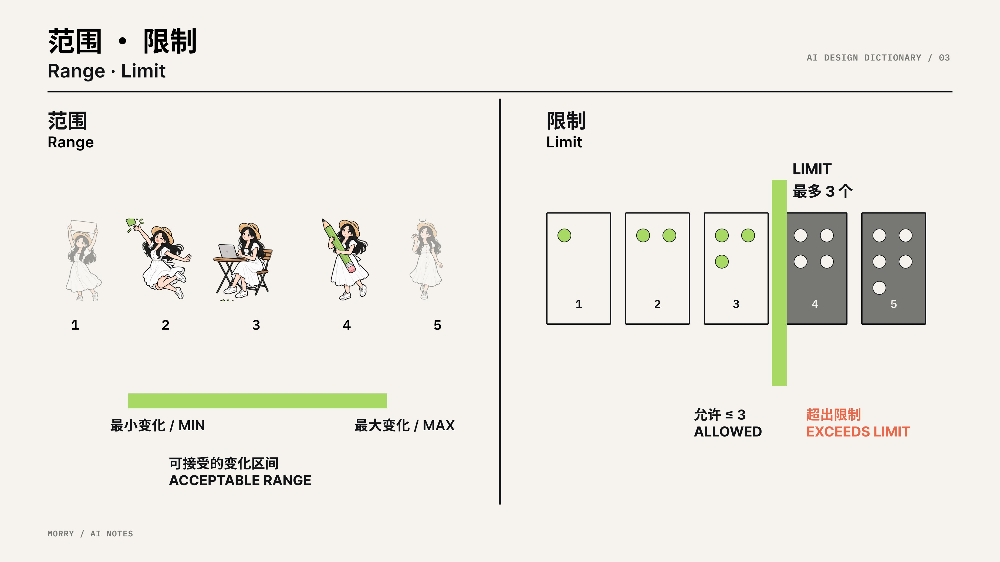

## **05｜Avoid 和 No：别只说「不要太复杂」**

前面是在告诉 AI：

**什么可以改。**

接下来还需要告诉它：

**什么不要出现。**

因为 AI 特别擅长一种事情：

**你没禁止的东西，它就可能帮你加上。**

——

### **★★★★★ 避免｜Avoid**

Avoid 比较适合：

**不希望出现，但不是绝对禁止的视觉倾向。**

例如：

> 避免加入过多装饰性元素。

> 避免过度未来感和科技感。

——

### **★★★★★ 禁止｜Do Not / No**

如果你非常确定某个东西不能出现，就直接说：

不使用渐变。

不使用霓虹发光。

不使用玻璃拟态。

——

### **★★★★ 排除｜Exclude**

Exclude 更适合：

**从设计范围里直接排除某一类东西。**

例如：

> 排除真实摄影元素，全部使用插画和图形语言。

——

### **★★★★ 不包含｜Without**

Without 很适合描述：

**有 A，但没有 B。**

例如：

> 使用极简编辑设计，但不包含渐变和发光效果。

这里有一个非常重要的原则：

**禁止项也要尽量具体。**

不要只说：

不要太复杂。

因为“复杂”本身仍然是一个感觉。

你可以改成：

> 不使用渐变、霓虹发光、玻璃效果、复杂纹理和装饰性图标。

突然就变得可以执行了。

所以：

**抽象否定 → 具体禁止项**

也是一种非常重要的 AI 设计能力。

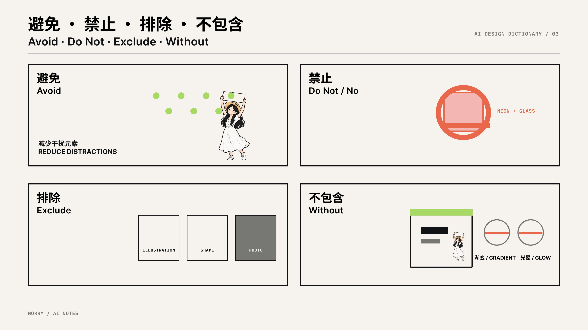

## **06｜一致性：做一张图和做一套图，是两件事**

如果你只是让 AI 做一张图片，

前面的内容已经够用了。

但如果你在做：

一套教程。

一个账号。

一个品牌。

一个长期更新的内容栏目。

真正困难的事情就会变成：

**怎么让第 20 张图，看起来还像第 1 张图？**

这时候最重要的词就是：

## **一致性｜Consistency**

### **★★★★★ 视觉一致性｜Visual Consistency**

这是最上层的要求。

它指：

不同图片看起来属于同一个视觉系统。

比如：

> 整套系列保持视觉一致性，不要因为主题变化重新设计整套视觉语言。

——

### **★★★★★ 风格一致性｜Style Consistency**

保证不同图片继续使用相同的：

● 风格方向

● 材质逻辑

● 图形语言

● 光影逻辑

例如：

> 与之前的系列图片保持相同的风格方向、材质和图形语言。

——

### **★★★★★ 角色一致性｜Character Consistency**

如果你有固定 IP 角色，这个非常重要。

包括：

● 五官

● 发型

● 身材比例

● 服装

● 配色

● 标志性特征

动作可以变。

**角色不能每张重新长一次。**

——

### **★★★★★ 品牌一致性｜Brand Consistency**

主要保证：

● 品牌色

● 字体

● Logo

● 图形语言

● 整体视觉气质

持续一致。

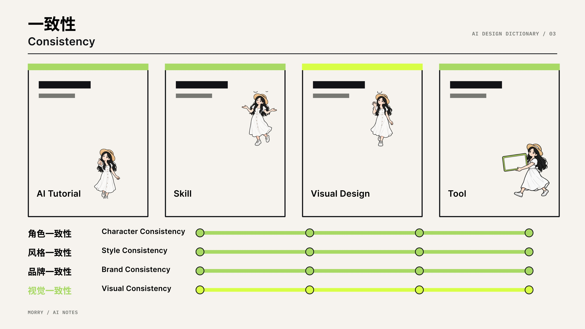

### **★★★★ 色彩一致性｜Color Consistency**

例如：

> 整套图片继续使用相同色板，不增加新的品牌主色。

不要让 AI 每生成一张图，就顺手增加一种新颜色。

——

### **★★★★ 字体一致性｜Typography Consistency**

标题、正文、数字、英文、辅助信息继续遵循同一套字体逻辑。

而不是：

第一张瑞士设计。

第二张突然手写字体。

第三张又变成未来科技字。

所以：

**Consistency 并不等于每张图都长得一样。**

真正的一致性应该是：

**规则不变，内容变化。**

这句话很重要。

因为一套视觉系统最理想的状态就是：

**固定规则 + 变化内容。**

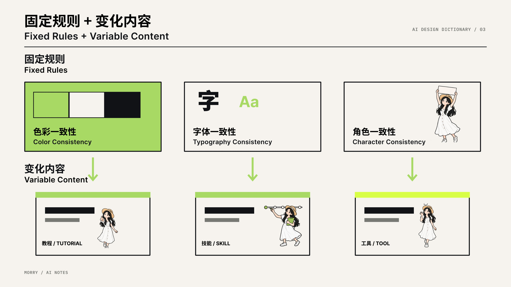

## **07｜把「设计边界」写成一个简单结构**

到这里，其实不用记很多词。

以后给 AI 做设计时，可以先把需求拆成 5 个问题：

### **① Reference｜参考什么？**

参考哪张图？

参考它的什么？

构图？

颜色？

字体？

材质？

还是整体风格？

——

### **② Fixed｜什么不能变？**

角色？

品牌色？

字体？

Logo？

视觉风格？

——

### **③ Variable｜什么可以变？**

动作？

场景？

构图？

辅助图形？

当前主题？

——

### **④ Avoid｜什么不要出现？**

渐变？

霓虹？

玻璃效果？

复杂纹理？

过多图标？

——

### **⑤ Consistency｜什么必须保持一致？**

角色一致性？

品牌一致性？

色彩一致性？

字体一致性？

还是整套视觉系统？

这五个问题回答完，

AI 的设计边界基本就清楚了。

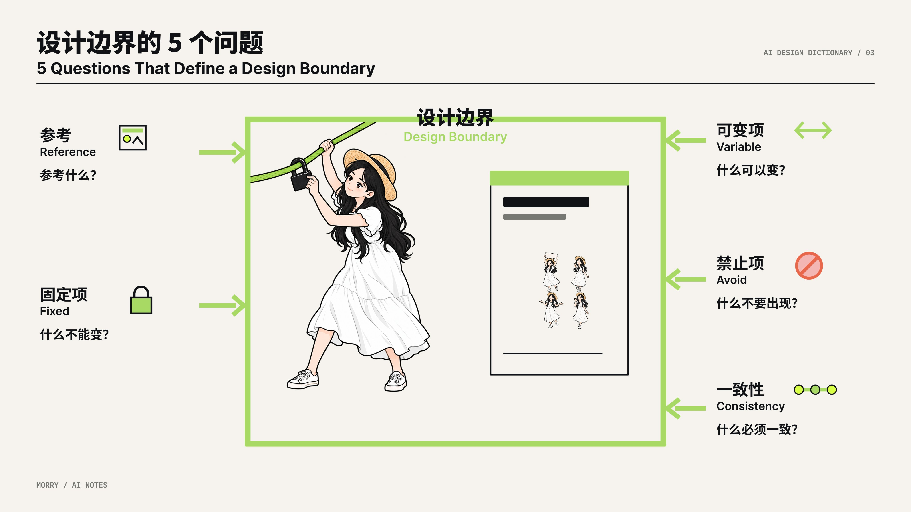

## **08｜来看一个完整例子**

假设我要继续制作一张 Morry 的教程封面。

以前我可能会说：

> 参考之前的风格，帮我继续做一张新的封面。

> 保持 Morry 的形象。

> 不要太复杂。

这三个要求都没错。

但里面仍然有大量空间需要 AI 自己猜。

现在可以改成：

```
参考：
基于现有 Morry 系列封面继续设计。
参考上一张图片的字体、色板、贴纸语言和整体视觉风格，但不要复制上一张的构图。

固定项：
保持 Morry 的角色外观、人物比例、服装、品牌抹茶绿色、字体体系和整体视觉规则不变。

可变项：
可以根据本篇主题重新设计 Morry 的动作、画面构图、辅助图形和场景关系。

禁止项：
不使用霓虹发光、赛博朋克、玻璃拟态、复杂 3D 材质、过多装饰图标和新的品牌颜色。

一致性：
最终图片需要与已有 Morry 系列保持角色、品牌和风格一致。
```

现在 AI 得到的不再只是：

**「帮我做一张类似的图。」**

而是一张非常明确的：

**设计活动范围地图。**

哪里可以走。

哪里不能走。

哪些东西必须带过去。

哪些东西可以重新设计。

全部说清楚了。

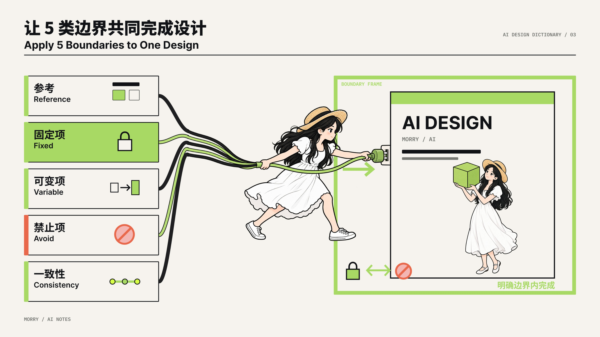

## **写在最后**

「AI 设计词典」三篇到这里就结束了。

我一直觉得，AI 做设计最难的地方，并不是不会写 Prompt。

而是：

**你脑子里有一个模糊的感觉，却不知道怎么把它说出来。**

所以这三篇真正想做的，不是让大家背一堆设计名词。

而是把：

「这里空一点。」

「字体高级一点。」

「别乱改我的风格。」

慢慢变成：

**Structure｜结构**

**Style｜视觉**

**Control｜控制**

你不需要成为设计师。

但至少下一次面对 AI 时，

你可以更准确地告诉它：

**东西放在哪里。**

**东西长什么样。**

以及：

**什么可以改，什么不能动。**

当这三件事都能说清楚以后，

AI 才真正从：

**随机帮你做一张图**

变成：

**按照你的规则完成设计。**

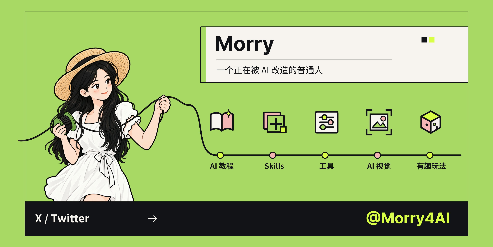
